# Espécies legislativas: comparação sistemática por iniciativa, quórum, deliberação, sanção e efeitos (Constituição Federal, art. 59)

**Concurso Câmara dos Deputados 2026, cargo 1, Divulgação Institucional, Cebraspe. Unidade CAM-PL-032 conforme arquitetura e inventário editorial.**

## Núcleo do conceito: por que comparar as espécies legislativas?

**Situação concreta.** Um deputado quer propor uma regra geral sobre serviços públicos. Outra proposta pretende mudar a Constituição. Uma terceira trata de assunto para o qual a Constituição exige lei complementar. As três ideias podem ser discutidas no Congresso, mas **não seguem necessariamente o mesmo caminho**. Antes de perguntar quantos votos são necessários, é preciso saber **que tipo de ato a Constituição exige para cada assunto**.

**Espécie legislativa** é o tipo de ato normativo produzido por um procedimento previsto na Constituição. **Ato normativo** é um texto que estabelece regras jurídicas. O artigo 59 da Constituição Federal (CF) enumera sete espécies: emenda à Constituição, lei complementar, lei ordinária, lei delegada, medida provisória, decreto legislativo e resolução. **Projeto** é a proposta em discussão; **lei** é o resultado normativo depois de concluídas as etapas exigidas. Uma proposta de emenda à Constituição (PEC), por exemplo, ainda não é uma emenda aprovada.

Para identificar a espécie correta, siga estas perguntas, nesta ordem:

1. **Qual assunto será regulado?** Verifique se a Constituição reservou a matéria a uma espécie específica. Se o objetivo for modificar o próprio texto constitucional, o caminho é a emenda constitucional, sujeita também aos limites do artigo 60. Se a Constituição exigir expressamente lei complementar, uma lei ordinária não basta.
2. **Quem pode iniciar?** O artigo 61 admite vários legitimados para projetos de lei, mas algumas matérias têm iniciativa reservada. Já a PEC tem o rol próprio do artigo 60. Medida provisória e lei delegada envolvem atuação do Presidente da República, com requisitos distintos.
3. **Quem decide e com quantos votos?** Não confunda **quórum de presença** (quantos membros precisam estar presentes para a deliberação) com **quórum de aprovação** (quantos votos favoráveis são necessários). A regra geral do artigo 47 exige presença da maioria absoluta dos membros e aprovação pela maioria dos votos; lei complementar exige maioria absoluta dos membros (artigo 69); emenda exige três quintos em dois turnos em cada Casa (artigo 60, § 2º).
4. **O Presidente participa da etapa final?** Projetos de lei ordinária e complementar seguem, em regra, para sanção ou veto (artigo 66). Emenda constitucional é promulgada pelas Mesas da Câmara e do Senado, sem sanção presidencial (artigo 60, § 3º). Decretos legislativos e resoluções também não dependem de sanção. A medida provisória requer atenção ao caminho efetivamente seguido na conversão em lei.
5. **Qual é o efeito?** Uma emenda modifica a Constituição. Uma lei disciplina matéria legislativa dentro dos limites constitucionais. Uma medida provisória, quando editada validamente, produz força de lei desde sua edição, mas depende da apreciação parlamentar e pode perder eficácia conforme o artigo 62.

**Exemplo progressivo.** Uma proposta de regra geral, sem reserva constitucional específica, pode tramitar como projeto de lei ordinária. Se a Constituição reservar aquele assunto à lei complementar, muda a espécie e o quórum de aprovação. Se a intenção for alterar o texto da Constituição, muda novamente o procedimento: passa a ser necessária uma PEC. **Contraexemplo:** chamar um projeto de “lei complementar” não transforma qualquer assunto em matéria constitucionalmente reservada; o critério é a exigência da Constituição, e não o nome escolhido pelo autor.

**Autochecagem (Certo ou Errado).** “Toda proposta legislativa aprovada pelo Congresso depende de sanção do Presidente da República.” **Errado.** A sanção integra o procedimento dos projetos de lei sujeitos ao artigo 66, mas emendas constitucionais, decretos legislativos e resoluções não passam por essa etapa.

**Autochecagem (Certo ou Errado).** “A lei complementar exige maioria absoluta para aprovação, enquanto a regra geral do artigo 47 combina maioria dos votos com presença da maioria absoluta dos membros.” **Certo.** A primeira regra está no artigo 69; a segunda, no artigo 47. A presença mínima e a quantidade de votos favoráveis são critérios diferentes.

As siglas usadas nos quadros seguintes designam **propostas**, não novas espécies: projeto de lei (PL), projeto de lei complementar (PLP), medida provisória (MP), projeto de decreto legislativo (PDL) e projeto de resolução (PR). As denominações regimentais podem variar entre as Casas. O quadro é uma comparação inicial; condições e exceções de cada espécie devem ser conferidas nas seções seguintes.

**Fonte normativa primária:** [Constituição Federal atualizada pela Câmara dos Deputados, artigos 47 e 59 a 69](https://www2.camara.leg.br/legin/fed/consti/1988/constituicao-1988-5-outubro-1988-322142-normaatualizada-pl.html). Os casos e perguntas acima são explicações didáticas, não transcrições legais.

## Definição constitucional: lei ordinária e lei complementar

A **Constituição Federal não formula uma definição abstrata dessas leis**. Ela as enumera como **espécies legislativas distintas** no art. **59, II e III**, estabelece seus **quóruns** nos arts. **47 e 69** e **reserva expressamente certas matérias** à lei complementar em vários dispositivos.

**Lei ordinária (LO, cujo projeto é um PL):** instrumento legislativo comum para disciplinar matérias submetidas a lei **sem reserva constitucional a lei complementar ou a outra espécie normativa**. O art. **47** aplica a regra de **maioria dos votos, presente a maioria absoluta dos membros da Casa**. Exemplo de lei ordinária: **Lei nº 8.112/1990** (regime jurídico dos servidores civis federais). O **art. 165, I a III**, também prevê as leis do Plano Plurianual (PPA), da Lei de Diretrizes Orçamentárias (LDO) e da Lei Orçamentária Anual (LOA): leis orçamentárias de natureza ordinária.

**Lei complementar (LC, cujo projeto é um PLP):** espécie exigida **pela própria Constituição para assuntos delimitados**. O art. **69** exige **maioria absoluta dos membros de cada Casa** (257 deputados e 41 senadores). Exemplos de matérias constitucionalmente reservadas:
- **CF, art. 14, § 9º:** outros casos de inelegibilidade e prazos de cessação;
- **CF, art. 37, XIX:** definição das áreas de atuação das fundações públicas;
- **CF, art. 93:** Estatuto da Magistratura, por iniciativa do Supremo Tribunal Federal (STF);
- **CF, art. 146, I a III:** conflitos de competência tributária, limitações ao poder de tributar e normas gerais de direito tributário;
- **CF, art. 163:** normas gerais sobre finanças públicas;
- **CF, art. 165, § 9º:** regras gerais de organização, elaboração e prazos das leis orçamentárias.

**Critério decisivo para classificar a matéria:** localizar no texto constitucional uma **exigência expressa de lei complementar**. A simples importância política da lei, o fato de tratar de tributos ou orçamento ou a expressão “complementar” no título não criam reserva. A LC **não tem superioridade hierárquica geral** em relação à LO; a reserva de matéria e o quórum são critérios separados. No Congresso, os **arts. 61, 65 e 66** também disciplinam iniciativa, revisão, sanção e veto quando aplicáveis às duas espécies.

**Regimento da Câmara:** o **PLP passa pelo Plenário**, sem apreciação conclusiva nas comissões (**Regimento Interno da Câmara dos Deputados (RICD), art. 24, II, a**), e está entre as exceções ao turno único (**art. 148: dois turnos na Câmara**). No **Senado**, a regra é **turno único** (Regimento Interno do Senado Federal (RISF), art. 270), salvo hipótese regimental de turno suplementar. A regra da LO na Câmara é turno único, admitida apreciação conclusiva nas comissões somente nas hipóteses regimentais permitidas.

Fontes: [Constituição Federal de 1988, Câmara dos Deputados](https://www2.camara.leg.br/atividade-legislativa/legislacao/constituicao1988), [RICD atualizado](https://www2.camara.leg.br/legin/fed/rescad/1989/resolucaodacamaradosdeputados-17-21-setembro-1989-320110-normaatualizada-pl.html) e [RISF, art. 270](https://legis.senado.leg.br/norma/563958/publicacao/30785361).

## 1. Matriz comparativa geral das 7 espécies normativas do art. 59 da CF

| Espécie Normativa | Legitimados para Iniciativa | Quórum de Aprovação | Turnos de Votação | Sanção e Veto Presidencial? | Autoridade Competente para Promulgação | Objeto Típico e Efeitos Jurídicos |
| :--- | :--- | :--- | :--- | :--- | :--- | :--- |
| **Emenda à Constituição (PEC)** (CF, art. 60) | **Rol taxativo e restrito:** 1/3 da Câmara (171); 1/3 do Senado (27); Presidente da República; ou mais da metade das Assembleias Legislativas (maioria relativa em cada) | **3/5 dos membros** de cada Casa (308 Deputados e 49 Senadores) | **2 turnos** na Câmara **e 2 turnos** no Senado | **NÃO** há sanção nem veto | **Mesas da Câmara dos Deputados e do Senado Federal**, conjuntamente | Altera o texto constitucional formal. Não admite iniciativa popular nem de tribunais/MP. |
| **Lei Complementar (PLP)** (CF, art. 61 e 69) | **Ampla:** Deputado, Senador, Comissão, Presidente da República, STF, Tribunais Superiores, Procurador-Geral da República (PGR), Defensor Público-Geral e Cidadãos (iniciativa popular) | **Maioria absoluta** dos membros de cada Casa (257 Deputados e 41 Senadores) | **Dois turnos na Câmara** (RICD, art. 148), com votação pelo Plenário; **turno único no Senado** (RISF, art. 270, ressalvado turno suplementar) | **SIM** (CF, art. 66: 15 dias úteis) | **Presidente da República** (ou subsidiariamente Presidente do Senado / Vice-Presidente do Senado) | Matérias taxativamente reservadas pela CF (reserva material de lei complementar). |
| **Lei Ordinária (PL)** (CF, art. 61 e 47) | **Ampla:** Deputado, Senador, Comissão, Presidente da República, STF, Tribunais Superiores, PGR, Defensor Público-Geral e Cidadãos (iniciativa popular) | **Maioria simples / relativa** (maioria dos votos dos presentes, com presença da maioria absoluta da Casa) | **Turno único** em cada Casa (admite apreciação conclusiva nas comissões - art. 24, II, RICD) | **SIM** (CF, art. 66: 15 dias úteis) | **Presidente da República** (ou subsidiariamente Presidente do Senado / Vice-Presidente do Senado) | Matéria residual geral (tudo o que não for expressamente reservado a outra espécie). |
| **Lei Delegada** (CF, art. 68) | **Exclusiva do Presidente da República**, mediante solicitação expressa de delegação ao Congresso Nacional | Aprovada a **Resolução autorizativa** por maioria simples do Congresso | A resolução de delegação é deliberada pelo Congresso Nacional em sessão conjunta, com votos de cada Casa computados separadamente (Regimento Comum do Congresso Nacional (RCCN), arts. 43 e 116–127); se a resolução exigir apreciação do projeto delegado, haverá votação única, sem emendas (CF, art. 68, § 3º) | **NÃO** (o Presidente da República já edita o texto com força de lei a partir da delegação concedida) | **Presidente da República** (que a elabora e a promulga diretamente) | Matérias delegáveis pelo Congresso. Vedações absolutas: atos de competência exclusiva do Congresso Nacional (CN) ou das Casas, leis complementares, orçamento e direitos fundamentais/nacionalidade. |
| **Medida provisória (MPV, também abreviada MP)** (CF, art. 62) | **Privativa do Presidente da República**, sob os pressupostos constitucionais de **relevância e urgência** | **Maioria simples / relativa** em cada Casa (após parecer de Comissão Mista) | **Turno único** na Câmara dos Deputados e **Turno único** no Senado Federal | **Depende:** se aprovada sem alteração de mérito, NÃO há sanção (promulga-se a MP); se aprovada com alteração (projeto de lei de conversão (PLV)), **SIM, há sanção e veto** | Se texto original: **Mesas do Congresso Nacional** (Mesa da Câmara dos Deputados (CD) e do Senado Federal (SF)). Se PLV sancionado: **Presidente da República**. | Força de lei imediata (60+60 dias). Vedações: direito penal, processual, eleitoral, partidos, orçamento (salvo créditos extraordinários) e detenção de bens/poupança. |
| **Decreto legislativo (projeto de decreto legislativo (PDL), também identificado como PDC em algumas classificações)** (CF, art. 59, VI e art. 49) | Deputados, Senadores, Comissões e Mesa Diretora | **Maioria simples / relativa** em cada Casa (salvo quóruns específicos da matéria) | **Turno único** em cada Casa (bicameralidade: Câmara e Senado) | **NÃO** há sanção nem veto | **Presidente do Senado Federal** (na qualidade de Presidente da Mesa do Congresso Nacional) | Matérias de competência exclusiva do Congresso Nacional (CF, art. 49): tratados internacionais, sustação de atos normativos do Executivo, contas presidenciais etc. Efeitos externos. |
| **Resolução (projetos de resolução da Câmara (PRC), do Senado (PRS) ou do Congresso Nacional (PRN))** (CF, art. 59, VII, arts. 51, 52 e RCCN) | Deputados, Senadores, Comissões ou Mesas Diretoras respectivas | **Maioria simples / relativa** (salvo quórum qualificado, como resoluções de regimento ou perda de mandato) | Unicameral se da Câmara ou do Senado; Bicameral se do Congresso Nacional | **NÃO** há sanção nem veto | Mesa da Casa respectiva (Presidente da Câmara, Presidente do Senado ou Mesa do Congresso Nacional) | Matérias de competência privativa da Casa ou do Congresso Nacional: regimento interno, organização administrativa, criação de cargos, delegação legislativa e fixação de alíquotas do Senado. Efeitos predominantemente internos (*interna corporis*), salvo exceções financeiras/tributárias do Senado. |

## 2. O critério da Iniciativa: ampla, reservada e taxativa

A iniciativa legislativa representa o ato inaugural do processo e subordina-se a regimes constitucionais diferenciados:

```
Distribuição da Iniciativa por Espécie
│
├── Iniciativa Ampla e Concorrente (Leis Ordinárias e Leis Complementares)
│   ├── Deputados e Senadores (individualmente ou em conjunto)
│   ├── Comissões permanentes ou especiais
│   ├── Presidente da República (iniciativa geral)
│   └── Cidadãos (iniciativa popular: 1% do eleitorado nacional, em 5 estados, com 0,3% em cada)
│
├── Iniciativa Reservada / Privativa (CF, arts. 61, § 1º, 93, 96 e 127)
│   ├── Presidente da República: servidores federais, criação de cargos, remuneração, militares, ministérios
│   ├── STF e Tribunais Superiores: Estatuto da Magistratura (STF), criação de varas e cargos judiciários
│   ├── Procurador-Geral da República: criação de cargos e organização do Ministério Público da União (MPU)
│   └── Defensoria Pública da União: criação de cargos e plano de carreira da Defensoria Pública da União (DPU)
│
├── Iniciativa Taxativa e Fechada da Emenda Constitucional (CF, art. 60)
│   ├── 1/3 da Câmara dos Deputados (171)
│   ├── 1/3 do Senado Federal (27)
│   ├── Presidente da República
│   └── Mais da metade das Assembleias Legislativas (maioria relativa em cada)
│   └── ATENÇÃO: NÃO há iniciativa popular de PEC nem iniciativa de Tribunais/MP!
│
└── Iniciativa Monopolizada da Medida Provisória e Lei Delegada
    └── Privativa e Exclusiva do Presidente da República
```

### O vício de iniciativa e o STF: entendimento atual e Súmula 5 superada
- **Vício de iniciativa é insanável:** se um parlamentar propuser projeto de lei que disponha sobre aumento de remuneração de servidores do Poder Executivo (reserva privativa do Presidente da República - CF, art. 61, § 1º, II, "a"), a proposição padece de vício formal de inconstitucionalidade.
- **A sanção presidencial NÃO convalida o vício de iniciativa no entendimento vigente:** a posterior sanção, expressa ou tácita, não sana a usurpação da iniciativa constitucionalmente reservada ao Executivo. **Atenção histórica:** a [Súmula 5 do STF](https://portal.stf.jus.br/jurisprudencia/sumariosumulas.asp?base=30&sumula=1318) afirmava exatamente o contrário, mas esse entendimento foi **superado**, como registra o próprio Supremo na **Ação Direta de Inconstitucionalidade (ADI) 1.197** e na **Ação Rescisória (AR) 1.753**. O **Tema 22 da repercussão geral (Recurso Extraordinário (RE) 560.900)** trata de restrição de candidatos em concursos públicos e **não se aplica** a vício de iniciativa.

**Resolução de delegação legislativa: sessão conjunta e votação por Casas.** O art. 68, § 2º, da CF exige resolução do **Congresso Nacional**, que delimita o conteúdo e os termos da delegação ao Presidente da República. No procedimento do **Regimento Comum, arts. 116 a 127**, o projeto de resolução é apreciado em **sessão conjunta**, embora os votos da Câmara e do Senado sejam **computados separadamente** (art. 43). Isso é diferente de afirmar que se trata de duas resoluções autônomas ou que a deliberação ocorre em sessões separadas de cada Casa. Se a própria resolução reservar ao Congresso a apreciação do texto preparado pelo Presidente, esta ocorrerá em **votação única, sem emendas** (CF, art. 68, § 3º). [Fonte: glossário legislativo do Congresso Nacional](https://www.congressonacional.leg.br/legislacao-e-publicacoes/glossario-legislativo/-/legislativo/termo/lei_delegada).

## 3. O critério do Quórum de Aprovação: o confronto Maioria Simples × Maioria Absoluta × Três Quintos

O quórum parlamentar divide-se em **quórum de abertura/instalação** (número mínimo de presentes para iniciar a sessão) e **quórum de deliberação/aprovação** (número de votos favoráveis exigido para aprovar a matéria):

```mermaid
flowchart TD
    A["Espécies Legislativas e seus Quóruns de Aprovação"] --> B["Maioria Simples / Relativa (CF, art. 47)"]
    A --> C["Maioria Absoluta (CF, art. 69)"]
    A --> D["Três Quintos / Qualificado (CF, art. 60, § 2º)"]

    B --> B1["Lei Ordinária (PL)"]
    B --> B2["Medida Provisória (MPV)"]
    B --> B3["Decreto Legislativo (PDC/PDL)"]
    B --> B4["Resolução (regra geral)"]
    B --> B5["Resolução autorizativa de Lei Delegada"]

    C --> C1["Lei Complementar (PLP)"]
    C --> C2["Matérias expressamente reservadas à LC pela Constituição"]
    C --> C3["Rejeição de Veto Presidencial (CF, art. 66, § 4º)"]
    C --> C4["Perda de Mandato Parlamentar por Quebra de Decoro"]

    D --> D1["Proposta de Emenda à Constituição (PEC)"]
    D --> D2["308 Deputados Federais na Câmara"]
    D --> D3["49 Senadores no Senado Federal"]

    classDef raiz fill:#fef3c7,stroke:#b45309,stroke-width:2px,color:#78350f;
    classDef criterio fill:#e0f2fe,stroke:#0284c7,stroke-width:2px,color:#0369a1;
    classDef opcao fill:#f3f4f6,stroke:#4b5563,stroke-width:1.5px,color:#1f2937;
    class A raiz;
    class B,C,D criterio;
    class B1,B2,B3,B4,B5,C1,C2,C3,C4,D1,D2,D3 opcao;
```



### A distinção técnica: Maioria Relativa × Maioria Absoluta
- **Maioria Simples (ou Relativa):** é a maioria dos votos dos presentes na sessão, desde que esteja presente a maioria absoluta dos membros da Casa (quórum de presença). Por exemplo, na Câmara (513 deputados), a sessão abre com 257 deputados; se estiverem presentes exatamente 300 deputados, a maioria simples será de **151 votos favoráveis**;
- **Maioria Absoluta:** é o primeiro número inteiro imediatamente superior à metade da totalidade dos membros que integram a Casa legislativa, **independentemente do número de parlamentares presentes na sessão**. Na Câmara dos Deputados, a maioria absoluta é sempre e invariavelmente **257 votos** ($513 / 2 = 256,5 \rightarrow 257$). No Senado Federal, é sempre **41 votos** ($81 / 2 = 40,5 \rightarrow 41$).

## 4. O critério da Sanção e Veto Presidencial: o que vai e o que não vai ao Executivo

A participação do Poder Executivo no processo legislativo materializa o sistema de freios e contrapesos (*checks and balances*). Todavia, nem todas as espécies se submetem à deliberação presidencial:

### A. Espécies submetidas a Sanção e Veto (CF, art. 66)
1. **Lei Ordinária:** submete-se integralmente à sanção (expressa ou tácita) ou ao veto (parcial ou total, político ou jurídico);
2. **Lei Complementar:** submete-se integralmente ao mesmo rito de sanção e veto do art. 66 da CF;
3. **Medida Provisória convertida em Projeto de Lei de Conversão (PLV):** se o Congresso Nacional aprovar emendas de mérito que alterem o texto original da MP editada pelo Presidente, o texto final transmuta-se em PLV e **obrigatoriamente deve ser enviado à sanção e veto do Presidente da República** (CF, art. 62, § 12).

### B. Espécies imunes a Sanção e Veto (Promulgação exclusiva do Legislativo)
1. **Emenda Constitucional (PEC):** não vai ao Presidente da República. É promulgada em sessão solene pelas Mesas da Câmara e do Senado conjuntamente;
2. **Decreto Legislativo:** materializa a competência exclusiva do Congresso Nacional (CF, art. 49). Não se submete a sanção do Executivo; é promulgado pelo Presidente do Senado Federal;
3. **Resolução:** consubstancia ato privativo das Casas legislativas ou do Congresso (CF, arts. 51, 52 e RCCN). É promulgada pela Mesa da Casa respectiva, sem qualquer interferência do Executivo;
4. **Medida Provisória aprovada sem alteração de mérito:** se o Congresso aprovar a MP exatamente como o Presidente a editou, **não há remessa à sanção presidencial** (seria ilógico o Presidente sancionar o próprio texto que ele mesmo editou). A MP aprovada na íntegra é diretamente **promulgada pelas Mesas do Congresso Nacional**.

## 5. O critério da Deliberação Conclusiva em Comissões (CF, art. 58, § 2º, I)

A Constituição Federal autoriza que o Regimento Interno delegue às comissões o poder de discutir e votar projetos de lei que dispensarem a competência do Plenário, salvo se houver recurso de um décimo dos membros da Casa.

### Onde cabe e onde NÃO cabe a apreciação conclusiva?
- **Cabe:** em **projetos de lei ordinária** nas hipóteses autorizadas pelo art. 24, II, do RICD. **PLP não admite apreciação conclusiva nas comissões da Câmara** (art. 24, II, a);
- **NÃO cabe (vedações expressas do art. 24, II, do RICD):**
  1. Projetos de lei complementar (PLP), que exigem Plenário e dois turnos na Câmara;
  2. Propostas de Emenda à Constituição (sempre exigem Plenário em dois turnos por 3/5);
  2. Projetos de código;
  3. Projetos de lei de iniciativa popular;
  4. Projetos de iniciativa de comissão;
  5. Projetos que envolvam matéria de competência de mais de quatro comissões de mérito;
  6. Matérias submetidas ao regime de urgência;
  7. Proposições com pareceres divergentes entre as comissões de mérito;
  8. Medidas provisórias (que exigem deliberação no Plenário de cada Casa).

## 6. O princípio da Irrepetibilidade (CF, arts. 60, § 5º, e 67)

A ordem constitucional brasileira protege o processo legislativo contra a reiteração insistente de matérias já rejeitadas pelos parlamentares na mesma sessão legislativa (ano legislativo, de 2 de fevereiro a 22 de dezembro):

### A. Irrepetibilidade Absoluta da PEC (CF, art. 60, § 5º)
> *"A matéria constante de proposta de emenda rejeitada ou havida por prejudicada não pode ser objeto de nova proposta na mesma sessão legislativa."*
- **Regime:** regra de irrepetibilidade **absoluta e intransponível**. Nem mesmo a totalidade dos 513 deputados ou 81 senadores pode reapresentar uma PEC com o mesmo objeto rejeitado antes da próxima sessão legislativa anual.

### B. Irrepetibilidade Relativa da Lei Ordinária e Complementar (CF, art. 67)
> *"A matéria constante de projeto de lei rejeitado somente poderá ser renovada, na mesma sessão legislativa, mediante proposta da maioria absoluta dos membros de qualquer das Casas do Congresso Nacional."*
- **Regime:** regra de irrepetibilidade **relativa**. O projeto de lei rejeitado pode ser reintroduzido na mesma sessão legislativa, desde que a reapresentação venha subscrita pela **maioria absoluta dos membros da Câmara (257) ou do Senado (41)**.

### C. Irrepetibilidade da Medida Provisória (CF, art. 62, § 10)
> *"É vedada a reedição, na mesma sessão legislativa, de medida provisória que tenha sido rejeitada ou que tenha perdido sua eficácia por decurso de prazo."*
- **Regime:** regra de irrepetibilidade **absoluta** para o Presidente da República quanto a matérias rejeitadas ou caducadas no mesmo ano legislativo.

## 7. Casos progressivos e situações de fronteira em prova

### Caso 1: Projeto de lei complementar aprovado por 240 votos em sessão com 450 deputados
Um projeto de lei complementar regulamentando dispositivo constitucional é apreciado no Plenário da Câmara dos Deputados em sessão que conta com 450 deputados presentes. Na votação, obtém 240 votos favoráveis, 200 contrários e 10 abstenções.
- **Análise do resultado:** a matéria **foi REJEITADA**.
- **Fundamentação:** para a aprovação de lei complementar, o art. 69 da CF exige **maioria absoluta de todos os membros da Casa (257 votos)**. Como o projeto obteve apenas 240 votos favoráveis (embora tenha alcançado maioria simples dos presentes), não atingiu o quórum qualificado exigido pela Constituição.

### Caso 2: Emenda Constitucional promulgada com texto alterado pelo Senado sem retorno à Câmara
Uma PEC sobre reforma administrativa é aprovada na Câmara em dois turnos por mais de 308 votos. No Senado, o relator insere uma alteração substancial de mérito, aprovada pelos senadores. Em seguida, as Mesas promulgam o texto imediatamente.
- **Inconstitucionalidade:** o princípio da bicameralidade e da identidade substancial de texto exige que qualquer alteração de mérito promovida pela Casa revisora **retorne obrigatoriamente à Casa iniciadora** (Câmara dos Deputados) para nova apreciação em dois turnos por 3/5. A promulgação direta de alteração substancial não chancelada por ambas as Casas viola o art. 60, § 2º, da CF.

### Caso 3: Medida Provisória aprovada com emendas parlamentares que criam encargos
A Câmara e o Senado aprovam medida provisória com emendas substantivas que alteram seu texto originário, convertendo-a em Projeto de Lei de Conversão (PLV). A Mesa do Congresso Nacional promulga o texto diretamente no Diário Oficial.
- **Ilegalidade e Nulidade:** a MP alterada por emendas parlamentares não pode ser promulgada pelas Mesas do Congresso. O texto resultante (PLV) deve ser **encaminhado à sanção e veto do Presidente da República** (CF, art. 62, § 12). A promulgação autônoma pelo Legislativo usurpa a prerrogativa privativa do Chefe do Executivo.

### Caso 4: Iniciativa popular de Proposta de Emenda à Constituição
Um movimento social reúne dois milhões de assinaturas de cidadãos distribuídos por dez estados da federação e protocola diretamente na Câmara uma Proposta de Emenda Constitucional sobre tributação de grandes fortunas.
- **Inadmissibilidade regimental e constitucional:** o art. 60 da CF estabelece um rol **taxativo (*numerus clausus*) de legitimados para propor PEC**, no qual **NÃO figura a iniciativa popular**. A iniciativa popular é admitida exclusivamente para **projetos de lei ordinária e projetos de lei complementar** (CF, art. 61, § 2º). Para tramitar, a proposta dos cidadãos precisaria ser encampada e subscrita por pelo menos um terço dos deputados ou dos senadores, pelo Presidente da República ou por mais da metade das Assembleias Legislativas.

## 8. Como o Cebraspe explora as espécies legislativas

O Cebraspe costuma testar a atenção do candidato com as seguintes armadilhas conceituais:

1. **Troca de quórum entre Lei Complementar e PEC:** afirmar que a lei complementar exige 3/5 dos votos, ou que a PEC pode ser aprovada por maioria absoluta em turno único.
2. **Iniciativa popular de PEC:** afirmar que a Constituição Federal admite iniciativa popular para propor emendas constitucionais, desde que subscrita por 1% do eleitorado nacional.
3. **Sanção presidencial em Decretos Legislativos e Resoluções:** afirmar que tratados internacionais aprovados por decreto legislativo submetem-se a veto do Presidente da República.
4. **Convalidação de vício de iniciativa:** formular item afirmando que a posterior sanção expressa do Presidente da República a projeto de lei de iniciativa parlamentar sana o vício formal de usurpação de competência privativa do Executivo.
5. **Regime de irrepetibilidade:** equiparar a irrepetibilidade de projeto de lei (que é relativa, admitindo desarquivamento por maioria absoluta da Casa) à de PEC (que é absoluta, vedada em qualquer hipótese na mesma sessão legislativa).

## 9. Questões inéditas comentadas no padrão Cebraspe (Certo ou Errado)

### Questão 1
*(Inédita — Cebraspe / Câmara dos Deputados / Analista Legislativo)*
> A Proposta de Emenda à Constituição será discutida e votada em cada Casa do Congresso Nacional, em dois turnos, considerando-se aprovada se obtiver, em ambos, três quintos dos votos dos respectivos membros, sendo promulgada pelas Mesas da Câmara dos Deputados e do Senado Federal, sem submissão a sanção ou veto do Presidente da República.

- **Gabarito: CERTO**
- **Comentário:** Exata dicção do art. 60, §§ 2º e 3º, da Constituição Federal. A PEC submete-se a quórum qualificado de 3/5 (308 deputados e 49 senadores) em dois turnos em cada Casa e não é encaminhada ao Presidente da República para sanção ou veto, sendo promulgada pelas Mesas da Câmara e do Senado conjuntamente.

---

### Questão 2
*(Inédita — Cebraspe / Câmara dos Deputados / Analista Legislativo)*
> Projeto de lei de iniciativa de deputado federal que verse sobre criação de cargos públicos na estrutura de ministério do Poder Executivo terá seu vício formal originário plenamente convalidado caso venha a ser sancionado expressamente pelo Presidente da República após aprovação pelo Congresso Nacional.

- **Gabarito: ERRADO**
- **Comentário:** A criação de cargos na estrutura de ministério integra a reserva de iniciativa do Presidente da República (CF, art. 61, § 1º, II, "a" e "e"). A sanção posterior **não convalida** o defeito formal. A [Súmula 5 do STF](https://portal.stf.jus.br/jurisprudencia/sumariosumulas.asp?base=30&sumula=1318), que historicamente dizia que a sanção supria a iniciativa, está **superada** (ADI 1.197 e AR 1.753). O Tema 22, sobre requisitos para participação em concursos públicos, não fundamenta essa matéria. Portanto, o item permanece **ERRADO**.

---

### Questão 3
*(Inédita — Cebraspe / Câmara dos Deputados / Analista Legislativo)*
> Para a aprovação de projeto de lei complementar, a Constituição da República exige o voto favorável da maioria simples dos parlamentares presentes à sessão deliberativa, desde que verificado o quórum de abertura com mais da metade da totalidade dos membros da Casa.

- **Gabarito: ERRADO**
- **Comentário:** A aprovação de lei complementar exige, obrigatoriamente, o voto favorável da **maioria absoluta dos membros de cada Casa legislativa** (CF, art. 69), o que corresponde a pelo menos 257 deputados na Câmara e 41 senadores no Senado. O quórum de maioria simples dos presentes é a regra geral para a aprovação de **leis ordinárias** (CF, art. 47).

---

### Questão 4
*(Inédita — Cebraspe / Câmara dos Deputados / Analista Legislativo)*
> As matérias de competência exclusiva do Congresso Nacional, tais como a aprovação de tratados internacionais e a fiscalização de atos do Poder Executivo, são materializadas mediante decretos legislativos, atos normativos primários promulgados pelo Presidente do Senado Federal e que prescindem de sanção presidencial.

- **Gabarito: CERTO**
- **Comentário:** Os decretos legislativos veiculam as competências exclusivas do Congresso Nacional (CF, art. 49). Sendo atos do Poder Legislativo bicameral soberano, não são enviados à sanção ou veto do Executivo, cabendo sua promulgação ao Presidente do Senado Federal na qualidade de Presidente da Mesa do Congresso Nacional.

---

### Questão 5
*(Inédita — Cebraspe / Câmara dos Deputados / Analista Legislativo)*
> Enquanto a rejeição de projeto de lei ordinária veda de modo absoluto a reapresentação da mesma matéria durante a mesma sessão legislativa, a proposta de emenda à Constituição rejeitada poderá ser novamente apreciada se subscrita pela maioria absoluta dos membros de qualquer das Casas do Congresso Nacional.

- **Gabarito: ERRADO**
- **Comentário:** O item inverteu completamente os regimes constitucionais de irrepetibilidade: 1) O projeto de lei possui **irrepetibilidade relativa**, admitindo reexame na mesma sessão legislativa mediante proposta da **maioria absoluta** dos membros de qualquer das Casas (CF, art. 67); 2) A PEC possui **irrepetibilidade absoluta**, sendo categoricamente vedada sua renovação na mesma sessão legislativa, sem qualquer exceção (CF, art. 60, § 5º).

---

### Questão 6
*(Inédita — Cebraspe / Câmara dos Deputados / Analista Legislativo)*
> Se uma medida provisória for aprovada pelo Congresso Nacional com alterações em seu conteúdo material que resultem em projeto de lei de conversão, este deverá ser submetido à deliberação do Presidente da República para fins de sanção ou veto.

- **Gabarito: CERTO**
- **Comentário:** Conforme o art. 62, § 12, da Constituição Federal, aprovado projeto de lei de conversão alterando o texto original da medida provisória, a proposição será remetida ao Presidente da República, que exercerá seu poder de sanção ou veto sobre as inovações introduzidas pelos parlamentares.

## Fontes primárias e jurisprudência

- **Constituição Federal de 1988:** art. 47 (maioria simples); art. 49 (competência exclusiva do Congresso e decreto legislativo); arts. 51 e 52 (competências privativas e resoluções); art. 58, § 2º, I (delegação conclusiva em comissões); art. 59 (elenco das espécies legislativas); art. 60 (processo de emenda à Constituição); arts. 61 a 67 (processo de elaboração das leis ordinárias e complementares); art. 68 (leis delegadas); art. 69 (quórum de lei complementar).
- **Regimento Interno da Câmara dos Deputados (RICD):** arts. 24, II (apreciação conclusiva e vedações), 100 a 114 (proposições legislativas) e 201 a 225 (tramitação de projetos e PEC).
- **Regimento Comum do Congresso Nacional (RCCN - Resolução nº 1/1970-CN):** tramitação de matérias bicamerais, vetos e orçamento.
- **Jurisprudência do Supremo Tribunal Federal:**
  - **[Súmula nº 5 do STF, entendimento histórico superado](https://portal.stf.jus.br/jurisprudencia/sumariosumulas.asp?base=30&sumula=1318):** seu enunciado dizia que a sanção supria a falta de iniciativa do Executivo; a página oficial documenta a superação na **ADI 1.197** e na **AR 1.753**, que confirmam a impossibilidade atual de convalidação;
  - **[Tema 22 do STF (RE 560.900)](https://portal.stf.jus.br/jurisprudenciarepercussao/tema.asp?num=22):** tema sobre restrições à participação em concurso público; citado aqui **apenas para prevenir confusão de numeração**, sem relação com a iniciativa legislativa;
  - **ADI 4.029 e ADI 5.127:** pertinência temática e rito das medidas provisórias e emendas parlamentares;
  - **Mandado de Segurança (MS) 22.503, do Distrito Federal (DF):** controle de constitucionalidade incidental do processo legislativo por parlamentar em caso de violação a direito público subjetivo ao devido processo legislativo constitucional.
