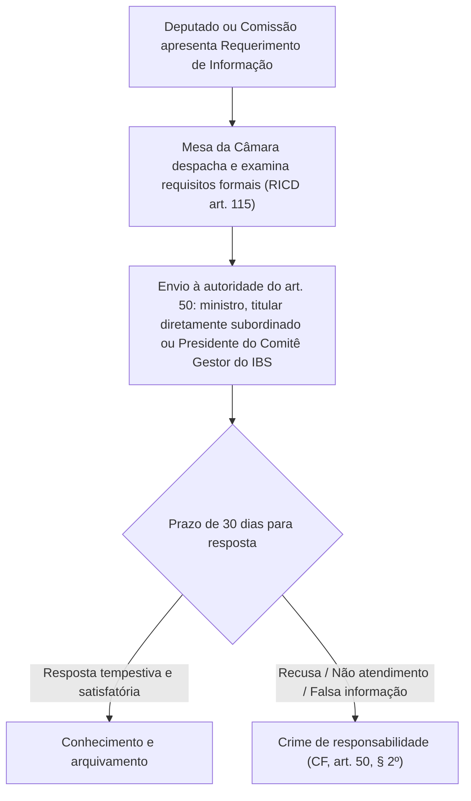
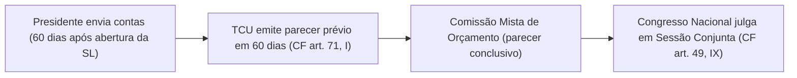

# Controle parlamentar: fiscalização contábil, financeira, requerimentos e prestação de contas

**Concurso Câmara dos Deputados 2026, cargo 1, Divulgação Institucional, Cebraspe. Unidade CAM-PL-033 conforme arquitetura e inventário editorial.**

O controle parlamentar constitui o exercício concreto da **função fiscalizadora** do Poder Legislativo, inerente ao princípio da separação de Poderes e ao sistema de freios e contrapesos (*checks and balances*). Na ordem constitucional republicana, legislar e fiscalizar ostentam igual hierarquia axiológica e funcional: a legitimidade democrática conferida pelo voto representativo exige a vigilância permanente sobre a gestão dos recursos públicos, a moralidade administrativa e o cumprimento estrito da lei pela Administração Pública.

A fiscalização legislativa abrange três grandes dimensões:
1. **Controle político institucional**: convocação de autoridades, pedidos de informação por escrito, sustação de atos normativos exorbitantes do Executivo e aprovação de atos complexos;
2. **Controle contábil, financeiro, orçamentário, operacional e patrimonial**: exercido pelo Congresso Nacional mediante controle externo, com o auxílio técnico e operacional do Tribunal de Contas da União (**CF, arts. 70 a 75**);
3. **Controle sobre a gestão do Chefe do Executivo**: julgamento anual das contas prestadas pelo Presidente da República, precedido de parecer prévio consultivo do TCU (**CF, art. 49, IX** c/c **art. 71, I**).

---

## 1. Instrumentos do controle político: convocações e requerimentos de informação

### 1.1 Convocação de autoridades do art. 50 da CF (redação da EC nº 132/2023)

A Câmara dos Deputados e o Senado Federal, ou qualquer de suas Comissões, podem convocar:
- **Ministros de Estado**;
- **Titulares de órgãos diretamente subordinados à Presidência da República** (exigida a subordinação direta; não basta que o órgão integre genericamente o Executivo federal);
- **Presidente do Comitê Gestor do Imposto sobre Bens e Serviços (IBS)**, expressamente incluído no art. 50 pela **EC nº 132/2023**.

> **Atenção — Sujeito passivo vedado:**
> O **Presidente da República e o Vice-Presidente da República NÃO podem ser convocados** pelo Congresso, pela Câmara, pelo Senado ou por Comissões para prestar depoimento ou esclarecimentos pessoais. A convocação pessoal do Chefe do Executivo violaria o princípio da separação de Poderes. A fiscalização sobre a Chefia do Poder Executivo se dá por requerimentos escritos de informação direcionados via Mesa, CPI, processo por crime de responsabilidade ou julgamento de contas.

**Consequência da recusa ou não comparecimento:**
O não comparecimento **sem justificação adequada** de autoridade regularmente convocada entre as indicadas no **art. 50, caput**, inclusive o **Presidente do Comitê Gestor do IBS**, importa **crime de responsabilidade**, na forma constitucional. Não presumir que a lista se restrinja a ministros.

**Caso de fronteira:** uma comissão parlamentar solicita o comparecimento do **Presidente do Comitê Gestor do IBS** sobre assunto previamente determinado. A convocação pode ocorrer com base no **art. 50, caput**, mesmo que essa autoridade não seja Ministro de Estado nem titular de órgão diretamente subordinado à Presidência. Se a comissão solicita informação por escrito, o procedimento constitucional de encaminhamento compete à **Mesa da Casa**, nos termos do § 2º.

### 1.2 Comparecimento espontâneo de autoridades (CF, art. 50, § 1º)

Os Ministros de Estado podem comparecer ao Senado Federal, à Câmara dos Deputados ou a qualquer de suas Comissões, por sua própria iniciativa e mediante entendimentos prévios com a respectiva Mesa, para expor assunto de relevância de seu Ministério.

### 1.3 Requerimentos de informação por escrito (CF, art. 50, § 2º c/c RICD, arts. 115 e 116)

A Mesa da Câmara dos Deputados e do Senado Federal pode encaminhar **pedidos de informação por escrito** a:
- Ministros de Estado;
- Titulares de órgãos diretamente subordinados à Presidência da República;
- **Presidente do Comitê Gestor do IBS** (EC nº 132/2023).

O **art. 50, § 2º**, refere-se às pessoas indicadas no caput. A forma de encaminhamento pela Mesa e o prazo constitucional de 30 dias devem ser distinguidos da convocação para comparecimento pessoal.

**Regras estritas e pegadinhas recorrentes do Cebraspe:**
- **Prazo constitucional:** **30 dias corridos** para envio das informações requeridas;
- **Tipificação penal-constitucional:** A **recusa**, o **não atendimento no prazo de 30 dias**, ou a **prestação de informações falsas** configura expressamente **crime de responsabilidade**;
- **Intermediação obrigatória:** Deputado individual ou Comissão não envia ofício direto ao Ministério com força coercitiva do art. 50, § 2º; a expedição formal decorre de ato da **Mesa Diretora** da Casa Legislativa.

---

**Item C/E inédito, complemento do art. 50.** A convocação do Presidente do Comitê Gestor do IBS por comissão da Câmara depende de que ele seja também Ministro de Estado, pois a Constituição somente permite convocar ministros e titulares de órgãos diretamente subordinados à Presidência.

**Gabarito: Errado.** O art. 50, caput, na redação da EC nº 132/2023, **menciona expressamente o Presidente do Comitê Gestor do IBS** como autoridade convocável. O erro da afirmação é transformar o rol constitucional atualizado em apenas duas categorias. [Constituição, art. 50](https://www.planalto.gov.br/ccivil_03/constituicao/constituicaocompilado.htm).

---

## 2. Fiscalização orçamentária e a Proposta de Fiscalização e Controle (PFC)

No âmbito do Regimento Interno da Câmara dos Deputados (**arts. 60 e 61**), as comissões exercem o controle operacional e orçamentário por meio da **Proposta de Fiscalização e Controle (PFC)**:

1. **Iniciativa:** Qualquer Deputado ou Comissão pode apresentar Proposta de Fiscalização e Controle destinada a investigar a gestão orçamentária, financeira, patrimonial ou contábil de órgão federal ou entidade recebedora de recursos federais;
2. **Tramitação e Plano de Execução:** A Comissão competente aprova o plano de auditoria/inspeção, podendo solicitar auxílio técnico ao TCU;
3. **Solicitação ao TCU (CF, art. 71, IV c/c RICD, art. 61):** A Câmara e o Senado realizam inspeções e auditorias solicitadas ao TCU pela respectiva Casa ou Comissão; o TCU não pode recusar a realização da auditoria solicitada pelo Congresso ou comissões permanentes competentes.

---

## 3. Controle externo e Tribunal de Contas da União (CF, arts. 70 a 75)

### 3.1 Abrangência material e subjetiva do controle (CF, art. 70)

A fiscalização contábil, financeira, orçamentária, operacional e patrimonial da União e das entidades da administração direta e indireta abrange a legalidade, a legitimidade, a economicidade, a aplicação das subvenções e a renúncia de receitas.

Prestará contas **qualquer pessoa física ou jurídica, pública ou privada**, que:
- Utilize, arrecade, guarde, gerencie ou administre dinheiros, bens e valores públicos federais;
- Assuma obrigações de natureza pecuniária em nome da União;
- Receba recursos da União mediante transferências voluntárias (convênios, contratos de repasse, termos de parceria ou emendas com finalidade definida).

### 3.2 Competências do TCU: atos de julgamento versus parecer prévio consultivo

Uma das distinções mais cobradas pelo Cebraspe reside na natureza da deliberação do TCU dependendo do sujeito examinado:

| Autoridade / Responsável | Competência do TCU | Natureza da Decisão | Órgão que julga em definitivo |
| :--- | :--- | :--- | :--- |
| **Presidente da República** (contas de governo) | CF, art. 71, I: apreciar mediante **parecer prévio** em 60 dias | **Opinião técnica consultiva** (não vinculante) | **Congresso Nacional** (CF, art. 49, IX), em sessão conjunta unicameral |
| **Demais administradores públicos e responsáveis por dinheiros públicos** (contas de gestão) | CF, art. 71, II: **julgar as contas** | **Decisão com eficácia de título executivo** (art. 71, § 3º) | O próprio **TCU** julga administrativamente em caráter definitivo |
| **Prefeitos municipais na gestão de verbas federais repassadas** | Julgamento das contas do convênio federal | Título executivo | O próprio **TCU** (Súmula 208 do STJ e Tema 835 do STF) |

> **Nota Crítica de Jurisprudência — STF, Temas 157 e 835 de Repercussão Geral:**
> Para fins de inelegibilidade de Prefeito ordenador de despesas (Lei Complementar nº 64/1990), a competência para julgar as contas de gestão e de governo do Chefe do Executivo Municipal é exclusiva da **Câmara Municipal**, cabendo ao Tribunal de Contas respectivo emitir parecer prévio (art. 31 da CF). Todavia, se o Prefeito gerir **recursos federais transferidos por convênio**, o TCU julga as contas do convênio (responsabilidade financeira e recomposição do erário perante a União).

---

## 4. Julgamento das contas do Presidente da República (CF, art. 49, IX e art. 71, I)

O rito de julgamento das contas do Chefe do Executivo articula harmoniosamente o auxílio técnico e o julgamento político:

1. **Prestação de Contas pelo Presidente:** O Presidente da República tem o dever constitucional de prestar contas anualmente ao Congresso Nacional, **dentro de 60 dias após a abertura da sessão legislativa** (CF, art. 84, XXIV);
2. **Omissão:** Se as contas não forem apresentadas no prazo, a Câmara dos Deputados procede à tomada de contas (CF, art. 51, II);
3. **Parecer Prévio do TCU:** O TCU recebe as contas e emite parecer prévio conclusivo no prazo de **60 dias a contar de seu recebimento** (CF, art. 71, I);
4. **Instrução na CMO (CF, art. 166, § 1º c/c Resolução nº 1/2006-CN):** O parecer e as contas são encaminhados à Comissão Mista de Planos, Orçamentos Públicos e Fiscalização (CMO), que elabora parecer deliberativo sobre as contas;
5. **Julgamento Definitivo pelo Congresso Nacional:** O Congresso Nacional delibera em **sessão conjunta** das duas Casas (art. 49, IX c/c art. 57, § 3º, II da CF).

---

## 5. Sustação de atos normativos e contratos administrativos (CF, art. 49, V e art. 71, §§ 1º e 2º)

A separação de poderes estabelece gradação específica para a sustação de atos irregulares:

### 5.1 Sustação de atos normativos que exorbitem o poder regulamentar (CF, art. 49, V)
- **Competência exclusiva:** Do **Congresso Nacional**;
- **Instrumento formal:** **Decreto Legislativo** (PDL aprovado por maioria simples nas duas Casas, sem sanção ou veto presidencial);
- **Objeto:** Decretos regulamentares do Executivo ou resoluções de órgãos administrativos que ultrapassem a autorização legal originária ou os limites da delegação legislativa.

### 5.2 Sustação de contrato administrativo irregular e poder cautelar do TCU (CF, art. 71, IX, X e §§ 1º e 2º)

Há uma diferença essencial entre **sustação constitucional do contrato** e **medida cautelar para preservar o erário**:

- **Determinação de providências à Administração (art. 71, IX):** ao identificar ilegalidade, o TCU pode assinar prazo para o órgão adotar providências de exato cumprimento da lei; a Constituição **não estabelece prazo fixo de 30 dias** para todas essas hipóteses. Segundo o STF (MS 23.550), o TCU pode determinar à autoridade administrativa que promova anulação de contrato e, se cabível, da licitação de origem, sem ele próprio anulá-los.
- **Sustação constitucional de contrato (art. 71, § 1º):** cabe inicialmente ao **Congresso Nacional**, que solicita imediatamente ao Executivo as medidas cabíveis. Se **Congresso ou Executivo** não efetivar as medidas em **90 dias**, o TCU **decidirá a respeito** (art. 71, § 2º). A regra não deve ser reduzida a uma proibição genérica de qualquer providência anterior do TCU.
- **Cautela do TCU:** em situações justificadas de risco ao erário ou à efetividade de sua decisão, o TCU pode determinar **medidas cautelares à Administração**, como suspensão temporária de repasses ou providências sobre a execução contratual, sem se confundir com anulação direta ou sustação definitiva do contrato. O STF reconhece o poder geral de cautela no **MS 24.510**, com aplicação a repasses contratuais no entendimento reunido em seu **Informativo 922**. A providência concreta exige motivação, proporcionalidade e observância das competências constitucionais.

> **Pegadinha Cebraspe:** sustar definitivamente um contrato, ordenar sua anulação à Administração e determinar cautelarmente a interrupção de pagamentos são **atos juridicamente distintos**. Os 90 dias do art. 71, § 2º, referem-se à atuação subsidiária na sustação constitucional, e não à condição universal para toda cautelar do TCU.

Fontes: [STF, art. 71 e precedentes MS 23.550/MS 24.510](https://portal.stf.jus.br/constituicao-supremo/artigo.asp?abrirArtigo=71&abrirBase=CF); [STF, Informativo 922](https://www.stf.jus.br/arquivo/informativo/documento/informativo922.htm).

---

## 6. Casos progressivos de aplicação

### Caso 1: Convocação de Chefe de Poder
Uma comissão parlamentar da Câmara dos Deputados aprova requerimento de convocação obrigatória do Presidente da República para prestar depoimento sobre denúncias veiculadas na imprensa.
*Análise:* O ato é flagrantemente inconstitucional. O art. 50 da CF autoriza a convocação coercitiva de Ministros de Estado e titulares de órgãos subordinados à Presidência, mas **jamais do Presidente ou do Vice-Presidente da República**, sob pena de violação ao princípio da separação de Poderes (cláusula pétrea do art. 60, § 4º, III).

### Caso 2: Requerimento de informação a Ministro e contagem de prazo
A Mesa da Câmara encaminha pedido de informações sobre contratos de publicidade institucional a determinado Ministro de Estado. Transcorridos 35 dias sem qualquer resposta ou solicitação fundamentada de prorrogação, o Ministro argumenta que não cometeu infração porque o prazo de resposta do processo administrativo geral seria de 60 dias.
*Análise:* A alegação é improcedente. O prazo constitucional do art. 50, § 2º é peremptório e expresso: **30 dias corridos**. O não atendimento ou recusa injustificada tipifica de pleno direito **crime de responsabilidade**, processável perante o STF (em crimes comuns) ou Senado Federal (se conexo com o Presidente da República - CF art. 52, I e II).

### Caso 3: Rejeição das contas presidenciais pelo TCU
O TCU, ao analisar as contas do Presidente da República relativas ao exercício financeiro anterior, emite parecer prévio recomendando sua rejeição por descumprimento de metas fiscais. Diante disso, o Tribunal publica acórdão declarando as contas rejeitadas e aplicando multa pecuniária ao Presidente.
*Análise:* O acórdão do TCU é nulo nessa parte. O Tribunal de Contas **não julga as contas do Chefe do Executivo**, competindo-lhe exclusivamente emitir parecer prévio técnico de caráter opinativo (CF art. 71, I). O julgamento político e definitivo cabe única e soberanamente ao **Congresso Nacional** (CF art. 49, IX).

### Caso 4: Cautelar sobre pagamentos e sustação definitiva de contrato
Uma auditoria do TCU identifica indícios robustos de superfaturamento em contrato de obra federal e risco de desembolsos imediatos. O Tribunal, de forma fundamentada, determina **cautelarmente à autarquia que suspenda repasses** enquanto apura os fatos; em outro ato, declara **diretamente e em caráter definitivo a anulação e sustação do contrato**, sem observar a atuação do Congresso.
*Análise:* **As duas medidas exigem fundamentos distintos.** A cautelar dirigida à Administração pode ser legítima para evitar dano e preservar a eficácia de decisão futura, conforme o poder geral de cautela reconhecido pelo STF (MS 24.510 e Informativo 922), desde que proporcional e motivada. **Já o TCU não pode anular por ato próprio o contrato**, e a sustação constitucional definitiva segue o art. 71, §§ 1º e 2º, com atuação inicial do Congresso Nacional. O marco de **90 dias não impede automaticamente a cautelar**, mas delimita o mecanismo subsidiário de sustação.

---

## 7. Questões inéditas comentadas (Padrão Cebraspe — C/E)

### Item 1
> A Câmara dos Deputados e o Senado Federal, ou qualquer de suas Comissões, têm legitimidade constitucional para convocar, sob pena de crime de responsabilidade em caso de ausência injustificada, Ministros de Estado e o Presidente da República para prestarem pessoalmente informações sobre assunto previamente determinado.

*( ) Certo*
*( ) Errado*

**Gabarito: Errado.**
**Comentário:** A prerrogativa de convocação coercitiva sob cominação de crime de responsabilidade (CF, art. 50, *caput*) alcança Ministros de Estado e titulares de órgãos subordinados à Presidência da República, **não incluindo o Presidente da República**. O Chefe do Poder Executivo não se submete à convocação pessoal por órgãos parlamentares, em respeito à harmonia e independência entre os Poderes.

---

### Item 2
> O não atendimento a requerimento de informações por escrito, formulado pela Mesa da Câmara dos Deputados ou do Senado Federal a Ministro de Estado, no prazo de trinta dias, bem como a prestação de informações falsas, importa crime de responsabilidade.

*( ) Certo*
*( ) Errado*

**Gabarito: Certo.**
**Comentário:** É a redação exata e taxativa do art. 50, § 2º da Constituição Federal: *"A Mesa da Câmara dos Deputados e a do Senado Federal podem encaminhar pedidos escritos de informações a Ministros de Estado ou a qualquer das pessoas referidas no caput deste artigo, importando em crime de responsabilidade a recusa, ou o não - atendimento, no prazo de trinta dias, bem como a prestação de informações falsas"*.

---

### Item 3
> Se o parecer prévio emitido pelo Tribunal de Contas da União concluir pela rejeição das contas anuais prestadas pelo Presidente da República, o Congresso Nacional somente poderá afastar essa conclusão técnica mediante o voto de dois terços dos membros de cada Casa legislativa.

*( ) Certo*
*( ) Errado*

**Gabarito: Errado.**
**Comentário:** A regra do quórum de dois terços para derrubar o parecer prévio do Tribunal de Contas existe **apenas para os Municípios** (CF, art. 31, § 2º: *"O parecer prévio, emitido pelo órgão competente sobre as contas que o Prefeito deve anualmente prestar, só deixará de prevalecer por decisão de dois terços dos membros da Câmara Municipal"*). No âmbito **federal**, a Constituição não impõe quórum de dois terços para o Congresso Nacional rejeitar o parecer prévio do TCU sobre as contas presidenciais; a deliberação na sessão conjunta obedece à maioria simples dos votos presentes, respeitada a maioria absoluta de presença em cada Casa.

---

### Item 4
> O Congresso Nacional dispõe de competência exclusiva para sustar a execução de atos normativos do Poder Executivo que exorbitem do poder regulamentar ou dos limites de delegação legislativa, o que é formalizado por meio de decreto legislativo.

*( ) Certo*
*( ) Errado*

**Gabarito: Certo.**
**Comentário:** Conforme o art. 49, V da CF, é competência exclusiva do Congresso Nacional sustar os atos normativos exorbitantes do Executivo. Por ser matéria de competência exclusiva do Congresso Nacional, o ato tem a forma de **Decreto Legislativo**, sem sanção ou veto do Presidente da República.

---

### Item 5
> Constatada a ilegalidade na celebração de contrato administrativo da Administração Pública federal, cabe primariamente ao Tribunal de Contas da União decretar a imediata sustação do instrumento contratual, cabendo ao Congresso Nacional ser apenas notificado da decisão nos trinta dias seguintes.

*( ) Certo*
*( ) Errado*

**Gabarito: Errado.**
**Comentário:** Inversão de competência deliberada. De acordo com o art. 71, § 1º da CF, no caso de contrato, o ato de sustação é adotado **diretamente pelo Congresso Nacional**, que solicita ao Poder Executivo as medidas cabíveis. Somente se o Congresso Nacional ou o Poder Executivo, no prazo de **90 dias**, não adotar as providências é que o TCU decidirá a respeito da sustação (art. 71, § 2º).

---

### Item 6
> As Propostas de Fiscalização e Controle (PFC) constituem instrumento regimental da Câmara dos Deputados que permite às suas comissões permanentes investigar a gestão orçamentária e financeira de órgãos públicos federais, podendo a comissão solicitar a realização de inspeções e auditorias ao Tribunal de Contas da União, o qual tem o dever constitucional de prestar esse auxílio técnico.

*( ) Certo*
*( ) Errado*

**Gabarito: Certo.**
**Comentário:** O RICD disciplina a PFC (arts. 60 e 61) e a Constituição Federal, no art. 71, IV, estabelece expressamente a competência do TCU para *"realizar, por iniciativa da Câmara dos Deputados, do Senado Federal, de Comissão técnica ou de inquérito, inspeções e auditorias de natureza contábil, financeira, orçamentária, operacional e patrimonial"*. O TCU atua como órgão auxiliar e técnico do Congresso, não podendo se recusar a executar a fiscalização requerida pela Casa ou comissão competente.

---

## 8. Síntese comparativa para memorização

| Mecanismo de Controle | Autoridade Alvo | Iniciativa / Deliberação | Sanção / Efeito |
| :--- | :--- | :--- | :--- |
| **Convocação de autoridade** (CF art. 50) | Ministros; titulares diretamente subordinados à Presidência; **Presidente do Comitê Gestor do IBS** | Câmara, Senado ou Comissões | Ausência injustificada = **crime de responsabilidade** |
| **Requerimento de informação** (CF art. 50, § 2º) | Autoridades do caput, inclusive **Presidente do Comitê Gestor do IBS** | Mesa Diretora da Casa | Recusa, não atendimento em **30 dias** ou informação falsa = **crime de responsabilidade** |
| **Julgamento de contas presidenciais** (CF art. 49, IX c/c 71, I) | Presidente da República | Parecer prévio do TCU (60 dias) → Julgamento pelo Congresso | Julgamento político definitivo em sessão conjunta |
| **Sustação de ato normativo exorbitante** (CF art. 49, V) | Chefe do Executivo / Regulamentos | Congresso Nacional via Decreto Legislativo | Extirpação do ato normativo sem sanção/veto |
| **Sustação constitucional de contrato irregular** (CF art. 71, §§ 1º e 2º) | Contrato da Administração sob controle externo | Inicialmente Congresso; subsidiariamente TCU após o mecanismo de 90 dias | Sustação nos termos constitucionais; distinguir de anulação administrativa e cautelar do TCU |
