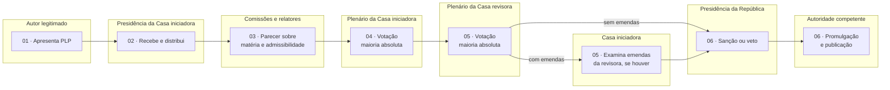
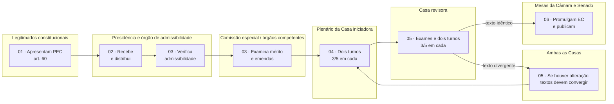
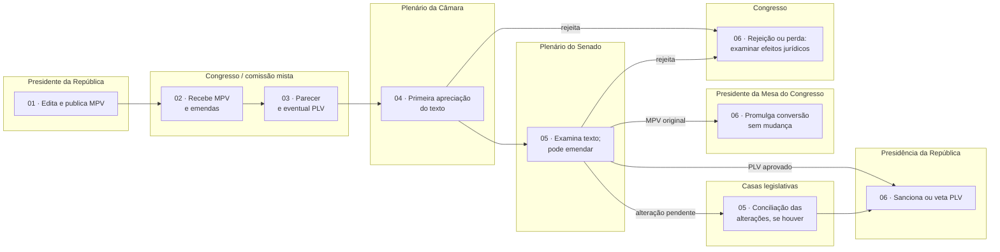
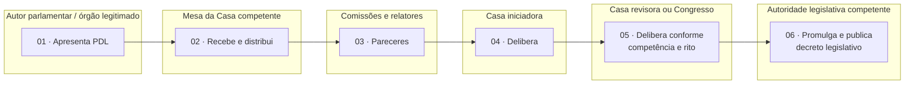
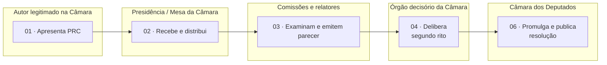
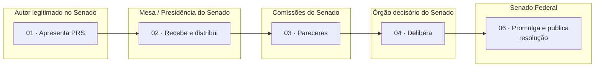
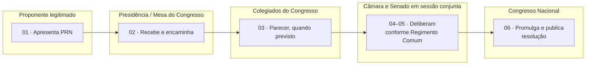
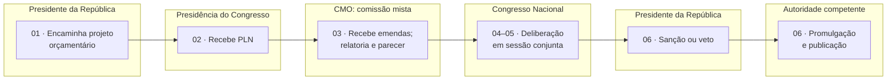
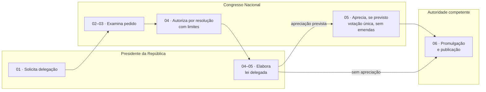

# Blueprints do processo legislativo por espécie normativa

**Fases:** 01 Origem · 02 Recebimento e distribuição · 03 Instrução · 04 Deliberação · 05 Revisão e retorno · 06 Conclusão.

**Leitura:** cada **faixa identifica um ator**; as caixas mostram a **fase e a atividade** sob sua responsabilidade. Setas indicam entregas entre atores. Prazos aparecem apenas quando são próprios do caminho indicado. Os fluxos representam a **rota típica**, com ramificações essenciais. Para detalhes normativos e exceções, siga os links abaixo de cada mapa. No explorador Mermaid, use zoom para percorrer cada blueprint.

## PL → lei ordinária

```mermaid
flowchart LR
  subgraph L0["Autor da proposição"]
    direction LR
    a["01 · Apresenta PL"]
  end
  subgraph L1["Presidência e serviços da Câmara"]
    direction LR
    b["02 · Recebe, publica<br/>e distribui"]
  end
  subgraph L2["Comissão e relator"]
    direction LR
    c["03 · Emendas e relatório<br/>parecer: 5 / 10 / 40 sessões"]
  end
  subgraph L3["Comissões / Plenário da Câmara"]
    direction LR
    d["04 · Apreciação conclusiva<br/>ou votação no Plenário"]
  end
  subgraph L4["Senado Federal"]
    direction LR
    e["05 · Revisa PL;<br/>emenda ou rejeita"]
  end
  subgraph L5["Câmara, quando houver emendas"]
    direction LR
    f["05 · Delibera sobre<br/>emendas do Senado"]
  end
  subgraph L6["Presidência da República"]
    direction LR
    g["06 · Sanção ou veto<br/>15 dias úteis"]
  end
  subgraph L7["Autoridade competente"]
    direction LR
    h["06 · Promulgação<br/>e publicação"]
  end
  a --> b --> c --> d --> e
  e -->|sem emendas| g
  e -->|com emendas| f --> g
  g --> h
```

Origem: legitimado constitucional. O caminho da Câmara pode ser conclusivo nas comissões ou seguir ao Plenário. PL iniciado no Senado inverte as Casas. **Aprofundar:** [[3 - Materias/Direito Constitucional/13 - tramitacao e fases do processo legislativo|Tramitação, comissões e revisão bicameral]] · [[3 - Materias/Direito Constitucional/18 - procedimentos abreviado e sumario|Ritos e urgência constitucional]].

## PLP → lei complementar

Origem: legitimado com iniciativa para matéria reservada à lei complementar. Maioria absoluta em cada Casa (CF, art. 69). **Aprofundar:** [[3 - Materias/Direito Constitucional/36 - especies legislativas comparacao por iniciativa quorum e efeito|Espécies legislativas e quóruns]] · [[3 - Materias/Direito Constitucional/12 - iniciativa legislativa sujeitos e limites|Iniciativa legislativa]].

## PEC → emenda constitucional

Origem: legitimados do art. 60. Dois turnos e três quintos em cada Casa; promulgação pelas Mesas, sem sanção. **Aprofundar:** [[3 - Materias/Direito Constitucional/10 - processo legislativo e poder constituinte|Poder constituinte e emendas]] · [[3 - Materias/Direito Constitucional/36 - especies legislativas comparacao por iniciativa quorum e efeito|Quóruns por espécie]].

## MPV e PLV → conversão em lei

Origem: Presidente edita MPV, com força de lei. 60 + 60 dias de vigência, recesso suspende a contagem; após 45 dias sem apreciação, urgência constitucional. **Aprofundar:** [[3 - Materias/Direito Constitucional/33 - medidas provisorias resolucao 1 2002 CN|Rito completo das medidas provisórias]] · [[3 - Materias/Direito Constitucional/21 - medida provisoria pressupostos prazos e efeitos|Prazos, eficácia e PLV]].

## PDL → decreto legislativo

Origem: órgão legislativo com competência para a matéria. A rota entre Casas depende do fundamento constitucional e do procedimento aplicável; sem sanção. **Aprofundar:** [[3 - Materias/Direito Constitucional/22 - projetos de decreto legislativo e resolucao|Decreto legislativo e competências]].

## PRC → resolução da Câmara

Origem: Câmara. Resolve matéria de competência da própria Casa; em regra não há revisão do Senado nem sanção. **Aprofundar:** [[3 - Materias/Direito Constitucional/22 - projetos de decreto legislativo e resolucao|Resoluções das Casas]] · [[3 - Materias/Direito Constitucional/23 - regimento da camara organizacao e orgaos artigos 1 a 24|Organização da Câmara]].

## PRS → resolução do Senado

Origem: Senado, em sua competência própria. Não passa pela Câmara como revisora nem depende de sanção. **Aprofundar:** [[3 - Materias/Direito Constitucional/22 - projetos de decreto legislativo e resolucao|Resoluções e competências privativas]].

## PRN → resolução do Congresso

Origem: Congresso Nacional. Exemplo: delegação legislativa. Sessões conjuntas seguem regras de votação próprias, com contagem por Casa quando aplicável. **Aprofundar:** [[3 - Materias/Direito Constitucional/31 - regimento comum organizacao comissoes mistas e votacao artigos 4 a 52|Sessões conjuntas e votação]] · [[3 - Materias/Direito Constitucional/22 - projetos de decreto legislativo e resolucao|PRN e resoluções]].

## PLN → lei orçamentária

Origem: Presidente apresenta PPA, LDO, LOA ou projeto de crédito adicional quando cabível. Prazos e emendas seguem CF, ADCT e regras orçamentárias próprias. **Aprofundar:** [[3 - Materias/Direito Constitucional/36 - especies legislativas comparacao por iniciativa quorum e efeito|Comparação de espécies]] · [[3 - Materias/Direito Constitucional/31 - regimento comum organizacao comissoes mistas e votacao artigos 4 a 52|Congresso e votação conjunta]].

## Delegação → lei delegada

Origem: Presidente solicita delegação ao Congresso; resolução delimita o objeto. Se houver apreciação parlamentar prevista, ocorre votação única, sem emendas. **Aprofundar:** [[3 - Materias/Direito Constitucional/20 - lei delegada e delegacao legislativa|Delegação legislativa, limites e procedimento]].

## Fontes normativas

[Constituição Federal, arts. 47–69 e 165–166](https://www2.camara.leg.br/atividade-legislativa/legislacao/constituicao1988) · [Regimento Interno da Câmara](https://www2.camara.leg.br/atividade-legislativa/legislacao/regimento-interno-da-camara-dos-deputados/regimentointerno.html) · [Regimento Comum do Congresso](https://www.congressonacional.leg.br/legislacao-e-publicacoes/regimento-do-congresso-nacional) · [Resolução nº 1/2002-CN](https://www2.camara.leg.br/legin/fed/rescon/2002/resolucao-1-8-maio-2002-497942-normaatualizada-pl.html).

Os diagramas apresentam modelos de rotas e não substituem o procedimento específico de cada matéria. Validação visual de faixas, posicionamento, contraste e zoom será registrada após inspeção real da página.
