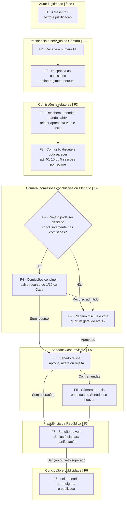
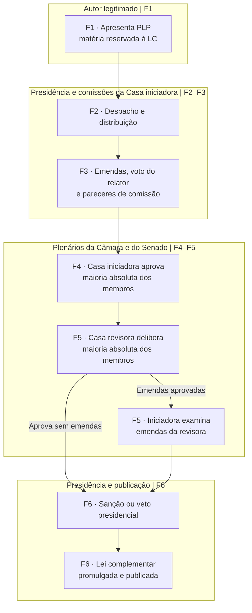
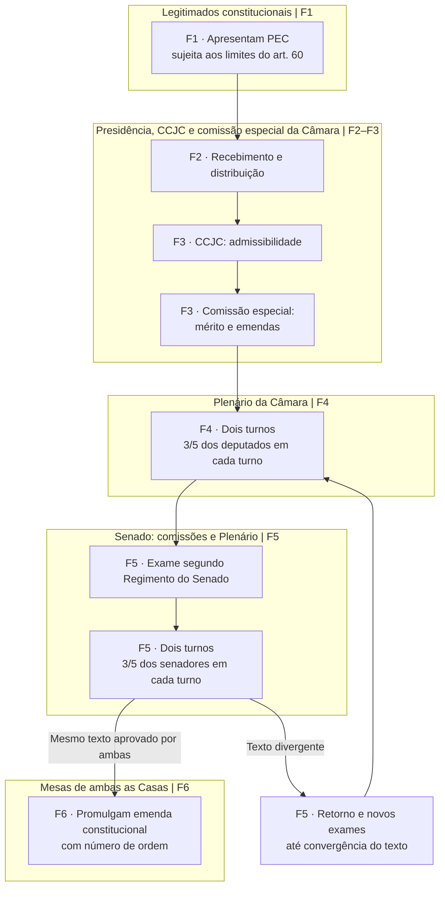
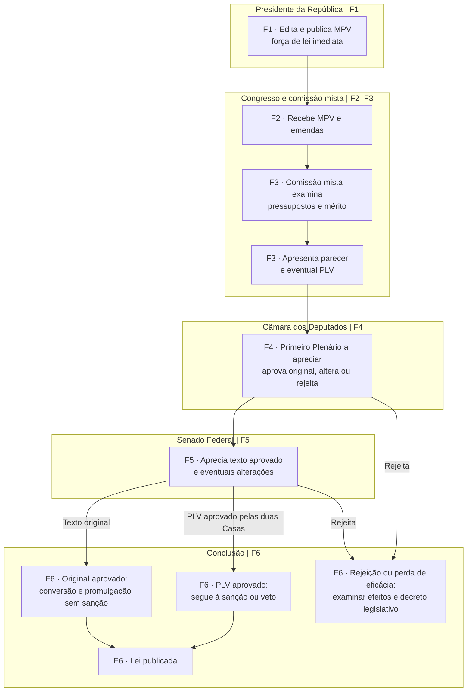
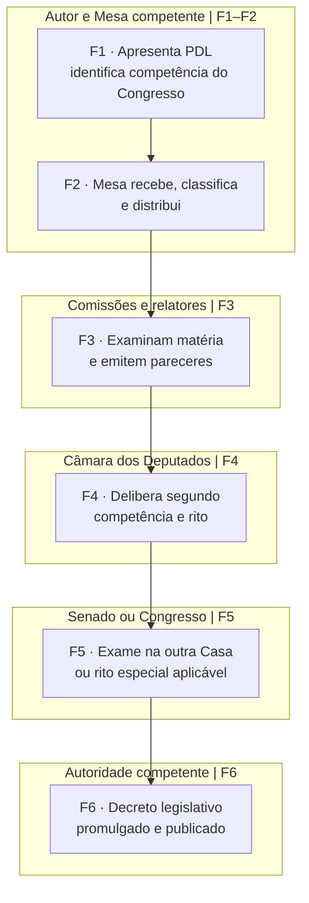
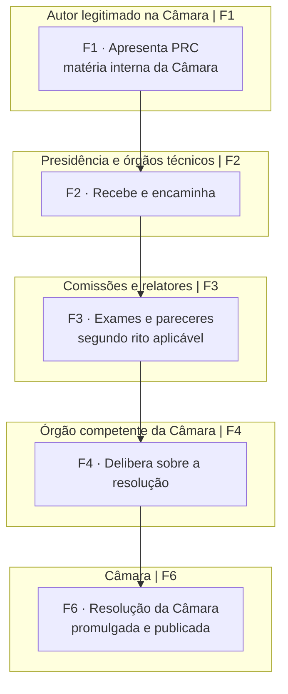
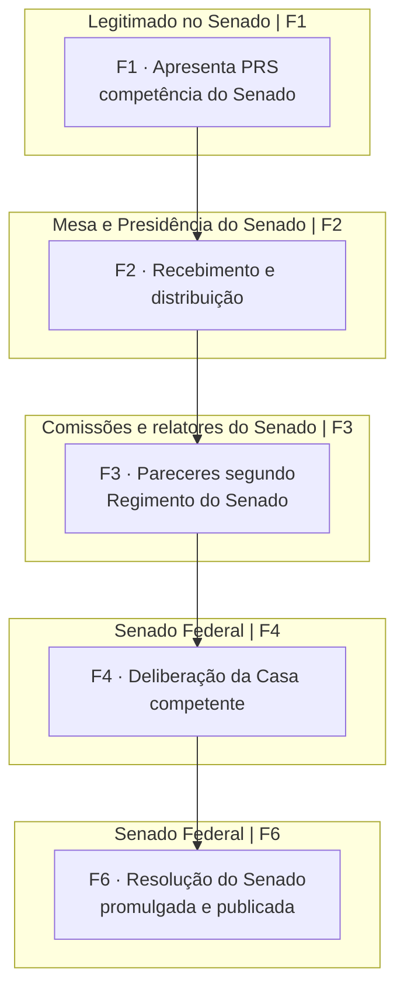
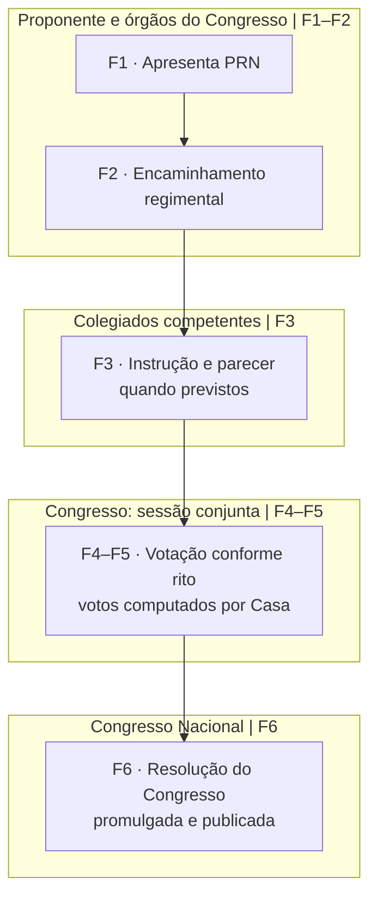
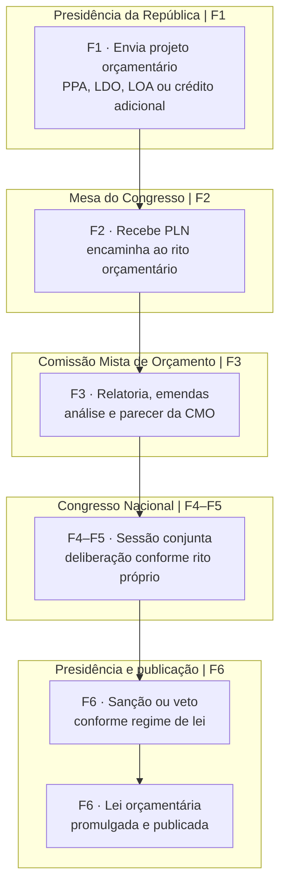
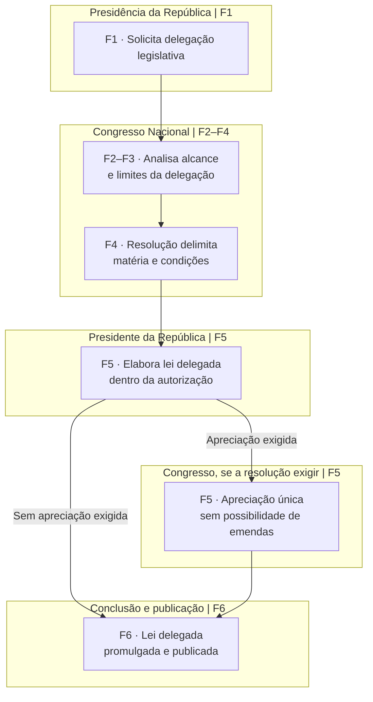

# Blueprints do processo legislativo: atores, fases, prazos e resultados por proposição

Este é um **mapa de funcionamento institucional**, organizado por tipo de proposição. Cada mapa mostra **onde a matéria começa**, **qual ator age**, **que documento entrega ao próximo**, **em qual fase**, **qual prazo ou quórum importa** e **como o percurso termina**. As setas representam entregas, decisões e retornos entre atores. Uma seta não significa, necessariamente, que a etapa seguinte ocorrerá imediatamente.

**Como ler:** o número `F1` a `F6` identifica as fases: **F1 origem e iniciativa → F2 protocolo e distribuição → F3 instrução e pareceres → F4 deliberação → F5 revisão ou controle pela outra Casa → F6 conclusão, promulgação e publicação**. Faixas `subgraph` reúnem atividades por **ator responsável**, não por momento cronológico; o momento está escrito dentro de cada atividade. Prazos e quóruns aparecem no nó ao qual pertencem. **Comissões de mérito** avaliam o conteúdo; **CCJC** e **CFT** exercem exames específicos de admissibilidade nas hipóteses regimentais. Os diagramas simplificam os caminhos de forma explícita; as exceções estão no texto imediatamente abaixo de cada um.

**Atenção:** `PL`, `PLP`, `PEC`, `PDL`, `PRC`, `PRS`, `PRN`, `PLN` e `PLV` são **proposições ou projetos**. A lei, emenda, decreto legislativo ou resolução são **atos finais**. A **medida provisória (MPV)** é diferente: já nasce com força de lei. Os prazos de **sessões** das comissões não devem ser convertidos em dias corridos. O mapa representa o procedimento federal, com as exceções pertinentes.

## Legenda de atores, atividades e relógios

| Camada | O que registrar em cada etapa | Como interpretar |
| :--- | :--- | :--- |
| **Ator** | Proponente, Presidência/Mesa, Secretaria-Geral da Mesa, comissões, relator, Plenário, Senado, Congresso ou Presidência da República | Quem pratica o ato, sem confundir órgão colegiado e pessoa que relata |
| **Atividade** | Receber, distribuir, relatar, emendar, discutir, votar, revisar, sancionar, promulgar | O verbo identifica a responsabilidade |
| **Documento** | Projeto, despacho, emenda, substitutivo, relatório e voto, parecer, autógrafo, veto, norma | O que passa de uma etapa a outra |
| **Relógio** | Prazo, unidade, marco de início, suspensão e consequência do descumprimento | Não somar prazos simultâneos nem aplicar prazo de rito especial a todos os projetos |
| **Decisão e saída** | Aprovado, alterado, rejeitado, recurso, retorno, perda de eficácia, arquivamento | A proposta pode sair do percurso antes do fim |

**Relógios na Câmara, quando aplicáveis ao procedimento do art. 52 do Regimento Interno:** comissão em regime ordinário: **40 sessões**; prioridade: **10 sessões**; urgência: **5 sessões**. O prazo usual do relator corresponde à **metade do prazo da comissão e corre dentro dele**, sujeito a regras de prorrogação e substituição; não se soma ao prazo da comissão. Os prazos citados dizem respeito à **comissão** e não à duração total da lei.

## PL: projeto de lei ordinária

**Onde começa:** iniciativa parlamentar ou de outro legitimado constitucional, conforme o assunto; projetos de iniciativa do Presidente da República começam na **Câmara**, enquanto projetos iniciados no Senado passam primeiro pelo Senado. A iniciativa reservada muda quem pode apresentar, não elimina as etapas legislativas.

**Saídas que mudam o caminho:** rejeição, arquivamento, retirada, parecer terminativo, recurso contra apreciação conclusiva, substitutivo, emendas da Casa revisora e veto são decisões distintas. Se o **Senado** iniciar o projeto, trocam-se os papéis de Casa iniciadora e revisora. **Urgência constitucional:** para projeto de sua iniciativa, o Presidente pode solicitar o procedimento do art. 64: **45 dias para cada Casa, sucessivamente**, e **10 dias para a Câmara examinar emendas do Senado**; prazos não correm no recesso e não se aplicam a projetos de código. A falta de votação gera sobrestamento nos termos do dispositivo. A sanção tácita decorre do silêncio presidencial no prazo de **15 dias úteis**; veto é apreciado pelo Congresso em sessão conjunta segundo art. 66.

## PLP: projeto de lei complementar

**Onde começa:** legitimado com iniciativa sobre a matéria; exige-se que a Constituição **reserve expressamente** o assunto à lei complementar. Caminho semelhante ao PL, mas a regra de aprovação muda.

**Ponto de prova:** **maioria absoluta dos integrantes** de cada Casa (CF, art. 69) é o quórum de aprovação do PLP. A mera importância do tema não o transforma em lei complementar. Os prazos de comissão são regimentais e variam segundo o regime efetivamente atribuído. Rejeição ou inadmissibilidade interrompem o percurso representado.

## PEC: proposta de emenda à Constituição

**Onde começa:** um terço, no mínimo, dos deputados ou senadores; Presidente da República; ou mais da metade das Assembleias Legislativas, manifestando-se cada uma pela maioria relativa de seus membros (CF, art. 60). A Casa de apresentação examina primeiro. Não há sanção presidencial.

**Exceções:** emenda constitucional **não é submetida a sanção/veto**. A Constituição não pode ser emendada durante intervenção federal, estado de defesa ou estado de sítio; há limites materiais e vedação de reapresentar, na mesma sessão legislativa, matéria de PEC rejeitada ou prejudicada (art. 60). A admissibilidade da Câmara e as comissões do Senado seguem seus regimentos próprios. **Não transportar o prazo de 40 sessões de comissão ordinária para o rito especial de PEC.**

## MPV e PLV: medida provisória e projeto de lei de conversão

**Onde começa:** o **Presidente da República edita e publica a MP**, com força de lei, em caso de relevância e urgência. O Congresso a examina, com **Câmara antes do Senado**. O PLV surge como texto proposto quando há alteração da MP, e não como uma nova MP.

**Relógios próprios:** vigência de **60 dias**, prorrogável **uma vez por mais 60**, com suspensão de contagem durante recesso; **após 45 dias da publicação sem apreciação**, urgência e sobrestamento na Casa em que tramita, conforme Constituição e interpretação aplicável. Se o Congresso aprovar **PLV**, a **MP original continua integralmente em vigor até sanção ou veto** do projeto (CF, art. 62, § 12). Quando a MP é rejeitada ou perde eficácia, o Congresso deve disciplinar as relações jurídicas por decreto legislativo; há regras constitucionais de preservação dessas relações na ausência de decreto. A tramitação pormenorizada da comissão mista e do PLV está em [[3 - Materias/Direito Constitucional/33 - medidas provisorias resolucao 1 2002 CN|Medidas provisórias: rito da Resolução nº 1/2002-CN]].

## PDL: projeto de decreto legislativo

**Onde começa:** proposição legislativa destinada a matéria de competência exclusiva do Congresso Nacional, ou outra hipótese de decreto legislativo prevista em norma competente. A matéria e a origem determinam se há tramitação sucessiva entre Casas ou procedimento próprio do Congresso. **Não existe sanção presidencial.**

**Exemplo:** sustar ato normativo do Executivo que exceda o poder regulamentar (CF, art. 49, V). **PDL é a proposição; decreto legislativo é o ato final.** PDL e projeto de resolução dispensam sanção, mas têm finalidades distintas; nem todos seguem o mesmo órgão ou rito.

## PRC: projeto de resolução da Câmara

**Onde começa:** na própria **Câmara dos Deputados**, em matérias de competência dessa Casa, como alterar seu Regimento Interno. Não passa pelo Senado como Casa revisora e não depende de sanção presidencial.

**Limite:** nem toda decisão administrativa interna pode ser tomada por resolução, e nem toda matéria interna dispensa lei. **Remuneração dos servidores da Câmara exige iniciativa de lei** (CF, art. 51, IV), embora a Câmara tenha competência para organizar seus serviços.

## PRS: projeto de resolução do Senado

**Onde começa:** no **Senado Federal**, dentro de suas competências, a exemplo de limites globais de dívida consolidada previstos no art. 52, VI, da Constituição. É importante incluí-lo no mapa mesmo sem iniciar na Câmara.

**Não deslocar para a Câmara:** o fato de o Congresso ter duas Casas não obriga todo instrumento legislativo a ser votado nas duas. O Senado exerce competências privativas por resolução nas hipóteses constitucionais.

## PRN: projeto de resolução do Congresso Nacional

**Onde começa:** no **Congresso Nacional**, para matéria sujeita à resolução do Congresso, segundo o Regimento Comum e a Constituição. Exemplo: delegação legislativa ao Presidente da República (CF, art. 68, § 2º).

**Contagem:** nas sessões conjuntas reguladas pelo Regimento Comum, a votação é computada **separadamente na Câmara e no Senado**; voto contrário de uma Casa rejeita a matéria nas condições regimentais. Não somar deputados e senadores como um único Plenário indiferenciado.

## PLN: projeto de lei do Congresso Nacional, especialmente orçamento

**Onde começa:** para **PPA, LDO, LOA e projetos de créditos adicionais nas hipóteses constitucionais**, a iniciativa é do **Presidente da República**. A proposição é dirigida ao Congresso e examinada, em regra, pela **Comissão Mista de Planos, Orçamentos Públicos e Fiscalização (CMO)**. Os relógios e ritos não são os de PL comum.

**Condições próprias:** os prazos de envio e devolução das leis orçamentárias decorrem da Constituição, do ADCT e das regras aplicáveis; a apresentação de emendas observa o art. 166 e normas do Congresso. A CMO **não aprova sozinha** a lei orçamentária. Nos créditos adicionais, confirmar a hipótese concreta e o instrumento correto: nem todo crédito adicional se apresenta como PLN.

## Lei delegada: solicitação, autorização e elaboração

**Onde começa:** o **Presidente da República solicita delegação ao Congresso**. A autorização se dá por resolução do Congresso, que especifica conteúdo e condições. A iniciativa da **lei delegada** não é um PL parlamentar comum.

**Limites do art. 68:** matérias reservadas a lei complementar, competências exclusivas do Congresso ou privativas das Casas e outros temas expressamente vedados não podem ser delegados. A eventual apreciação pelo Congresso ocorre **em votação única e sem emendas**.

## Caminhos que atravessam os blueprints

**Emenda e substitutivo:** alteração parcial ou texto alternativo mais amplo podem modificar o percurso de análise e o que volta à Casa iniciadora. **Parecer:** voto do relator não é decisão da comissão. **Apreciação conclusiva:** pode dispensar votação comum do Plenário em projetos abrangidos pelo art. 58, § 2º, I, ressalvado recurso. **Urgência:** diferenciar regime regimental, urgência constitucional do art. 64, urgência da medida provisória e sobrestamento por veto; seus relógios não são intercambiáveis. **Arquivamento e desarquivamento:** exigem identificar fundamento e fase; não supor que aconteçam da mesma forma para todos os tipos de proposição.

Os diagramas de cada espécie exibem a **rota principal** e os pontos decisivos. Eles não são um simulador exaustivo de cada requerimento ou incidente processual. Para o detalhe de emendas, vistas, substituição do relator, quóruns, redação final e decisões regimentais, usar os artigos [[3 - Materias/Direito Constitucional/13 - tramitacao e fases do processo legislativo|Tramitação legislativa: fases, comissões, Plenário e revisão bicameral]], [[3 - Materias/Direito Constitucional/14 - comissoes parlamentares natureza competencias e poderes|Comissões parlamentares: tipos, competências e poderes]], [[3 - Materias/Direito Constitucional/15 - parecer legislativo relatorio voto e deliberacao|Parecer legislativo: relatório, voto e deliberação das comissões]], [[3 - Materias/Direito Constitucional/16 - discussao votacao quoruns e modalidades de decisao|Discussão, votação, quóruns e modalidades de decisão na Câmara]] e [[3 - Materias/Direito Constitucional/17 - sancao veto promulgacao e publicacao|Sanção, veto, promulgação e publicação: etapas, prazos e competências]]. As explicações permanecem integradas ao corpo destes artigos.

## Fontes e limites de cobertura

- [Constituição Federal atualizada](https://www2.camara.leg.br/atividade-legislativa/legislacao/constituicao1988): arts. 47 a 52, 58 a 69, 84 e 165 a 166; ADCT, regras orçamentárias transitórias pertinentes.
- [Regimento Interno da Câmara dos Deputados, texto atualizado](https://www2.camara.leg.br/atividade-legislativa/legislacao/regimento-interno-da-camara-dos-deputados/regimentointerno.html): especialmente arts. 24, 52, 100 a 159 e dispositivos de ritos especiais.
- [Regimento Comum do Congresso Nacional](https://www.congressonacional.leg.br/legislacao-e-publicacoes/regimento-do-congresso-nacional): sessões conjuntas, deliberações e matérias de competência do Congresso.
- [Resolução nº 1/2002-CN, atualizada](https://www2.camara.leg.br/legin/fed/rescon/2002/resolucao-1-8-maio-2002-497942-normaatualizada-pl.html): rito das medidas provisórias.
- [Glossário legislativo do Congresso Nacional](https://www.congressonacional.leg.br/legislacao-e-publicacoes/glossario-legislativo): nomenclatura PL, PLP, PEC, MPV, PLV, PDL, PRC, PRS, PRN e PLN.

**Limite editorial:** os diagramas mostram a estrutura normativa e a rota típica de cada instrumento, com alertas de exceção. Não afirmam que toda proposição passa obrigatoriamente por todas as caixas. A verificação visual e funcional dos onze diagramas no leitor, no modal de zoom e nos temas claro/escuro depende de teste específico após publicação.
