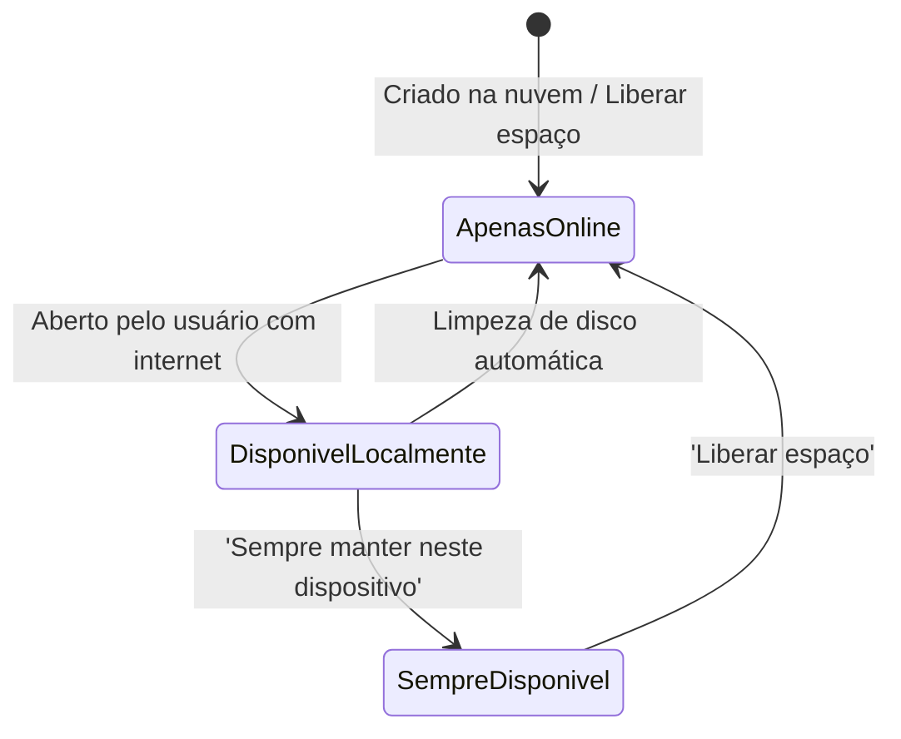

# Arquivo, pasta, nuvem e sincronização: conceitos, estruturas e operações

**Concurso Câmara dos Deputados 2026, cargo 1, Divulgação Institucional, Cebraspe. Unidade CAM-TI-001 conforme arquitetura e inventário editorial.**

## Núcleo do conceito: por que compreender sistemas de arquivos e sincronização?

No ambiente profissional contemporâneo — e especificamente na atuação do Poder Legislativo e da Administração Pública —, a manipulação diária de documentos, relatórios, projetos e dados apoia-se em sistemas operacionais e serviços de armazenamento corporativo. O Cebraspe não cobra informática apenas de forma memorizada sobre ícones; a banca examina a **lógica operacional**, os **limites estruturais dos sistemas de arquivos**, os **efeitos de operações de movimentação versus cópia** e a distinção precisa entre **backup, espelhamento e sincronização em nuvem**.

Compreender com rigor o ciclo de vida do dado (criação, nomenclatura, organização hierárquica, metadados, permissões e sincronização remota) é essencial para evitar armadilhas clássicas da banca sobre exclusão sincronizada, caracteres proibidos e compartilhamento seguro.

---

## 1. Arquivos e pastas: conceitos e estrutura lógica

### 1.1 Arquivo (*File*)
Um **arquivo** é uma unidade lógica de dados armazenada em um suporte físico ou virtual (SSD, disco rígido, pendrive, nuvem). É identificado por:
1. **Nome base**: sequência de caracteres que identifica o conteúdo para o usuário;
2. **Extensão**: sufixo separado por ponto (ex.: `.docx`, `.xlsx`, `.pdf`) que indica o formato interno e determina a associação de aplicativos padrão no sistema operacional;
3. **Caminho absoluto (*Path*)**: localização exata do arquivo desde a raiz da unidade de armazenamento (ex.: `C:\Usuarios\Analista\Documentos\Relatorio.pdf`);
4. **Metadados e atributos**: tamanho em bytes, data de criação, data de última modificação, data de último acesso e atributos como *Somente Leitura* (*Read-Only*), *Oculto* (*Hidden*), *Arquivo morto* (*Archive*) e *Sistema* (*System*).

### 1.2 Pasta ou Diretório (*Folder / Directory*)
Uma **pasta** é uma estrutura organizadora que armazena referências para arquivos e outras pastas (subpastas), estabelecendo uma **árvore hierárquica**. Em termos técnicos do sistema de arquivos (como NTFS ou FAT32), uma pasta é ela própria uma tabela especial contendo ponteiros para as entradas de arquivos.

### 1.3 Regras de nomenclatura e caracteres proibidos no Windows (NTFS / FAT32)
O Cebraspe frequentemente explora os caracteres que **não podem** ser utilizados no nome de arquivos e pastas no ambiente Windows. São nove caracteres reservados do sistema:

$$\backslash \quad / \quad : \quad * \quad ? \quad " \quad < \quad > \quad |$$

> **Mnemônico para a prova:**
> Pense em perguntas e comparações de caminhos: **Duas barras** (`/` e `\`), **dois pontos** (`:`), **aspas** (`"`), **asterisco** (`*`), **interrogação** (`?`), **menor e maior** (`<` e `>`) e a **barra vertical / pipe** (`|`).
> Nomes de dispositivos legados também são reservados: `CON`, `PRN`, `AUX`, `NUL`, `COM1` a `COM9`, `LPT1` a `LPT9`.

---

## 2. Operações fundamentais: arrastar, mover, copiar e atalhos

O comportamento padrão do Explorador de Arquivos (*File Explorer*) ao arrastar e soltar um item com o botão esquerdo do mouse varia conforme as unidades de origem e destino:

```mermaid
flowchart TD
    Arr["Arrastar e soltar com o botão esquerdo do mouse"] --> Teste{"Unidade de destino é a mesma da origem?"}
    Teste -->|Mesma unidade (ex.: C: para C:)| Mover["MOVE o arquivo (recorta e cola)"]
    Teste -->|Unidades diferentes (ex.: C: para D: ou Pendrive)| Copiar["COPIA o arquivo (duplica)"]
```

### Modificadores de teclado obrigatórios:
- **Pressionando `Ctrl` ao arrastar**: força a **CÓPIA** (inclusive na mesma unidade);
- **Pressionando `Shift` ao arrastar**: força o **MOVIMENTO** (inclusive entre unidades diferentes);
- **Pressionando `Alt` ou `Ctrl + Shift` ao arrastar**: cria um **ATALHO** (`.lnk`), que é apenas um ponteiro leve (alguns kilobytes) para o arquivo original, sem duplicar seu conteúdo;
- **Arrastar com o botão direito do mouse**: ao soltar, o Windows exibe um menu de contexto perguntando explicitamente se o usuário deseja *Mover para cá*, *Copiar para cá* ou *Criar atalho aqui*.

---

## 3. Armazenamento local versus armazenamento em nuvem (*Cloud Storage*)

A computação em nuvem (*cloud computing*) transfere o armazenamento físico local para centros de dados remotos (*data centers*) altamente redundantes, acessíveis pela rede mundial ou corporativa via protocolo seguro (HTTPS/TLS):

| Dimensão | Armazenamento Local | Armazenamento em Nuvem (Cloud) |
| :--- | :--- | :--- |
| **Localização física** | Disco rígido/SSD do dispositivo do usuário | Servidores remotos distribuídos do provedor |
| **Disponibilidade** | Limitada ao acesso físico à máquina | Acessível de qualquer dispositivo conectado |
| **Resiliência a desastres locais** | Vulnerável a roubo, queima de disco ou inundação | Alta resiliência via replicação geográfica de dados |
| **Dependência de conectividade** | Opera 100% offline | Exige internet para envio/recebimento de atualizações |
| **Colaboração em tempo real** | Inviável nativamente (conflito de versões) | Edição simultânea por múltiplos autores com versionamento |

---

## 4. O mecanismo de sincronização e arquivos sob demanda

A **sincronização** consiste em manter duas ou mais réplicas de uma estrutura de arquivos em perfeita correspondência de estado. Quando um arquivo é criado, editado ou excluído na máquina local, o cliente de sincronização (como o Microsoft OneDrive ou Google Drive) propaga essa alteração para a nuvem e para os demais dispositivos vinculados à mesma conta.

### Estados de arquivos em nuvem (Exemplo: OneDrive — *Files On-Demand*)
O Cebraspe costuma explorar os ícones de status que indicam a presença física do arquivo no disco local:

1. **Apenas online (*Online-only files*) — Ícone de Nuvem azul/branca:**
   - O arquivo aparece no Explorador de Arquivos, mas seu conteúdo não ocupa espaço no disco local;
   - Ao dar dois cliques, o arquivo é baixado sob demanda para que o usuário possa abri-lo;
   - Requer conexão com a internet para ser aberto pela primeira vez.
2. **Disponível localmente (*Locally available files*) — Ícone de Círculo verde com marca de seleção cinza/verde:**
   - O arquivo foi aberto ou baixado; ele ocupa espaço no disco local e está acessível offline;
   - O sistema operacional pode liberar o espaço novamente se o disco ficar cheio (voltando a ser apenas online).
3. **Sempre disponível (*Always available files*) — Ícone de Círculo verde sólido com marca de seleção branca:**
   - O usuário selecionou explicitamente a opção *"Sempre manter neste dispositivo"*;
   - O arquivo nunca é descartado pelo gerenciador de armazenamento local; fica permanentemente disponível offline.



---

## 5. Fronteira crítica: sincronização versus backup

Uma das maiores pegadinhas conceituais do Cebraspe em provas de tribunais, ministérios e casas legislativas é **confundir sincronização com backup**:

```
+---------------------------------------------------------------------------------+
|                                 ATENÇÃO MÁXIMA                                  |
|                                                                                 |
| SINCRONIZAÇÃO NÃO É BACKUP AUTOMÁTICO!                                          |
|                                                                                 |
| Se um usuário apagar um arquivo por engano na sua pasta sincronizada local,     |
| a exclusão tende a ser sincronizada com a nuvem e outros dispositivos quando houver conexão e processamento, sujeita a filas, erros e políticas de retenção  |
| computadores sincronizados.                                                     |
|                                                                                 |
| Embora ferramentas de nuvem tenham lixeira e histórico de versões, a lógica da  |
| sincronização é a CORRESPONDÊNCIA DE ESTADO (se apaga aqui, apaga lá).          |
| Já o BACKUP visa à PRESERVAÇÃO HISTÓRICA INDEPENDENTE contra desastres e        |
| erros humanos, mantendo versões recuperáveis independentes; imutabilidade é um controle adicional, não requisito universal.                |
+---------------------------------------------------------------------------------+
```

---

## 6. Casos progressivos de aplicação

### Caso 1: Nomenclatura com caracteres especiais
Um servidor da Câmara deseja salvar o arquivo de ata com o nome `Sessão_Solene_10/05/2026.docx`. Ao tentar salvar, o sistema operacional Windows emite alerta de erro e impede a gravação.
*Análise:* O erro decorre do uso do caractere barra (`/`), que é reservado pelo sistema de arquivos para a separação de diretórios. O nome correto deve utilizar traço ou sublinhado: `Sessão_Solene_10-05-2026.docx`.

### Caso 2: Movimentação entre partições diferentes
Um analista seleciona uma pasta de fotos institucionais no diretório `C:\Imagens` e, utilizando o botão esquerdo do mouse, arrasta-a diretamente para a pasta `D:\ArquivoInstitucional`. Ao final do processo, ele constata que os arquivos ainda existem na pasta de origem `C:\Imagens`.
*Análise:* O comportamento está correto. Quando o usuário arrasta um arquivo entre unidades de disco diferentes (`C:` para `D:`), o Windows executa por padrão uma operação de **CÓPIA** (duplicando o arquivo e mantendo a origem). Para mover entre unidades distintas pelo mouse, seria obrigatório manter pressionada a tecla `Shift`.

### Caso 3: Edição offline de arquivo apenas online
Um servidor embarca em um voo sem conexão Wi-Fi e tenta abrir um documento que consta na sua pasta do OneDrive com o ícone de uma nuvem azul.
*Análise:* O arquivo não abrirá. O status de nuvem (*Online-only*) indica que o arquivo não reside fisicamente no armazenamento do computador (não consome bytes do disco rígido). Sem conectividade à internet, não há como transferir o fluxo de dados para a memória da máquina. Para utilizá-lo em viagens, o servidor deveria ter clicado previamente com o botão direito e selecionado *"Sempre manter neste dispositivo"*.

### Caso 4: Exclusão em pasta sincronizada
Um usuário quer liberar espaço no seu computador corporativo e apaga uma pasta compartilhada inteira da pasta sincronizada do OneDrive local. No dia seguinte, seus colegas de trabalho reclamam que os arquivos da equipe sumiram da nuvem.
*Análise:* A sincronização é bidirecional. Ao deletar arquivos de uma pasta sincronizada no disco local, o serviço replica a ação destrutiva na nuvem. A forma correta de economizar espaço local sem apagar os arquivos da nuvem para os outros usuários é clicar com o botão direito e escolher a opção **"Liberar espaço"** (*Free up space*), transformando os itens em arquivos apenas online.

---

## 7. Questões inéditas comentadas (Padrão Cebraspe — C/E)

### Item 1
> No sistema operacional Windows, os caracteres `>`, `<`, `|` e `*` são reservados pelo sistema de arquivos e, por essa razão, não podem ser empregados na composição do nome de arquivos ou pastas.

*( ) Certo*
*( ) Errado*

**Gabarito: Certo.**
**Comentário:** Nas regras usuais de nomes de arquivos e pastas usadas pelas interfaces do Windows, são reservados nove caracteres especiais: `\`, `/`, `:`, `*`, `?`, `"`, `<`, `>`, e `|`. Todos os itens citados no enunciado pertencem ao rol de caracteres proibidos.

---

### Item 2
> Ao arrastar um arquivo de uma pasta situada no drive `C:` e soltá-lo em uma pasta situada no drive `D:` utilizando o botão esquerdo do mouse, sem pressionar nenhuma tecla do teclado, o Windows realizará por padrão a movimentação do arquivo, retirando-o da origem e alocando-o no destino.

*( ) Certo*
*( ) Errado*

**Gabarito: Errado.**
**Comentário:** Regra clássica do Cebraspe: arrastar entre **unidades distintas** (`C:` para `D:`) resulta por padrão em **CÓPIA** (*duplica o arquivo*). A movimentação direta só ocorreria por padrão se a origem e o destino estivessem na **mesma unidade** de disco (ex.: de `C:\PastaA` para `C:\PastaB`). Para forçar a movimentação entre unidades diferentes, seria necessário segurar a tecla `Shift`.

---

### Item 3
> A sincronização de arquivos em serviços de armazenamento em nuvem equivale funcionalmente a uma política de backup, haja vista que a exclusão acidental de um arquivo no computador local do usuário preserva intacta a cópia armazenada no servidor remoto.

*( ) Certo*
*( ) Errado*

**Gabarito: Errado.**
**Comentário:** A sincronização replica alterações de estado: exclusão local é sincronizada como exclusão na nuvem (o arquivo é enviado para a lixeira da nuvem). O backup é uma rotina de preservação independente que mantém dados recuperáveis segundo uma política de retenção. Imutabilidade é uma proteção adicional possível e não requisito de toda cópia de segurança.

---

### Item 4
> No Microsoft OneDrive com o recurso Arquivos sob Demanda ativado, um arquivo com o ícone de nuvem azul consome espaço no disco rígido local do usuário e pode ser executado mesmo quando o dispositivo estiver totalmente desconectado da internet.

*( ) Certo*
*( ) Errado*

**Gabarito: Errado.**
**Comentário:** O ícone de nuvem indica que o arquivo é **apenas online** (*online-only*): seu conteúdo não está baixado para uso offline, embora possam existir metadados ou estruturas locais. Para abrir o conteúdo ainda não disponível localmente, é necessária conectividade. O gabarito ERRADO se mantém pela impossibilidade de presumir leitura ou execução offline.

---

### Item 5
> No Windows, a criação de um atalho para um arquivo executável duplica integralmente o código-fonte e os dados do programa original em um novo local, permitindo sua execução mesmo se o arquivo original for definitivamente excluído do sistema.

*( ) Certo*
*( ) Errado*

**Gabarito: Errado.**
**Comentário:** O atalho (extensão `.lnk`) é apenas um arquivo ponteiro de tamanho ínfimo que aponta para o caminho do arquivo de destino. Se o arquivo original for excluído ou renomeado, o atalho torna-se inválido ("atalho quebrado").

---

### Item 6
> Para garantir que determinado documento corporativo armazenado no OneDrive permaneça permanentemente acessível para leitura e edição em um computador portátil durante períodos sem conexão à internet, o usuário deve acionar a opção regimental "Sempre manter neste dispositivo".

*( ) Certo*
*( ) Errado*

**Gabarito: NÃO HOMOLOGADO (garantia absoluta).**
**Comentário:** A opção **“Sempre manter neste dispositivo”** orienta o OneDrive a baixar e manter o conteúdo local, permitindo acesso offline quando sincronizado. Entretanto, o enunciado promete acesso **permanente** e edição garantida durante qualquer período desconectado, o que depende de integridade do dispositivo, conclusão do download, permissões e aplicativos disponíveis. **Reformulação para treino:** “Com a sincronização concluída, a opção Sempre manter neste dispositivo permite manter uma cópia local de documento do OneDrive para uso offline, sujeita às condições do dispositivo e aplicativo.” **Gabarito reformulado: CERTO.**

---

## 8. Tabela de síntese para memorização

| Operação / Estado | Comportamento Padrão | Modificador de Teclado |
| :--- | :--- | :--- |
| **Arrastar na mesma unidade** (ex.: `C:` para `C:`) | **Move** o arquivo | Segurar `Ctrl` força a **Cópia** |
| **Arrastar entre unidades diferentes** (ex.: `C:` para `D:`) | **Copia** o arquivo | Segurar `Shift` força o **Movimento** |
| **Criar atalho** | Ponteiro `.lnk` leve | Segurar `Alt` ou `Ctrl + Shift` ao arrastar |
| **Arquivo Apenas Online** (Nuvem) | Ocupa 0 bytes locais; requer internet para abrir | Clicar com botão direito e escolher *"Liberar espaço"* |
| **Arquivo Sempre Disponível** (Círculo verde) | Ocupa bytes locais; disponível offline permanente | Clicar com botão direito e escolher *"Sempre manter neste dispositivo"* |
| **Exclusão em pasta sincronizada** | Deleta na nuvem e em todos os dispositivos sincronizados | Não confundir sincronização com backup |

> **Nota de revisão (11/11/2026):** um arquivo lógico pode ocupar blocos físicos não contíguos. Propagação de exclusões depende de conectividade e sincronização, e backup não exige imutabilidade em todos os modelos. Achado TI-036 da auditoria Câmara.

> **Auditoria de questões, segunda passagem (11/11/2026):** itens 1 a 5 mantêm gabaritos **C, E, E, E, E**; item 6 **não homologado** por prometer permanência e disponibilidade offline sem condições. Distinção entre conteúdo baixado e metadados locais explicitada. Esta é uma validação técnica dirigida, não homologação por prova oficial.

---

## Questão substituta S03-6: disponibilidade offline após sincronização

> Em um computador Windows com o OneDrive e Arquivos sob Demanda habilitados, a opção **Sempre manter neste dispositivo**, aplicada a um arquivo cuja transferência tenha sido concluída, permite abrir seu conteúdo sem conexão à internet, desde que o dispositivo e o aplicativo necessário estejam funcionando.

**Gabarito: CERTO (inédita, substitui o Item 6 bloqueado).** O recurso baixa e mantém uma cópia no dispositivo. Há diferença entre **apenas online** (conteúdo exige download), **disponível localmente** (baixado, mas passível de liberação de espaço) e **sempre disponível** (marcado para manter uma cópia). Esse estado não substitui backup nem garante integridade física do computador.

**Variação de prova:** se o mesmo arquivo estiver marcado como *apenas online* e nunca tiver sido aberto, a garantia de acesso integral offline é **ERRADA**. A alteração de uma única condição, a existência da cópia local, muda o julgamento.

**Fonte primária:** [Microsoft: Arquivos Sob Demanda no OneDrive](https://support.microsoft.com/pt-br/onedrive/save-disk-space-with-onedrive-files-on-demand-for-windows). **Relação:** [[3 - Materias/Informatica/07 - onedrive sincronizacao compartilhamento e permissoes|OneDrive, disponibilidade e permissões]].

**Rastreabilidade:** o Item 6 original permanece **NÃO HOMOLOGADO**, com bloqueio de seleção; esta é uma nova questão inédita independente.
