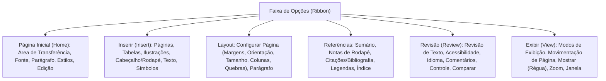
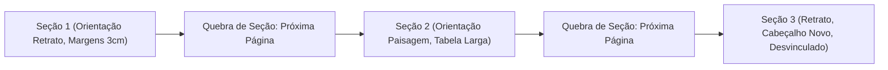
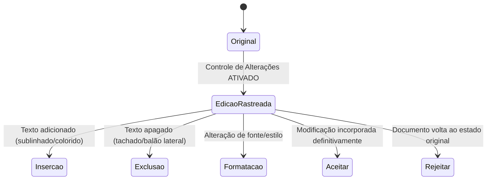

# Word 365: estrutura, edição, formatação, seções e controle de alterações

**Concurso Câmara dos Deputados 2026, cargo 1, Divulgação Institucional, Cebraspe. Unidade CAM-TI-002 conforme arquitetura e inventário editorial.**

## Núcleo do conceito: por que dominar a estrutura interna do Word 365?

Na redação institucional de atos legislativos, relatórios técnicos, pareceres de comissões e comunicados oficiais, o processador de textos corporativo (Microsoft Word no ecossistema Microsoft 365) é o instrumento central de trabalho. O Cebraspe aborda o Word sob a ótica de sua **arquitetura de objetos**, **hierarquia de formatação** e **mecanismos de colaboração documental**.

A banca explora com rigor os limites entre **formatação de fonte (caractere)**, **formatação de parágrafo** e **configuração de seção/página**, bem como o funcionamento do **Controle de Alterações (*Track Changes*)**, estilos automáticos, navegação hierárquica e regras de quebra de página versus quebra de seção.

---

## 1. Faixa de Opções (*Ribbon*), estrutura e guias principais

A interface moderna do Word organiza ferramentas em **Guias** (*Tabs*), divididas em **Grupos**:

### Principais pegadinhas de localização do Cebraspe:
- **Quebras de Página e Quebras de Seção**: Estão na guia **Layout** (grupo *Configurar Página*). A quebra de página simples também pode ser inserida na guia **Inserir** (`Ctrl + Enter`), mas as quebras de seção estão concentradas em **Layout**;
- **Controle de Alterações e Comparação de Documentos**: Localizam-se exclusivamente na guia **Revisão**;
- **Sumário Automático e Notas de Rodapé**: Localizam-se na guia **Referências** (não em *Inserir*);
- **Pincel de Formatação (*Format Painter*)**: Localiza-se na guia **Página Inicial** (grupo *Área de Transferência*).

---

## 2. A hierarquia de formatação: Caractere, Parágrafo e Seção

Compreender o escopo de cada nível de formatação resolve dezenas de questões da banca:

| Nível de Formatação | O que afeta | Exemplos de propriedades | Onde se aplica |
| :--- | :--- | :--- | :--- |
| **Fonte / Caractere** | Glifos e caracteres individuais selecionados | Família da fonte, tamanho, negrito, itálico, sublinhado, cor, sobrescrito ($X^2$), subscrito ($H_2O$) | Apenas ao texto selecionado (ou a partir do ponto de inserção) |
| **Parágrafo** | O bloco de texto delimitado por uma marca de parágrafo ($\P$) | Alinhamento (esquerda, centralizado, direita, justificado), recuos (primeira linha, deslocado), espaçamento entre linhas (1,5; duplo) e espaçamento antes/depois | Aplica-se ao parágrafo inteiro onde o cursor está posicionado, **mesmo sem selecionar todo o texto** |
| **Seção / Página** | Unidades estruturais independentes do documento | Margens, orientação (retrato/paisagem), tamanho do papel, número de colunas, cabeçalhos e rodapés | Aplica-se a todo o documento ou à **seção corrente** |

---

## 3. O papel crítico das Seções: quebras e cabeçalhos independentes

### 3.1 Quebra de Página simples (`Ctrl + Enter`) versus Quebra de Seção
- **Quebra de Página**: Apenas empurra o cursor e o conteúdo seguinte para o início da próxima página física, **mantendo todas as configurações da mesma seção** (mesmas margens, mesma orientação, mesmos cabeçalhos);
- **Quebra de Seção**: Cria uma partição lógica autônoma dentro do documento.

### 3.2 Tipos de Quebra de Seção:
1. **Próxima Página (*Next Page*)**: Inicia a nova seção no topo da página seguinte (essencial para alternar uma página específica de *Retrato* para *Paisagem*);
2. **Contínua (*Continuous*)**: Inicia a nova seção na **mesma página** (usada tipicamente para criar um trecho em **duas colunas** no meio de um texto em coluna única);
3. **Página Par (*Even Page*) / Página Ímpar (*Odd Page*)**: Força a nova seção a começar na próxima página com numeração par ou ímpar (padrão editorial de abertura de capítulos de livros).

### 3.3 Cabeçalhos e Rodapés: o botão "Vincular ao Anterior" (*Link to Previous*)
Por padrão, ao criar uma nova seção, os cabeçalhos e rodapés vêm configurados como **"Vincular ao Anterior"**. Isso significa que qualquer texto digitado no cabeçalho da Seção 2 se repetirá na Seção 1.
Para que a Seção 2 tenha numeração de página diferente ou cabeçalho exclusivo (ex.: iniciar numeração apenas na introdução e omitir na capa e no sumário), é **estritamente obrigatório desmarcar a opção "Vincular ao Anterior"** no cabeçalho da Seção 2.

---

## 4. Estilos (*Styles*) e Sumário Automático

O uso de **Estilos** (`Título 1`, `Título 2`, `Normal`) não é mero recurso estético:
1. **Hierarquia Estrutural**: Define o nível de tópicos do documento (*Heading levels*);
2. **Painel de Navegação (`Ctrl + F`)**: Permite reorganizar capítulos inteiros arrastando os títulos pelo painel lateral;
3. **Geração de Sumário Automático**: O Word varre o documento buscando os parágrafos marcados com os estilos de título e gera o sumário com pontilhado e número de página atualizado com um clique.

---

## 5. Colaboração: Controle de Alterações (*Track Changes*) e Comentários

O recurso de **Controle de Alterações** (guia *Revisão*) monitora todas as modificações feitas no arquivo por qualquer usuário:

### Modos de visualização de marcações:
1. **Marcação Simples (*Simple Markup*)**: Exibe o documento com as alterações aplicadas e uma barra vertical vermelha na margem indicando onde houve modificação;
2. **Todas as Marcações (*All Markup*)**: Exibe todas as inserções (com sublinhado e cores por autor) e exclusões (tachadas ou em balões na margem);
3. **Nenhuma Marcação (*No Markup*)**: Oculta os comentários e traços de edição, mostrando como o documento ficaria se todas as alterações fossem aceitas (mas sem aceitá-las de fato!);
4. **Original**: Exibe o texto exatamente como era antes do início do rastreamento.

> **Pegadinha Suprema do Cebraspe:**
> Selecionar a exibição *"Nenhuma Marcação"* ou ocultar as alterações na tela **NÃO elimina as alterações nem aceita as sugestões**. Se o arquivo for salvo e enviado a um terceiro, ele poderá abrir o painel de revisão e ver todo o histórico de comentários e trechos apagados. A única forma de eliminar definitivamente o rastreamento é clicar em **Aceitar Todas as Alterações** ou **Rejeitar Todas as Alterações**.

---

## 6. Casos progressivos de aplicação

### Caso 1: Formatação de parágrafo sem seleção integral
Um redator posiciona o cursor no meio de um parágrafo de três linhas, sem selecionar nenhuma palavra, e clica no botão **Centralizar** (`Ctrl + E`).
*Análise:* O parágrafo inteiro é centralizado. Alinhamento é propriedade de **parágrafo**, não de caractere. O Word aplica a formatação de parágrafo à totalidade do bloco delimitado pela marca $\P$ em que o cursor reside.

### Caso 2: Tabela larga no meio de relatório retrato
Um analista está elaborando um relatório em páginas no formato Retrato (vertical). Na página 15, necessita inserir uma tabela com 12 colunas que só cabe no formato Paisagem (horizontal), e a partir da página 16 o relatório deve voltar ao formato Retrato.
*Análise:* O analista deve:
1. Ao final da página 14, inserir uma **Quebra de Seção (Próxima Página)**;
2. Na página 15 (agora Seção 2), alterar a orientação para **Paisagem**;
3. Ao final da página 15, inserir outra **Quebra de Seção (Próxima Página)**;
4. Na página 16 (Seção 3), retornar a orientação para **Retrato**.
Se o analista tivesse usado apenas a quebra de página simples (`Ctrl + Enter`), ao mudar a orientação para Paisagem, o documento inteiro seria alterado.

### Caso 3: Início de numeração na página 5
Um documento corporativo possui capa, folha de rosto, sumário e introdução. A numeração de páginas deve começar a aparecer visualmente apenas na página 5 (Introdução), marcando o número "5".
*Análise:* O usuário deve inserir uma Quebra de Seção entre a página 4 e a página 5. No cabeçalho/rodapé da Seção 2 (pág. 5), deve desativar a opção **"Vincular ao Anterior"**. Em seguida, insere a numeração de páginas, garantindo que a Seção 1 permaneça sem numeração.

### Caso 4: Envio acidental de histórico confidencial
Um assessor redigiu uma nota oficial com o Controle de Alterações ativo. Antes de enviar o arquivo `.docx` à imprensa, ele selecionou o modo *"Nenhuma Marcação"* na guia Revisão, salvou e anexou o arquivo.
*Análise:* Falha grave de segurança. O destinatário, ao abrir o documento no Word, pode simplesmente alterar o modo de exibição para *"Todas as Marcações"* ou abrir o Painel de Revisão e visualizar todos os termos que foram excluídos ou sugeridos internamente pela equipe. O correto seria acionar **Revisão > Aceitar > Aceitar Todas as Alterações e Parar o Controle**.

---

## 7. Questões inéditas comentadas (Padrão Cebraspe — C/E)

### Item 1
> No Microsoft Word 365, para aplicar alinhamento justificado a um parágrafo que contenha dez linhas de texto, é indispensável selecionar previamente todas as palavras do referido parágrafo.

*( ) Certo*
*( ) Errado*

**Gabarito: Errado.**
**Comentário:** O alinhamento é uma formatação de parágrafo. Basta que o ponto de inserção (cursor) esteja posicionado em qualquer parte do parágrafo para que a ação de justificar (`Ctrl + J`) seja aplicada a todo o parágrafo delimitado pela marca $\P$.

---

### Item 2
> Para intercalar páginas com orientação paisagem e retrato em um mesmo documento do Word 365, é necessário dividir o documento em seções por meio da inserção de quebras de seção, visto que a orientação da página é uma propriedade de seção, e não de parágrafo.

*( ) Certo*
*( ) Errado*

**Gabarito: Certo.**
**Comentário:** Configurações de página (orientação, margens, tamanho do papel e colunas) são atributos de seção. Sem a quebra de seção (como a quebra de seção de *Próxima Página*), a alteração da orientação afetará todas as páginas do documento.

---

### Item 3
> Para inserir um trecho de texto disposto em três colunas no meio de uma página formatada originariamente em coluna única, mantendo o início e o fim da página com coluna única, o Word insere automaticamente quebras de seção contínuas antes e depois do trecho selecionado.

*( ) Certo*
*( ) Errado*

**Gabarito: Certo.**
**Comentário:** A quebra de seção contínua (*Continuous Section Break*) permite que diferentes configurações de seção (como número de colunas) coexistam na mesma página física. Ao selecionar um texto e aplicar colunas, o Word cria as quebras contínuas delimitadoras automaticamente.

---

### Item 4
> No Word 365, a opção de visualização "Nenhuma Marcação" no grupo Controle da guia Revisão aceita automaticamente todas as inserções e exclusões realizadas no documento, expurgando de modo definitivo o histórico de revisões anteriores.

*( ) Crado*
*( ) Errado*

**Gabarito: Errado.**
**Comentário:** Pegadinha clássica da banca. "Nenhuma Marcação" apenas altera a forma de visualização em tela, ocultando as marcas para leitura limpa. As alterações continuam armazenadas no arquivo e podem ser reexibidas a qualquer tempo, a menos que o usuário clique formalmente em "Aceitar Todas as Alterações".

---

### Item 5
> No Word 365, o atalho de teclado `Ctrl + Enter` insere uma quebra de seção do tipo próxima página, permitindo a criação imediata de um cabeçalho desvinculado da página anterior.

*( ) Certo*
*( ) Errado*

**Gabarito: Errado.**
**Comentário:** O atalho `Ctrl + Enter` insere uma **quebra de página simples**, não uma quebra de seção. As quebras de seção exigem navegação pela guia *Layout > Quebras*.

---

### Item 6
> O recurso Pincel de Formatação do Word 365, quando acionado com um único clique do mouse, permite copiar e aplicar a formatação do texto selecionado em múltiplos trechos de forma contínua até que a tecla Esc seja pressionada.

*( ) Certo*
*( ) Errado*

**Gabarito: Errado.**
**Comentário:** Com um **único clique**, o Pincel de Formatação aplica a formatação em apenas um trecho de destino e desativa-se em seguida. Para aplicar a múltiplos trechos contínuos, é necessário dar um **duplo clique** no ícone do Pincel de Formatação.

---

## 8. Tabela de atalhos e operações essenciais do Word 365

| Operação | Atalho / Caminho | Efeito e Observação |
| :--- | :--- | :--- |
| **Quebra de Página Simples** | `Ctrl + Enter` (ou *Inserir > Quebra de Página*) | Empurra texto para a próxima página na mesma seção |
| **Quebra de Seção** | *Layout > Quebras > Quebras de Seção* | Permite orientações e cabeçalhos distintos |
| **Salvar / Salvar Como** | `Ctrl + B` (pt-BR) / `F12` | Grava alterações no disco ou na nuvem |
| **Localizar / Substituir** | `Ctrl + L` (Localizar) / `Ctrl + U` (Substituir) | Abre o painel de navegação ou caixa de diálogo |
| **Pincel de Formatação** | `Ctrl + Shift + C` (copiar formato) / `Ctrl + Shift + V` (colar formato) | Duplo clique no botão permite múltiplas colagens |
| **Alinhamento de Parágrafo** | `Ctrl + Q` (Esq), `Ctrl + E` (Centro), `Ctrl + G` (Dir), `Ctrl + J` (Just) | Aplica ao parágrafo inteiro do cursor |
| **Controle de Alterações** | `Ctrl + Shift + E` (ou *Revisão > Controlar Alterações*) | Liga/desliga o rastreamento colaborativo de edições |
