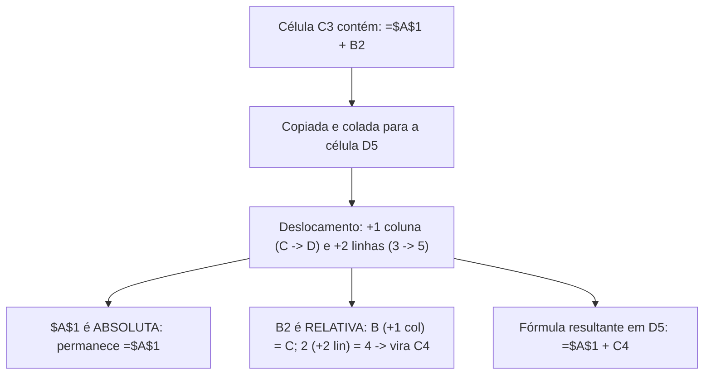

# Excel 365: células, referências relativas e absolutas, funções e tabelas dinâmicas

**Concurso Câmara dos Deputados 2026, cargo 1, Divulgação Institucional, Cebraspe. Unidade CAM-TI-003 conforme arquitetura e inventário editorial.**

## Núcleo do conceito: a lógica computacional das planilhas eletrônicas

No tratamento de dados institucionais, orçamentos, monitoramento de metas e pesquisas de opinião pública, o Microsoft Excel 365 é a ferramenta analítica elementar. O Cebraspe aborda o Excel com foco na **lógica de avaliação de fórmulas**, na **aritmética de referências de células ao copiar/colar ou arrastar**, no comportamento das **funções lógicas, estatísticas e de busca**, e nas regras de funcionamento das **Tabelas Dinâmicas (*Pivot Tables*)**.

Para acertar itens da banca, o candidato precisa dominar o efeito exato do caractere cifrão (`$`), a ordem de precedência dos operadores matemáticos e lógicos, o tratamento de células vazias e a sintaxe de funções aninhadas.

---

## 1. Estrutura de dados: pasta de trabalho, planilhas e endereçamento

- **Pasta de Trabalho (*Workbook*)**: O arquivo do Excel (extensões padrão `.xlsx`, `.xlsm` com macros, `.xlsb` binário);
- **Planilha (*Worksheet*)**: Cada aba de grade bidimensional composta por **1.048.576 linhas** (numeradas de 1 a 1.048.576) e **16.384 colunas** (rotuladas de `A` até `XFD`);
- **Célula**: Interseção de uma coluna e uma linha (ex.: `B4`). É a unidade elementar de armazenamento que pode conter texto, números, datas, valores booleanos (`VERDADEIRO`/`FALSO`) ou fórmulas;
- **Intervalo de Células**: Bloco retangular contíguo delimitado pelo operador dois-pontos (`:`, significando "até", ex.: `A1:C10`) ou lista de argumentos separados por ponto e vírgula (`;`, significando "e", ex.: `A1; C10`).

---

## 2. Aritmética de referências: Relativa, Absoluta e Mista

O mecanismo mais explorado pelo Cebraspe é o deslocamento de fórmulas ao usar a **Alça de Preenchimento** ou os comandos Copiar (`Ctrl + C`) e Colar (`Ctrl + V`).

O caractere cifrão (`$`) atua como um **congelador / fixador** da coordenada que o sucede imediatamente:

| Tipo de Referência | Exemplo | Ao copiar para a direita (colunas) | Ao copiar para baixo (linhas) |
| :--- | :--- | :--- | :--- |
| **Relativa** | `A1` | Muda a coluna (`B1`, `C1`...) | Muda a linha (`A2`, `A3`...) |
| **Absoluta** | `$A$1` | **Não muda nada** (`$A$1`) | **Não muda nada** (`$A$1`) |
| **Mista (coluna fixa)** | `$A1` | Mantém coluna `$A` fixa | Muda a linha (`$A2`, `$A3`...) |
| **Mista (linha fixa)** | `A$1` | Muda a coluna (`B$1`, `C$1`...) | Mantém linha `$1` fixa |

---

## 3. Ordem de precedência dos operadores

No Excel, qualquer fórmula inicia-se obrigatoriamente pelo sinal de igual (`=`) ou, alternativamente, pelos sinais de adição (`+`) ou subtração (`-`), que o Excel converte automaticamente para `=+` ou `=-`.

A avaliação matemática segue a precedência estrita:
1. **Parênteses** `( )`: Forçam a prioridade interna;
2. **Dois-pontos (`:`) e ponto e vírgula (`;`)**: Operadores de intervalo de referência;
3. **Exponenciação** `^`: Ex.: `=2^3` (resultado: 8);
4. **Multiplicação (`*`) e Divisão (`/`)**: Da esquerda para a direita;
5. **Adição (`+`) e Subtração (`-`)**: Da esquerda para a direita;
6. **Concatenação de textos (`&`)**: Ex.: `="Câmara" & " " & "2026"` resulta em `Câmara 2026`;
7. **Operadores de comparação** (`=`, `<`, `>`, `<=`, `>=`, `<>`): Retornam `VERDADEIRO` ou `FALSO`.

> **Pegadinha do Cebraspe:**
> Na fórmula `=10 + 20 * 2`, o resultado é **50**, e não 60, pois a multiplicação tem precedência sobre a adição.
> Se a intenção fosse somar primeiro, seriam obrigatórios os parênteses: `=(10 + 20) * 2` (resultado: 60).

---

## 4. Catálogo de funções de alta incidência Cebraspe

### 4.1 Funções Matemáticas e Estatísticas
- **`SOMA(núm1; [núm2]; ...)`**: Soma todos os números do intervalo. Textos e células vazias dentro do intervalo referenciado são ignorados;
- **`MÉDIA(núm1; [núm2]; ...)`**: Calcula a média aritmética dos valores numéricos. **Atenção:** Células vazias não entram no denominador, mas células com o número `0` (zero) entram e diminuem a média!
- **`CONT.NUM(intervalo)`**: Conta quantas células contêm **apenas números** (ignora textos e erros);
- **`CONT.VALORES(intervalo)`**: Conta todas as células que **não estão vazias** (números, textos, erros, espaços);
- **`CONT.VAZIO(intervalo)`**: Conta as células em branco;
- **`MÁXIMO(intervalo)`** e **`MÍNIMO(intervalo)`**: Retornam o maior e o menor valor do intervalo;
- **`MAIOR(intervalo; k)`** e **`MENOR(intervalo; k)`**: Retornam o k-ésimo maior ou menor valor (ex.: `=MAIOR(A1:A10; 2)` retorna o 2º maior valor do conjunto).

### 4.2 Funções Lógicas e Condicionais
- **`SE(teste_lógico; valor_se_verdadeiro; valor_se_falso)`**:
  - Ex.: `=SE(A1>=7; "Aprovado"; "Reprovado")`;
- **`E(lógico1; lógico2; ...)`**: Retorna `VERDADEIRO` apenas se **todos** os testes forem verdadeiros;
- **`OU(lógico1; lógico2; ...)`**: Retorna `VERDADEIRO` se **pelo menos um** teste for verdadeiro;
- **`SOMASE(intervalo; critérios; [intervalo_soma])`**: Soma apenas os valores que atendem a um critério;
- **`CONT.SE(intervalo; critérios)`**: Conta quantas células satisfazem determinado critério (ex.: `=CONT.SE(A1:A10; ">50")`).

### 4.3 Funções de Busca e Referência
- **`PROCV(valor_procurado; matriz_tabela; núm_índice_coluna; [procurar_intervalo])`**:
  - Busca o `valor_procurado` obrigatoriamente na **primeira coluna** da matriz e retorna o valor da coluna indicada por `núm_índice_coluna`;
  - Se `procurar_intervalo` for `FALSO` (ou `0`), realiza **busca exata**; se for `VERDADEIRO` (ou `1`), busca aproximação e exige tabela ordenada;
  - **Limitação clássica:** O `PROCV` só busca da esquerda para a direita (não retorna valores situados em colunas à esquerda da coluna de pesquisa).
- **`PROCX(pesquisa_valor; matriz_pesquisa; matriz_retorno; ...)`** (Nativo do Excel 365):
  - Supera as limitações do `PROCV`: busca em qualquer direção (esquerda, direita, vertical, horizontal), com correspondência exata por padrão e sem exigir matriz contígua única.

---

## 5. Tabelas e Tabelas Dinâmicas (*Pivot Tables*)

### 5.1 O recurso "Formatar como Tabela" (`Ctrl + Alt + T` ou `Ctrl + L`)
Não é mera pintura de células:
- Converte a grade em um objeto estruturado de banco de dados;
- Cria automaticamente filtros nas colunas;
- Estende fórmulas e formatos para novas linhas adicionadas;
- Permite referências estruturadas legíveis (ex.: `=SOMA(Tabela1[Salário])`).

### 5.2 Tabelas Dinâmicas (*Pivot Tables*)
Ferramenta interativa para **resumir, analisar, explorar e consolidar grandes volumes de dados**:
1. **Campos da Tabela Dinâmica**:
   - **Filtros**: Permitem segmentar o relatório global por variáveis específicas;
   - **Colunas**: Dispersam os valores horizontalmente;
   - **Linhas**: Agrupam os registros em categorias verticais;
   - **Valores**: Onde ocorrem os cálculos agregados (por padrão, **Soma** para campos numéricos e **Contagem** para campos de texto).
2. **Atualização de Dados (*Refresh*)**:
   - A atualização da Tabela Dinâmica **depende da versão do Excel, tipo de origem e configuração de atualização automática**. Em versões atuais, Tabelas Dinâmicas com dados locais podem usar *Auto Refresh* (inclusive habilitado por padrão em novos casos elegíveis). Em outros cenários, é necessário usar **Atualizar** (*Refresh*), por exemplo `Alt + F5` no Excel para Windows.

---

## 6. Casos progressivos de aplicação

### Caso 1: Deslocamento com referências mistas
A célula `B2` contém a fórmula `=$A1 + B$1`. O usuário copia a célula `B2` e a cola na célula `C3`.
*Análise:*
- Deslocamento: de `B` para `C` (+1 coluna); de `2` para `3` (+1 linha).
- O termo `$A1` tem coluna fixa e linha livre: a coluna continua `$A`, a linha anda de 1 para 2 $\rightarrow$ resulta em `$A2`.
- O termo `B$1` tem coluna livre e linha fixa: a coluna anda de `B` para `C`, a linha continua `$1` $\rightarrow$ resulta em `C$1`.
- A fórmula final em `C3` será: `=$A2 + C$1`.

### Caso 2: Diferença crítica de zeros e células vazias na MÉDIA
Dadas as células: `A1 = 10`, `A2 = 20`, `A3 = em branco` e `A4 = 0`.
O usuário aplica a fórmula `=MÉDIA(A1:A3)` e, em outra célula, `=MÉDIA(A1:A4)`.
*Análise:*
- Em `=MÉDIA(A1:A3)`, a célula vazia `A3` é completamente ignorada pelo cálculo. A soma é $10 + 20 = 30$, e o divisor é $2$. Resultado: **15**.
- Em `=MÉDIA(A1:A4)`, o zero de `A4` é um valor numérico válido e conta como elemento. A soma é $10 + 20 + 0 = 30$, e o divisor passa a ser $3$ (células A1, A2 e A4). Resultado: **10**.

### Caso 3: Busca reversa com PROCV
Um servidor possui uma tabela onde os nomes dos funcionários estão na coluna `A` e as matrículas funcionais estão na coluna `B`. Ele tenta usar a função `=PROCV("12345"; A1:B100; 1; FALSO)` buscando a matrícula digitada na coluna B para retornar o nome da coluna A.
*Análise:* A fórmula resultará em erro `#N/D` (*Não Disponível*). O `PROCV` pesquisa o valor exclusivamente na primeira coluna do intervalo fornecido (`A`). Como a matrícula procurada está na coluna `B`, o `PROCV` não consegue buscar "para trás" (à esquerda). Para resolver, o analista deve reordenar as colunas, usar a combinação `=ÍNDICE(A1:A100; CORRESP(...))` ou a função moderna `=PROCX(...)`.

### Caso 4: Tabela Dinâmica desatualizada
Após redigir um relatório de despesas com Tabela Dinâmica, um analista corrige os lançamentos na planilha base, alterando o valor de uma nota fiscal de R$ 1.000 para R$ 10.000. Ele gera o PDF imediatamente e envia à chefia, mas a Tabela Dinâmica continua exibindo o total anterior.
*Análise:* O caso é possível quando a atualização automática está desabilitada, não disponível para a origem ou ainda não ocorreu. Em versões atuais, algumas Tabelas Dinâmicas com origem local podem usar **Auto Refresh**, de modo que não se deve afirmar que todas exigem atualização manual.

---

## 7. Questões inéditas comentadas (Padrão Cebraspe — C/E)

### Item 1
> Se na célula `D4` de uma planilha do Excel 365 constar a fórmula `=SOMA($B$2:B3)` e essa célula for copiada e colada na célula `E5`, a fórmula resultante na célula `E5` será `=SOMA($B$2:C4)`.

*( ) Certo*
*( ) Errado*

**Gabarito: Certo.**
**Comentário:** Vamos calcular o deslocamento: de `D4` para `E5`, houve avanço de 1 coluna (`D` $\rightarrow$ `E`) e de 1 linha (`4` $\rightarrow$ `5`).
Na fórmula `=SOMA($B$2:B3)`:
- `$B$2` é referência absoluta: permanece rigorosamente `$B$2`;
- `B3` é referência relativa: sofre o deslocamento (+1 coluna e +1 linha), transformando-se em `C4`.
Portanto, a fórmula em `E5` será perfeitamente `=SOMA($B$2:C4)`.

---

### Item 2
> A função `=MÉDIA(A1:A5)` ignora em seu cômputo as células do intervalo que contenham o valor numérico zero, considerando apenas as células que contenham números positivos ou negativos.

*( ) Certo*
*( ) Errado*

**Gabarito: Errado.**
**Comentário:** O valor numérico `0` participa da média e do denominador. Na referência de **intervalo** usada no item, `MÉDIA` ignora células vazias e valores de texto/lógicos não numéricos, conforme as regras da função. Isso não significa que todos os tipos de argumentos e fórmulas que parecem vazios sejam tratados identicamente.

---

### Item 3
> No Excel 365, a função `PROCV` localiza determinado valor na última coluna de uma matriz-tabela e retorna o valor correspondente situado na primeira coluna da mesma linha.

*( ) Certo*
*( ) Errado*

**Gabarito: Errado.**
**Comentário:** A regra do `PROCV` é exatamente o inverso: ela procura o valor obrigatoriamente na **primeira coluna** (coluna mais à esquerda) da tabela e retorna o valor de uma coluna especificada à direita.

---

### Item 4
> A função `=CONT.VALORES(A1:A10)` conta a quantidade de células preenchidas no intervalo especificado, incluindo células que contenham textos, números, valores lógicos e fórmulas que retornem sequências de caracteres vazias.

*( ) Certo*
*( ) Errado*

**Gabarito: Certo.**
**Comentário:** A função `CONT.VALORES` contabiliza todas as células não vazias. Apenas as células verdadeiramente em branco são ignoradas por ela.

---

### Item 5
> No Excel 365, a função `MAIOR(A1:A10; 1)` produz exatamente o mesmo resultado numérico que a função `MÁXIMO(A1:A10)`.

*( ) Certo*
*( ) Errado*

**Gabarito: NÃO HOMOLOGADO (domínio dos dados omitido).**
**Comentário:** Quando o intervalo contém pelo menos um número válido, `MAIOR(A1:A10;1)` e `MÁXIMO(A1:A10)` retornam o mesmo valor. **Sem números**, `MAIOR` produz erro `#NÚM!`, enquanto `MÁXIMO` devolve `0`, contrariando a equivalência universal do enunciado. **Redação de treino:** “Se A1:A10 contém ao menos um número, `MAIOR(A1:A10;1)` e `MÁXIMO(A1:A10)` retornam o mesmo resultado numérico.” **Gabarito reformulado: CERTO.**

---

### Item 6
> Uma Tabela Dinâmica do Excel 365 recalcula e atualiza seus totais consolidados de forma instantânea e automática assim que qualquer dado numérico da planilha original de origem é alterado pelo usuário.

*( ) Certo*
*( ) Errado*

**Gabarito: Errado.**
**Comentário:** A expressão **“instantânea ... assim que qualquer dado ... é alterado”** universaliza um comportamento que depende de versão, tipo de fonte e opção de atualização. A Microsoft documenta **Auto Refresh** para Tabelas Dinâmicas com origem local, com disponibilidade dependente da versão/canal de atualização (a documentação também menciona distribuição pelo Microsoft 365 Insider). Em outras configurações, é preciso atualizar manualmente. O gabarito **ERRADO** é mantido pela afirmação incondicional de atualização **instantânea de qualquer dado**, não por inexistência da função. Fonte: [Microsoft Support, atualizar dados da Tabela Dinâmica](https://support.microsoft.com/pt-br/excel/refresh-pivottable-data).

---

## 8. Tabela de síntese de erros comuns do Excel

| Código de Erro | Causa Principal | Como Corrigir |
| :--- | :--- | :--- |
| `#####` | Coluna estreita demais para exibir o número ou data negativa | Alargar a coluna dando duplo clique na divisória |
| `#DIV/0!` | Divisão por zero ou por célula vazia | Verificar o denominador ou usar `=SEERRO(A1/B1; 0)` |
| `#N/D` (*#N/A*) | Valor procurado não encontrado (típico em `PROCV`) | Checar se o código procurado realmente existe na 1ª coluna |
| `#NOME?` | Nome da função digitado incorretamente ou texto sem aspas | Corrigir a grafia (ex.: digitou `SOMMA` em vez de `SOMA`) |
| `#VALOR!` | Tipo de dado incompatível na operação matemática (ex.: somar texto) | Garantir que as células operadas contenham números |
| `#REF!` | Célula referenciada na fórmula foi excluída (*Deleted*) | Reconstruir a referência à célula |

> **Nota de revisão (11/11/2026):** corrigido o caráter universal da atualização manual de Tabelas Dinâmicas, preservado o enunciado do item 6 e explicitada a reserva de versão/configuração conforme TI-034.

> **Validação de questão, segunda passagem (11/11/2026):** Item 6 conferido contra a [documentação atual de atualização de Tabelas Dinâmicas da Microsoft](https://support.microsoft.com/pt-br/excel/refresh-pivottable-data). **Gabarito mantido: ERRADO**, por universalizar o comportamento. Status: **validado com ressalva de versão/canal e redação**; não usar a antiga regra “sempre exige atualização manual”.

> **Auditoria de questões, segunda passagem (11/11/2026):** seis itens examinados; Q1–Q4 e Q6 mantêm **C, E, E, C, E**, com a ressalva de versão já registrada na Q6. **Q5 não homologada**, pois a igualdade entre MAIOR e MÁXIMO pressupõe dados numéricos. A revisão protege contra memorização de igualdade incondicional.
