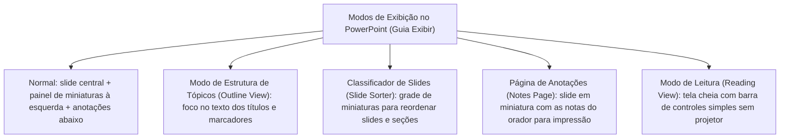
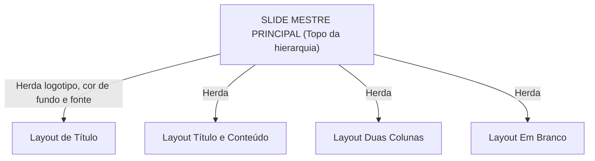

# PowerPoint 365: organização de slides, slide mestre, transições, animações e apresentação

**Concurso Câmara dos Deputados 2026, cargo 1, Divulgação Institucional, Cebraspe. Unidade CAM-TI-004 conforme arquitetura e inventário editorial.**

## Núcleo do conceito: por que estudar o PowerPoint 365 para Divulgação Institucional?

Na comunicação institucional da Câmara dos Deputados, a transmissão visual de relatórios de atividades legislativas, balanços de comissões, audiências públicas e campanhas de comunicação apoia-se fortemente em apresentações digitais estruturadas. O Cebraspe avalia o Microsoft PowerPoint 365 sob a ótica da **arquitetura de apresentação**, **padronização visual corporativa via Slide Mestre**, diferenciação precisa entre **transições de slides e animações de objetos**, e os recursos de execução como o **Modo Apresentador (*Presenter View*)**.

Dominar as regras do PowerPoint impede a perda de pontos preciosos em itens sobre atalhos de projeção, formatos de exportação executável (`.ppsx`) e controle centralizado de layout.

---

## 1. Modos de exibição e organização da apresentação

O PowerPoint organiza a exibição da apresentação em diferentes modos na guia **Exibir** (*View*), cada qual desenhado para uma etapa específica do fluxo de trabalho:



### Seções de Slides (*Slide Sections*)
No painel de miniaturas ou no *Classificador de Slides*, o usuário pode organizar apresentações extensas em **Seções** (ex.: "Abertura", "Dados Orçamentários", "Encerramento"). Isso permite:
- Recolher e expandir blocos inteiros de slides;
- Mover dezenas de slides em bloco;
- Aplicar formatação, transição ou imprimir apenas uma seção específica.

---

## 2. A ferramenta de governança visual: o Slide Mestre (*Slide Master*)

O **Slide Mestre** é a espinha dorsal de qualquer apresentação profissional. Ele define elementos visuais e layouts dos slides vinculados àquele mestre; uma mesma apresentação pode utilizar mais de um mestre, e modificações locais ou escolhas de layout podem interferir na herança.



### Regras fundamentais cobradas em prova:
1. **Herança em cascata**: Ao inserir um logotipo ou alterar a cor de fundo no **Slide Mestre superior** (o slide de nível 1 na árvore), **os layouts subordinados e os slides vinculados àquele mestre podem herdar a alteração**, respeitadas as configurações e exceções locais;
2. **Personalização pontual de layout**: Se a alteração for feita apenas no *Layout de Título* (nível 2), ela afetará somente os slides criados com aquele layout específico;
3. **Imutabilidade no modo Normal**: Elementos inseridos no Slide Mestre (como uma marca d'água ou número de página fixo) **não podem ser selecionados, movidos ou apagados diretamente no modo Normal** de edição de slides. Para alterá-los, é obrigatório retornar a **Exibir > Slide Mestre**.

---

## 3. Transição de Slides versus Animação de Objetos

Uma das distinções conceituais mais cobradas pela banca reside na fronteira entre **Transições** e **Animações**:

| Característica | Transição de Slides (*Transitions*) | Animação de Objetos (*Animations*) |
| :--- | :--- | :--- |
| **O que afeta** | A **mudança de uma página/slide inteiro** para o próximo | **Elementos individuais internos** de um slide (texto, imagem, forma, gráfico) |
| **Guia no PowerPoint** | Guia **Transições** | Guia **Animações** |
| **Quando ocorre** | Na passagem/troca do slide atual para o slide seguinte | Durante a exibição do slide já projetado na tela |
| **Tipos principais** | Esmaecer, Empurrão, Esmaecer, Cortar, Transformar (*Morph*) | Entrada (*Green*), Ênfase (*Yellow*), Saída (*Red*), Caminhos de Animação |

```mermaid
flowchart LR
    S1["Slide 1"] -->|TRANSIÇÃO (Troca de slide)| SLIDE2["Slide 2 Projetado"]
    subgraph S2["Slide 2"]
        Obj1["Título: Animação de ENTRADA"]
        Obj2["Gráfico: Animação de ÊNFASE"]
        Obj3["Rodapé: Animação de SAÍDA"]
    end
```

### O recurso inovador Transformar (*Morph*):
Introduzido no Office 365, a transição **Transformar** identifica objetos com o mesmo nome em slides consecutivos e anima suavemente sua posição, tamanho e rotação de um slide para outro, sem necessidade de configurar caminhos de animação complexos.

---

## 4. Apresentação de slides e o Modo Apresentador (*Presenter View*)

### 4.1 Atalhos indispensáveis de projeção (`F5` versus `Shift + F5`)
- **`F5`**: Inicia a apresentação de slides **desde o primeiro slide**;
- **`Shift + F5`**: Inicia a apresentação de slides **a partir do slide atual** selecionado;
- **Tecla `Esc`**: Interrompe e finaliza a apresentação;
- **Tecla `B`** (ou ponto `.`): Escurece a tela (*Blackout*), deixando-a totalmente preta para focar a atenção do público no orador;
- **Tecla `W`** (ou vírgula `,`): Clareia a tela (*Whiteout*), deixando-a totalmente branca;
- **Número do slide + `Enter`**: Pula diretamente para o slide digitado (ex.: digitar `12` e pressionar `Enter`).

### 4.2 O Modo Apresentador (*Presenter View*)
Quando o computador está conectado a um segundo monitor ou projetor multimídia (modo Estender tela), o PowerPoint ativa o **Modo Apresentador**:
- **Na tela do público (Projetor)**: É exibido apenas o slide limpo em tela cheia;
- **Na tela do orador (Notebook do apresentador)**: São exibidos:
  1. O slide atual em exibição;
  2. A prévia do **próximo slide**;
  3. As **anotações do orador** (que o público não enxerga);
  4. O cronômetro de tempo decorrido e o relógio do sistema;
  5. Ferramentas de apontador laser, caneta de desenho e lupa de zoom.

---

## 5. Formatos de arquivo: `.pptx` versus `.ppsx`

O formato do arquivo determina como o arquivo se comporta ao receber um duplo clique no Explorador de Arquivos:

- **`.pptx` (Apresentação do PowerPoint)**: Abre o arquivo diretamente no **Modo de Edição (Normal)** do PowerPoint, permitindo alterar textos, cores e configurações;
- **`.ppsx` (Apresentação de Slides do PowerPoint / *PowerPoint Show*)**: Abre o arquivo diretamente no **Modo de Apresentação em Tela Cheia**. Quando a apresentação termina (ou o usuário aperta `Esc`), o PowerPoint se fecha automaticamente sem exibir a área de trabalho de edição.

> **Dica técnica de prova:**
> Um arquivo `.ppsx` **não é protegido contra edição**. Se o usuário abrir o PowerPoint primeiro e utilizar o menu *Arquivo > Abrir*, ele conseguirá editar o arquivo `.ppsx` normalmente. O sufixo `.ppsx` apenas comanda o sistema operacional a iniciar o modo de exibição automática no duplo clique.

---

## 6. Casos progressivos de aplicação

### Caso 1: Padronização de logotipo em 80 slides
Um assessor recebe uma apresentação institucional de 80 slides da Câmara dos Deputados e precisa inserir o brasão oficial no canto superior direito de todos os slides. Ele começa a copiar e colar o brasão manualmente em cada slide.
*Análise:* O procedimento do assessor é ineficiente e propenso a desalinhamentos. Uma solução eficiente consiste em **Exibir > Slide Mestre** e inserir o brasão no mestre adequado. O elemento se aplica aos layouts e slides vinculados a esse mestre; se houver mais de um mestre ou sobreposições locais, é preciso conferir o resultado nos 80 slides.

### Caso 2: Diferença entre Transição e Animação
Um apresentador afirma que configurou uma "transição" para fazer uma frase de efeito surgir letra por letra dentro de um slide.
*Análise:* O conceito está equivocado. Fazer palavras ou objetos surgirem ou se moverem dentro de um mesmo slide é uma **Animação** (especificamente uma animação de *Entrada*). Transição é o efeito que ocorre na **passagem de um slide inteiro para o slide seguinte**.

### Caso 3: Início de apresentação durante reunião técnica
Durante uma audiência de comissão, o analista está no slide 24 revisando um dado e a autoridade solicita: *"Projete esse slide na tela agora"*. O analista pressiona `F5` e a apresentação volta para a capa (slide 1), obrigando-o a avançar manualmente 24 slides na frente de todos.
*Análise:* O analista usou o atalho incorreto. A tecla `F5` sempre reinicia a apresentação a partir do slide 1. Para projetar exatamente a partir do slide ativo em que o cursor está posicionado, o atalho correto e padrão é **`Shift + F5`**.

### Caso 4: Anotações visíveis apenas para o palestrante
Um orador teme colocar dados estatísticos complexos no campo de Anotações do PowerPoint com receio de que a plateia leia suas colas no telão da plenária.
*Análise:* O receio é infundado se o sistema estiver configurado no modo de vídeo estendido. No **Modo Apresentador**, o projetor exibe unicamente a imagem do slide, enquanto as anotações do orador permanecem visíveis exclusivamente na tela do notebook do palestrante.

---

## 7. Questões inéditas comentadas (Padrão Cebraspe — C/E)

### Item 1
> No Microsoft PowerPoint 365, a inserção de uma imagem no slide mestre principal faz que essa imagem seja automaticamente reproduzida em todos os slides da apresentação que compartilham aquela estrutura de layout.

*( ) Certo*
*( ) Errado*

**Gabarito: Certo.**
**Comentário:** Essa é a função definidora do Slide Mestre: controlar e padronizar elementos visuais corporativos (logotipos, rodapés, planos de fundo e fontes) em cascata para todos os slides subordinados na apresentação.

---

### Item 2
> O atalho de teclado `F5` inicia a apresentação de slides a partir do slide atualmente selecionado, enquanto a combinação de teclas `Shift + F5` inicia a exibição desde o primeiro slide da apresentação.

*( ) Certo*
*( ) Errado*

**Gabarito: Errado.**
**Comentário:** Inversão clássica de atalhos da banca:
- `F5`: Inicia **do começo** (slide 1);
- `Shift + F5`: Inicia **do slide atual**.

---

### Item 3
> No PowerPoint 365, o efeito aplicado para controlar a forma como determinado slide é substituído pelo slide subsequente na tela durante a exibição é denominado animação.

*( ) Certo*
*( ) Errado*

**Gabarito: Errado.**
**Comentário:** A substituição/passagem de um slide inteiro pelo subsequente é chamada de **Transição de Slides** (guia *Transições*). A **Animação** (guia *Animações*) atua sobre os objetos individuais contidos dentro do slide.

---

### Item 4
> Durante uma apresentação de slides em tela cheia no PowerPoint, caso o apresentador pressione a tecla `B` no teclado, a tela de projeção ficará totalmente preta, recurso útil para pausar a exibição e redirecionar a atenção do público.

*( ) Certo*
*( ) Errado*

**Gabarito: Certo.**
**Comentário:** A tecla `B` (*Black*) escurece a tela instantaneamente (deixando-a preta). Da mesma forma, a tecla `W` (*White*) deixa a tela totalmente branca. Pressionar qualquer tecla numérica ou de navegação restaura a exibição do slide.

---

### Item 5
> Os arquivos salvos com a extensão `.ppsx` consistem em apresentações compiladas em modo somente leitura que não admitem qualquer tipo de alteração em seus textos ou layouts, mesmo se forem abertos diretamente por meio do menu Arquivo do PowerPoint.

*( ) Certo*
*( ) Errado*

**Gabarito: Errado.**
**Comentário:** A extensão `.ppsx` (*PowerPoint Show*) apenas determina que o arquivo seja executado diretamente em tela cheia ao receber duplo clique no Windows Explorer. Ela não aplica criptografia ou bloqueio de edição. Se o usuário abrir o PowerPoint e usar o comando *Arquivo > Abrir*, o arquivo `.ppsx` abrirá no modo de edição normal e poderá ser modificado.

---

### Item 6
> O Modo Apresentador do PowerPoint 365 possibilita que o apresentador visualize, na tela do seu computador pessoal, as anotações do orador e a miniatura do slide seguinte, enquanto a plateia visualiza apenas o slide corrente no projetor multimídia.

*( ) Certo*
*( ) Errado*

**Gabarito: Certo.**
**Comentário:** É a descrição exata do funcionamento do Modo Apresentador (*Presenter View*), viabilizado pelo uso de dois monitores com área de trabalho estendida.

---

## 8. Tabela de síntese dos atalhos de apresentação do PowerPoint 365

| Tecla / Atalho | Ação Executada | Observação de Prova |
| :--- | :--- | :--- |
| **`F5`** | Inicia a apresentação do início | Sempre a partir do slide 1 |
| **`Shift + F5`** | Inicia a apresentação do slide atual | Mantém o ponto de leitura do orador |
| **`Esc`** | Encerra a apresentação | Retorna ao modo de edição |
| **`B` ou `.`** | Tela preta (*Black*) | Oculta slide para fala do apresentador |
| **`W` ou `,`** | Tela branca (*White*) | Oculta slide com fundo branco |
| **`Ctrl + P`** | Ativa a Caneta de anotação | Permite rabiscar sobre o slide na projeção |
| **`Ctrl + A`** | Retorna a Seta do mouse | Desativa a caneta de desenho |
| **`Nº` + `Enter`** | Pula diretamente para o slide `Nº` | Permite saltos não lineares durante a fala |

> **Nota de revisão (11/11/2026):** herança do Slide Mestre qualificada para apresentações com múltiplos mestres; nó do diagrama renomeado para evitar colisão com o identificador de subgrafo `S2`. Revisão ligada a TI-038 e TI-039. Renderização do Mermaid no site ainda depende de teste de publicação.
