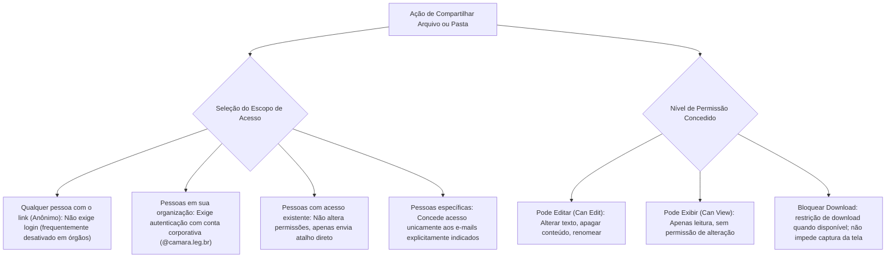
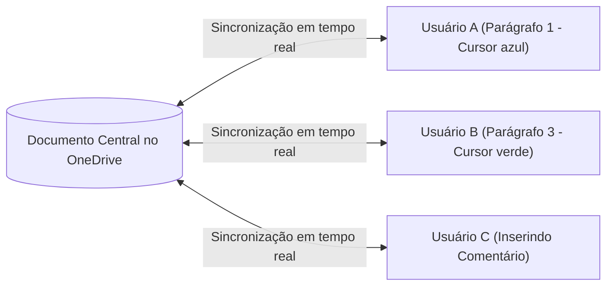
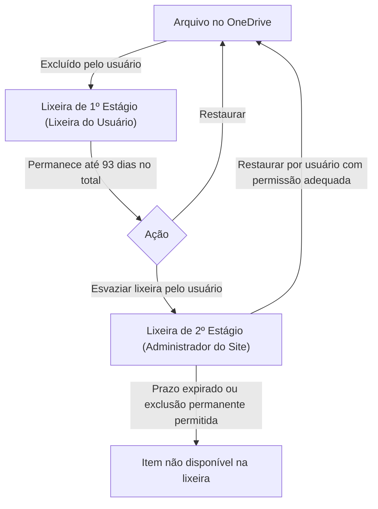

# OneDrive: sincronização corporativa, compartilhamento de links e permissões de acesso

**Concurso Câmara dos Deputados 2026, cargo 1, Divulgação Institucional, Cebraspe. Unidade CAM-TI-005 conforme arquitetura e inventário editorial.**

## Núcleo do conceito: armazenamento e colaboração em nuvem no setor público

No ecossistema corporativo da Câmara dos Deputados e de órgãos públicos federais, o Microsoft OneDrive for Business (integrado ao Microsoft 365 e ao SharePoint Online) atua como o repositório centralizado de arquivos individuais e de equipe. O Cebraspe examina o OneDrive não apenas como um disco virtual, mas sob a perspectiva da **segurança da informação corporativa**, da **gestão de permissões de acesso e links**, do **controle de versões (*Version History*)** e dos mecanismos de **coautoria simultânea (*Co-authoring*)**.

Compreender o alcance de cada modalidade de link de compartilhamento, a vigência de prazos de expiração, a proteção por senha e a política de lixeira corporativa em dois estágios é indispensável para gabaritar itens da banca.

---

## 1. OneDrive Pessoal versus OneDrive for Business (Corporativo)

Embora compartilhem o mesmo cliente de sincronização no Windows, as duas modalidades possuem arquiteturas e regras de conformidade distintas:

| Característica | OneDrive Pessoal | OneDrive for Business |
| :--- | :--- | :--- |
| **Conta de acesso** | Conta Microsoft pessoal (`@outlook.com`, `@hotmail.com`) | Conta corporativa/institucional gerida pelo órgão (`@camara.leg.br`) |
| **Infraestrutura subjacente** | Centros de dados de consumo Microsoft | Baseado no **SharePoint Online** e integrado ao Azure AD / Entra ID |
| **Controle de segurança** | Gerido pelo próprio usuário individual | Gerido pelo **Administrador de TI** do órgão (políticas DLP, retenção) |
| **Lixeira corporativa** | Lixeira única de 30 dias | **Lixeira em dois estágios** (Lixeira do Usuário + Lixeira da Coleção de Sites) |
| **Compartilhamento externo** | Aberto por padrão | Pode ser restrito, bloqueado ou auditado centralmente |

---

## 2. Tipos de links de compartilhamento e escopos de permissão

Ao compartilhar um arquivo ou pasta no OneDrive for Business, o usuário pode configurar o **escopo do público** e o **nível de permissão**:

### Configurações de segurança avançadas nos links (dependem da política, tipo de link, arquivo ou pasta e licença):
- **Data de expiração**: Quando disponível, define um prazo limite (ex.: 7 dias) para a validade do link;
- **Senha de proteção**: Quando disponível para o tipo de link e a política institucional, exige senha para liberar o acesso;
- **Bloqueio de download**: Quando a opção estiver disponível e habilitada para aquele arquivo, link e política, restringe o download por meio da interface. Não se deve presumir disponibilidade igual para arquivos e pastas nem proteção absoluta contra cópias da informação.

---

## 3. Coautoria (*Co-authoring*) e salvamento automático (*AutoSave*)

Quando um documento do Word, Excel ou PowerPoint está salvo no OneDrive (ou SharePoint) e compartilhado com permissão de edição, múltiplos usuários podem trabalhar nele **ao mesmo tempo**:

### Regras do Salvamento Automático (*AutoSave*):
- O botão de alternância **Salvamento Automático** só fica ativo se o documento estiver armazenado na nuvem (OneDrive ou SharePoint); em arquivos salvos no disco local (`C:`), ele fica desativado;
- O salvamento é contínuo e incremental;
- O recurso exibe a presença de outros editores em tempo real através de cursores coloridos com o nome do colega.

---

## 4. Histórico de Versões (*Version History*)

O OneDrive mantém automaticamente o histórico de alterações de todos os arquivos:
1. **Restauração sem perda de versões intermediárias**: Ao restaurar uma versão antiga (ex.: a versão 3 de um documento que já está na versão 10), o OneDrive **não apaga as versões posteriores**; ele simplesmente cria a **versão 11**, idêntica à versão 3;
2. **Comparação de versões**: No Word integrado ao OneDrive, o usuário pode comparar o documento atual com qualquer versão histórica para visualizar exatamente quais frases foram modificadas em cada data;
3. **Proteção contra Ransomware**: Caso arquivos sejam criptografados por um ataque malicioso local, o recurso *"Restaurar seu OneDrive"* permite voltar toda a biblioteca para um momento no tempo anterior ao ataque (até 30 dias).

---

## 5. A Lixeira em dois estágios do OneDrive corporativo

O ciclo de exclusão de arquivos no ambiente corporativo segue uma proteção em camadas contra perdas acidentais:

> **Atenção — Regra dos 93 dias corporativos:**
> No OneDrive for Business/SharePoint Online, a retenção nas lixeiras costuma chegar a **93 dias ao todo**, somando os dois estágios. A recuperação depende de o item ainda estar disponível e de permissões apropriadas; exclusões permanentes e outras políticas podem alterar o resultado. A lixeira de segundo estágio é acessada por administradores da coleção de sites e outros usuários com permissões compatíveis, não exclusivamente por um cargo denominado “Administrador de TI”.

---

## 6. Casos progressivos de aplicação

### Caso 1: Compartilhamento acidental com público externo
**Cenário hipotético:** em uma organização que permite links do tipo *Qualquer pessoa com o link*, um servidor seleciona esse escopo para compartilhar uma minuta interna com colega de outro setor. **Não se afirma que essa seja a configuração padrão da Câmara dos Deputados**.
*Análise:* Se a opção de link anônimo estiver habilitada, qualquer pessoa que possua a URL poderá acessar o conteúdo **nos limites das permissões do link**, sem autenticação corporativa. A escolha adequada depende de finalidade, sensibilidade do documento e política interna; opções mais restritas incluem pessoas da organização ou destinatários específicos. A URL não é necessariamente indexada por buscadores só por existir.

### Caso 2: Restauração de relatório corrompido
Um analista abre uma planilha de controle no Excel 365 e descobre que um colega apagou acidentalmente várias fórmulas há dois dias. Desesperado, ele tenta dar `Ctrl + Z`, mas o arquivo já foi fechado e reaberto várias vezes.
*Análise:* O analista não perdeu o trabalho. No OneDrive, basta clicar com o botão direito no arquivo no Explorador de Arquivos (ou acessar pelo navegador) e selecionar **Histórico de Versões**. O sistema lista todas as versões salvas por data e autor. Ele pode selecionar a versão de três dias atrás e clicar em **Restaurar**, recuperando integralmente as fórmulas.

### Caso 3: Arquivo excluído da lixeira pessoal
Um usuário apagou uma pasta importante do seu OneDrive e, querendo "limpar tudo", esvaziou a lixeira pessoal do OneDrive. No dia seguinte, percebeu que precisava de um contrato que estava na pasta. Ele afirma que o arquivo foi destruído para sempre.
*Análise:* A conclusão está errada no OneDrive for Business. A **Lixeira de Segundo Estágio** pode permitir a recuperação durante a janela de retenção corporativa de até 93 dias, desde que o item ainda esteja disponível e não tenha sido excluído definitivamente por outro mecanismo ou administrador.

### Caso 4: Envio de material para leitura externa sem cópia
A assessoria de imprensa da Câmara precisa permitir que jornalistas credenciados consultem um documento confidencial em primeira mão, mas deseja evitar que o arquivo seja baixado para os computadores pessoais dos repórteres antes do anúncio oficial.
*Análise:* Quando o tipo de arquivo, a licença e a política do ambiente permitirem, o assessor **pode** configurar acesso de **Exibição** com restrição de download. Isso limita a obtenção de cópia pela interface, mas **não garante impedir fotografias, capturas ou transcrição** do conteúdo. Para material confidencial, também é necessário avaliar se a simples exibição externa é autorizada.

---

## 7. Questões inéditas comentadas (Padrão Cebraspe — C/E)

### Item 1
> No Microsoft OneDrive for Business, ao se compartilhar um arquivo por meio da opção "Qualquer pessoa com o link", o acesso aos dados é franqueado exclusivamente a usuários que possuam credenciais de login cadastradas no domínio corporativo da instituição.

*( ) Certo*
*( ) Errado*

**Gabarito: Errado.**
**Comentário:** Quando habilitada pela política institucional, a opção **“Qualquer pessoa com o link”** permite acesso a quem tiver a URL, sem exigir credenciais do domínio corporativo. O compartilhamento pode estar desabilitado ou limitado pelo administrador. A opção de acesso apenas a usuários da instituição é **“Pessoas em sua organização”**, razão do gabarito ERRADO.

---

### Item 2
> O recurso Histórico de Versões do OneDrive for Business permite restaurar uma versão anterior de determinado documento; ao se efetivar essa restauração, as versões produzidas posteriormente àquela restaurada são automaticamente apagadas para preservar a integridade cronológica dos dados.

*( ) Certo*
*( ) Errado*

**Gabarito: Errado.**
**Comentário:** O OneDrive não apaga as versões posteriores ao restaurar uma versão antiga. Ele simplesmente adiciona uma nova versão no topo da pilha histórica (com o conteúdo da versão restaurada), preservando integralmente o histórico de edições intermediárias.

---

### Item 3
> No OneDrive for Business, arquivos excluídos pelo usuário que venham a ser removidos de sua lixeira pessoal ainda podem ser recuperados pelo administrador do sistema por meio da lixeira de segundo estágio, respeitado o período global de retenção de 93 dias.

*( ) Certo*
*( ) Errado*

**Gabarito: Certo.**
**Comentário:** O SharePoint/OneDrive corporativo normalmente usa uma retenção total de até **93 dias** entre os estágios da lixeira. Itens **podem** ser recuperados no segundo estágio se ainda estiverem presentes, observadas as permissões e políticas. A exclusão permanente antecipada ou outras condições podem impedir a recuperação, mesmo dentro do prazo; por isso, o verbo **“podem”** do enunciado sustenta o gabarito CERTO.

---

### Item 4
> A funcionalidade de Salvamento Automático (AutoSave) dos aplicativos do Microsoft 365 opera tanto em arquivos salvos localmente na partição `C:` do disco rígido do computador quanto em arquivos armazenados no OneDrive.

*( ) Certo*
*( ) Errado*

**Gabarito: Errado.**
**Comentário:** O Salvamento Automático (*AutoSave*) em tempo real só funciona quando o arquivo está hospedado em serviços de nuvem da Microsoft (**OneDrive** ou **SharePoint**). Em arquivos salvos localmente no disco rígido do computador, o botão de salvamento automático permanece desabilitado, cabendo ao usuário salvar manualmente (`Ctrl + B`) ou contar com a autorecuperação periódica em caso de pane.

---

### Item 5
> Ao compartilhar um link de pasta no OneDrive, é possível definir uma data limite de expiração e uma senha de acesso, mas tais mecanismos de proteção não impedem que os destinatários realizem o download integral dos arquivos para suas máquinas locais, a menos que a opção de bloqueio de download seja especificamente acionada.

*( ) Certo*
*( ) Errado*

**Gabarito: NÃO HOMOLOGADO (questão condicional).**
**Comentário:** O item combina **link de pasta**, **senha**, **expiração** e **bloqueio de download** como se fossem funções simultaneamente disponíveis em qualquer configuração. A documentação Microsoft apresenta variações conforme conta, licença, tipo de link, arquivo ou pasta e política da organização. O uso de senha e expiração não bloqueia, por si só, o download; contudo, o enunciado não delimita ambiente suficiente para um julgamento C/E seguro. **Não usar este item em simulados sem reformulação.** Fontes: [Compartilhar arquivos e pastas](https://support.microsoft.com/pt-br/onedrive/share-files-and-folders-in-microsoft-onedrive) e [Bloquear downloads de arquivos somente exibição](https://support.microsoft.com/pt-br/onedrive/block-downloads-for-view-only-files-in-sharepoint-and-onedrive).

---

### Item 6
> O recurso de coautoria do OneDrive possibilita que dois ou mais usuários editem simultaneamente a mesma planilha do Excel 365 sem que ocorra bloqueio integral do arquivo, permitindo a visualização dos cursores dos colaboradores em tempo real.

*( ) Certo*
*( ) Errado*

**Gabarito: Certo.**
**Comentário:** A coautoria é suportada em versões e formatos compatíveis do Excel para arquivos compartilhados no OneDrive/SharePoint e pode permitir edição simultânea sem bloqueio integral. **A presença de cursores ou seleções dos colaboradores pode variar** conforme versão, cliente e estado de sincronização. O gabarito CERTO descreve uma capacidade disponível, não uma garantia em qualquer ambiente.

---

## 8. Tabela de síntese de permissões do OneDrive

| Opção de compartilhamento | Identidade e acesso | Finalidade e limite |
| :--- | :--- | :--- |
| **Qualquer pessoa** (*Anyone*) | Em geral não exige conta institucional quando disponível | Link pode ser repassado; permissões e expiração ainda importam |
| **Pessoas em sua organização** | Restringe a identidades da organização | Compartilhamento interno conforme política e permissões |
| **Pessoas com acesso existente** | Não cria novas permissões | Reutiliza acesso previamente concedido |
| **Pessoas específicas** | Acesso associado aos destinatários designados | Requer confirmação adequada de identidade segundo o serviço |
| **Bloquear download** | Controle dependente de arquivo, política e licença | Dificulta download pela interface; não impede toda reprodução visual |
| **Lixeira de segundo estágio** | Acesso por usuário com permissão apropriada | Recuperação possível dentro da retenção, não garantida em toda exclusão |

**Comparação de segurança:** não existe escala universal “Baixo / Alto / Máximo” entre esses links. A proteção real depende de **quem pode acessar**, **que operação pode fazer**, **por quanto tempo**, **qual conteúdo** e **quais controles institucionais** se aplicam.

> **Nota de revisão (11/11/2026):** as opções de compartilhamento e retenção dependem do ambiente Microsoft 365. O item 5 sobre link de **pasta** permanece sob reserva e não deve ser memorizado como regra universal até validação do escopo. Fontes: [lixeira do OneDrive](https://support.microsoft.com/pt-br/onedrive/restore-deleted-files-or-folders-in-onedrive), [lixeira de segundo estágio do SharePoint](https://support.microsoft.com/pt-br/sharepoint/admin/restore-deleted-items-from-the-site-collection-recycle-bin). Achado TI-037.

> **Validação de questão, segunda passagem (11/11/2026):** Item 5 **retirado do conjunto de gabaritos homologáveis**, mantendo o enunciado e o histórico. Para treino, utilizar esta versão com condições suficientes: *“Em uma conta corporativa do OneDrive, quando a política permitir, pode-se compartilhar um arquivo com permissão somente de exibição e a opção Bloquear download, restringindo a operação de download pela interface do serviço.”* **Gabarito da versão reformulada: CERTO**, com as limitações explicitadas na [documentação Microsoft](https://support.microsoft.com/pt-br/onedrive/block-downloads-for-view-only-files-in-sharepoint-and-onedrive). Não atribuir à versão antiga um gabarito inequívoco.

> **Auditoria de questões, segunda passagem (11/11/2026):** Q1–Q4 e Q6 mantêm **E, E, C, E, C** com ressalvas de configuração, retenção e cliente. **Q5 permanece NÃO HOMOLOGADA**, conforme a revisão anterior sobre links de pasta e bloqueio de download. Questões inéditas não foram cotejadas com prova real.

---

## Questão substituta S07-5: proteção do link e proteção do conteúdo

> Em um ambiente corporativo do Microsoft 365 no qual o administrador permita a opção **Bloquear download** para um **arquivo** compartilhado com permissão de somente exibição, ativar essa opção pode impedir que o destinatário baixe o arquivo pela interface de compartilhamento, embora isso não impeça que ele registre visualmente as informações exibidas na tela.

**Gabarito: CERTO (inédita, substitui o Item 5 bloqueado).** A permissão de **visualizar** e o impedimento de **baixar pela interface** são controles distintos. Senha e data de expiração regulam a entrada e a duração do acesso, não significam, por si só, proibição de cópia. A disponibilidade de controles varia por licença, tipo de link, tipo de conteúdo e configuração da organização. Um bloqueio de download não garante sigilo absoluto depois de o dado ser mostrado na tela.

**Contraexemplo:** um link que exija senha e expire amanhã, mas **permita download**, pode autorizar a obtenção de uma cópia local enquanto estiver válido. A expiração posterior não apaga automaticamente essa cópia.

**Fontes primárias:** [Microsoft: compartilhamento no OneDrive](https://support.microsoft.com/pt-br/onedrive/share-files-and-folders-in-microsoft-onedrive) e [Microsoft Learn: política de bloqueio de download](https://learn.microsoft.com/pt-br/sharepoint/block-download-from-sites). **Relação:** [[3 - Materias/Informatica/12 - seguranca da informacao principios cidan politicas e controles|Confidencialidade e controles de segurança]].

**Rastreabilidade:** Item 5 antigo, relativo a **pasta**, permanece **NÃO HOMOLOGADO**. Não transferir automaticamente os recursos de arquivos para pastas.

> **Implementação TI-103 (11/11/2026):** retiradas classificações absolutas de segurança de links e presunção de configurações internas da Câmara, e condicionadas lixeira e bloqueio de download. Fontes: [Microsoft, segundo estágio da lixeira](https://support.microsoft.com/pt-br/sharepoint/admin/restore-deleted-items-from-the-site-collection-recycle-bin), [Microsoft, proteção de downloads](https://learn.microsoft.com/pt-br/sharepoint/block-download-from-sites).
