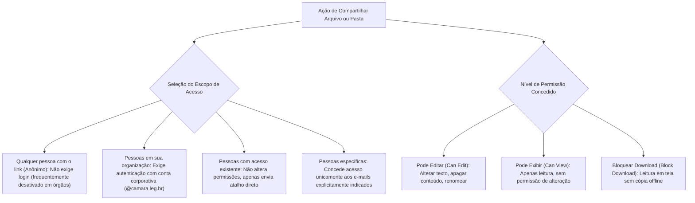
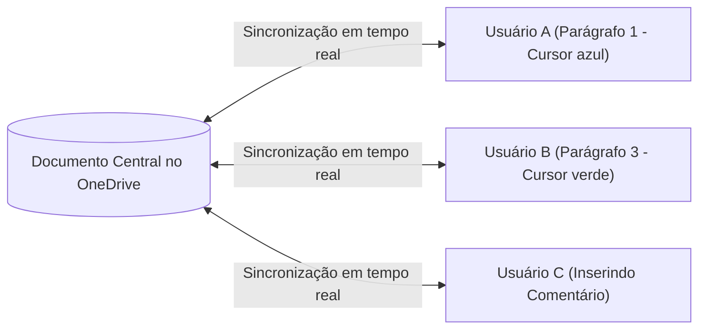
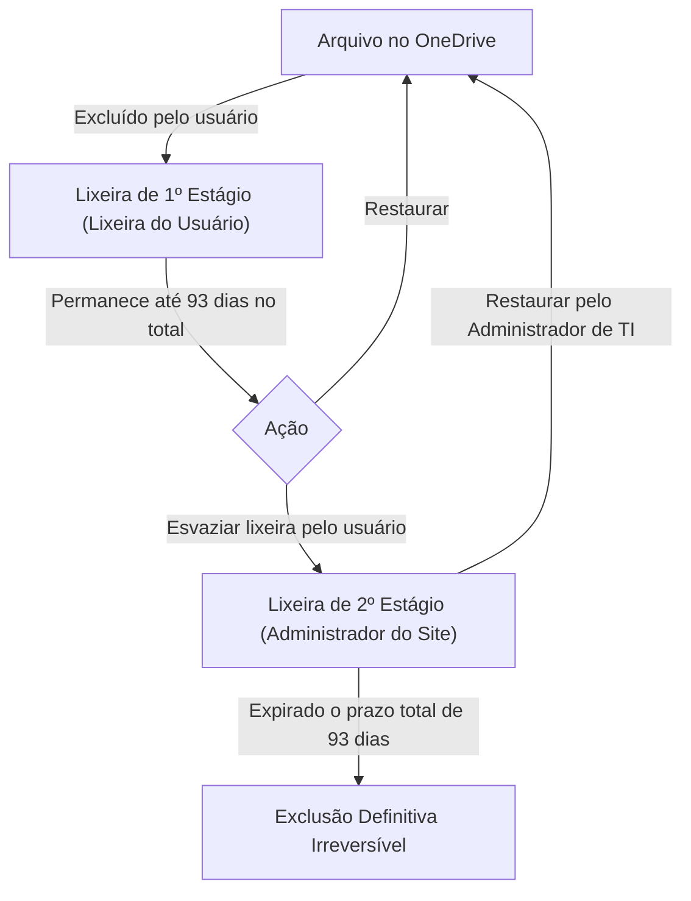

# OneDrive: sincronização corporativa, compartilhamento de links e permissões de acesso

**Concurso Câmara dos Deputados 2026, cargo 1, Divulgação Institucional, Cebraspe. Unidade CAM-TI-005 conforme arquitetura e inventário editorial.**

## Núcleo do conceito: armazenamento e colaboração em nuvem no setor público

No ecossistema corporativo da Câmara dos Deputados e de órgãos públicos federais, o Microsoft OneDrive for Business (integrado ao Microsoft 365 e ao SharePoint Online) atua como o repositório centralizado de arquivos individuais e de equipe. O Cebraspe examina o OneDrive não apenas como um disco virtual, mas sob a perspectiva da **segurança da informação corporativa**, da **gestão de permissões de acesso e links**, do **controle de versões (*Version History*)** e dos mecanismos de **coautoria simultânea (*Co-authoring*)**.

Compreender o alcance de cada modalidade de link de compartilhamento, a vigência de prazos de expiração, a proteção por senha e a política de lixeira corporativa em dois estágios é indispensável para gabaritar itens da banca.

---

## 1. OneDrive Pessoal versus OneDrive for Business (Corporativo)

Embora compartilhem o mesmo cliente de sincronização no Windows, as duas modalidades possuem arquiteturas e regras de conformidade distintas:

| Característica | OneDrive Pessoal | OneDrive for Business |
| :--- | :--- | :--- |
| **Conta de acesso** | Conta Microsoft pessoal (`@outlook.com`, `@hotmail.com`) | Conta corporativa/institucional gerida pelo órgão (`@camara.leg.br`) |
| **Infraestrutura subjacente** | Centros de dados de consumo Microsoft | Baseado no **SharePoint Online** e integrado ao Azure AD / Entra ID |
| **Controle de segurança** | Gerido pelo próprio usuário individual | Gerido pelo **Administrador de TI** do órgão (políticas DLP, retenção) |
| **Lixeira corporativa** | Lixeira única de 30 dias | **Lixeira em dois estágios** (Lixeira do Usuário + Lixeira da Coleção de Sites) |
| **Compartilhamento externo** | Aberto por padrão | Pode ser restrito, bloqueado ou auditado centralmente |

---

## 2. Tipos de links de compartilhamento e escopos de permissão

Ao compartilhar um arquivo ou pasta no OneDrive for Business, o usuário pode configurar o **escopo do público** e o **nível de permissão**:

### Configurações de segurança avançadas nos links:
- **Data de expiração**: Define um prazo limite (ex.: 7 dias) após o qual o link perde automaticamente a validade;
- **Senha de proteção**: Exige a digitação de uma senha secreta para liberar o acesso ao link;
- **Bloqueio de download**: Impede que o destinatário baixe o arquivo para seu computador local, permitindo apenas a visualização em modo somente leitura no navegador (*Office for the Web*).

---

## 3. Coautoria (*Co-authoring*) e salvamento automático (*AutoSave*)

Quando um documento do Word, Excel ou PowerPoint está salvo no OneDrive (ou SharePoint) e compartilhado com permissão de edição, múltiplos usuários podem trabalhar nele **ao mesmo tempo**:

### Regras do Salvamento Automático (*AutoSave*):
- O botão de alternância **Salvamento Automático** só fica ativo se o documento estiver armazenado na nuvem (OneDrive ou SharePoint); em arquivos salvos no disco local (`C:`), ele fica desativado;
- O salvamento é contínuo e incremental;
- O recurso exibe a presença de outros editores em tempo real através de cursores coloridos com o nome do colega.

---

## 4. Histórico de Versões (*Version History*)

O OneDrive mantém automaticamente o histórico de alterações de todos os arquivos:
1. **Restauração sem perda de versões intermediárias**: Ao restaurar uma versão antiga (ex.: a versão 3 de um documento que já está na versão 10), o OneDrive **não apaga as versões posteriores**; ele simplesmente cria a **versão 11**, idêntica à versão 3;
2. **Comparação de versões**: No Word integrado ao OneDrive, o usuário pode comparar o documento atual com qualquer versão histórica para visualizar exatamente quais frases foram modificadas em cada data;
3. **Proteção contra Ransomware**: Caso arquivos sejam criptografados por um ataque malicioso local, o recurso *"Restaurar seu OneDrive"* permite voltar toda a biblioteca para um momento no tempo anterior ao ataque (até 30 dias).

---

## 5. A Lixeira em dois estágios do OneDrive corporativo

O ciclo de exclusão de arquivos no ambiente corporativo segue uma proteção em camadas contra perdas acidentais:

> **Atenção — Regra dos 93 dias corporativos:**
> No OneDrive for Business / SharePoint, o tempo total de retenção na lixeira antes da eliminação definitiva é de **93 dias**, somando o tempo em que o item ficou no primeiro estágio com o tempo no segundo estágio. O usuário comum só tem acesso à lixeira de primeiro estágio; a lixeira de segundo estágio é gerenciada pelo administrador de TI.

---

## 6. Casos progressivos de aplicação

### Caso 1: Compartilhamento acidental com público externo
Um servidor quer compartilhar uma minuta de portaria interna da Câmara com um colega de outro gabinete. Ele clica em Compartilhar e envia o link gerado com a opção padrão *"Qualquer pessoa com o link"*.
*Análise:* Falha de governança. O link "Qualquer pessoa" gera uma URL pública anônima que não exige autenticação. Se esse link for repassado ou indexado, qualquer indivíduo na internet poderá ler ou editar o arquivo. Em órgãos públicos, a boa prática exige selecionar **"Pessoas em sua organização"** (que exige login `@camara.leg.br`) ou **"Pessoas específicas"**.

### Caso 2: Restauração de relatório corrompido
Um analista abre uma planilha de controle no Excel 365 e descobre que um colega apagou acidentalmente várias fórmulas há dois dias. Desesperado, ele tenta dar `Ctrl + Z`, mas o arquivo já foi fechado e reaberto várias vezes.
*Análise:* O analista não perdeu o trabalho. No OneDrive, basta clicar com o botão direito no arquivo no Explorador de Arquivos (ou acessar pelo navegador) e selecionar **Histórico de Versões**. O sistema lista todas as versões salvas por data e autor. Ele pode selecionar a versão de três dias atrás e clicar em **Restaurar**, recuperando integralmente as fórmulas.

### Caso 3: Arquivo excluído da lixeira pessoal
Um usuário apagou uma pasta importante do seu OneDrive e, querendo "limpar tudo", esvaziou a lixeira pessoal do OneDrive. No dia seguinte, percebeu que precisava de um contrato que estava na pasta. Ele afirma que o arquivo foi destruído para sempre.
*Análise:* A conclusão está errada no OneDrive for Business. Graças à **Lixeira de Segundo Estágio**, o administrador de TI do órgão tem acesso ao repositório de retenção corporativa e consegue recuperar o arquivo dentro do ciclo total de 93 dias.

### Caso 4: Envio de material para leitura externa sem cópia
A assessoria de imprensa da Câmara precisa permitir que jornalistas credenciados consultem um documento confidencial em primeira mão, mas deseja evitar que o arquivo seja baixado para os computadores pessoais dos repórteres antes do anúncio oficial.
*Análise:* O assessor deve criar um link de compartilhamento com permissão de **Exibição** e ativar explicitamente a opção **"Bloquear Download"**. Com isso, os jornalistas conseguem ler o texto na tela pelo navegador, mas os botões de baixar, imprimir e copiar texto ficam desabilitados no aplicativo web.

---

## 7. Questões inéditas comentadas (Padrão Cebraspe — C/E)

### Item 1
> No Microsoft OneDrive for Business, ao se compartilhar um arquivo por meio da opção "Qualquer pessoa com o link", o acesso aos dados é franqueado exclusivamente a usuários que possuam credenciais de login cadastradas no domínio corporativo da instituição.

*( ) Certo*
*( ) Errado*

**Gabarito: Errado.**
**Comentário:** A opção "Qualquer pessoa com o link" cria um link anônimo e público que pode ser acessado por qualquer indivíduo que detenha a URL, sem exigir qualquer tipo de autenticação ou login. A opção que restringe o acesso aos usuários da instituição com credenciais corporativas é **"Pessoas em sua organização"**.

---

### Item 2
> O recurso Histórico de Versões do OneDrive for Business permite restaurar uma versão anterior de determinado documento; ao se efetivar essa restauração, as versões produzidas posteriormente àquela restaurada são automaticamente apagadas para preservar a integridade cronológica dos dados.

*( ) Certo*
*( ) Errado*

**Gabarito: Errado.**
**Comentário:** O OneDrive não apaga as versões posteriores ao restaurar uma versão antiga. Ele simplesmente adiciona uma nova versão no topo da pilha histórica (com o conteúdo da versão restaurada), preservando integralmente o histórico de edições intermediárias.

---

### Item 3
> No OneDrive for Business, arquivos excluídos pelo usuário que venham a ser removidos de sua lixeira pessoal ainda podem ser recuperados pelo administrador do sistema por meio da lixeira de segundo estágio, respeitado o período global de retenção de 93 dias.

*( ) Certo*
*( ) Errado*

**Gabarito: Certo.**
**Comentário:** É a mecânica da lixeira corporativa em dois estágios do SharePoint/OneDrive for Business: primeiro estágio gerenciado pelo usuário e segundo estágio acessível pelos administradores da coleção de sites durante a janela total de 93 dias.

---

### Item 4
> A funcionalidade de Salvamento Automático (AutoSave) dos aplicativos do Microsoft 365 opera tanto em arquivos salvos localmente na partição `C:` do disco rígido do computador quanto em arquivos armazenados no OneDrive.

*( ) Certo*
*( ) Errado*

**Gabarito: Errado.**
**Comentário:** O Salvamento Automático (*AutoSave*) em tempo real só funciona quando o arquivo está hospedado em serviços de nuvem da Microsoft (**OneDrive** ou **SharePoint**). Em arquivos salvos localmente no disco rígido do computador, o botão de salvamento automático permanece desabilitado, cabendo ao usuário salvar manualmente (`Ctrl + B`) ou contar com a autorecuperação periódica em caso de pane.

---

### Item 5
> Ao compartilhar um link de pasta no OneDrive, é possível definir uma data limite de expiração e uma senha de acesso, mas tais mecanismos de proteção não impedem que os destinatários realizem o download integral dos arquivos para suas máquinas locais, a menos que a opção de bloqueio de download seja especificamente acionada.

*( ) Certo*
*( ) Errado*

**Gabarito: Certo.**
**Comentário:** Por padrão, quem tem permissão de exibição pode visualizar e baixar uma cópia do arquivo. Para impedir a transferência do arquivo para o disco local do terceiro, o usuário deve ativar cumulativamente o recurso **Bloquear Download** (*Block Download*).

---

### Item 6
> O recurso de coautoria do OneDrive possibilita que dois ou mais usuários editem simultaneamente a mesma planilha do Excel 365 sem que ocorra bloqueio integral do arquivo, permitindo a visualização dos cursores dos colaboradores em tempo real.

*( ) Certo*
*( ) Errado*

**Gabarito: Certo.**
**Comentário:** A coautoria em tempo real (*co-authoring*) é suportada nativamente nas versões modernas do Word, Excel e PowerPoint vinculadas ao OneDrive/SharePoint, permitindo edições concorrentes e seguras sem lock total do arquivo.

---

## 8. Tabela de síntese de permissões do OneDrive

| Opção de Compartilhamento | Exige Login? | Finalidade Principal | Nível de Segurança |
| :--- | :--- | :--- | :--- |
| **Qualquer pessoa** (*Anyone*) | Não | Divulgação ampla e irrestrita | Baixo (risco de vazamento) |
| **Pessoas em sua organização** | Sim (institucional) | Compartilhamento interno entre colegas | Médio-Alto |
| **Pessoas com acesso existente** | Não cria novo acesso | Reenviar atalho para quem já é membro | Alto |
| **Pessoas específicas** | Sim (e-mail indicado) | Acesso restrito a destinatários nomeados | Máximo |
| **Bloquear Download** | Depende do escopo | Permite leitura em tela sem cópia offline | Proteção contra extração |
| **Lixeira de 2º Estágio** | Apenas Administrador | Resgate de itens excluídos em até 93 dias | Governança corporativa |
