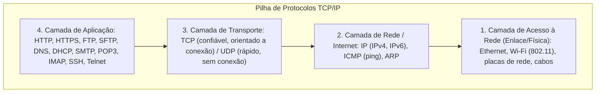
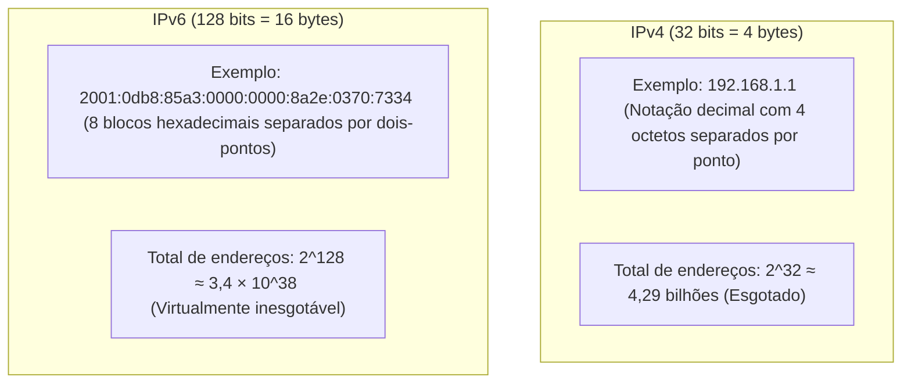

# Redes de computadores: internet, intranet, extranet, protocolos TCP/IP e endereçamento IPv4 e IPv6

**Concurso Câmara dos Deputados 2026, cargo 1, Divulgação Institucional, Cebraspe. Unidade CAM-TI-006 conforme arquitetura e inventário editorial.**

## Núcleo do conceito: a infraestrutura de comunicação digital corporativa

No contexto da Câmara dos Deputados, a transmissão instantânea de votações, notícias legislativas, transmissões multimídia e documentos oficiais depende integralmente da arquitetura de redes de computadores. O Cebraspe aborda redes não como um exercício teórico abstrato de telecomunicações, mas sob o viés da **distinção operacional entre Internet, Intranet e Extranet**, da **arquitetura de protocolos da pilha TCP/IP**, dos **mecanismos de transporte confiável versus não orientado a conexão (TCP versus UDP)** e das regras de **endereçamento e esgotamento do IPv4 em relação ao IPv6**.

Para gabaritar a banca, é imperativo compreender que a tecnologia utilizada em uma intranet é **rigorosamente a mesma da internet** (os mesmos protocolos TCP/IP e os mesmos navegadores), sendo a diferença exclusivamente o **escopo de acesso e controle administrativo**.

---

## 1. Topologia de escopo de rede: Internet, Intranet e Extranet

```mermaid
flowchart TD
    Ext["EXTRANET: Acesso externo controlado para parceiros, órgãos conveniados e cidadãos autorizados (via VPN/Login seguro)"]
    subgraph Intranet["INTRANET (Rede Privada)"]
        Serv["Servidores e Sistemas Internos da Câmara (@camara.leg.br)"]
        Firewall["Firewall Corporativo / Controle de Acesso Rígido"]
    end
    Internet["INTERNET: Rede pública mundial, aberta, descentralizada e não proprietária"]
    
    Internet -->|Bloqueado por padrão| Firewall
    Ext -->|Túnel Criptografado (VPN)| Firewall
    Firewall --> Serv
```

### Quadro comparativo de escopos:
| Modalidade | Definição | Público-Alvo | Tecnologias / Protocolos | Acesso |
| :--- | :--- | :--- | :--- | :--- |
| **Internet** | A rede mundial de computadores interconectados (*rede pública*) | Qualquer cidadão no mundo | Pilha TCP/IP, DNS, HTTP/HTTPS | Aberto, irrestrito e não proprietário |
| **Intranet** | Rede corporativa privada de acesso estritamente interno de uma instituição | Funcionários e servidores do órgão | **Exatamente a mesma pilha TCP/IP da Internet** | Restrito à rede local física ou autenticação corporativa |
| **Extranet** | Ambiente de acesso controlado a recursos institucionais compartilhados com usuários ou organizações externas autorizadas | Parceiros, fornecedores e conveniados | TCP/IP, VPN (*Virtual Private Network*), TLS, conforme a arquitetura | Restrito mediante políticas de acesso; acesso remoto de servidor por VPN à intranet não caracteriza necessariamente extranet |

> **Pegadinha Clássica do Cebraspe:**
> A banca frequentemente afirma que *"a intranet não utiliza os protocolos da internet por razões de segurança, adotando protocolos proprietários fechados"*. **Isso é FALSO!** A intranet utiliza exatamente os mesmos protocolos da internet (HTTP, HTTPS, FTP, SMTP, TCP, IP). A segurança da intranet decorre de mecanismos de filtragem de pacotes (**Firewalls**), listas de controle de acesso (ACL) e autenticação de usuários, e não da invenção de uma tecnologia de rede diferente.

---

## 2. A arquitetura de camadas TCP/IP

A pilha TCP/IP é o modelo prático universal de comunicação em rede, estruturado em quatro camadas funcionais:



---

## 3. Protocolos de Aplicação essenciais para a prova

### 3.1 Navegação Web e Transferência de Arquivos
- **HTTP (*Hypertext Transfer Protocol*) — Porta padrão `80`**: Protocolo não seguro (texto claro, sem criptografia) para transferência de hipertexto;
- **HTTPS (*HTTP Secure*) — Porta padrão `443`**: Protocolo seguro que encapsula o tráfego HTTP sobre uma camada criptográfica **TLS/SSL**, garantindo confidencialidade e autenticidade;
- **FTP (*File Transfer Protocol*) — Portas `20` (dados) e `21` (controle)**: Transferência de arquivos cliente-servidor (sem criptografia nativa);
- **SFTP (*SSH File Transfer Protocol*) — Porta padrão `22`**: Transferência segura de arquivos sobre o protocolo SSH (*Secure Shell*).

### 3.2 Correio Eletrônico (Envio versus Recebimento)
O Cebraspe explora intensamente a separação funcional dos protocolos de e-mail:
- **SMTP (*Simple Mail Transfer Protocol*)**: Protocolo de **ENVIO** de mensagens. A porta `25` continua utilizada na transferência entre servidores SMTP; a porta `587` é utilizada com frequência para submissão autenticada de mensagens por clientes, normalmente com STARTTLS conforme a configuração do serviço. Distinguir transmissão entre servidores de submissão por usuário;
- **POP3 (*Post Office Protocol v3*) — Porta `110` (não segura) / `995` (com SSL/TLS)**: Protocolo de **RECEBIMENTO / BAIXA**: por padrão, baixa as mensagens do servidor para o computador local e as apaga do servidor;
- **IMAP (*Internet Message Access Protocol*) — Porta `143` (não segura) / `993` (com SSL/TLS)**: Protocolo de **ACESSO / SINCRONIZAÇÃO**: as mensagens permanecem armazenadas no servidor, permitindo que o usuário visualize suas pastas sincronizadas em múltiplos dispositivos (celular, notebook e webmail).

### 3.3 Serviços de Infraestrutura de Rede
- **DNS (*Domain Name System*) — Porta padrão `53`**: Resolve nomes de domínio amigáveis em endereços IP numéricos (ex.: converte `www.camara.leg.br` em `200.219.130.100`);
- **DHCP (*Dynamic Host Configuration Protocol*) — Portas `67/68`**: Atribui automaticamente parâmetros de configuração de rede aos dispositivos (endereço IP dinâmico, máscara de sub-rede, gateway padrão e servidores DNS).

---

## 4. Camada de Transporte: TCP versus UDP

A distinção entre TCP e UDP é uma das matrizes comparativas prediletas do Cebraspe:

| Dimensão | TCP (*Transmission Control Protocol*) | UDP (*User Datagram Protocol*) |
| :--- | :--- | :--- |
| **Orientação a conexão** | **Orientado a conexão** (executa o *Three-Way Handshake* — SYN, SYN-ACK, ACK) | **Não orientado a conexão** (envia os pacotes sem estabelecer sessão prévia) |
| **Confiabilidade e entrega** | **Confiável**: confirma o recebimento (ACK), retransmite pacotes perdidos e ordena os dados | **Não confiável**: não garante entrega, não retransmite e não ordena pacotes |
| **Controle de fluxo/congestionamento** | Sim, ajusta a velocidade de envio ao receptor | Não, envia os dados na velocidade máxima do emissor |
| **Sobrecarga (*Overhead*)** | Maior (cabeçalho de 20 a 60 bytes) | Mínimo (cabeçalho fixo de 8 bytes) |
| **Casos de uso típicos** | HTTP/1.1 e HTTP/2, SMTP/IMAP, FTP, SSH e algumas formas de streaming | DNS em consultas comuns, VoIP, jogos online e QUIC, utilizado pelo HTTP/3. Aplicações podem oferecer confiabilidade sobre UDP, como faz o QUIC. |

---

## 5. Camada de Rede: Endereçamento IPv4 versus IPv6

O crescimento exponencial de dispositivos conectados à internet esgotou o espaço de endereços do protocolo IPv4, exigindo a transição global para o IPv6:



### Regras de simplificação do IPv6:
1. **Omissão de zeros à esquerda**: `0042` pode ser escrito simplesmente como `42` dentro de um bloco;
2. **Compressão de blocos contíguos de zeros (`::`)**: Uma sequência de um ou mais blocos compostos exclusivamente por zeros pode ser substituída por dois-pontos duplos (`::`). **Regra estrita de prova:** Essa substituição por `::` só pode ser realizada **uma única vez** no mesmo endereço IPv6, sob pena de ambiguidade matemática na recomposição dos 128 bits.

---

## 6. Casos progressivos de aplicação

### Caso 1: Acesso a sistemas da Câmara em regime de teletrabalho
Uma servidora da Divulgação Institucional da Câmara dos Deputados precisa acessar o sistema interno de tramitação de matérias restrito aos computadores físicos de Brasília. Ela conecta seu notebook pessoal à internet de sua residência e acessa a rede interna da Câmara por meio de um software de **VPN (*Virtual Private Network*)**.
*Análise:* O cenário descreve **acesso remoto à intranet por VPN**. A VPN pode proteger o tráfego em redes públicas, conforme sua configuração e a segurança dos pontos de conexão. O simples acesso de uma servidora à rede interna não transforma necessariamente o ambiente em **extranet**, termo normalmente usado para recursos compartilhados com parceiros externos autorizados.

### Caso 2: Falha de envio de e-mail por bloqueio de porta
Um técnico de TI configura uma nova estação de trabalho para envio de comunicados aos servidores. Ele configura o cliente de e-mail para utilizar o protocolo POP3 na porta 25. O software emite erro e não consegue enviar nenhuma mensagem.
*Análise:* O erro é conceitual e prático. O protocolo **POP3 é exclusivo para recebimento/baixa** de mensagens; ele não tem capacidade de enviar e-mails. O envio exige o protocolo **SMTP**. A porta **587** é recomendada para submissão autenticada por clientes, conforme configuração do provedor. A porta **25** continua usada para transporte SMTP entre servidores; políticas de bloqueio ou migração de clientes não significam descontinuação universal da porta.

### Caso 3: Escolha de protocolo para transmissão ao vivo da TV Câmara
A equipe técnica da Câmara está implementando uma plataforma de *streaming* para transmitir as sessões deliberativas do Plenário em tempo real para a população. A equipe debate se deve utilizar o protocolo TCP ou o protocolo UDP na camada de transporte do áudio e vídeo contínuo.
*Análise:* A escolha depende da aplicação e dos requisitos. **UDP** pode favorecer comunicação interativa de baixa latência, mas perdas e congestionamento podem afetar seriamente o vídeo. Muitas transmissões ao vivo usam **HTTP sobre TCP**; outras usam **HTTP/3 sobre QUIC/UDP**, que implementa mecanismos próprios de confiabilidade e controle de fluxo. Portanto, UDP não é universalmente o protocolo ideal para todo streaming.

### Caso 4: Compressão inválida de endereço IPv6
Um técnico escreve o endereço IPv6 `2001:0000:0000:0001:0000:0000:0000:0002` da seguinte forma comprimida: `2001::0001::0002`. O sistema operacional rejeita a configuração de rede como inválida.
*Análise:* O erro decorre do uso de dois-pontos duplos (`::`) em dois locais distintos do endereço. A regra de sintaxe do IPv6 permite o uso de `::` **apenas uma vez** por endereço. A forma correta seria comprimir a maior sequência de zeros: `2001:0:0:1::2`.

---

## 7. Questões inéditas comentadas (Padrão Cebraspe — C/E)

### Item 1
> A intranet é uma rede corporativa privada que, por motivos estritos de segurança da informação, utiliza protocolos de comunicação e padrões de formatação próprios e incompatíveis com os protocolos da internet pública.

*( ) Certo*
*( ) Errado*

**Gabarito: Errado.**
**Comentário:** Pegadinha clássica e recorrente do Cebraspe. A intranet utiliza **exatamente a mesma tecnologia, os mesmos navegadores e a mesma pilha de protocolos TCP/IP da internet** (HTTP, HTTPS, FTP, SMTP, DNS, IP). A diferença entre internet e intranet não reside nos protocolos, mas no **acesso físico e lógico**, que é restrito aos membros de uma instituição mediante firewalls e autenticação.

---

### Item 2
> O protocolo TCP opera na camada de transporte do modelo TCP/IP e caracteriza-se por ser orientado a conexão, assegurando a entrega dos pacotes de dados sem duplicação e na sequência correta por meio de mecanismos de confirmação e retransmissão.

*( ) Certo*
*( ) Errado*

**Gabarito: Certo.**
**Comentário:** O TCP (*Transmission Control Protocol*) estabelece conexão prévia (*three-way handshake*), numera os pacotes para garantir a ordenação correta e retransmite qualquer segmento cujo recebimento não seja confirmado pelo destinatário (ACK).

---

### Item 3
> Enquanto o protocolo SMTP é empregado tanto para o envio quanto para o recebimento de mensagens eletrônicas entre o cliente do usuário e a caixa postal de correio, o protocolo IMAP restringe-se a arquivar localmente as mensagens baixadas, excluindo-as do servidor remoto.

*( ) Certo*
*( ) Errado*

**Gabarito: Errado.**
**Comentário:** O SMTP é utilizado para **envio** de e-mails (e comunicação entre servidores MTA). Para o recebimento e consulta da caixa de entrada pelo cliente, utilizam-se o POP3 ou o IMAP. Ademais, quem apaga do servidor por padrão ao baixar é o **POP3**; o **IMAP mantém as mensagens sincronizadas no servidor**.

---

### Item 4
> O espaço de endereçamento do protocolo IPv6 é constituído por 128 bits, o que viabiliza uma quantidade de endereços substancialmente superior à capacidade do IPv4, que possui 32 bits de endereçamento.

*( ) Certo*
*( ) Errado*

**Gabarito: Certo.**
**Comentário:** O IPv4 possui 32 bits ($2^{32} \approx 4,3$ bilhões de endereços). O IPv6 possui 128 bits ($2^{128} \approx 3,4 \times 10^{38}$ endereços), eliminando definitivamente o problema de escassez de endereços IP públicos no mundo.

---

### Item 5
> Na representação textual de um endereço IPv6, é lícito substituir uma ou mais sequências contíguas de blocos compostos exclusivamente por zeros por dois-pontos duplos (`::`), desde que essa abreviação seja utilizada no máximo uma única vez no mesmo endereço.

*( ) Certo*
*( ) Errado*

**Gabarito: Certo.**
**Comentário:** A regra do RFC 4291 permite o uso de `::` apenas uma vez para evitar ambiguidade na contagem do número de blocos omitidos na recomposição dos 128 bits.

---

### Item 6
> O protocolo DNS é responsável por atribuir dinamicamente configurações de rede aos computadores clientes conectados a uma rede local, incluindo o endereço IP da máquina e o gateway padrão.

*( ) Certo*
*( ) Errado*

**Gabarito: Errado.**
**Comentário:** O protocolo que atribui endereços IP dinamicamente e configurações de rede às máquinas clientes é o **DHCP** (*Dynamic Host Configuration Protocol*). O **DNS** (*Domain Name System*) é o serviço responsável pela resolução de nomes de domínio em endereços IP (converte URL amigável em IP).

---

## 8. Tabela de síntese de protocolos e portas clássicas

| Protocolo | Camada TCP/IP | Função Principal | Porta Padrão |
| :--- | :--- | :--- | :--- |
| **DNS** | Aplicação | Resolução de nomes em endereços IP | 53 (UDP/TCP) |
| **DHCP** | Aplicação | Configuração dinâmica de IP e parâmetros de rede | 67 / 68 (UDP) |
| **HTTP** | Aplicação | Navegação web padrão em texto claro | 80 (TCP) |
| **HTTPS** | Aplicação | Navegação web segura com TLS; HTTP/3 utiliza QUIC sobre UDP | 443 (TCP em HTTP/1.1 e HTTP/2; UDP em HTTP/3) |
| **FTP** | Aplicação | Transferência de arquivos não criptografada | 20 (dados) / 21 (controle) |
| **SSH** | Aplicação | Acesso remoto seguro e túneis criptografados | 22 (TCP) |
| **SMTP** | Aplicação | Envio de mensagens de correio eletrônico | 25 / 587 (TCP) |
| **POP3** | Aplicação | Baixa e exclusão de e-mails no servidor | 110 / 995 (TCP) |
| **IMAP** | Aplicação | Acesso e sincronização contínua de e-mails | 143 / 993 (TCP) |
| **TCP** | Transporte | Comunicação confiável, ordenada e orientada a conexão | — |
| **UDP** | Transporte | Comunicação rápida, sem confirmação e sem conexão | — |
| **IP** | Rede / Internet | Roteamento e endereçamento de pacotes (IPv4 / IPv6) | — |
| **ICMP** | Rede / Internet | Mensagens de controle e diagnóstico (comando `ping`) | — |

> **Atualização técnica (11/11/2026):** HTTP/3 usa QUIC, que opera sobre UDP, conforme [RFC 9114](https://www.rfc-editor.org/rfc/rfc9114.html). Alterações pontuais segundo TI-043 e TI-044 da auditoria; questões inéditas ainda não homologadas.
