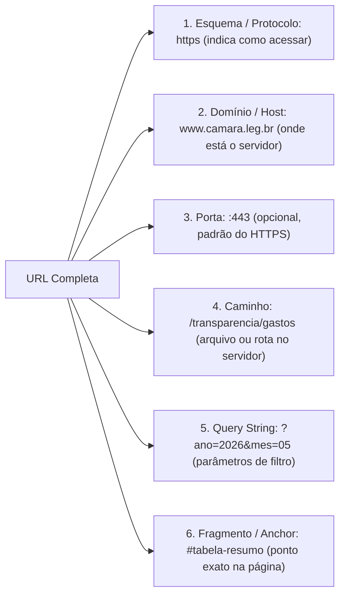
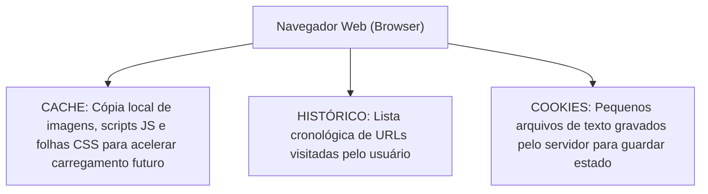

# Navegação web, anatomia de URLs, operadores de busca avançada e privacidade no navegador

**Concurso Câmara dos Deputados 2026, cargo 1, Divulgação Institucional, Cebraspe. Unidade CAM-TI-007 conforme arquitetura e inventário editorial.**

## Núcleo do conceito: por que estudar navegação e busca para a Câmara dos Deputados?

Na atividade de Comunicação Social e Divulgação Institucional, a pesquisa qualificada de dados legislativos, a verificação de fontes de informação (*fact-checking*), o monitoramento de publicações oficiais e a preservação da segurança na navegação constituem rotinas mandatórias. O Cebraspe aborda os navegadores modernos (Google Chrome, Microsoft Edge, Mozilla Firefox) e os mecanismos de busca não sob aspectos triviais, mas com foco rigoroso na **anatomia técnica de uma URL/URI**, nos **operadores booleanos e de filtro na busca avançada (Google / Bing)**, na distinção de funcionamento de **Cookies primários versus Cookies de terceiros** e nos **limites da Navegação Anônima (*InPrivate / Incognito*)**.

O candidato precisa compreender com precisão o que a navegação privativa esconde (dados locais na máquina) e o que ela **jamais oculta** (o tráfego perante o provedor de internet, os servidores do órgão público e os sites visitados).

---

## 1. Anatomia técnica de uma URL (*Uniform Resource Locator*)

Uma URL é a forma padronizada de localizar e acessar qualquer recurso na teia mundial de computadores. Ela é subdividida em componentes funcionais obrigatórios e opcionais:

$$\underbrace{\text{https}}_{\text{Esquema / Protocolo}} \text{://} \underbrace{\text{www.camara.leg.br}}_{\text{Domínio / Host}} \text{:} \underbrace{\text{443}}_{\text{Porta}} \underbrace{\text{/transparencia/gastos}}_{\text{Caminho / Path}} \underbrace{\text{?ano=2026\&mes=05}}_{\text{Parâmetros de Consulta (Query)}} \underbrace{\text{\#tabela-resumo}}_{\text{Âncora / Fragmento}}$$



### Detalhamento dos componentes:
- **Protocolo/Esquema**: Define a regra de comunicação (`http`, `https`, `ftp`, `mailto`, `file`);
- **Domínio**: Nome amigável registrado na autoridade DNS (no Brasil, sob o Registro.br, gerido pelo CGI.br);
- **Porta**: Endereço lógico do serviço (oculta quando se usam as portas padrão 80 para HTTP e 443 para HTTPS);
- **Caminho (*Path*)**: Estrutura hierárquica de diretórios ou rota virtual do aplicativo web;
- **Parâmetros de Consulta (*Query String*)**: Iniciados pelo caractere `?` e separados entre si por `&`, passam variáveis de busca para o servidor (ex.: `?termo=reforma&ano=2026`);
- **Fragmento (*Anchor / Hash*)**: Iniciado pelo caractere `#`, o fragmento identifica uma referência dentro da representação do recurso. Pode orientar rolagem a um elemento, estado ou rota de uma aplicação web no cliente. **O fragmento não é enviado na requisição HTTP ao servidor**.

---

## 2. Operadores de busca avançada (Google e Bing)

Para localizar matérias legislativas com precisão em meio a bilhões de páginas indexadas, os motores de busca disponibilizam operadores booleanos e filtros estruturados de alta incidência no Cebraspe:

| Operador de Busca | Sintaxe Exata | Finalidade / Efeito | Exemplo Prático |
| :--- | :--- | :--- | :--- |
| **Aspas Duplas** | `"termo exato"` | Busca a **frase exata**, na mesma ordem, sem variações morfológicas ou sinônimos | `"reforma tributária"` |
| **Sinal de Menos (Exclusão)** | `-termo` | **Exclui** páginas que contenham a palavra especificada (sem espaço após o sinal `-`) | `parlamento -europeu` |
| **Filtro de Site / Domínio** | `site:dominio` | Restringe a pesquisa aos resultados indexados para o domínio ou prefixo | `orçamento site:camara.leg.br` |
| **Filtro de Tipo de Arquivo** | `filetype:ext` | Localiza documentos disponíveis em um formato de arquivo específico (`pdf`, `xlsx`, `docx`) | `regimento interno filetype:pdf` |
| **Filtro de Título** | `intitle:palavra` | Exige que a palavra apareça expressamente na tag `<title>` da página | `intitle:liderança` |
| **Filtro de URL** | `inurl:termo` | Exige que o termo conste na própria URL do endereço | `inurl:comissoes` |
| **Operador OU (*OR*)** | `A OR B` | Localiza páginas que contenham **pelo menos um** dos termos (deve ser em maiúsculas) | `senado OR câmara` |
| **Curinga Asterisco** | `*` | Substitui uma ou mais palavras desconhecidas dentro de uma expressão entre aspas | `"Presidente da * dos Deputados"` |

> **Dica Suprema de Prova do Cebraspe:**
> Na sintaxe dos operadores `site:` e `filetype:`, **NÃO PODE HAVER ESPAÇO** entre o operador e o valor.
> Correto: `site:camara.leg.br`.
> Incorreto (o Google interpretará como busca comum de texto): `site: camara.leg.br`.

---

## 3. Gestão de dados no navegador: Cache, Cookies e Histórico

Os navegadores modernos armazenam três tipos fundamentais de dados locais:



### 3.1 O que são Cookies e suas classificações:
Um **Cookie** é um pequeno arquivo de texto (geralmente menor que 4 KB) gravado pelo navegador a pedido de um servidor web para manter **estado** em um protocolo nativamente sem estado (*stateless* como o HTTP).
- **Cookies de Sessão**: Temporários; são apagados automaticamente assim que o usuário fecha o navegador;
- **Cookies Persistentes**: Permanecem gravados no disco do computador até atingirem sua data de expiração (*Expires*) ou serem excluídos manualmente;
- **Cookies Primários (*First-party*)**: Criados pelo próprio site visitado (ex.: guardar o login do servidor no portal da Câmara);
- **Cookies de Terceiros (*Third-party*)**: Criados por domínios diferentes daquele que o usuário está visitando (tipicamente redes de publicidade e scripts de rastreamento comportamental).

---

## 4. O mito da Navegação Anônima (*Incognito / InPrivate*)

A **Navegação Anônima** (denominada *Janela Anônima* no Chrome e *Janela InPrivate* no Edge) é um dos tópicos onde o Cebraspe mais derruba candidatos desatentos.

```mermaid
flowchart TD
    Anon["Sessão de Navegação Anônima / InPrivate"]
    Anon -->|O que é apagado LOCALMENTE ao fechar a janela| Oculta["1. Histórico de navegação<br>2. Cookies daquela sessão<br>3. Dados de formulários preenchidos<br>4. Cache temporário da sessão"]
    Anon -->|O que PERMANECE gravado no disco| Fica["1. Arquivos baixados (Downloads)<br>2. Favoritos (Bookmarks) criados"]
    Anon -->|O que NÃO É ESCONDIDO na rede (Tráfego Externo)| Visivel["1. Administrador da rede da Câmara<br>2. Provedor de Acesso à Internet (ISP)<br>3. Servidores dos sites visitados<br>4. Endereço IP real do usuário"]
```

| O que a Navegação Anônima FAZ | O que a Navegação Anônima NÃO FAZ |
| :--- | :--- |
| Apaga o histórico local ao fechar a janela | Não torna o usuário invisível na internet |
| Descarta os cookies da sessão após o fechamento | Não oculta o endereço IP real do usuário |
| Não grava dados de preenchimento de formulários | Não impede que a empresa/órgão monitore o tráfego de rede |
| Permite abrir duas contas diferentes do mesmo serviço | Não protege contra malwares, vírus ou ataques de phishing |

---

## 5. Atalhos de teclado universais nos navegadores modernos

| Ação | Google Chrome / Microsoft Edge / Mozilla Firefox |
| :--- | :--- |
| **Nova Aba / Guia** | `Ctrl + T` |
| **Fechar Aba Atual** | `Ctrl + W` (ou `Ctrl + F4`) |
| **Reabrir Última Aba Fechada** | `Ctrl + Shift + T` |
| **Nova Janela Normal** | `Ctrl + N` |
| **Nova Janela Anônima / InPrivate** | `Ctrl + Shift + N` (Chrome/Edge) / `Ctrl + Shift + P` (Firefox) |
| **Abrir Histórico** | `Ctrl + H` |
| **Abrir Downloads** | `Ctrl + J` |
| **Adicionar aos Favoritos** | `Ctrl + D` |
| **Atualizar Página (*Reload*)** | `F5` ou `Ctrl + R` |
| **Forçar Atualização Limpando Cache** | `Ctrl + F5` ou `Ctrl + Shift + R` |
| **Focar na Barra de Endereços** | `Ctrl + L` ou `Alt + D` ou `F6` |
| **Localizar texto na página** | `Ctrl + F` |

---

## 6. Casos progressivos de aplicação

### Caso 1: Busca restrita de relatórios em PDF
Um assessor da Câmara precisa encontrar o arquivo PDF oficial do relatório da Reforma Tributária publicado exclusivamente no portal da Câmara dos Deputados, evitando notícias secundárias de jornais.
*Análise:* O comando de busca avançada ideal a ser digitado no motor de busca é:
`"reforma tributária" site:camara.leg.br filetype:pdf`
As aspas solicitam a correspondência da frase; `site:camara.leg.br` e `filetype:pdf` restringem resultados **indexados** por domínio e formato identificado. Esses filtros não comprovam autoria editorial, autenticidade dos documentos ou completude do índice.

### Caso 2: Equívoco sobre navegação anônima no trabalho
Um estagiário utiliza a Janela InPrivate do Microsoft Edge em seu computador na Câmara para acessar redes sociais e sites de compras durante o expediente, acreditando que a equipe de segurança da informação da Casa não saberá o que ele acessou porque "o modo anônimo não deixa rastros".
*Análise:* Conclusão totalmente falsa. A navegação anônima atua **apenas no nível do dispositivo local** (não gravando histórico ou cookies no disco rígido do PC). Todo o fluxo de pacotes de dados sai pela placa de rede e passa pelos servidores proxy e firewalls da Câmara, onde os endereços de destino, horários e volumes de dados ficam registrados detalhadamente nos logs corporativos da instituição.

### Caso 3: Preservação de downloads no modo privativo
Um servidor acessa um site via Janela Anônima, baixa um arquivo em formato `.xlsx` para conferência e, em seguida, fecha a janela anônima. Minutos depois, ele procura o arquivo na pasta *Downloads* do computador e constata que a planilha ainda está lá.
*Análise:* O comportamento está rigorosamente correto. A navegação anônima apaga o histórico de navegação e os cookies daquela sessão ao ser encerrada, mas **não apaga os arquivos baixados (*downloads*) nem os novos favoritos (*bookmarks*) criados pelo usuário**.

### Caso 4: Papel do fragmento (#) na URL
Um desenvolvedor compartilha o link `https://www.camara.leg.br/noticias#votacao-plenario`. Ao analisar o tráfego HTTP no servidor web da Câmara, ele nota que o texto `#votacao-plenario` não aparece nas requisições recebidas pelo servidor.
*Análise:* O comportamento decorre do padrão técnico da RFC 3986. O fragmento iniciado por `#` é interpretado no lado do **cliente** e não integra a requisição HTTP ao servidor. Pode identificar um elemento de página para navegação, mas aplicações web também o utilizam para roteamento ou estado local. O fato de ele não constar do pedido HTTP não determina seu uso visual.

---

## 7. Questões inéditas comentadas (Padrão Cebraspe — C/E)

### Item 1
> A navegação anônima, disponível em navegadores modernos como o Google Chrome e o Microsoft Edge, garante a privacidade integral do usuário, impedindo que o provedor de acesso à internet e os administradores da rede corporativa monitorem os sítios eletrônicos visitados.

*( ) Certo*
*( ) Errado*

**Gabarito: Errado.**
**Comentário:** A navegação privativa reduz a persistência de histórico e dados de sessão **após encerrar a sessão privativa**, mas não anonimiza o usuário perante sites, administradores ou provedores. Com HTTPS, terceiros na rede normalmente **não veem o conteúdo integral das páginas**, embora possam observar metadados de conexão e certos destinos, dependendo de DNS, TLS e políticas da rede. A afirmação de privacidade integral é falsa.

---

### Item 2
> Na sintaxe de busca avançada do Google, o comando `orçamento site:camara.leg.br filetype:pdf` restringe os resultados a documentos no formato PDF que contenham a palavra "orçamento" e que estejam hospedados especificamente no domínio oficial da Câmara dos Deputados.

*( ) Certo*
*( ) Errado*

**Gabarito: Certo.**
**Comentário:** `site:` restringe a busca ao domínio indicado e `filetype:pdf` busca resultados identificados como PDF. A interpretação é adequada para a **sintaxe de busca do Google**, mas o índice pode omitir arquivos existentes e os filtros não garantem que **todos** os resultados relevantes sejam recuperados. O enunciado descreve restrição de pesquisa, não exaustividade do acervo.

---

### Item 3
> Ao fechar uma janela de navegação privativa no Microsoft Edge, todos os arquivos baixados pelo usuário durante aquela sessão são automaticamente expurgados da pasta de downloads do sistema operacional, em observância ao princípio da não persistência de dados locais.

*( ) Certo*
*( ) Errado*

**Gabarito: Errado.**
**Comentário:** O fechamento da janela anônima apaga cookies, histórico e cache da sessão, mas **preserva intactos os arquivos baixados (downloads)** e os favoritos salvos na máquina.

---

### Item 4
> Em uma URL, a parte que sucede o caractere de interrogação (`?`) constitui a cadeia de consulta (*query string*), sendo utilizada para enviar parâmetros e valores específicos ao servidor web de destino.

*( ) Certo*
*( ) Errado*

**Gabarito: Certo.**
**Comentário:** A *query* começa após o primeiro `?` da URL e vai até o fragmento `#`, se houver. É **frequentemente** usada para codificar pares chave-valor separados por `&`, mas a RFC 3986 não impõe esse formato para toda consulta. A query pode ser transmitida ao servidor; os parâmetros também podem ser tratados pelo aplicativo cliente.

---

### Item 5
> Os cookies primários são arquivos de texto gravados no computador pelo próprio domínio que o usuário está visitando, com a finalidade precípua de manter o estado da sessão de navegação, tais como preferências de idioma e itens de login.

*( ) Certo*
*( ) Errado*

**Gabarito: NÃO HOMOLOGADO (descrição técnica excessivamente restritiva).**
**Comentário:** Cookies primários são associados ao contexto do site visitado e **podem** manter sessão, autenticação e preferências, mas também podem ser usados em outras finalidades. A expressão **“são arquivos de texto gravados no computador pelo próprio domínio”** simplifica a implementação: navegadores podem armazená-los em bancos de dados e aplicar regras de domínio e contexto de site. **Versão de treino:** “Cookies de primeira parte são associados ao site visitado e podem armazenar informações para manutenção de sessão e preferências.” **Gabarito reformulado: CERTO.**

---

### Item 6
> No navegador Google Chrome, a combinação de teclas `Ctrl + Shift + T` é utilizada para abrir uma nova janela de navegação anônima.

*( ) Certo*
*( ) Errado*

**Gabarito: Errado.**
**Comentário:** O atalho `Ctrl + Shift + T` serve para **reabrir a última aba/guia que foi fechada acidentalmente**. O atalho para abrir uma nova Janela Anônima no Chrome e no Edge é **`Ctrl + Shift + N`** (ou `Ctrl + Shift + P` no Firefox).

---

## 8. Tabela de síntese de operadores de busca do Google

| Operador | O que faz | Sintaxe Correta | Sintaxe Inválida |
| :--- | :--- | :--- | :--- |
| `" "` | Frase exata | `"comissão mista"` | Exemplo inválido: aspa final ausente |
| `-` | Exclui termo | `câmara -comércio` | `câmara - comércio` |
| `site:` | Restringe a domínio | `site:leg.br` | `site: leg.br` |
| `filetype:` | Restringe a extensão | `filetype:pdf` | `filetype: pdf` |
| `intitle:` | Palavra no título | `intitle:posse` | `intitle: posse` |
| `inurl:` | Palavra na URL | `inurl:noticia` | `inurl: noticia` |
| `OR` | Disjunção booleana | `deputado OR senador` | `deputado or senador` (minúsculo falha) |
| `*` | Curinga para palavras | `"regimento * da câmara"` | — |

> **Revisão (11/11/2026):** refinado o conceito de fragmento de URL, conforme TI-045. Referência: [RFC 3986, seção 3.5](https://www.rfc-editor.org/rfc/rfc3986#section-3.5). Os operadores de busca dependem de mecanismos e versões, e sua sintaxe deve ser conferida no serviço utilizado.

> **Auditoria C/E, segunda passagem (11/11/2026):** itens 1–4 e 6 mantêm **E, C, E, C, E**; **item 5 não homologado** pela definição material universal de cookie e finalidade restritiva. Comentários sobre privacidade e sintaxe de query atualizados. Referências: [RFC 3986](https://www.rfc-editor.org/rfc/rfc3986), [MDN, HTTP cookies](https://developer.mozilla.org/en-US/docs/Web/HTTP/Guides/Cookies).

---

## Questão substituta S09-5: cookies de primeira parte

> Um cookie de primeira parte é associado ao contexto do site que o usuário visita e pode ser utilizado para manter o estado de autenticação ou preferências entre requisições HTTP; sua classificação depende do contexto do site, não da obrigação de existir como arquivo de texto independente no disco.

**Gabarito: CERTO (inédita, substitui o Item 5 bloqueado).** Uma resposta HTTP pode enviar `Set-Cookie: sessao=123; Secure; HttpOnly`; em requisições seguintes elegíveis, o navegador pode encaminhar `Cookie: sessao=123`. O protocolo HTTP é sem estado por padrão, e o cookie ajuda a relacionar requisições. O armazenamento interno depende da implementação do navegador.

**Fronteiras:** `HttpOnly` dificulta acesso ao valor por JavaScript na página, não impede seu envio automático; `Secure` limita transmissão a contextos protegidos, não significa criptografia do valor; *first-party* refere-se ao contexto de site e não define, por si, uma finalidade exclusiva.

**Variação C/E:** “Cookies de primeira parte servem exclusivamente para login e não podem ser usados para medição de uso.” **ERRADO**: podem atender a diferentes finalidades.

**Fonte técnica:** [MDN: Cookies HTTP](https://developer.mozilla.org/pt-BR/docs/Web/HTTP/Guides/Cookies) e [MDN: cookies de terceiros e contexto first-party](https://developer.mozilla.org/en-US/docs/Web/Privacy/Guides/Third-party_cookies). Item 5 original permanece **NÃO HOMOLOGADO**.

> **Implementação TI-107 (11/11/2026):** corrigida tabela de aspas e limitação dos filtros de busca: operadores não garantem autenticidade ou exaustividade. Fonte: [Ajuda do Google](https://support.google.com/websearch/answer/2466433?hl=pt-br).
