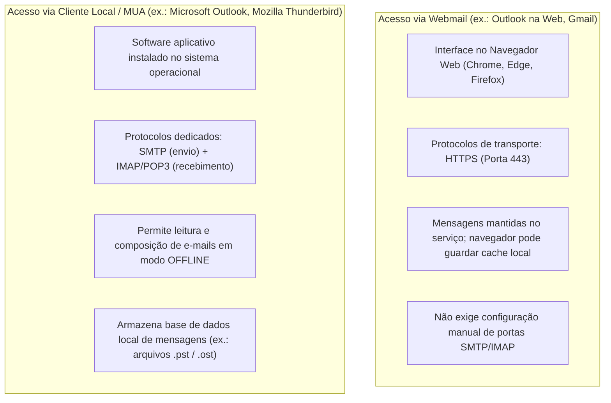
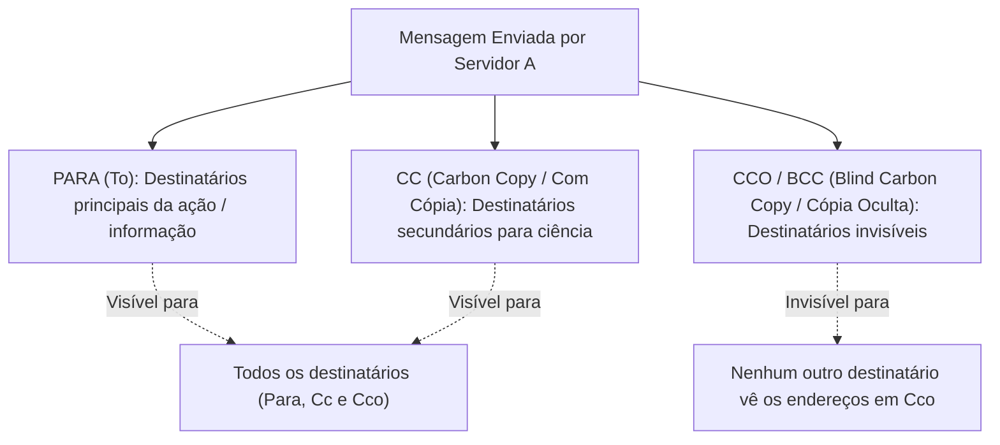

# Correio eletrônico: webmail, cliente local, campos de cabeçalho, anexos e segurança

**Concurso Câmara dos Deputados 2026, cargo 1, Divulgação Institucional, Cebraspe. Unidade CAM-TI-008 conforme arquitetura e inventário editorial.**

## Núcleo do conceito: a comunicação oficial por e-mail no serviço público

O correio eletrônico corporativo é a espinha dorsal da tramitação de informações, convocações institucionais, releases de imprensa e comunicação interdepartamental na Câmara dos Deputados. O Cebraspe explora com rigor técnico a distinção operacional entre o acesso via **Webmail** (navegador web) e via **Cliente de E-mail Local** (como o Microsoft Outlook), o comportamento estrito dos campos de destinatários (**Para, Cc e Cco/Bcc**), os riscos e limitações na transferência de **anexos**, as ações de **Responder, Responder a Todos e Encaminhar**, e as boas práticas de segurança contra ameaças transmitidas por mensagens.

Dominar os efeitos exatos de cada campo em cenários com dezenas de destinatários e os mecanismos de privacidade do envio oculto é indispensável para gabaritar questões da banca.

---

## 1. Webmail versus Cliente de E-mail Local (MUA)

Existem duas formas fundamentais de interagir com o correio eletrônico:

| Critério | Webmail | Cliente Local de E-mail (*Mail User Agent*) |
| :--- | :--- | :--- |
| **Acesso** | De qualquer dispositivo conectado à internet via navegador | Restrito ao computador onde o programa está instalado |
| **Protocolo de acesso** | HTTPS | IMAP (ou POP3) para recebimento; SMTP para envio |
| **Operação offline** | Não (ou muito limitada com extensões específicas) | **Sim**, lê mensagens já baixadas e redige novos e-mails offline |
| **Ocupação de disco local** | Pode utilizar cache, dados de navegação e recursos offline conforme serviço/configuração | Pode armazenar mensagens em disco, dependendo da política de sincronização e cache |
| **Backup de mensagens** | Depende das políticas de retenção do servidor | Permite exportar arquivos de dados locais (`.pst`, `.mbox`, `.eml`) |

---

## 2. Anatomia dos campos de cabeçalho: Para, Cc e Cco (Bcc)

A correta aplicação e visibilidade dos campos de destinatários é uma das áreas de maior incidência em provas do Cebraspe:

### Regras de visibilidade e privacidade:
1. **Destinatários em `Para` e `Cc`**: Todos os que recebem a mensagem (inclusive os que estão em Cco) conseguem visualizar os nomes e endereços de e-mail listados em `Para` e `Cc`;
2. **Destinatários em `Cco`**:
   - Os destinatários em `Para` e `Cc` **NÃO sabem** que a mensagem foi enviada para terceiros em `Cco` e não enxergam esses endereços;
   - **Isolamento mútuo em `Cco`**: Se houver mais de uma pessoa em `Cco` (ex.: `chefe@camara.leg.br` e `auditor@camara.leg.br`), **um destinatário em Cco NÃO vê o outro destinatário em Cco**; cada um recebe a mensagem enxergando apenas a si mesmo no campo de cópia oculta (ou com o campo Cco em branco) e os nomes de `Para` e `Cc`.

---

## 3. Dinâmica das ações: Responder, Responder a Todos e Encaminhar

O Cebraspe frequentemente propõe situações práticas em que uma mensagem é respondida ou repassada, exigindo prever quem receberá a nova mensagem:

| Ação Executada | Destinatários do Novo E-mail | Anexos Originais são incluídos? |
| :--- | :--- | :--- |
| **Responder (*Reply*)** | **Apenas o Remetente original** da mensagem (endereço em `De` / *From*) | **NÃO** (anexos originais são descartados por padrão) |
| **Responder a Todos (*Reply All*)** | O **Remetente original** (`De`) + **Todos os endereços visíveis** em `Para` e `Cc` (exceto o próprio usuário que responde) | **NÃO** (anexos originais são descartados por padrão) |
| **Encaminhar (*Forward*)** | O remetente original **NÃO** é destinatário automático; o usuário digita novos destinatários | **SIM**, os **anexos originais são preservados** e enviados por padrão |

> **Pegadinha Fatal do Cebraspe sobre Cco e "Responder a Todos":**
> Se um usuário recebeu uma mensagem como **cópia oculta (Cco)** e clica em **Responder a Todos**, para quem a resposta é enviada?
> A resposta vai para o **Remetente original** e para todos os que estavam nos campos **`Para` e `Cc`**!
> **Consequência dramática:** O usuário que estava oculto **DENUNCIA A SI PRÓPRIO**, pois sua resposta chegará na caixa postal de todos os destinatários principais, revelando publicamente que ele havia recebido a cópia oculta!

---

## 4. Anexos (*Attachments*): limites, formatos e segurança

1. **Limites de tamanho por mensagem**: Servidores corporativos impõem tetos de tamanho para tráfego de e-mail (tipicamente de 20 MB a 35 MB por mensagem). Para arquivos que ultrapassam esse volume, a boa prática no Microsoft 365 é enviar um **link de compartilhamento do OneDrive** em vez do arquivo binário anexado;
2. **Bloqueio de extensões executáveis**: Servidores de correio da Administração Pública bloqueiam ativamente o tráfego de anexos com extensões que possam executar código na máquina do destinatário:
   - Extensões bloqueadas comuns: `.exe`, `.bat`, `.cmd`, `.vbs`, `.js`, `.scr`, `.com`, `.ps1`;
   - Nem mesmo compactar em `.zip` ou `.rar` burla firewalls modernos, pois o antivírus do servidor examina o conteúdo interno de arquivos comprimidos;
3. **Assinatura Digital e Criptografia (S/MIME)**:
   - **Assinatura Digital**: Garante a **autenticidade** (prova que o e-mail partiu de quem diz ter partido), a **integridade** (prova que o texto e os anexos não foram alterados no trânsito) e o **não repúdio**;
   - **Criptografia de E-mail**: Garante a **confidencialidade**, permitindo que somente o detentor da chave privada do destinatário consiga decodificar e ler o conteúdo da mensagem.

---

## 5. Ameaças comuns via e-mail e boas práticas corporativas

- **Phishing**: Mensagens fraudulentas que imitam comunicações de órgãos oficiais, bancos ou chefias, contendo links maliciosos que direcionam a páginas clonadas para captura de senhas e dados bancários;
- **Spear Phishing**: Phishing altamente direcionado e personalizado para um servidor ou setor específico (ex.: mencionando número de processo real da Câmara para induzir o clique);
- **Spoofing de E-mail**: Falsificação do cabeçalho da mensagem para fazer parecer que o e-mail partiu de um remetente legítimo (combatido por protocolos de autenticação de domínio como **SPF, DKIM e DMARC**).

---

## 6. Casos progressivos de aplicação

### Caso 1: Envio de mala direta a 500 jornalistas
A assessoria de imprensa da Câmara precisa disparar um comunicado de imprensa para uma lista de 500 jornalistas de diferentes veículos de mídia. O assessor insere todos os 500 endereços no campo **`Para`** e clica em Enviar.
*Análise:* O campo `Para` torna os endereços visíveis aos demais destinatários, o que pode gerar exposição desnecessária e risco de privacidade. A eventual **infração à LGPD** depende do contexto, finalidade, base legal e demais circunstâncias, não apenas do uso do campo. Para uma lista cujos participantes não precisam conhecer os contatos uns dos outros, recomenda-se utilizar **`Cco`** ou uma plataforma adequada de envio, com controles de dados pessoais.

### Caso 2: Cco respondendo a todos
O Diretor de Comunicação envia um e-mail com críticas a uma matéria jornalística para o Redator (no campo `Para`) e coloca o Secretário-Geral em **`Cco`**. O Secretário-Geral, desejando intervir no debate, clica no botão **Responder a Todos** em seu cliente de e-mail e escreve: *"Concordo plenamente"*.
*Análise:* O Redator (que estava em `Para`) receberá a mensagem do Secretário-Geral. Com isso, o Redator descobrirá que o Secretário-Geral estava monitorando a conversa em segredo. Se o Secretário-Geral quisesse manter o sigilo de sua presença, deveria ter clicado unicamente em **Responder** (enviando mensagem privada apenas ao Diretor) ou redigido um novo e-mail isolado.

### Caso 3: Envio de relatório em PDF de 80 MB
Uma assessora precisa enviar um arquivo PDF de 80 MB contendo fotos e relatórios da sessão legislativa para deputados. O e-mail retorna imediatamente com a mensagem de erro *"Mailbox size limit exceeded / Message size exceeds fixed maximum limit"*.
*Análise:* Os servidores de correio eletrônico possuem travas de segurança de tamanho de mensagem (geralmente até 25 ou 35 MB) para evitar sobrecarga de armazenamento. A solução corporativa no Microsoft 365 é carregar o arquivo no **OneDrive da Câmara** e inserir no corpo da mensagem um **link seguro de compartilhamento** para exibição ou download.

### Caso 4: Anexo não acompanhado na resposta
Um servidor recebe um e-mail com uma planilha anexada contendo o orçamento da campanha publicitária. Ele clica em **Responder**, digita *"Aprovado"* e envia. Posteriormente, o colega reclama que a planilha aprovada não voltou com o e-mail.
*Análise:* O comportamento do sistema é padrão. Os clientes de e-mail e webmails **não incluem os anexos originais nas ações de "Responder" ou "Responder a Todos"**, justamente para economizar tráfego de rede e armazenamento nos servidores. Se o objetivo fosse repassar o anexo original junto com a mensagem, a ação necessária seria **Encaminhar (*Forward*)**.

---

## 7. Questões inéditas comentadas (Padrão Cebraspe — C/E)

### Item 1
> Ao se responder a uma mensagem de correio eletrônico utilizando-se a funcionalidade "Responder a Todos", todos os arquivos anexados originalmente à mensagem recebida são automaticamente duplicados e reenviados aos destinatários.

*( ) Certo*
*( ) Errado*

**Gabarito: Errado.**
**Comentário:** Na configuração usual dos clientes de e-mail, **Responder** e **Responder a Todos** não incluem os anexos originais automaticamente. **Encaminhar** costuma incluí-los, mas também permite remoção ou alterações pelo usuário, conforme aplicativo e política. O enunciado diz “todos ... automaticamente”, o que é falso.

---

### Item 2
> Um destinatário cujo endereço de e-mail tenha sido incluído no campo Cco (cópia oculta) receberá a mensagem sem que os destinatários constantes nos campos Para e Cc tenham conhecimento de sua inclusão.

*( ) Certo*
*( ) Errado*

**Gabarito: Certo.**
**Comentário:** Essa é a finalidade precípua do campo `Cco` (*Blind Carbon Copy*): ocultar os endereços nele inseridos de todos os demais destinatários que constam nos campos `Para` e `Cc`.

---

### Item 3
> Caso um usuário receba uma mensagem eletrônica na condição de destinatário oculto (campo Cco) e decida utilizar a opção "Responder a Todos", sua resposta será encaminhada ao remetente original e a todos os endereços listados nos campos Para e Cc, expondo aos demais o fato de que ele recebeu cópia da mensagem original.

*( ) Certo*
*( ) Errado*

**Gabarito: Certo.**
**Comentário:** Em clientes de e-mail usuais, **Responder a Todos** a partir de uma mensagem recebida via Cco inclui o remetente e os destinatários visíveis em `Para` e `Cc`, podendo revelar que a pessoa originalmente oculta recebeu a mensagem. O comportamento exato pode depender de listas, aliases e configuração do cliente; a questão descreve o caso típico.

---

### Item 4
> A utilização de cliente local de correio eletrônico, a exemplo do Microsoft Outlook, impossibilita totalmente a visualização ou redação de mensagens em momentos nos quais o computador esteja desconectado da internet.

*( ) Certo*
*( ) Errado*

**Gabarito: Errado.**
**Comentário:** Clientes como Outlook podem permitir consultar mensagens **previamente sincronizadas** e redigir rascunhos offline. A efetiva transmissão depende de reconexão e das configurações de envio; o nome da pasta temporária pode variar. A expressão “impossibilita totalmente” é falsa.

---

### Item 5
> A assinatura digital de uma mensagem eletrônica por meio de certificado digital assegura a confidencialidade do conteúdo, impedindo que terceiros não autorizados interceptem e leiam o corpo do e-mail.

*( ) Certo*
*( ) Errado*

**Gabarito: Errado.**
**Comentário:** A **assinatura digital** permite verificar autoria vinculada à chave e integridade, com efeitos de não repúdio que dependem do contexto técnico e jurídico; ela **não cifra o conteúdo**. Confidencialidade exige **criptografia apropriada**, como proteção de transporte ou de ponta a ponta, sem garantia absoluta contra leitura por quem detenha as chaves ou tenha acesso autorizado. Portanto, o gabarito ERRADO permanece.

---

### Item 6
> No envio de comunicados externos a uma lista extensa de cidadãos, a inserção dos endereços dos destinatários no campo Cco constitui medida de segurança e privacidade alinhada às diretrizes da LGPD, pois impede a divulgação indevida de dados pessoais entre os próprios receptores da mensagem.

*( ) Certo*
*( ) Errado*

**Gabarito: Certo.**
**Comentário:** Usar `Cco` evita exibir a lista de endereços aos destinatários de `Para` e `Cc`, reduzindo exposição de dados pessoais e risco de respostas coletivas. O recurso é uma **medida técnica de minimização** que pode apoiar a proteção de dados, mas não substitui finalidade legítima, base legal e demais exigências pertinentes da LGPD.

---

## 8. Tabela de síntese dos campos e comportamentos de e-mail

| Campo / Ação | Visibilidade / Comportamento | Efeito nos Anexos | Recomendação de Uso |
| :--- | :--- | :--- | :--- |
| **`Para` (To)** | Visível para todos | Anexo manual | Destinatários principais da ação |
| **`Cc` (Cópia)** | Visível para todos | Anexo manual | Pessoas que precisam de ciência |
| **`Cco` (Oculta)** | **Invisível** para Para, Cc e outros Cco | Anexo manual | Preservação de privacidade e malas diretas |
| **Responder** | Apenas para quem enviou (`De`) | **Sem anexo** | Resposta individual privada |
| **Responder a Todos** | Para `De` + `Para` + `Cc` | **Sem anexo** | Discussões colaborativas de equipe |
| **Encaminhar** | Novos destinatários digitados | **Com anexo original** | Repasse integral de informações a terceiros |

> **Revisão (11/11/2026):** corrigidas generalizações sobre armazenamento local no webmail e sobre a incidência automática da LGPD (TI-046 e TI-047). Os comportamentos de clientes e políticas de organizações podem variar; os itens C/E permanecem inéditos.

> **Auditoria C/E, segunda passagem (11/11/2026):** seis questões examinadas, gabaritos mantidos **E, C, C, E, E, C**, com explicações condicionadas ao cliente e com precisão sobre assinatura digital e proteção de dados. Sem evidência de inversão obrigatória de gabarito nessa leitura dirigida.
