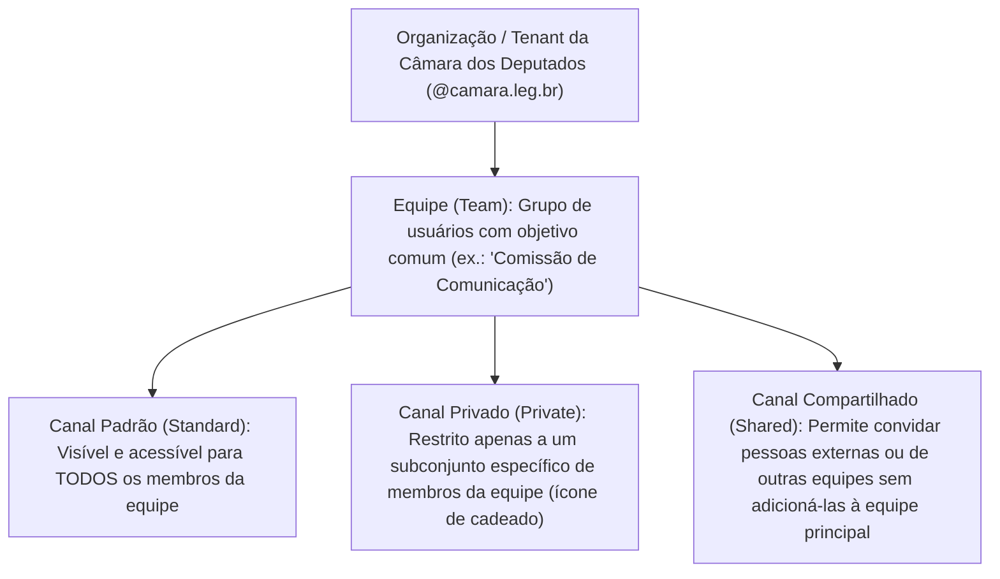
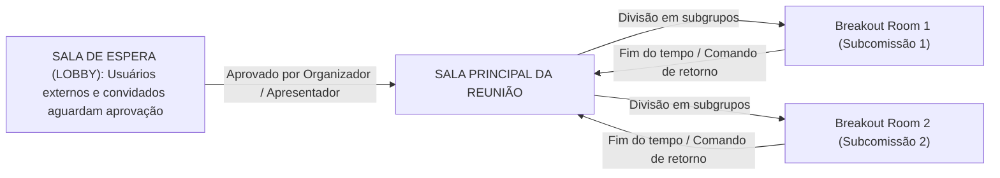

# Teams e Google Meet: ferramentas de colaboração, videoconferência corporativa, canais e moderação

**Concurso Câmara dos Deputados 2026, cargo 1, Divulgação Institucional, Cebraspe. Unidade CAM-TI-009 conforme arquitetura e inventário editorial.**

## Núcleo do conceito: plataformas de colaboração remota no serviço público

A consolidação do modelo híbrido de trabalho e a realização de audiências públicas virtuais, comissões legislativas remotas e reuniões de alinhamento institucional impuseram a adoção generalizada de plataformas integradas de colaboração e videoconferência no Poder Legislativo. O Microsoft Teams (no Microsoft 365) e o Google Meet (no Google Workspace) são os ambientes corporativos dominantes.

O Cebraspe aborda essas plataformas sob três eixos principais:
1. **Arquitetura estrutural**: distinção entre chats de grupo e canais de equipes (*Teams*), integração de arquivos na nuvem (SharePoint/OneDrive e Google Drive);
2. **Dinâmica de reuniões virtuais**: papeis e privilégios de moderação (organizador, apresentador e participante), salas simultâneas (*Breakout Rooms*) e controle de microfones/câmeras;
3. **Segurança e conformidade institucional**: controle de acesso via sala de espera (*Lobby*), gravação na nuvem com geração de transcrição e políticas de ingresso para usuários externos/convidados.

---

## 1. Microsoft Teams: arquitetura de equipes e canais

O Microsoft Teams atua como um *hub* central que unifica conversas, videoconferências, armazenamento e automação de fluxos de trabalho. A organização hierárquica é vital para entender sua operação:

### O repositório de arquivos por trás do Teams:
- **Nos Canais de Equipe**: Todo arquivo compartilhado em uma postagem de canal fica fisicamente armazenado em uma biblioteca de sites do **SharePoint Online** associada àquela equipe;
- **Nos Chats Privados (1:1 ou em grupo)**: Todo arquivo enviado em uma conversa direta fica fisicamente armazenado na pasta *Teams Chat Files* do **OneDrive for Business** do usuário que enviou o arquivo, sendo concedida permissão de leitura/edição automática aos demais participantes.

---

## 2. Google Meet: conferências em nuvem no Google Workspace

O Google Meet é a solução de videoconferência corporativa focada em **navegação nativa leve no navegador** (sem necessidade de instalação de software cliente pesado):
- Totalmente integrado ao **Google Agenda** (*Google Calendar*) e ao Gmail;
- **Acesso simplificado**: O ingresso ocorre via link direto (`meet.google.com/abc-defg-hij`);
- **Gravação de reuniões**: O vídeo gerado é salvo automaticamente na pasta *Gravações do Meet* no **Google Drive** do organizador da reunião;
- **Legendas em tempo real (*Live Captions*)**: Transcrição automática instantânea impulsionada por inteligência artificial com tradução simultânea.

---

## 3. Gestão de reuniões virtuais: papéis e privilégios

O Cebraspe frequentemente formula itens sobre o controle de moderação de reuniões:

| Papel / Função | Pode falar e ligar câmera? | Pode compartilhar tela? | Pode silenciar outros participantes? | Pode admitir pessoas da sala de espera (*Lobby*)? | Pode encerrar a reunião para todos? |
| :--- | :--- | :--- | :--- | :--- | :--- |
| **Organizador (*Organizer*)** | Sim | Sim | Sim | Sim | **Sim** |
| **Co-organizador (*Co-organizer*)** | Sim | Sim | Sim | Sim | Não (na maioria dos tenants não encerra para todos) |
| **Apresentador (*Presenter*)** | Sim | Sim | Sim | Sim | Não |
| **Participante (*Attendee*)** | Sim (se liberado pelo organizador) | **Não** (por padrão) | **Não** | **Não** | Não |

---

## 4. Recursos avançados de colaboração em chamadas

### 4.1 Salas Simultâneas (*Breakout Rooms*)
Permitem que o organizador divida uma reunião grande em **pequenas salas virtuais paralelas** para discussões temáticas:
- Os participantes podem ser distribuídos de forma automática (aleatória) ou manual;
- O organizador pode circular entre as salas e enviar anúncios em texto para todas as salas simultaneamente;
- Ao encerrar as salas, todos os participantes retornam compulsoriamente para a sala principal.

### 4.2 Compartilhamento de Conteúdo e Modo Destaque
- **Compartilhar Tela Inteira (*Desktop*)**: Projeta tudo o que aparece no monitor (incluindo notificações pop-up confidenciais);
- **Compartilhar Janela Específica (*Window*)**: Projeta apenas o aplicativo selecionado (ex.: uma apresentação de PowerPoint), ocultando e-mails ou chats que cheguem na máquina;
- **Modo Destaque (*Spotlight*)**: Fixa o vídeo de um orador específico como foco principal para todos os participantes da chamada (ideal para discursos e palestras).

---

## 5. Casos progressivos de aplicação

### Caso 1: Compartilhamento acidental de tela com notificação pessoal
Durante uma reunião pública transmitida online pelo Teams, um analista compartilha a opção "Área de Trabalho Inteira" para exibir um documento. No meio da fala, surge na tela uma notificação privada de chat com fofocas de trabalho, sendo gravada e transmitida ao vivo.
*Análise:* O erro decorre do tipo de compartilhamento escolhido. Para preservar a segurança e a privacidade institucional em transmissões, deve-se selecionar a opção **"Janela"** (projetando exclusivamente a janela do documento desejado) ou usar o modo integrado **PowerPoint Live**, que transmite apenas os slides sem projetar a área de trabalho do sistema operacional.

### Caso 2: Controle de ruído e áudio vazado em audiência de 300 pessoas
Em uma audiência pública remota com centenas de cidadãos, vários participantes deixam seus microfones abertos por descuido, gerando microfonia e ruídos domésticos que impedem a fala do palestrante.
*Análise:* O organizador ou co-organizador deve utilizar o comando **"Desativar o mudo de todos" / "Silenciar todos os participantes"** (*Mute all*). Adicionalmente, nas opções de reunião, o moderador pode alterar a permissão padrão para desativar a opção *"Permitir que os participantes ativem o mudo"*, impedindo que os participantes reabram seus microfones por conta própria até que sua fala seja formalmente autorizada.

### Caso 3: Armazenamento de arquivo enviado em chat privado do Teams
Um servidor envia uma minuta de contrato confidencial em um chat privado (conversa direta de 1 para 1) com seu colega no Teams. Ele acredita que o arquivo foi salvo no SharePoint da equipe da comissão.
*Análise:* Conclusão errada. Arquivos anexados em **chats privados** do Teams não vão para o SharePoint da equipe; eles são armazenados automaticamente na pasta pessoal do **OneDrive for Business** do remetente, sendo criadas permissões de leitura automáticas para o colega que participa do chat.

### Caso 4: Resgate de gravação de reunião do Google Meet
Uma reunião de trabalho foi gravada no Google Meet. O servidor que participou como convidado procura o arquivo de vídeo no seu computador local e não encontra nada.
*Análise:* O comportamento é padrão da nuvem. O Google Meet não grava localmente no disco rígido do participante; a gravação em vídeo (formato `.mp4`) é processada pelos servidores da nuvem e depositada automaticamente na pasta *Gravações do Meet* no **Google Drive do organizador da reunião**.

---

## 6. Questões inéditas comentadas (Padrão Cebraspe — C/E)

### Item 1
> No Microsoft Teams, os arquivos compartilhados pelos usuários em canais padrão de uma equipe são armazenados automaticamente na biblioteca de documentos de um site do SharePoint Online associado à respectiva equipe.

*( ) Certo*
*( ) Errado*

**Gabarito: Certo.**
**Comentário:** Essa é a arquitetura técnica exata do Teams: cada equipe (*Team*) criada no Teams gera automaticamente um site e uma biblioteca de documentos correspondente no **SharePoint Online**, onde residem todos os arquivos dos canais.

---

### Item 2
> Em uma videoconferência realizada por meio do Google Meet, os participantes com perfil comum de participante (*attendee*) dispõem de autorização regimental para silenciar o microfone do organizador da reunião e encerrar a chamada para todos os presentes.

*( ) Certo*
*( ) Errado*

**Gabarito: Errado.**
**Comentário:** Privilégios de moderação crítica — como desativar o microfone do anfitrião, admitir pessoas na sala de espera (*Lobby*) e encerrar a chamada em definitivo para todos os participantes — são exclusivos do **Organizador** (*Host*) e dos **Co-organizadores** (*Co-hosts*).

---

### Item 3
> O recurso de salas simultâneas (*Breakout Rooms*), presente nas principais ferramentas corporativas de videoconferência, permite segmentar uma reunião principal em subsalas temporárias para discussões em grupos menores, possibilitando ao organizador transitar entre as salas e emitir anúncios para todos os grupos.

*( ) Certo*
*( ) Errado*

**Gabarito: Certo.**
**Comentário:** As salas simultâneas viabilizam essa divisão dinâmica e controlada de grupos, mantendo o controle centralizado do moderador da reunião.

---

### Item 4
> Os arquivos enviados por um usuário durante uma conversa direta (chat privado 1:1) no Microsoft Teams são armazenados no diretório de arquivos do OneDrive for Business desse usuário remetente, sendo concedida permissão automática de acesso aos participantes daquele chat.

*( ) Certo*
*( ) Errado*

**Gabarito: Certo.**
**Comentário:** Distinção fundamental da arquitetura do Teams: arquivos de **canais** vão para o **SharePoint**; arquivos de **chats privados** vão para o **OneDrive for Business** do remetente.

---

### Item 5
> Ao encerrar uma reunião no Google Meet, o arquivo de vídeo da gravação é salvo automaticamente na pasta de downloads da máquina local de todos os usuários que estavam presentes no momento do encerramento.

*( ) Certo*
*( ) Errado*

**Gabarito: Errado.**
**Comentário:** A gravação é processada em nuvem e enviada exclusivamente para a pasta do **Google Drive do organizador da chamada**, não sendo salva nos computadores locais dos participantes.

---

### Item 6
> Para evitar interrupções indevidas durante uma transmissão de audiência institucional no Teams, o organizador pode configurar o recurso de Sala de Espera (Lobby), de forma que usuários externos ou não convidados previamente permaneçam aguardando admissão expressa antes de ingressarem na conferência.

*( ) Certo*
*( ) Errado*

**Gabarito: Certo.**
**Comentário:** O *Lobby* (sala de espera) é o mecanismo de controle de fronteira essencial para impedir acessos não autorizados e invasões (*zoombombing*) em reuniões corporativas.

---

## 7. Tabela de síntese comparativa Teams versus Meet

| Recurso / Propriedade | Microsoft Teams | Google Meet |
| :--- | :--- | :--- |
| **Suíte / Ecossistema** | Microsoft 365 | Google Workspace |
| **Repositório de canais/reuniões** | SharePoint Online | Google Drive |
| **Repositório de chat privado** | OneDrive for Business | Google Drive |
| **Controle de entrada** | Sala de Espera (*Lobby*) | Sala de Espera (*Knocking / Pedir para entrar*) |
| **Subgrupos de discussão** | Salas Simultâneas (*Breakout Rooms*) | Salas Temáticas (*Breakout Rooms*) |
| **Modo de apresentação focado** | PowerPoint Live / Modo Destaque | Compartilhar Guia / Apresentar tela |
| **Encerramento de reunião** | "Sair da reunião" (individual) $\times$ "Encerrar reunião" (para todos) | "Sair da chamada" $\times$ "Encerrar chamada para todos" |
