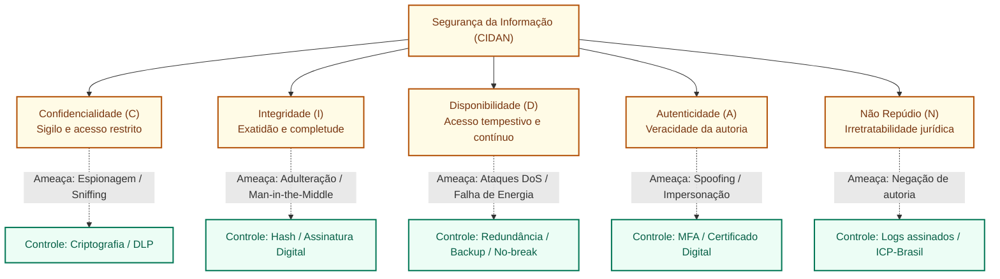

# Segurança da informação: princípios CIDAN, políticas corporativas e controles de proteção

**Concurso Câmara dos Deputados 2026, cargo 1, Divulgação Institucional, Cebraspe. Unidade CAM-TI-010 conforme arquitetura e inventário editorial.**

## Núcleo do conceito: os pilares da segurança da informação

No setor público e em órgãos com alta visibilidade institucional como a Câmara dos Deputados, a **Segurança da Informação (SI)** é a prática de proteger ativos informacionais contra acessos não autorizados, alterações indevidas, destruição, indisponibilidade ou divulgação. Ela transcende os componentes puramente tecnológicos (software e hardware), englobando pessoas, processos de governança e controles físicos.

A doutrina e normas técnicas consagradas (família **ABNT NBR ISO/IEC 27001 e 27002**) fundamentam a segurança em uma tríade clássica expandida para cinco pilares fundamentais, frequentemente sintetizados pelo acrônimo **CIDAN**:

---

## 1. Os cinco princípios fundamentais (CIDAN)

### 1.1 Confidencialidade
- **Definição**: Garantia de que a informação não será disponibilizada ou revelada a indivíduos, entidades ou processos não autorizados.
- **Objeto protegido**: O sigilo e a privacidade dos dados.
- **Mecanismos de controle**: Criptografia em trânsito (TLS) e em repouso (BitLocker, AES-256), controle de acesso baseado em funções (RBAC), classificação de sigilo da informação (Pública, Reservada, Secreta e Ultrassecreta) e políticas de prevenção de perda de dados (*Data Loss Prevention* - DLP).
- **Ameaças típicas**: *Eavesdropping* (interceptação de tráfego), visualização indiscreta de telas (*shoulder surfing*), vazamento interno acidental e espionagem cibernética.

### 1.2 Integridade
- **Definição**: Salvaguarda da exatidão e da completude da informação e de seus métodos de processamento, assegurando que o dado não foi modificado, corrompido, inserido ou excluído de forma não autorizada ou acidental.
- **Objeto protegido**: A fidelidade e fidedignidade do conteúdo original ao longo do seu ciclo de vida (criação, trânsito e armazenamento).
- **Mecanismos de controle**: Funções de resumo criptográfico (*hashes* como SHA-256), somas de verificação (*checksums*), assinaturas digitais, controle estrito de versões e trilhas de auditoria (*write-once-read-many* - WORM).
- **Ameaças típicas**: Ataques de injeção de dados, adulteração em trânsito (*Man-in-the-Middle*), infecção por malware que corrompe arquivos e erros humanos de digitação sem validação de entrada.

### 1.3 Disponibilidade
- **Definição**: Garantia de que os usuários e sistemas autorizados tenham acesso contínuo e tempestivo à informação e aos ativos associados sempre que deles necessitarem.
- **Objeto protegido**: A acessibilidade e o tempo de atividade (*uptime*) dos serviços e dados.
- **Mecanismos de controle**: Redundância de hardware e enlaces de telecomunicações (alta disponibilidade / *clustering*), sistemas de alimentação ininterrupta (no-breaks / geradores), planos formais de contingência e recuperação de desastres (*Disaster Recovery Plan* - DRP), balanceamento de carga e rotinas periódicas de cópia de segurança (backup testado).
- **Ameaças típicas**: Ataques de Negação de Serviço distribuída (DDoS), ransomware que cifra sistemas vitais, incêndios, inundações, falhas físicas de discos rígidos e quedas de energia elétrica.

### 1.4 Autenticidade
- **Definição**: Propriedade que garante que uma entidade (pessoa, computador ou sistema) é genuinamente quem ela alega ser, atestando a identidade do autor ou da origem da mensagem.
- **Objeto protegido**: A veracidade da autoria ou fonte emissora.
- **Mecanismos de controle**: Autenticação multifator (MFA - baseada em algo que você sabe, tem ou é), certificados digitais padrão X.509, protocolos de autenticação mútua (Kerberos) e biometria.
- **Ameaças típicas**: *Spoofing* de e-mail (forjamento do cabeçalho `From`), falsificação de identidade (*impersonation*) e roubo de credenciais de login.

### 1.5 Não Repúdio (Irretratabilidade)
- **Definição**: Capacidade de provar a autoria e a ocorrência de uma ação ou transação eletrônica de tal maneira que nem o remetente nem o destinatário possam negar com sucesso que enviaram, processaram ou receberam a informação.
- **Objeto protegido**: A validade e a oponibilidade jurídica do ato eletrônico.
- **Mecanismos de controle**: Assinatura digital com carimbo de tempo (*timestamp*) emitida sob a Infraestrutura de Chaves Públicas Brasileira (ICP-Brasil), logs centralizados e imutáveis com registros de transação.
- **Diferença sutil entre Autenticidade e Não Repúdio**: A *autenticidade* valida que a mensagem partiu de determinado autor no momento da criação; o *não repúdio* agrega uma força probatória incontestável perante terceiros (inclusive no Poder Judiciário), impedindo que o signatário conteste judicialmente a autoria do documento por ele assinado digitalmente.

---

## 2. Matriz de classificação de controles de segurança

Os controles e contramedidas de SI são classificados segundo a sua **natureza** e segundo o seu **momento de atuação**:

| Eixo de Classificação | Categorias | Exemplos Concretos no Ambiente Legislativo |
| :--- | :--- | :--- |
| **Quanto à Natureza** | **Físicos** | Catracas biométricas para acesso ao data center, portas corta-fogo, vigilância por CFTV e no-breaks. |
| | **Lógicos (Técnicos)** | Criptografia AES, firewalls, sistemas de autenticação MFA, antivírus, listas de controle de acesso (ACL). |
| | **Administrativos (Organizacionais)** | Política de Segurança da Informação (PSI), termos de confidencialidade (NDA), treinamentos de conscientização. |
| **Quanto ao Momento de Atuação** | **Preventivos** | Implementação de senhas fortes, treinamento anti-phishing, MFA e bloqueio de portas USB. |
| | **Detectivos** | Sistemas de Detecção de Intrusão (IDS), monitoramento de logs em SIEM e auditorias periódicas. |
| | **Corretivos** | Restauração de backups após incidente, aplicação de patches de correção e acionamento do plano de contingência. |

---

## 3. Política de Segurança da Informação (PSI) e conformidade institucional

A **Política de Segurança da Informação (PSI)** é o documento formal de mais alto nível em uma instituição pública que expressa o compromisso da alta administração com a proteção dos ativos informacionais.

### Características essenciais da PSI:
1. **Obrigatoriedade e abrangência**: Aplica-se a todos os servidores efetivos, parlamentares, ocupantes de cargos em comissão, terceirizados, estagiários e prestadores de serviços;
2. **Clareza e acessibilidade**: Deve ser redigida em linguagem compreensível, sem tecnicismos herméticos que inviabilizem a adesão dos colaboradores;
3. **Revisão periódica**: Deve ser atualizada formalmente a intervalos planejados ou sempre que ocorrerem mudanças significativas na infraestrutura, nas ameaças ou no ordenamento jurídico (como o advento da LGPD - Lei nº 13.709/2018);
4. **Sanções disciplinares**: Deve prever expressamente as consequências e procedimentos apuratórios em caso de descumprimento, articulando-se com o regime disciplinar da Lei nº 8.112/1990 e o Código de Ética.

---

## 4. Casos progressivos de aplicação

### Caso 1: O portal de notícias sob ataque massivo no dia de uma votação polêmica
- **Cenário**: Durante uma votação de grande repercussão nacional, o portal institucional da Câmara dos Deputados recebe milhões de requisições maliciosas simultâneas provenientes de uma botnet internacional, impedindo que os cidadãos acessem o texto dos projetos de lei e o resultado das votações em tempo real. Os bancos de dados internos e os textos das proposições permanecem intactos e sem qualquer alteração.
- **Análise**: O ataque é um típico DoS/DDoS (Negação de Serviço). A integridade e a confidencialidade dos dados não foram violadas (os dados não foram corrompidos nem lidos por quem não devia). O princípio exclusivamente violado foi a **Disponibilidade**, que exige acesso tempestivo aos serviços aos usuários legítimos.

### Caso 2: Vazamento de minuta restrita de CPI para a imprensa
- **Cenário**: Um relatório sigiloso de uma Comissão Parlamentar de Inquérito (CPI), classificado formalmente como "Reservado", é enviado por e-mail por um servidor não autorizado a um jornalista. O conteúdo do arquivo não sofreu nenhuma alteração em seu texto ou formatação.
- **Análise**: O documento permaneceu íntegro (mesmo conteúdo) e continuou disponível no sistema interno. O princípio violado foi estritamente a **Confidencialidade**, pois a informação restrita foi conhecida por pessoa que não possuía a devida credencial e necessidade de conhecer (*need-to-know*).

### Caso 3: Inserção fraudulenta de parágrafo em projeto de lei aprovado
- **Cenário**: Um atacante invade o servidor de arquivos legislativos e altera o texto digital de uma proposição aprovada pelo Plenário, modificando um percentual de alíquota tributária antes do envio para a redação final e sanção presidencial. A alteração passa despercebida visualmente, mas o sistema estava acessível e online o tempo todo.
- **Análise**: Houve violação frontal da **Integridade**, pois a fidedignidade e a exatidão do documento oficial foram corrompidas. Se o sistema utilizar resumo criptográfico (*hash*) e assinatura digital, a violação é imediatamente detectada pela quebra da assinatura.

### Caso 4: Recusa de autoria em requerimento legislativo eletrônico
- **Cenário**: Um gabinete parlamentar encaminha eletronicamente um requerimento de convocação de autoridade. Dias depois, devido à repercussão negativa na imprensa, o parlamentar afirma que jamais protocolou aquele pedido e que sua assinatura foi forjada. Contudo, a auditoria demonstra que o arquivo foi assinado digitalmente com o certificado pessoal ICP-Brasil do parlamentar, com carimbo de tempo válido.
- **Análise**: A tecnologia de assinatura digital padrão ICP-Brasil garante a **Autenticidade** (prova que a chave privada do parlamentar realizou o cálculo da assinatura) e o **Não Repúdio (Irretratabilidade)**, o que impede juridicamente o parlamentar de alegar que não foi o autor da manifestação eletrônica.

---

## 5. Questões inéditas comentadas (Padrão Cebraspe)

### Questão 1 (Cebraspe / Inédita)
> Em relação aos princípios fundamentais da segurança da informação, a disponibilidade é a garantia de que a informação não será revelada a entidades não autorizadas, enquanto a integridade assegura que os serviços permaneçam operacionais e acessíveis mediante solicitação de um usuário legítimo.

- **Gabarito**: **ERRADO**
- **Fundamentação**: O item promoveu uma clássica **inversão de conceitos**: a garantia de que a informação não será revelada a pessoas não autorizadas é a **Confidencialidade** (e não a disponibilidade). A garantia de que os recursos estarão operacionais e acessíveis quando solicitados é a **Disponibilidade** (e não a integridade, que trata da exatidão e fidedignidade da informação).

---

### Questão 2 (Cebraspe / Inédita)
> O princípio do não repúdio ou irretratabilidade assegura que o emissor de uma determinada informação ou transação eletrônica não possa, posteriormente, negar a autoria ou a ocorrência da referida transmissão.

- **Gabarito**: **CERTO**
- **Fundamentação**: Definição literal e precisa do princípio do não repúdio (*non-repudiation*). A irretratabilidade confere eficácia probatória plena, impedindo a escusa de autoria, sendo tipicamente implementada mediante o uso de assinaturas digitais com certificados emitidos sob cadeias confiáveis (como a ICP-Brasil).

---

### Questão 3 (Cebraspe / Inédita)
> Em um ataque de negação de serviço (DoS/DDoS) bem-sucedido que sobrecarregue os servidores web de um órgão público, provocando a indisponibilidade temporária de seu portal de notícias, restam violados concomitantemente os princípios da confidencialidade, da integridade e da disponibilidade dos dados institucionais.

- **Gabarito**: **ERRADO**
- **Fundamentação**: A pegadinha consiste em afirmar que múltiplos princípios são violados ao mesmo tempo. No ataque de DoS puro, a ação do invasor se limita a esgotar os recursos de rede, memória ou processamento do servidor para impedir o atendimento de requisições legítimas. Não há, necessariamente, invasão de bases de dados para leitura indevida (o que violaria a confidencialidade) nem alteração do conteúdo dos arquivos (o que violaria a integridade). A violação ocorre estritamente contra a **Disponibilidade**.

---

### Questão 4 (Cebraspe / Inédita)
> A utilização de funções de resumo criptográfico (*hash*), tais como SHA-256, associadas aos arquivos de tramitação legislativa, atua como controle tecnológico primordial para garantir a confidencialidade do conteúdo das proposições.

- **Gabarito**: **ERRADO**
- **Fundamentação**: O *hash* criptográfico é um algoritmo unidirecional que gera uma assinatura matemática de comprimento fixo a partir de qualquer volume de dados. Ele serve para atestar a **Integridade** (verificar se qualquer bit do arquivo foi alterado entre a origem e o destino). O *hash* **não** garante a confidencialidade, pois ele não impede que terceiros leiam o texto original do documento (o sigilo é garantido pela criptografia simétrica ou assimétrica).

---

### Questão 5 (Cebraspe / Inédita)
> A Política de Segurança da Informação (PSI) de uma instituição pública deve constituir um instrumento estático e imutável, aprovado em caráter definitivo pela diretoria-geral para assegurar a perenidade dos controles operacionais ao longo dos mandatos legislativos.

- **Gabarito**: **ERRADO**
- **Fundamentação**: Conforme as normas ISO/IEC 27001 e 27002, a PSI é um documento formal corporativo que deve ser revisado periodicamente (ao menos anualmente) e sempre que ocorrerem mudanças regulatórias, novas ameaças tecnológicas ou alterações organizacionais substanciais. Tratá-la como documento estático e imutável tornaria a segurança obsoleta e ineficaz.

---

### Questão 6 (Cebraspe / Inédita)
> Os controles de segurança da informação podem ser categorizados tanto quanto à sua natureza (físicos, lógicos e administrativos) quanto ao momento temporal de sua atuação (preventivos, detectivos e corretivos), sendo a restauração de um backup testado um exemplo típico de controle corretivo.

- **Gabarito**: **CERTO**
- **Fundamentação**: O item classifica com rigor as duas principais taxonomias de contramedidas de SI. A restauração de um backup é um controle corretivo porque entra em ação *após* a ocorrência de um sinistro, corrupção ou ataque (como um ransomware), restaurando a disponibilidade e o estado anterior dos dados.

---

## 6. Heurísticas para a prova da Câmara dos Deputados

1. **Inversões de papéis clássicas na banca**:
   - Falou em *"acesso indevido / bisbilhotice / vazamento"* $\rightarrow$ **Confidencialidade**.
   - Falou em *"adulteração / alteração não autorizada / corrompimento"* $\rightarrow$ **Integridade**.
   - Falou em *"fora do ar / indisponível / sobrecarga de requisições / falha de energia"* $\rightarrow$ **Disponibilidade**.
   - Falou em *"provar a identidade de quem fez / verificar que a pessoa é ela mesma"* $\rightarrow$ **Autenticidade**.
   - Falou em *"impedir de negar o que fez / não poder voltar atrás"* $\rightarrow$ **Não Repúdio (Irretratabilidade)**.
2. **Criptografia $\times$ Hash**:
   - Criptografia (cifração com chaves) protege a **Confidencialidade**.
   - Hash (resumo unidirecional) protege a **Integridade**.
   - Assinatura Digital (Hash + Criptografia com Chave Privada) assegura **Integridade**, **Autenticidade** e **Não Repúdio**.
3. **MFA (Autenticação Multifator)**: Para o Cebraspe, exige fatores de categorias diferentes (conhecimento = senha; posse = token/celular; inerência = biometria). Exigir duas senhas diferentes **não** é MFA.

---

## Fontes consultadas e vigência

- **ABNT NBR ISO/IEC 27001:2022**: Sistemas de gestão da segurança da informação — Requisitos.
- **ABNT NBR ISO/IEC 27002:2022**: Segurança da informação, segurança cibernética e proteção da privacidade — Controles de segurança da informação.
- **Instrução Normativa GSI/PR nº 01/2020**: Disciplina a Gestão de Segurança da Informação na Administração Pública Federal.
- **Lei nº 13.709/2018 (LGPD)**: Artigos 46 a 51 (Segurança e Boas Práticas).
- **Legislação da Câmara dos Deputados**: Portarias administrativas sobre uso seguro de recursos computacionais e política corporativa de senhas.
