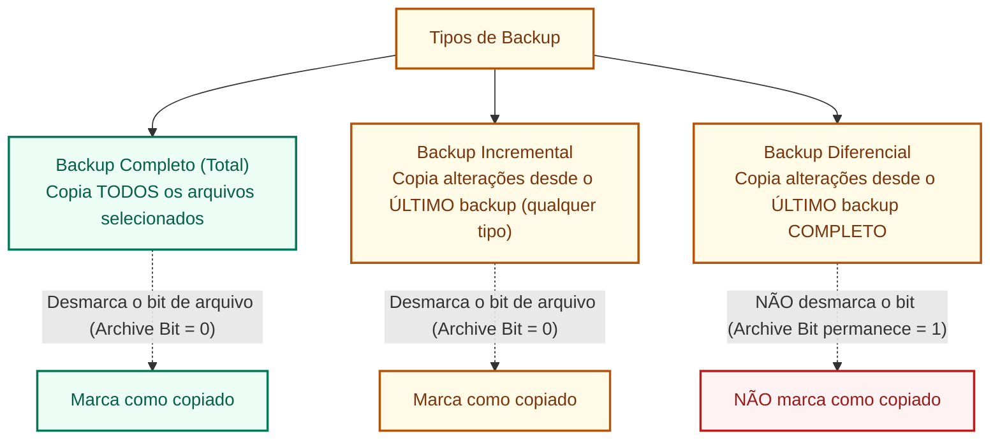

# Backup: estratégias, tipos, recuperação e diferença de sincronização em nuvem

**Concurso Câmara dos Deputados 2026, cargo 1, Divulgação Institucional, Cebraspe. Unidade CAM-TI-011 conforme arquitetura e inventário editorial.**

## Núcleo do conceito: salvaguarda de dados e continuidade operacional

O **backup** (cópia de segurança) é o procedimento sistemático e periódico de duplicar dados digitais para um meio de armazenamento secundário e independente, com a finalidade exclusiva de permitir sua **restauração integral** em caso de perda acidental, exclusão maliciosa (ex.: ransomware), corrupção de arquivos ou falha física de hardware.

No âmbito da governança de Tecnologia da Informação do setor público e em órgãos do Poder Legislativo, o backup é a contramedida primordial para assegurar o princípio da **Disponibilidade** e salvaguardar a **Integridade** histórica do patrimônio documental.

---

## 1. O atributo de arquivo (*Archive Bit*)

Para compreender como os softwares de backup operam nos sistemas de arquivos (como NTFS e FAT), é imprescindível conhecer o **Atributo de Arquivo** (*Archive Attribute* ou bit de arquivo):
- Quando um arquivo é criado ou modificado pelo usuário ou sistema, o sistema operacional ativa automaticamente o seu *Archive Bit* (valor `1`), sinalizando: *"Este arquivo sofreu alterações e precisa de cópia de segurança"*;
- No **modelo clássico baseado no archive bit**, os tipos podem ser explicados pelo modo como consultam e alteram esse atributo. Soluções atuais também usam catálogos, snapshots, registros de alteração e rastreamento de blocos, dispensando o bit:
  1. **Backup Completo (Total)**: Copia todos os arquivos independentemente do estado do bit. Ao concluir, **desmarca o bit** (define como `0` ou inativo);
  2. **Backup Incremental**: Copia apenas os arquivos cujo bit está ativo (`1`). Ao concluir a cópia de cada arquivo, **desmarca o bit** (define como `0`);
  3. **Backup Diferencial**: Copia apenas os arquivos cujo bit está ativo (`1`). Ao concluir, **NÃO altera o bit** (o bit permanece ativo, `1`).

---

## 2. Matriz comparativa dos tipos de backup

| Critério | Backup Completo (*Full*) | Backup Incremental | Backup Diferencial |
| :--- | :--- | :--- | :--- |
| **Arquivos copiados** | Todos os dados da seleção | Apenas arquivos alterados desde o **último backup** (seja Full ou Incremental) | Apenas arquivos alterados desde o **último backup Completo** |
| **Manipulação do Atributo** | No modelo clássico com archive bit, desmarca (`0`) | No modelo clássico com archive bit, desmarca (`0`) | No modelo clássico com archive bit, não desmarca (`1`) |
| **Velocidade de execução** | Mais lenta (maior volume) | **Mais rápida** (volume mínimo diário) | Intermediária (volume cresce ao longo dos dias) |
| **Espaço em disco exigido** | Muito alto | **Muito baixo** | Intermediário a alto (dados repetem-se nos dias seguintes) |
| **Processo de Restauração** | **Mais simples e rápido**: restaura apenas a mídia do Full | **Mais complexo e demorado**: restaura o último Full + **TODOS** os incrementais em sequência cronológica | **Equilibrado**: restaura apenas o último Full + o **ÚLTIMO** diferencial |
| **Risco na perda de uma fita/mídia** | Perda restrita àquela data | Se **uma fita incremental** falhar na cadeia, todos os incrementais posteriores ficam inutilizáveis | Se um diferencial intermediário for perdido, não há prejuízo (apenas o último interessa) |

---

## 3. Dinâmica de restauração na prática (cenário de prova)

Imagine uma rotina de segunda a quinta-feira, com sinistro na sexta-feira pela manhã:

### Estratégia A: Full no Domingo + Incremental nos demais dias
- Domingo: **Completo (Total)**
- Segunda: **Incremental 1** (alterações de seg)
- Terça: **Incremental 2** (alterações de ter)
- Quarta: **Incremental 3** (alterações de qua)
- Quinta: **Incremental 4** (alterações de qui)
- **Restauração na Sexta-feira**: Necessita de **5 mídias/etapas**:
  $$\text{Full (Domingo)} \rightarrow \text{Inc 1 (Seg)} \rightarrow \text{Inc 2 (Ter)} \rightarrow \text{Inc 3 (Qua)} \rightarrow \text{Inc 4 (Qui)}$$
- *Atenção Cebraspe*: A ordem cronológica estrita deve ser respeitada. Se a fita de Terça-feira estiver corrompida, só é possível restaurar os dados até Segunda-feira!

### Estratégia B: Full no Domingo + Diferencial nos demais dias
- Domingo: **Completo (Total)**
- Segunda: **Diferencial 1** (alterações desde domingo: dados de seg)
- Terça: **Diferencial 2** (alterações desde domingo: dados de seg + ter)
- Quarta: **Diferencial 3** (alterações desde domingo: dados de seg + ter + qua)
- Quinta: **Diferencial 4** (alterações desde domingo: dados de seg + ter + qua + qui)
- **Restauração na Sexta-feira**: Necessita de apenas **2 mídias/etapas**:
  $$\text{Full (Domingo)} \rightarrow \text{Diferencial 4 (Quinta)}$$
- *Atenção Cebraspe*: Os diferenciais de segunda, terça e quarta são totalmente dispensáveis na restauração, pois o diferencial de quinta-feira já contém todas as alterações acumuladas desde o último Full.

---

## 4. Estratégia de segurança: a regra 3-2-1 de backup

Padrão internacional de resiliência corporativa adotado em planos de continuidade de negócios:
- **3 Cópias**: Manter no mínimo 3 cópias de qualquer dado importante (1 cópia de produção + 2 cópias de backup);
- **2 Mídias diferentes**: Armazenar as cópias em pelo menos 2 tipos de tecnologias ou mídias distintas (ex.: disco rígido local/NAS e fita LTO magnética ou nuvem);
- **1 Cópia fora do local (*Off-site*)**: Manter pelo menos 1 cópia em local físico geograficamente separado (outra cidade, cofre de segurança externo ou nuvem pública) para proteção contra desastres físicos (incêndio, inundação, furto).

---

## 5. Diferença crítica: Backup $\times$ Sincronização em nuvem

Um dos erros mais comuns de usuários leigos e uma das pegadinhas mais frequentes do Cebraspe é equiparar ferramentas de sincronização (OneDrive, Google Drive, Dropbox) ao conceito estrito de backup:

| Dimensão | Backup Corporativo | Sincronização em Nuvem (Sync) |
| :--- | :--- | :--- |
| **Finalidade primordial** | Salvaguarda estática e histórica para recuperação de desastres (*Point-in-Time Recovery*) | Disponibilização ubíqua dos mesmos arquivos atualizados em múltiplos dispositivos |
| **Efeito da exclusão acidental** | O arquivo apagado na máquina de produção **permanece preservado** intacto nas cópias de backup anteriores | A exclusão feita em uma máquina é **replicada instantaneamente** na nuvem e em todos os dispositivos sincronizados |
| **Efeito de ataque por Ransomware** | Backups imutáveis (*WORM* / *offline* / *air-gapped*) permanecem inacessíveis e protegidos contra cifração | Arquivos cifrados localmente são **sincronizados e substituídos na nuvem**, propagando o estrago em tempo real |
| **Independência de estado** | Total: o backup é uma fotografia pontual (*snapshot*) desconectada da rotina de edição ativa | Nula: reflete o estado dinâmico atual dos arquivos locais |

> [!IMPORTANT]
> A sincronização em nuvem oferece conveniência operacional, coautoria e mobilidade. Porém, **sincronização não é backup**. Uma estratégia de backup confiável requer retenção e restauração testada, proteção de acesso e cópias independentes da sincronização operacional. Imutabilidade e isolamento adicional são controles importantes contra ransomware, mas não integram obrigatoriamente toda definição de backup.

---

## 6. Métricas essenciais de recuperação: RPO e RTO

Em planos de contingência do setor público, dois parâmetros definem os limites aceitáveis de interrupção:
1. **RPO (*Recovery Point Objective* - Objetivo de Ponto de Recuperação)**:
   - Mede a **tolerância à perda de dados** em termos de tempo.
   - Pergunta: *"Quantas horas de dados a instituição pode se dar ao luxo de perder se houver um desastre?"*
   - Se o backup é executado uma vez por dia à meia-noite e o desastre ocorre às 23h, a organização perde 23 horas de trabalho. Para reduzir o RPO para minutos, exigem-se backups contínuos ou replicação síncrona.
2. **RTO (*Recovery Time Objective* - Objetivo de Tempo de Recuperação)**:
   - Mede a **tolerância ao tempo de inatividade** (*downtime*).
   - Pergunta: *"Quanto tempo o serviço pode ficar fora do ar até ser restabelecido?"*
   - O RTO define a agilidade exigida da infraestrutura para restaurar o sistema e deixá-lo operacional novamente.

---

## 7. Casos progressivos de aplicação

### Caso 1: A rotina diária no gabinete parlamentar
- **Cenário**: A equipe de TI da Câmara realiza um backup completo aos sábados à meia-noite e backups incrementais de segunda a sexta-feira, sempre às 22h. Na quinta-feira às 14h, um servidor de banco de dados queima a placa-mãe e corrompe os discos.
- **Análise**: Para restaurar o sistema ao estado de quarta-feira às 22h, a equipe precisará restaurar o backup Completo do sábado, seguido sucessivamente do Incremental de segunda-feira, do Incremental de terça-feira e do Incremental de quarta-feira. Os dados digitados entre as 22h de quarta e as 14h de quinta foram perdidos (janela de RPO).

### Caso 2: Ransomware atacando pastas sincronizadas
- **Cenário**: Um servidor da Divulgação Institucional abre um anexo infectado por ransomware. Os arquivos de sua pasta local do OneDrive são rapidamente criptografados com a extensão `.locked`. O cliente OneDrive sincroniza imediatamente as alterações com a nuvem da Microsoft.
- **Análise**: A sincronização automática propagou a corrupção para a nuvem. O que salvará os dados não é o fato de estarem sincronizados, mas sim o recurso de **Histórico de Versões** e a ferramenta corporativa de **Restauração em Massa do OneDrive** (*Point-in-Time Restore*), que reverte a biblioteca inteira para um momento anterior ao ataque, atuando como mecanismo de contingência.

### Caso 3: Desastre físico no prédio principal do Congresso
- **Cenário**: Um curto-circuito provoca um incêndio de grandes proporções no Centro de Informática do Senado e da Câmara, destruindo completamente os servidores de produção e os storages de backup em disco local instalados no mesmo prédio.
- **Análise**: A instituição somente conseguirá restabelecer seus serviços se tiver implementado a **regra 3-2-1**, possuindo uma réplica externa (*Off-site*) em data center geograficamente distante ou em nuvem governamental resiliente.

### Caso 4: Escolha de estratégia para minimizar tempo de restauração em plenário
- **Cenário**: O sistema de votação eletrônica do plenário exige tempo de retorno mínimo em caso de desastre (RTO extremamente baixo). A TI deve escolher entre rotina Incremental ou Diferencial para os dias úteis.
- **Análise**: A estratégia **Diferencial** é a mais indicada para minimizar o RTO de restauração, pois exige restaurar apenas duas mídias (o último Completo + o último Diferencial), eliminando o tempo de processamento em cadeia de múltiplos arquivos intermediários exigido pelo método Incremental.

---

## 8. Questões inéditas comentadas (Padrão Cebraspe)

### Questão 1 (Cebraspe / Inédita)
> O procedimento de backup incremental copia todos os arquivos alterados desde o último backup completo ou incremental, desmarcando o atributo de arquivo (*archive bit*) ao término da operação.

- **Gabarito**: **NÃO HOMOLOGADO (implementação não especificada)**
- **Fundamentação**: O conceito incremental é copiar dados modificados desde o backup relevante anterior. **Desmarcar o *archive bit*** caracteriza implementações tradicionais que utilizam esse atributo, mas não é comportamento obrigatório de todo software de backup incremental. O enunciado não fixa produto ou mecanismo, logo combina um princípio geral com um detalhe não universal. **Versão de treino:** “Em um sistema tradicional de backup baseado no *archive bit*, o backup incremental copia arquivos modificados desde o último backup apropriado e pode limpar esse atributo após copiá-los.” **Gabarito reformulado: CERTO.**

---

### Questão 2 (Cebraspe / Inédita)
> Em uma política de segurança que adote backup completo aos domingos e backup diferencial de segunda a quinta-feira, a restauração completa dos dados na manhã de sexta-feira exigirá a recuperação do backup de domingo e de todos os backups diferenciais executados ao longo da semana, de forma sequencial.

- **Gabarito**: **ERRADO**
- **Fundamentação**: A necessidade de restaurar a cadeia completa e sequencial é característica do backup **Incremental**. No backup **Diferencial**, como cada arquivo diferencial acumula todas as alterações desde o último backup completo, a restauração na sexta-feira requer apenas o **backup de domingo (Full)** e o **backup de quinta-feira (último Diferencial)**. Os diferenciais de segunda, terça e quarta são descartáveis.

---

### Questão 3 (Cebraspe / Inédita)
> A sincronização automática de arquivos de uma estação de trabalho para um repositório corporativo em nuvem, como o Microsoft OneDrive ou Google Drive, substitui plenamente a necessidade de rotinas de backup, haja vista que qualquer alteração realizada localmente é imediatamente replicada e preservada em ambiente externo.

- **Gabarito**: **ERRADO**
- **Fundamentação**: Pegadinha recorrente. A sincronização automática **não** substitui o backup. Se um arquivo for deletado por engano ou corrompido por um ransomware localmente, a sincronização propagará a exclusão ou corrupção imediatamente para a nuvem. O backup exige estratégia de recuperação e retenção independente da mera sincronização corrente; **não precisa ser imutável ou completamente isolado** em toda arquitetura.

---

### Questão 4 (Cebraspe / Inédita)
> O atributo de arquivo (*archive bit*) é mantido ativo (marcado) após a conclusão de um backup diferencial, razão pela qual os arquivos alterados na segunda-feira voltam a ser copiados no backup diferencial de terça-feira, caso não haja novo backup completo no intervalo.

- **Gabarito**: **NÃO HOMOLOGADO (implementação não especificada)**
- **Fundamentação**: Em rotinas tradicionais **baseadas no *archive bit***, o diferencial não o limpa e os arquivos continuam elegíveis para diferenciais seguintes. Porém, **backups diferenciais modernos não precisam usar esse atributo**. O enunciado apresenta o comportamento do atributo como universal. **Versão de treino:** “Em uma implementação clássica que utiliza o *archive bit*, um backup diferencial não limpa o atributo e volta a incluir arquivos alterados desde o backup completo.” **Gabarito reformulado: CERTO.**

---

### Questão 5 (Cebraspe / Inédita)
> De acordo com a regra 3-2-1 de cópias de segurança, uma organização deve manter 3 cópias dos seus dados, armazenadas em 2 tipos diferentes de mídias, com pelo menos 1 dessas cópias guardada em local externo (*off-site*).

- **Gabarito**: **CERTO**
- **Fundamentação**: Enunciado literal da regra 3-2-1, considerada o padrão ouro de mercado para mitigação de riscos catastróficos e proteção contra falhas simultâneas de mídia e instalações físicas.

---

### Questão 6 (Cebraspe / Inédita)
> Em relação às métricas de continuidade de negócios, o RTO (*Recovery Time Objective*) define o volume máximo tolerável de dados perdidos medido em horas, ao passo que o RPO (*Recovery Point Objective*) estipula o tempo máximo aceitável para restabelecer o funcionamento de um sistema indisponível.

- **Gabarito**: **ERRADO**
- **Fundamentação**: Houve uma **inversão de conceitos**:
  - O **RPO** (*Point*) é quem define a tolerância à perda de dados (o ponto no tempo até onde os dados podem ser recuperados);
  - O **RTO** (*Time*) é quem define o tempo máximo aceitável de duração da indisponibilidade até o restabelecimento do sistema.

---

## 9. Heurísticas para a prova da Câmara dos Deputados

1. **Incremental $\times$ Diferencial na velocidade de execução**:
   - Backup **Incremental** tende a copiar menos alterações e pode exigir a sequência de incrementais desde o completo para restauração, conforme a implementação; não significa necessariamente “copiar só o dia” nem depender de fitas.
   - Backup **Diferencial** acumula alterações desde o completo de referência e, no modelo clássico, permite restaurar com o completo e o último diferencial. Desempenho depende do volume de mudanças e da solução.
2. **Manipulação do Atributo (*Archive Bit*) apenas em implementações clássicas que o utilizam**:
   - Completo: desmarca (`0`).
   - Incremental: desmarca (`0`).
   - Diferencial: **não desmarca** (mantém `1`).
3. **Sincronização $\ne$ Backup**: Se o enunciado disser que sincronizar dispensa backup ou que serve como cópia de segurança infalível contra exclusões, marque **ERRADO**.

---

## Fontes consultadas e vigência

- **ABNT NBR ISO/IEC 27002:2022**: Controle 8.13 (Cópia de segurança de informações).
- **Instrução Normativa GSI/PR nº 01/2020**: Gestão de continuidade de negócios e planos de recuperação de desastres na Administração Pública Federal.
- **NIST Special Publication 800-34 Rev. 1**: *Contingency Planning Guide for Federal Information Systems*.
- **Microsoft Learn**: Guia de arquitetura de proteção de dados e histórico de versões do Microsoft 365 e Azure Backup.

> **Revisão dirigida (11/11/2026):** ajustes com base nos achados TI-049 a TI-058 da auditoria da Câmara, distinguindo características gerais de implementações específicas. Persistem pendências de validação integral das questões e referências.

> **Auditoria C/E, segunda passagem (11/11/2026):** questões 1 e 4 **não homologadas** por universalizarem manipulação do *archive bit* sem definir implementação. Questões 2, 3, 5 e 6 mantêm **E, E, C, E**. As regras de backup completo/incremental/diferencial devem distinguir conceito de mecanismo operacional.
