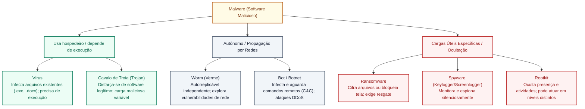
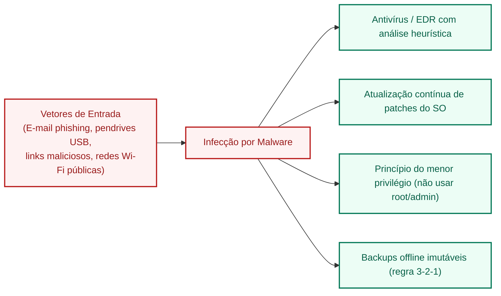

# Malware: vírus, worm, trojan, ransomware, spyware, rootkit e botnets

**Concurso Câmara dos Deputados 2026, cargo 1, Divulgação Institucional, Cebraspe. Unidade CAM-TI-012 conforme arquitetura e inventário editorial.**

## Núcleo do conceito: taxonomia de softwares maliciosos

O termo **malware** (aglutinação de *malicious software*) é a denominação genérica que abrange qualquer programa, código ou script desenvolvido especificamente para se infiltrar em sistemas computacionais, causar danos, corromper dados, roubar credenciais, interromper operações ou obter acesso não autorizado a recursos de rede.

No âmbito de órgãos públicos de alta relevância estratégica como a Câmara dos Deputados, a compreensão das espécies de malware é indispensável tanto para a política de governança de segurança quanto para a resolução de questões de concurso público. A banca **Cebraspe** fundamenta suas questões na taxonomia da Cartilha de Segurança para a Internet do CERT.br (NIC.br/CGI.br), explorando meticulosamente os **mecanismos de propagação**, a **necessidade ou não de arquivo hospedeiro** e a **interação com o usuário**.

---

## 1. Espécies de malware e matriz de diferenciação técnica

### 1.1 Vírus
- **Definição**: Programa ou trecho de código malicioso que se propaga inserindo cópias de si mesmo em **outros programas, documentos ou arquivos executáveis** existentes no computador hospedeiro.
- **Dependência essencial**: **Necessita de um hospedeiro** (*host*) e da execução do código infectado para se ativar e se propagar. Essa execução pode ocorrer por ações humanas ou por processos automáticos; clique deliberado do usuário não é requisito universal.
- **Subtipos clássicos cobrados em prova**:
  - *Vírus de Macro*: Escrito em linguagens de automação de suítes de escritório (VBA no Word e Excel); infecta documentos `.docm`, `.xlsm` ou modelos globais (`Normal.dotm`);
  - *Vírus de Boot*: Aloja-se no setor de inicialização do disco rígido (*Master Boot Record* - MBR) ou memória de inicialização para ser executado antes do sistema operacional;
  - *Vírus Polimórfico / Metamórfico*: Altera sua própria estrutura e assinatura binária a cada infecção para burlar a detecção baseada em assinatura dos antivírus.

### 1.2 Worm (Verme)
- **Definição**: Programa malicioso completo e **autônomo**, projetado para se propagar automaticamente através de redes de computadores, explorando falhas de segurança (*vulnerabilidades*) em sistemas operacionais e aplicações.
- **Distinção crucial do Vírus**:
  1. O worm **NÃO precisa de um arquivo hospedeiro** (ele é um arquivo independente);
  2. O worm **NÃO depende de ação do usuário** para se propagar (dissemina-se sozinho pelas conexões de rede ativas);
  3. Costuma provocar **lentidão severa na rede e esgotamento de banda/memória** devido ao volume massivo de cópias que envia pela rede.

### 1.3 Cavalo de Troia (Trojan Horse)
- **Definição**: Programa malicioso que se apresenta disfarçado de aplicativo legítimo, útil ou inofensivo (jogo, cartão virtual de felicitações, utilitário de otimização de sistema), induzindo o usuário a instalá-lo e executá-lo.
- **Finalidade e mecânica**: pode simular função legítima e executar ações maliciosas não anunciadas, como instalar um *backdoor*, extrair dados ou modificar configurações. **Abertura de porta remota é exemplo possível, não característica necessária de todo trojan**.
- **Atenção**: O Trojan tradicional **não se propaga infectando outros arquivos** (como o vírus) nem se replica automaticamente pela rede (como o worm).

### 1.4 Ransomware
- **Definição**: Malware que torna inacessíveis os dados armazenados em um computador ou rede inteira, geralmente utilizando **criptografia assimétrica ou simétrica de alta robustez** (como AES-256 e RSA-2048), exigindo em seguida o pagamento de um resgate (normalmente em criptomoedas como Bitcoin ou Monero) para fornecer a chave de descriptografia.
- **Modalidades**:
  - *Crypto-ransomware*: Criptografa arquivos pessoais e institucionais (documentos, planilhas, bancos de dados, imagens), deixando o sistema operacional funcional, porém inútil;
  - *Locker-ransomware*: Bloqueia a interface de acesso do usuário à máquina (tela cheia com aviso falso de autoridade policial), impedindo o login no dispositivo;
  - *Double Extortion* (Dupla Extorsão): Antes de criptografar os dados, os criminosos realizam o download furtivo das informações (*exfiltração*) e ameaçam vazar os dados confidenciais na *Dark Web* caso o resgate não seja pago.

### 1.5 Spyware
- **Definição**: Software espião projetado para monitorar secretamente as atividades do usuário no computador e enviar as informações coletadas para terceiros via internet, sem consentimento.
- **Variantes cobradas pelo Cebraspe**:
  - *Keylogger*: Grava de forma oculta todas as teclas pressionadas no teclado físico pelo usuário (capturando senhas, nomes de usuário e números de cartão de crédito);
  - *Screenlogger*: Captura a imagem da tela (prints) na região próxima ao cursor do mouse sempre que o usuário clica, desenvolvido especificamente para burlar os teclados virtuais com clique de mouse usados em bancos;
  - *Adware*: Exibe anúncios publicitários invasivos e monitora o perfil de navegação para direcionamento de marketing.

### 1.6 Rootkit
- **Definição**: Conjunto refinado de programas e ferramentas que visa **assegurar e manter o acesso privilegiado** de um invasor a um sistema comprometido, tendo como característica definidora a capacidade de **ocultar a sua própria presença** e a presença de outros malwares.
- **Mecanismo de ocultação**: rootkits podem ocultar arquivos, processos ou atividades em **modo usuário, modo kernel, inicialização ou firmware**, conforme sua arquitetura. Alguns interceptam chamadas do sistema; outros manipulam mecanismos diferentes. A capacidade de **ocultação/persistência**, e não operar obrigatoriamente em *Ring 0*, caracteriza essa classe.

### 1.7 Bot e Botnet
- **Definição**: O *Bot* é um programa malicioso que, uma vez instalado, permite que o computador infectado (denominado "zumbi") seja controlado remotamente pelo atacante (*botmaster*) através de um servidor de Comando e Controle (C&C).
- **Botnet**: Uma rede composta por milhares ou milhões de computadores zumbis infectados que operam de forma coordenada para executar ataques massivos de Negação de Serviço distribuída (DDoS), disparo de spam ou mineração clandestina de criptomoedas, sem que os proprietários percebam.

---

## 2. Matriz taxonômica oficial (Padrão CERT.br / Cebraspe)

| Tipo de Malware | Necessita de Hospedeiro? | Propagação Autônoma em Rede? | Ação Primária / Característica Distintiva |
| :--- | :--- | :--- | :--- |
| **Vírus** | **SIM** (infecta arquivos/programas) | **Em geral não se propaga autonomamente como worm** (requer execução de código infectado, que pode ser automática) | Anexa seu código a arquivos sadios e se multiplica ao serem executados |
| **Worm** | **NÃO** (é autossuficiente) | **SIM** (varre redes ativamente) | Explora vulnerabilidades de rede e consome recursos e largura de banda |
| **Trojan** | Não obrigatoriamente | **NÃO** | Disfarça-se de programa útil; pode instalar *backdoor* ou outra carga |
| **Ransomware** | Não obrigatoriamente | Pode conter módulo de worm | Cifra dados ou bloqueia o sistema exigindo pagamento de resgate |
| **Spyware** | Não obrigatoriamente | **NÃO** | Espiona a navegação e registra ações (teclas via *keylogger*, telas via *screenlogger*) |
| **Rootkit** | Não obrigatoriamente | **NÃO** | **Oculta** presença ou atividade; pode atuar em modo usuário, kernel ou camadas de inicialização |
| **Bot** | Não obrigatoriamente | Frequentemente usa worm | Transforma a máquina em zumbi sob comando remoto (*C&C*) para DDoS e spam |

---

## 3. Vetores de infecção e defesas recomendadas

---

## 4. Casos progressivos de aplicação

### Caso 1: A lentidão inexplicável na rede interna do parlamento
- **Cenário**: De repente, a rede local de gabinetes parlamentares fica saturada, com links de internet lentos e servidores recusando conexões. A equipe técnica verifica que nenhum usuário executou arquivos suspeitos recentemente, mas um programa malicioso está se replicando sozinho entre computadores que estavam sem a atualização recente do Windows.
- **Análise**: Trata-se tipicamente de um **Worm**. A ausência de necessidade de arquivo hospedeiro e a capacidade de autorreplicação autônoma explorando falhas de rede de máquina para máquina sem clique humano são as assinaturas inconfundíveis dessa praga digital.

### Caso 2: O teclado virtual bancário burlado
- **Cenário**: Um servidor utiliza o computador institucional para acessar sua conta bancária. Sabendo dos riscos de digitação de senhas, utiliza o mouse para clicar nos botões do teclado virtual da página do banco. Mesmo assim, suas credenciais foram capturadas e sua conta esvaziada.
- **Análise**: A máquina estava infectada por um **Screenlogger** (variante de spyware). Enquanto o *keylogger* captura apenas teclas digitadas no teclado físico (sendo ineficaz contra teclados virtuais), o screenlogger fotografa a área ao redor do clique do mouse no momento exato em que o botão virtual é acionado.

### Caso 3: O utilitário falso de verificação de contracheque
- **Cenário**: Servidores recebem um e-mail afirmando que a Câmara lançou um novo software para calcular a restituição do imposto de renda e o saldo do auxílio-alimentação. O arquivo chama-se `Calculadora_Camara.exe`. Ao ser executado, o programa abre uma calculadora funcional na tela, mas instala silenciosamente um backdoor na porta 4444.
- **Análise**: Este é um caso clássico de **Cavalo de Troia (Trojan)**. O malware enganou o usuário exibindo uma funcionalidade aparentemente útil e desejável para disfarçar a instalação clandestina de um código malicioso de acesso remoto.

### Caso 4: O ataque que paralisou a produção legislativa
- **Cenário**: Os computadores da Diretoria Legislativa amanhecem exibindo um aviso de que todas as proposições, minutas e planilhas foram codificadas com chave criptográfica militar. Um arquivo de texto na área de trabalho orienta a transferência de 5 Bitcoins para uma carteira anônima dentro de 48 horas sob pena de perda definitiva da chave.
- **Análise**: Ataque executado por **Ransomware** (especificamente do tipo *crypto-ransomware*). O vetor violou frontalmente a disponibilidade dos dados através da cifração maliciosa do conteúdo.

---

## 5. Questões inéditas comentadas (Padrão Cebraspe)

### Questão 1 (Cebraspe / Inédita)
> Diferentemente dos vírus, que necessitam de um programa hospedeiro e da intervenção do usuário para serem executados e disseminados, os *worms* são programas autônomos capazes de se propagar automaticamente pelas redes de computadores por meio da exploração de vulnerabilidades dos sistemas.

- **Gabarito**: **ERRADO**
- **Fundamentação**: A diferença central é que o vírus infecta um hospedeiro e depende da execução do código infectado, enquanto o *worm* consegue se autorreplicar e propagar de modo independente. A assertiva erra ao exigir **intervenção do usuário** para toda execução ou disseminação de vírus: a execução do código hospedeiro pode ocorrer automaticamente, sem ação deliberada da pessoa. O trecho sobre propagação autônoma de worms é compatível com a distinção didática, mas não salva a generalização inicial.

---

### Questão 2 (Cebraspe / Inédita)
> Os *keyloggers* são ferramentas de monitoramento pertencentes à categoria dos *spywares*, cuja característica definidora é a captura periódica de imagens da tela do computador na área circundante ao ponteiro do mouse sempre que o usuário efetua um clique.

- **Gabarito**: **ERRADO**
- **Fundamentação**: O item trocou o conceito: a ferramenta que captura telas circundantes ao clique do mouse é o **Screenlogger**. O **Keylogger** captura especificamente as sequências de teclas digitadas no teclado físico. Ambos são espécies do gênero *spyware*, mas possuem mecanismos distintos de captura.

---

### Questão 3 (Cebraspe / Inédita)
> O *rootkit* é um tipo de malware cuja principal finalidade é desferir ataques coordenados de negação de serviço distribuída (DDoS) contra servidores corporativos por meio de comandos remotos recebidos de um servidor central de comando e controle.

- **Gabarito**: **ERRADO**
- **Fundamentação**: O cenário de máquinas sob comando remoto usadas para DDoS corresponde a **bots/botnets**. Um **rootkit** é um conjunto de técnicas ou componentes que ocultam presença e auxiliam persistência ou acesso privilegiado; pode atuar em diferentes níveis, **não obrigatoriamente no kernel**. O gabarito ERRADO permanece.

---

### Questão 4 (Cebraspe / Inédita)
> Um *trojan* (cavalo de troia) é um programa malicioso que se apresenta como um software legítimo ou inofensivo para induzir o usuário a executá-lo, executando, em segundo plano e sem autorização, atividades prejudiciais como a abertura de portas lógicas para permitir o controle remoto do computador.

- **Gabarito**: **CERTO**
- **Fundamentação**: O *trojan* pode se apresentar como programa legítimo para induzir sua execução e realizar atividades ocultas, **inclusive** instalar um *backdoor*. Esse é um comportamento possível, não obrigatório a todo cavalo de troia. A instalação pode ocorrer por diferentes vetores, sem depender sempre de ação deliberada do usuário. O gabarito CERTO é sustentado pelo exemplo descrito.

---

### Questão 5 (Cebraspe / Inédita)
> Ataques de *ransomware* restringem-se ao bloqueio temporário da interface gráfica do sistema operacional mediante exibição de telas falsas de órgãos judiciais, sendo tecnicamente incapazes de alterar ou criptografar os arquivos de dados dos usuários.

- **Gabarito**: **ERRADO**
- **Fundamentação**: Ransomware pode **cifrar arquivos**, bloquear acesso ou combinar extorsão e exfiltração de dados, conforme a família. Portanto, a afirmação de incapacidade técnica de criptografar dados é falsa. Não é necessário supor frequência estatística específica de cada variante para resolver o item.

---

### Questão 6 (Cebraspe / Inédita)
> Computadores que integram uma *botnet* passam a atuar como zumbis, podendo ser instruídos remotamente para o envio massivo de spams e a execução de ataques do tipo DDoS, sem que os seus respectivos proprietários tenham ciência do comprometimento da máquina.

- **Gabarito**: **CERTO**
- **Fundamentação**: Exato. A arquitetura de uma botnet fundamenta-se no controle silencioso e remoto de centenas ou milhares de nós distribuídos (máquinas zumbis), que atendem às ordens do *botmaster* sem o conhecimento dos usuários legítimos dos equipamentos.

---

## 6. Heurísticas para a prova da Câmara dos Deputados

1. **Quadro-resumo mental para resolver itens Cebraspe em 5 segundos**:
   - *"Infecta outros arquivos / precisa de hospedeiro / precisa de execução"* $\rightarrow$ **Vírus**.
   - *"Propaga-se sozinho pela rede / explora falhas / satura banda / não tem hospedeiro"* $\rightarrow$ **Worm**.
   - *"Parece útil ou legítimo, mas traz carga oculta / backdoor"* $\rightarrow$ **Trojan (Cavalo de Troia)**.
   - *"Criptografa arquivos / exige resgate"* $\rightarrow$ **Ransomware**.
   - *"Espiona silenciosamente / teclado (keylogger) / tela (screenlogger)"* $\rightarrow$ **Spyware**.
   - *"Esconde vestígios / oculta processos, arquivos ou atividade em diferentes níveis"* $\rightarrow$ **Rootkit**.
   - *"Zumbi / rede de computadores controlada remotamente / DDoS / spam"* $\rightarrow$ **Bot / Botnet**.
2. **Armadilha de classificação**: Se a questão afirmar que o *Trojan* se replica sozinho pela rede como um vírus, o item está **ERRADO** (ele não tem mecanismo de autorreplicação autônoma; precisa ser executado pela vítima).

---

## Fontes consultadas e vigência

- **CERT.br (Centro de Estudos, Resposta e Tratamento de Incidentes de Segurança no Brasil)**: *Cartilha de Segurança para a Internet* — Fascículo Malwares (versão consolidada).
- **NIST Special Publication 800-83 Rev. 1**: *Guide to Malware Incident Prevention and Handling for Desktops and Laptops*.
- **ABNT NBR ISO/IEC 27002:2022**: Controle 8.7 (Proteção contra malware).
- **Legislação Federal**: Lei nº 12.737/2012 (Lei Carolina Dieckmann) — Art. 154-A do Código Penal (Invasão de dispositivo informático).

> **Revisão dirigida (11/11/2026):** ajustes com base nos achados TI-049 a TI-058 da auditoria da Câmara, distinguindo características gerais de implementações específicas. Persistem pendências de validação integral das questões e referências.

> **Correção de gabarito da questão inédita 1 (11/11/2026):** CERTO → **ERRADO**, por afirmar intervenção humana universal na execução de vírus. Mantido o enunciado para rastreabilidade; questão ainda não homologada como questão real Cebraspe.

> **Auditoria C/E, segunda passagem (11/11/2026):** seis questões examinadas, gabaritos mantidos **E, E, E, C, E, C**. Q1 mantém a correção prévia sobre vírus sem intervenção humana universal; comentários de rootkit, trojan e ransomware foram qualificados.

> **Implementação TI-113 (11/11/2026):** alinhados diagrama, definição e tabela: rootkit não exige operação em kernel; trojan não exige abertura de *backdoor*. Mantidos os seis gabaritos originais.
