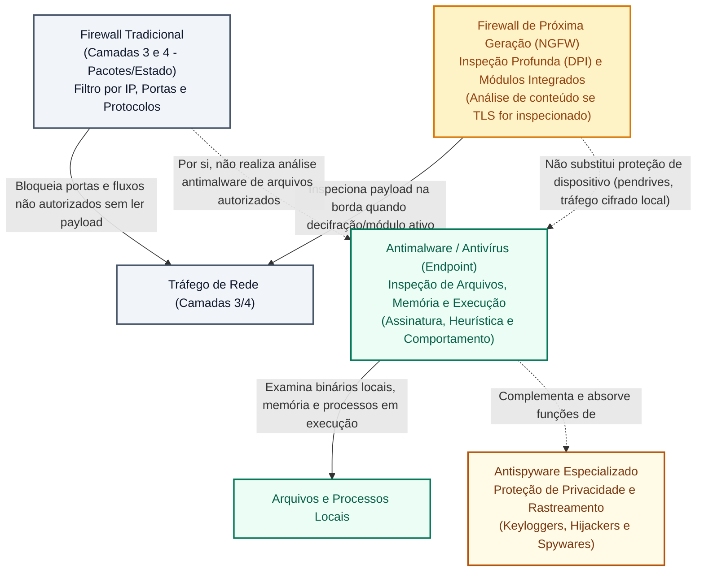

# Antivírus, firewall e antispyware: atuação, técnicas de detecção e limites de proteção

**Concurso Câmara dos Deputados 2026, cargo 1, Divulgação Institucional, Cebraspe. Unidade CAM-TI-013 conforme arquitetura e inventário editorial.**

## Núcleo do conceito: ferramentas defensivas e defesa em profundidade

A proteção de ecossistemas computacionais contra ameaças cibernéticas assenta-se no princípio da **Defesa em Profundidade** (*Defense in Depth*), que prega a sobreposição de múltiplas camadas independentes de controles lógicos, físicos e administrativos. Nenhuma ferramenta individual de segurança é autossuficiente ou infalível.

No inventário das ferramentas lógicas fundamentais, destacam-se três contramedidas essenciais: o **Antivírus** (ou solução moderna de *Endpoint Detection and Response* - EDR), o **Firewall** (pessoal e de borda) e o **Antispyware**. A banca **Cebraspe** explora com frequência a **delimitação exata da competência de cada ferramenta**, seus **mecanismos de detecção** e, principalmente, seus **limites operacionais** (o que cada uma é incapaz de fazer).

---

## 1. Antivírus: métodos de detecção e ciclo operacional

O antivírus (atualmente denominado *antimalware*) é o software projetado para **detectar, neutralizar, desinfetar ou remover** códigos maliciosos residentes em mídias de armazenamento, memória RAM ou tráfego de entrada.

### 1.1 Métodos fundamentais de detecção
1. **Detecção baseada em Assinatura (*Signature-based*)**:
   - Compara o código binário ou o resumo criptográfico (*hash*) do arquivo examinado com uma base de dados centralizada de assinaturas de malwares conhecidos mantida pelo fabricante;
   - *Vantagem*: Extremamente rápida, confiável e com baixíssima taxa de falsos positivos para pragas catalogadas;
   - *Limitações operacionais*: A detecção exclusivamente baseada em assinaturas conhecidas apresenta limitações importantes contra ameaças inéditas, especialmente quando não há assinatura correspondente na base local (embora assinaturas genéricas possam identificar variantes de uma mesma família). Por depender do conhecimento prévio da praga, essa técnica é complementada por mecanismos heurísticos, comportamentais e sandboxing para cobrir ameaças de dia zero (*Zero-Day*) e mutações polimórficas. Exige rotina tempestiva de atualização da base de definições.
2. **Detecção Heurística (*Heuristic Analysis*)**:
   - Examina o código-fonte ou binário em busca de **instruções suspeitas**, sequências de comandos perigosos ou estruturas típicas de vírus (ex.: código que tenta modificar o setor de inicialização ou injetar DLLs em processos do sistema), mesmo que o malware nunca tenha sido visto antes;
   - *Vantagem*: Capaz de detectar variações de vírus conhecidos e novas ameaças não catalogadas;
   - *Limite crítico*: Propensa a gerar **falsos positivos** (classificar um programa inofensivo legítimo como malware) ou **falsos negativos** (deixar passar uma ameaça sutil).
3. **Análise Comportamental (*Behavior-based / Anomalia*)**:
   - Monitora ações de processos **no próprio dispositivo ou em ambiente instrumentado**, como tentativas de cifrar muitos arquivos, modificar configurações ou estabelecer persistência. **Monitoramento comportamental não exige sandbox**; esta é uma técnica diferente de análise em isolamento;
   - **Pode alertar, registrar, bloquear ou isolar** conforme política, modo de detecção, confiança e produto; uma detecção não garante bloqueio imediato.
4. **Execução em Sandbox (Isolamento em Caixa de Areia)**:
   - Executa arquivos desconhecidos em um ambiente virtual isolado e descartável antes de liberá-los para o usuário final, observando se o artefato tenta abrir conexões externas maliciosas ou danificar registros.

### 1.2 Ações possíveis do antivírus diante de uma ameaça
- **Desinfecção (Limpeza)**: Remove o código malicioso do arquivo hospedeiro, preservando o documento ou programa original são e salvo (ação típica para vírus clássicos);
- **Quarentena**: isola ou restringe o acesso ao arquivo suspeito segundo o mecanismo do produto; **criptografia do contêiner não é obrigatória** e uma restauração depende das permissões, da disponibilidade e da avaliação de segurança;
- **Exclusão (Deleção)**: Apaga definitivamente o arquivo do disco quando a desinfecção for impossível (típico de worms, trojans e ferramentas maliciosas que são o próprio malware por inteiro, não contendo código útil a preservar).

---

## 2. Firewall: o sentinela do tráfego de rede

O **Firewall** (seja implementado em hardware dedicado na borda da rede ou em software pessoal no sistema operacional do usuário) atua como uma **barreira de segurança e ponto de controle**, inspecionando e filtrando os pacotes de dados que entram e saem de uma rede ou computador com base em um conjunto estrito de **regras de segurança** (*Access Control Lists* - ACLs).

### 2.1 Categorias e gerações de firewall
1. **Firewall de Filtragem de Pacotes (*Packet Filtering*)**:
   - Analisa individualmente os cabeçalhos de cada pacote IP na camada de rede e transporte (camadas 3 e 4 do modelo OSI);
   - Critérios de decisão: endereço IP de origem e destino, porta lógica de origem e destino (ex.: porta 80, 443, 22) e protocolo de transporte (TCP, UDP, ICMP);
   - Não guarda memória de conexões anteriores (*Stateless*).
2. **Firewall com Inspeção de Estados (*Stateful Inspection*)**:
   - Padrão dominante corporativo e doméstico (como o Firewall do Windows);
   - Mantém uma **tabela de estados** ativa das conexões estabelecidas. Se uma estação interna solicita uma página web (porta 80/443), o firewall permite automaticamente o retorno das respostas vindas do servidor externo porque reconhece que pertencem a uma sessão legítima iniciada internamente, bloqueando qualquer pacote que tente entrar sem sessão prévia.
3. **Firewall de Aplicação / Proxy (*Application Gateway / WAF*)**:
   - Opera na camada de aplicação (camada 7), inspecionando o conteúdo semântico do tráfego web (ex.: comandos HTTP/HTTPS, prevenindo injeções de SQL ou Cross-Site Scripting - XSS).
4. **Firewall de Próxima Geração (NGFW - *Next-Generation Firewall*)**:
   - Integra em um único equipamento inspeção de pacotes com estado, prevenção de intrusão (IPS), controle de aplicativos e antivírus de borda.

### 2.2 Limites do Firewall: distinção essencial entre modelos tradicionais e NGFW

A compreensão dos limites operacionais do firewall exige distinguir o modelo tradicional (filtragem de pacotes e estado) das arquiteturas modernas unificadas:

1. **Firewalls Tradicionais (Filtragem de Pacotes e Inspeção de Estados - Camadas 3 e 4)**:
   - Operam examinando apenas cabeçalhos de rede (endereço IP, porta lógica e protocolo de transporte);
   - **Não inspecionam o interior da carga útil (*payload*) dos pacotes**: se o tráfego web estiver liberado na porta 443 (HTTPS) ou 80 (HTTP) e o usuário fizer o download de um arquivo executável infectado por vírus, o firewall tradicional deixará o arquivo passar normalmente;
   - **Não removem vírus nem desinfetam arquivos** armazenados no disco;
   - **Não impedem golpes de engenharia social (phishing)**: se o usuário acessar um site falso autorizado e entregar suas credenciais, o firewall tradicional não intervém.
2. **Firewalls de Próxima Geração (NGFW - *Next-Generation Firewalls*)**:
   - Incorporam módulos integrados de **Inspeção Profunda de Pacotes (*Deep Packet Inspection* - DPI)**, antivírus de borda e sistemas de prevenção de intrusão (IPS);
   - São capazes de inspecionar o fluxo de dados em busca de assinaturas conhecidas de malwares antes que o arquivo chegue à estação do usuário;
   - *Ressalva crítica para a prova*: Mesmo um NGFW com módulo antivírus atua como barreira de perímetro (em trânsito na rede); ele não substitui a proteção de *endpoint* (antivírus local), pois não analisa arquivos criptografados de ponta a ponta sem interceptação SSL/TLS, pendrives USB locais, mídias externas ou arquivos gerados internamente na máquina.

> [!WARNING]
> **Como o Cebraspe formula em prova:** Em itens que delimitem um **firewall tradicional de filtragem**, ele controla o tráfego e **não substitui antivírus do dispositivo**. Ferramentas modernas podem integrar inspeção de aplicação e proteção contra malware; avaliar os recursos declarados no enunciado, evitando classificar todo firewall pelo mesmo conjunto fixo de funções. Quando a banca quer cobrar recursos de NGFW ou antivírus de borda, o enunciado menciona expressamente a expressão *"Firewall de Próxima Geração (NGFW)"*, *"Inspeção Profunda de Pacotes (DPI)"* ou *"módulo de antivírus integrado"*.

---

## 3. Antispyware: atuação especializada na privacidade

O **Antispyware** é a ferramenta especializada em monitorar, bloquear e remover softwares espiões (spywares), como *keyloggers*, *screenloggers*, *adwares* e *trackers* de publicidade abusiva.
- Embora a maioria das suítes de antivírus modernas já incorpore módulos de antispyware (unificadas sob o rótulo de *antimalware*), em provas teóricas o Cebraspe preserva a distinção conceitual:
  - O antivírus tradicional foca em códigos destrutivos e propagação;
  - O antispyware foca em ferramentas que violam a **privacidade**, modificam a página inicial do navegador (*hijackers*), injetam barras de ferramentas indesejadas ou capturam teclas e cliques do usuário.

---

## 4. Matriz comparativa das ferramentas de proteção

| Critério | Antivírus / Antimalware | Firewall (Pessoal / Borda) | Antispyware |
| :--- | :--- | :--- | :--- |
| **Foco primordial de atuação** | Arquivos, pastas, programas e memória RAM | Tráfego de pacotes nas conexões de rede | Softwares espiões, rastreadores e capturadores de dados |
| **Critérios de decisão** | Assinatura binária, heurística e comportamento anômalo | Regras de portas, IPs, protocolos e tabela de conexões ativas | Identificação de rotinas de monitoramento e sequestro de navegador |
| **Ação contra ameaça** | Limpar (desinfetar), colocar em quarentena ou excluir | **Bloquear ou Permitir** o tráfego de rede (*Drop/Reject/Accept*) | Bloquear execução, remover arquivos e restaurar registros do SO |
| **Capacidade de interceptar tráfego de rede** | Limitada (examina anexos/downloads, mas não filtra portas) | **Limitada ao tráfego que atravessa o controle**, segundo regras, arquitetura e protocolos | Nenhuma |
| **Capacidade de examinar conteúdo de arquivo** | **Parcial**, conforme permissões, formato, criptografia, técnica de análise e configuração | **Nula** no modelo tradicional (analisa apenas cabeçalhos) | Total para códigos espiões |

---

## 5. Casos progressivos de aplicação

### Caso 1: O anexo infectado que atravessou a proteção de rede
- **Cenário**: Um servidor da Câmara recebe um e-mail com o arquivo `Relatorio_Oficial.docx` em anexo. O e-mail passou com sucesso pelo firewall corporativo da Casa, que autoriza o tráfego de e-mail na porta 587 e 993. Contudo, ao salvar o anexo na máquina local, o Microsoft Defender alerta imediatamente que o arquivo contém um vírus de macro e move-o para a quarentena.
- **Análise**: O comportamento das ferramentas está rigorosamente correto. O firewall cumpriu seu papel de permitir o tráfego autorizado de correio eletrônico; ele não tem a função de ler o conteúdo binário dos anexos locais. Nesse cenário, o antivírus do endpoint detectou o código malicioso. Soluções de segurança de e-mail e firewalls modernos com inspeção apropriada também podem identificar ameaças antes da chegada ao dispositivo.

### Caso 2: A invasão externa frustrada em porta aberta indevidamente
- **Cenário**: Um hacker executa uma varredura de portas (*port scan*) na faixa de IPs públicos da Câmara, tentando conectar-se remotamente à porta 3389 (Remote Desktop - RDP) de estações de trabalho administrativas.
- **Análise**: O **Firewall** intercepta a tentativa de conexão vinda de IP externo para a porta 3389 e descarta silenciosamente os pacotes (*DROP*), pois a regra de segurança só permite acesso via VPN institucional. O antivírus não tem qualquer relação com esse bloqueio.

### Caso 3: O programa desconhecido que tenta criptografar arquivos
- **Cenário**: Um novo ransomware, criado há apenas 3 horas por cibercriminosos e sem assinatura catalogada em nenhuma base de vacinas do mundo (ameaça *Zero-Day*), é executado por um funcionário. Segundos após a execução, a solução corporativa de EDR paralisa o processo e encerra sua atividade.
- **Análise**: A detecção ocorreu por **análise comportamental (anomalia) ou heurística avançada**, pois a detecção baseada puramente em assinaturas teria falhado completamente por se tratar de ameaça inédita.

### Caso 4: O falso positivo bloqueando a publicação de matéria
- **Cenário**: O editor do portal da Câmara compila um script interno em Python para automatizar a publicação de notas informativas. Ao tentar rodar o executável, o antivírus bloqueia o arquivo acusando-o de ser um cavalo de troia genérico, embora o código seja 100% legítimo e seguro.
- **Análise**: Ocorrência clássica de **Falso Positivo**, provocada pela **análise heurística** do antivírus, que identificou padrões de código no script semelhantes aos utilizados por malwares reais.

---

## 6. Questões inéditas comentadas (Padrão Cebraspe)

### Questão 1 (Cebraspe / Inédita)
> Um *firewall* pessoal devidamente instalado e ativo em um computador é suficiente para identificar e eliminar vírus e vermes (*worms*) contidos em arquivos recebidos por meio de mensagens de correio eletrônico ou baixados diretamente da internet.

- **Gabarito**: **ERRADO**
- **Fundamentação**: A formulação retrata a clássica pegadinha do Cebraspe em provas de concurso. Um firewall tradicional (filtragem de pacotes ou inspeção com estado) atua exclusivamente na filtragem de tráfego de rede (bloqueando ou liberando conexões com base em portas, IPs e protocolos), sendo **incapaz** de inspecionar a carga útil dos arquivos baixados por conexões autorizadas para detectar vírus ou de desinfetar arquivos infectados na estação. Embora soluções de Firewall de Próxima Geração (NGFW) possam integrar inspeção profunda de pacotes (DPI) e antivírus de borda, a questão trata do conceito canônico geral de *firewall pessoal*, o qual opera estritamente nas camadas de rede e transporte, não dispensando nem substituindo o software antivírus local no *endpoint*.

---

### Questão 2 (Cebraspe / Inédita)
> O método de detecção por heurística adotado por softwares antivírus permite identificar a presença de programas maliciosos previamente desconhecidos ou variantes inéditas de pragas digitais, por meio da análise de estruturas de código e instruções suspeitas, embora apresente a desvantagem de poder gerar alarmes falsos-positivos.

- **Gabarito**: **CERTO**
- **Fundamentação**: Exposição perfeita da detecção heurística. Diferentemente da busca por assinatura rígida (que só pega o que já conhece), a heurística busca características comportamentais e instruções suspeitas, viabilizando o combate a ameaças de dia zero ao custo de eventuais falsos positivos.

---

### Questão 3 (Cebraspe / Inédita)
> A quarentena de um software antivírus consiste no envio imediato e definitivo de arquivos infectados para a lixeira do sistema operacional, inviabilizando qualquer possibilidade de recuperação posterior dos dados pelo usuário caso se constate que o alerta se tratava de um falso positivo.

- **Gabarito**: **ERRADO**
- **Fundamentação**: A **quarentena** isola ou restringe o acesso ao arquivo suspeito, de acordo com o produto, e não equivale a apagá-lo definitivamente na lixeira. Ela pode permitir restauração, mas **não exige contêiner criptografado universalmente** nem garante recuperação ou restauração sem risco em qualquer momento. O gabarito ERRADO continua.

---

### Questão 4 (Cebraspe / Inédita)
> *Firewalls* com inspeção de estados (*stateful*) operam mantendo o registro das conexões estabelecidas em uma tabela dinâmica, permitindo que os pacotes de dados de retorno pertencentes a uma sessão de navegação iniciada legitimamente por um usuário interno atravessem a proteção sem violar as regras de bloqueio de acessos externos não solicitados.

- **Gabarito**: **CERTO**
- **Fundamentação**: Descrição técnica precisa do funcionamento dos firewalls com estado (*stateful*). Eles reconhecem o contexto da comunicação: como o pacote de resposta é consequência de um pedido interno legítimo, o retorno é admitido, barrando conexões externas que não foram requisitadas.

---

### Questão 5 (Cebraspe / Inédita)
> O *antispyware* é a ferramenta de segurança projetada primordialmente para monitorar as portas de comunicação TCP e UDP de um servidor web corporativo, com o intuito de neutralizar ataques distribuídos de negação de serviço (DDoS).

- **Gabarito**: **ERRADO**
- **Fundamentação**: O **antispyware** procura identificar e mitigar software espião em dispositivos. Controles de rede, *firewalls*, IPS e serviços específicos de mitigação DDoS cumprem funções distintas e complementares. Um firewall simples, isoladamente, **não neutraliza necessariamente um ataque DDoS distribuído**. O item está ERRADO porque atribui ao antispyware uma função típica da proteção de rede.

---

### Questão 6 (Cebraspe / Inédita)
> As soluções de segurança que operam exclusivamente com detecção baseada em assinatura dispensam a atualização periódica de suas bases de dados, pois são arquitetadas para derivar algoritmicamente a estrutura de novos códigos maliciosos a partir do histórico de navegação do usuário.

- **Gabarito**: **ERRADO**
- **Fundamentação**: A detecção **exclusivamente por assinaturas conhecidas** depende de uma base de identificadores atualizada para reconhecer novas amostras. Sem atualização, continua capaz de detectar ameaças **já cobertas**, mas pode falhar diante de variantes inéditas. A alegação de que atualizações são dispensáveis é falsa; não significa cegueira completa contra toda ameaça recente.

---

## 7. Heurísticas para a prova da Câmara dos Deputados

1. **Firewall no Cebraspe**:
   - Falou em *"analisar portas, conexões, IPs, filtrar tráfego, permitir/bloquear pacotes"* $\rightarrow$ **CERTO** (modelo tradicional de camadas 3 e 4).
   - Falou em *"eliminar vírus de anexo, desinfetar arquivo, bloquear phishing, limpar malware do disco"* $\rightarrow$ **ERRADO** (competências de antivírus/endpoint, não desempenhadas por firewall tradicional). Se a questão mencionar explicitamente *NGFW* com DPI e módulo antimalware, atentar para a inspeção de tráfego na rede, ressalvando que não substitui a proteção do dispositivo.
2. **Métodos de Antivírus**:
   - Assinatura = compara artefatos a indicadores conhecidos, **limitado contra ameaças sem correspondência com assinaturas disponíveis**; taxas de falso positivo variam por produto e regra.
   - Heurística = analisa código e instruções suspeitas, **detecta novas variantes/mutações**, mas **sujeito a falsos positivos**.
   - Comportamental = vigia ações do processo em execução (ex.: tentativas anômalas de criptografar múltiplos arquivos em sequência).
3. **Destino da Ameaça**:
   - Desinfetar = limpa o vírus do arquivo hospedeiro.
   - Quarentena = restringe o acesso ao item suspeito, com possibilidade de recuperação **conforme a ferramenta, permissões e política de retenção**; não é sempre reversível.
   - Excluir = apaga de vez quando não há arquivo útil a salvar.

---

## Fontes consultadas e vigência

- **CERT.br (NIC.br/CGI.br)**: *Cartilha de Segurança para a Internet* — Fascículo Mecanismos de Segurança (versão consolidada).
- **NIST Special Publication 800-41 Rev. 1**: *Guidelines on Firewalls and Firewall Policy*.
- **ABNT NBR ISO/IEC 27002:2022**: Controle 8.7 (Proteção contra malware) e Controle 8.20 (Segurança de redes).
- **Documentação Técnica Microsoft Learn**: Arquitetura do Microsoft Defender Antivirus e Firewall do Windows com Segurança Avançada.

> **Revisão dirigida (11/11/2026):** ajustes com base nos achados TI-049 a TI-058 da auditoria da Câmara, distinguindo características gerais de implementações específicas. Persistem pendências de validação integral das questões e referências.

> **Auditoria C/E, segunda passagem (11/11/2026):** questões 1–6 mantêm **E, C, E, C, E, E**. Atualizados os comentários sobre quarentena, detecção por assinatura e proteção contra DDoS, retirando garantias absolutas.

> **Implementação TI-114 (11/11/2026):** separadas detecção comportamental e sandbox, resposta do produto condicionada à política e quarentena sem criptografia obrigatória. Gabaritos C/E mantidos.
