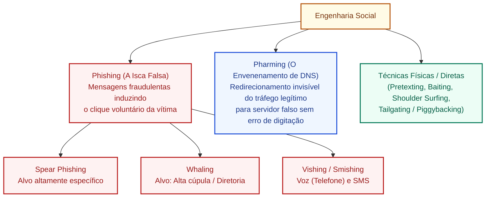

# Phishing, pharming e engenharia social: técnicas de manipulação, vetores e contramedidas

**Concurso Câmara dos Deputados 2026, cargo 1, Divulgação Institucional, Cebraspe. Unidade CAM-TI-014 conforme arquitetura e inventário editorial.**

## Núcleo do conceito: a exploração do elo humano na segurança da informação

Na segurança da informação, costuma-se afirmar que o usuário é a ponta mais vulnerável da cadeia de defesa (*elo humano*). A **Engenharia Social** é a arte e a técnica de manipular psicologicamente pessoas para induzi-las a realizar ações precipitadas, violar procedimentos formais de segurança ou divulgar dados confidenciais (senhas, códigos de token, dados fiscais, segredos industriais ou institucionais).

Diferentemente dos ataques baseados puramente na exploração de falhas de software (*bugs* de programação ou vulnerabilidades de sistema operacional), os ataques de engenharia social exploram **gatilhos comportamentais humanos**: sentimento de urgência, medo de punição, autoridade, curiosidade, ganância ou compaixão.

Entre as modalidades de ataque que combinam manipulação psicológica e ferramentas tecnológicas, o **Cebraspe** destaca a oposição sistemática entre o **Phishing** e o **Pharming**, além de suas variantes especializadas.

---

## 1. Phishing: modalidades e táticas de engodo

O **Phishing** (termo derivado de *fishing*, pescaria) consiste no envio de mensagens eletrônicas fraudulentas (e-mails, mensagens instantâneas, redes sociais) que simulam a identidade visual e o discurso de uma instituição confiável (órgãos públicos, bancos, tribunais, empresas de logística), induzindo a vítima a clicar em links para páginas falsas clonadas ou a descompactar anexos maliciosos.

### 1.1 Variantes cruciais cobradas em concurso
1. **Phishing Clássico (Genérico / Massivo)**:
   - Disparado em massa para milhões de destinatários aleatórios com textos genéricos (*"Prezado cliente, seu CPF está irregular na Receita Federal"* ou *"Sua conta será bloqueada hoje"*);
   - Aposta no volume e na probabilidade estatística de acerto.
2. **Spear Phishing (Phishing Direcionado)**:
   - Ataque meticulosamente customizado para um **indivíduo, equipe ou organização específica**;
   - Os criminosos realizam coleta prévia de inteligência (*OSINT* - fontes abertas em redes sociais e portais de transparência) para redigir mensagens altamente críveis, citando nomes de colegas, cargos reais, projetos em andamento ou número de processos legislativos internos.
3. **Whaling (Caça à Baleia)**:
   - Subespécie de *spear phishing* voltada exclusivamente para o **topo da hierarquia institucional** (deputados, ministros, diretores-gerais, presidentes de empresas públicas);
   - Explora temas corporativos sofisticados: intimações judiciais sigilosas, auditorias de órgãos de controle ou operações financeiras de grande vulto.
4. **Smishing e Vishing**:
   - *Smishing*: Phishing conduzido por mensagens curtas de texto (**SMS**);
   - *Vishing* (*Voice Phishing*): Fraude conduzida por chamadas telefônicas de voz, frequentemente utilizando centrais de atendimento simuladas ou clonagem de voz por inteligência artificial (*deepfake* de áudio).

---

## 2. Pharming: o redirecionamento imperceptível de DNS

O **Pharming** é uma modalidade refinada de ataque cibernético que corrompe o processo de **resolução de nomes de domínio (DNS)**. O usuário digita o endereço URL rigorosamente correto e oficial no navegador (ex.: `www.camara.leg.br`), mas é **redirecionado automaticamente e de forma transparente para um servidor web falso e clonado**, controlado pelo atacante.

### 2.1 Mecanismos de execução do Pharming
1. **Envenenamento de Arquivo Local (*Hosts File Poisoning*)**:
   - Um malware no computador da vítima altera o arquivo local `hosts` (em `C:\Windows\System32\drivers\etc\hosts`), associando o nome de domínio legítimo ao endereço IP do servidor malicioso;
2. **Envenenamento de Cache de DNS (*DNS Cache Poisoning*)**:
   - O invasor invade e compromete o servidor DNS do provedor de internet ou da rede corporativa, inserindo respostas falsas na tabela de cache do servidor. A partir desse momento, **todas as pessoas conectadas àquela rede** que tentarem acessar o site oficial serão enviadas para o endereço fraudulento;
3. **Sequestro de Roteador (*DNS Hijacking*)**:
   - O criminoso explora senhas padrões de roteadores Wi-Fi domésticos para alterar os servidores DNS primário e secundário configurados no equipamento.

### 2.2 Distinção definitiva entre Phishing e Pharming (Tabela de Ouro do Cebraspe!)

| Critério de Comparação | Phishing | Pharming |
| :--- | :--- | :--- |
| **Ponto focal do ataque** | A **mensagem/comunicação** enviada à vítima | A **infraestrutura de resolução de nomes (DNS)** |
| **Comportamento da vítima** | O usuário clica em um link fraudulento ou acessa URL ligeiramente adulterada (*typosquatting*) | O usuário **digita a URL oficial perfeitamente correta** na barra de endereços |
| **Mecanismo de engodo** | Engenharia social pura induzindo ao clique na isca | Redirecionamento tecnológico silencioso no DNS |
| **Alcance do comprometimento** | Individual (quem clicar na mensagem) | Coletivo (todos que usam o servidor DNS envenenado) |
| **Detecção pelo usuário** | Possível pela leitura atenta do remetente e do link | Pode manter a URL legítima; a validação de **HTTPS/TLS e certificado** pode denunciar desvio, mas depende da integridade do cliente e de uma cadeia de confiança válida |

---

## 3. Outras técnicas clássicas de engenharia social

Além do phishing, o Cebraspe exige o conhecimento de táticas de manipulação direta:

1. **Pretexting (Criação de Pretexto)**:
   - O invasor cria um cenário fictício e elaborado no qual assume um papel de autoridade ou necessidade técnica (ex.: técnico de TI ligando para o gabinete pedindo a senha para *“atualizar o patch de segurança do sistema de votação”*);
2. **Baiting (Isca Física ou Digital)**:
   - Oferece uma promessa tentadora para atrair a vítima. O exemplo clássico é deixar um **pendrive USB infectado** caído no estacionamento ou na recepção do órgão com a etiqueta *"Salários e Gratificações 2026"*; a curiosidade leva o servidor a plugá-lo no computador institucional;
3. **Shoulder Surfing (Espionagem sobre os Ombros)**:
   - Observação física direta de senhas digitadas ou telas abertas por cima dos ombros do usuário em locais públicos ou gabinetes compartilhados;
4. **Tailgating / Piggybacking (Carona Física)**:
   - Entrar em uma área de segurança restrita aproveitando-se da gentileza do funcionário que segura a porta após passar seu crachá biométrico na catraca.

---

## 4. Contramedidas institucionais e cultura de segurança

A proteção contra engenharia social exige a convergência de tecnologia e capacitação contínua:
- **Autenticação Multifator (MFA / 2FA)**: O MFA acrescenta barreiras quando a senha é capturada, mas certos métodos podem ser alvo de phishing em tempo real, roubo de sessão ou fadiga de aprovação. Métodos resistentes a phishing, como chaves de segurança FIDO2/WebAuthn, oferecem proteção mais forte;
- **Inspeção de Certificados SSL/TLS (HTTPS) e suas Condições Críticas**:
  - O protocolo HTTPS associado à validação de certificados digitais atua como a principal barreira contra o redirecionamento invisível do pharming, **desde que cumpridas as seguintes condições técnicas**:
    1. **Incompatibilidade de Nome de Domínio (CN / SAN)**: O atacante que redireciona o tráfego para seu servidor não possui o certificado oficial do domínio legítimo (`camara.leg.br`). Se apresentar um certificado emitido para outro domínio sob seu controle (ex.: `camara-falsa.com`), o navegador rejeita a conexão e emite alerta de incompatibilidade (*Name Mismatch*);
    2. **Falta de Confiança na Autoridade Certificadora (Cadeia de Confiança)**: Se o invasor gerar um certificado autoassinado para o domínio legítimo, o navegador bloqueará o acesso alertando que a Autoridade Certificadora (AC) emissora não consta da lista de raízes confiáveis do sistema operacional;
    3. **Indisponibilidade da Chave Privada Oficial**: A matemática criptográfica do TLS impede que o atacante utilize o certificado legítimo da instituição sem possuir a chave privada correspondente;
  - *Exceções e cenários em que o HTTPS pode falhar no pharming*:
    - Se a estação de trabalho estiver previamente comprometida com privilégios de administrador (*root*) e o invasor tiver instalado uma **Autoridade Certificadora Raiz maliciosa** no repositório de certificados do próprio sistema operacional (*Trust Store*), o navegador aceitará o certificado falso sem emitir aviso;
    - Se o usuário ignorar ativamente os avisos de segurança do navegador (*"Avançar mesmo assim / Risco potencial à frente"*).
- **Treinamento e Simulações Periódicas**: Campanhas de conscientização com falsos ataques controlados para medir a resiliência dos colaboradores;
- **Protocolos de Verificação por Segundo Canal**: Regra rígida de que transferências financeiras, envio de relatórios sigilosos ou redefinições de credenciais nunca sejam realizadas com base exclusiva em e-mail ou mensagem de WhatsApp.

---

## 5. Casos progressivos de aplicação

### Caso 1: O e-mail falso da Presidência da Câmara
- **Cenário**: Servidores da Diretoria de Comunicação recebem uma mensagem vinda aparentemente do endereço `presidencia@camara-deputados.com.br`, informando que uma portaria urgente alterou as escalas de plantão de fim de ano, exigindo login imediato em um link para validação. Vários servidores acessaram a página e digitaram suas credenciais de rede.
- **Análise**: Caso clássico de **Spear Phishing**. Os criminosos usaram técnicas de engenharia social direcionadas à realidade da Casa e registraram um domínio muito similar ao oficial (*typosquatting*). A URL continha erro sutil, pois o domínio legítimo do Poder Legislativo é `camara.leg.br`.

### Caso 2: Digitação correta com destino adulterado
- **Cenário**: Um analista abre o navegador e digita manualmente `https://intranet.camara.leg.br`. Sem que ele saiba, o roteador de seu home office teve as configurações de DNS alteradas remotamente. Ao carregar a página, a interface é idêntica à da intranet, mas o navegador emite um aviso em vermelho de que o certificado digital pertence a outro domínio.
- **Análise**: Ocorrência inequívoca de **Pharming** (sequestro de DNS). A vítima não clicou em links falsos e digitou o endereço oficial corretamente, mas a conversão do nome em endereço IP foi desviada para um servidor malicioso. O alerta do certificado TLS salvou o acesso.

### Caso 3: O pendrive encontrado na cafeteria do Anexo IV
- **Cenário**: Um estagiário encontra um pendrive novo no refeitório da Câmara com um adesivo impresso: *"Fotos da posse e lista VIP de convidados"*. Por curiosidade, ele espeta o dispositivo em seu computador de trabalho. Um script de execução automática instala um cavalo de troia na máquina.
- **Análise**: Trata-se da técnica de engenharia social denominada **Baiting** (isca), que explora a fraqueza humana da curiosidade para vencer barreiras lógicas de rede.

### Caso 4: Ligação urgente fingindo suporte técnico da DTI
- **Cenário**: Uma secretária parlamentar recebe uma ligação de alguém que se identifica como coordenador do setor de suporte de informática da Câmara, afirmando que a conta de e-mail do deputado está disparando spams e será desativada em 5 minutos a menos que ela confirme o código de 6 dígitos que acabou de chegar por SMS no celular do parlamentar.
- **Análise**: O ataque utiliza **Vishing** associado a **Pretexting**, explorando os gatilhos psicológicos de urgência e medo de censura institucional para burlar a autenticação de dois fatores.

---

## 6. Questões inéditas comentadas (Padrão Cebraspe)

### Questão 1 (Cebraspe / Inédita)
> Enquanto o *phishing* depende usualmente do envio de mensagens eletrônicas com links fraudulentos para induzir o usuário a acessar páginas clonadas, o *pharming* atua na corrupção do serviço de resolução de nomes (DNS), fazendo que o usuário seja redirecionado a um site falso mesmo que digite o endereço URL correto em seu navegador.

- **Gabarito**: **CERTO**
- **Fundamentação**: Síntese perfeita da distinção conceitual cobrada recorrentemente pelo Cebraspe. O phishing foca na persuasão e no clique na isca; o pharming foca na adulteração do DNS, operando de forma tecnológica e transparente à digitação correta da vítima.

---

### Questão 2 (Cebraspe / Inédita)
> O ataque denominado *spear phishing* caracteriza-se pelo disparo aleatório e maciço de mensagens enganosas a milhares de destinatários indiscriminados, apostando na probabilidade matemática de captura de vítimas negligentes.

- **Gabarito**: **ERRADO**
- **Fundamentação**: O item descreve o **Phishing Tradicional (Genérico)**. O **Spear Phishing** é, por definição técnica, **altamente direcionado e personalizado** para uma vítima, órgão ou empresa específica, utilizando informações contextuais previamente coletadas para conferir máxima credibilidade ao golpe.

---

### Questão 3 (Cebraspe / Inédita)
> A engenharia social constitui um conjunto de técnicas de exploração computacional que prescinde da intervenção ou manipulação humana, atuando exclusivamente na detecção e exploração automatizada de vulnerabilidades nos protocolos de comunicação da camada de rede.

- **Gabarito**: **ERRADO**
- **Fundamentação**: Erro conceitual absoluto. A essência definidora da engenharia social é justamente a **manipulação psicológica do ser humano** (o usuário). Ataques automatizados a protocolos de rede pertencem ao campo de exploração técnica de vulnerabilidades de software e hardware, sem relação com engenharia social.

---

### Questão 4 (Cebraspe / Inédita)
> Na técnica de engenharia social conhecida como *baiting*, o atacante busca atrair a vítima por meio de uma isca física ou digital tentadora, como o abandono proposital de mídias de armazenamento removíveis infectadas em áreas de grande circulação da instituição-alvo.

- **Gabarito**: **CERTO**
- **Fundamentação**: Definição exata de *baiting* (iscagem). A curiosidade ou o interesse do usuário em inspecionar o conteúdo da mídia esquecida (como um pendrive) serve como veículo para a introdução do malware no ecossistema corporativo.

---

### Questão 5 (Cebraspe / Inédita)
> Caso uma instituição pública seja vítima de um ataque de *pharming* em seu servidor DNS corporativo, a exigência de conexões seguras sob o protocolo HTTPS e o rigor na validação de certificados digitais válidos emitidos por autoridades certificadoras confiáveis perdem totalmente a utilidade prática para alertar os usuários acerca do redirecionamento fraudulento.

- **Gabarito**: **ERRADO**
- **Fundamentação**: A assertiva é categoricamente incorreta ao afirmar que a validação de certificados HTTPS/TLS "perde totalmente a utilidade prática". A checagem criptográfica do TLS é, no modelo de segurança da web, a barreira técnica fundamental no cliente para denunciar o desvio de tráfego decorrente de envenenamento de DNS (*pharming*). A proteção efetiva proporcionada pela validação TLS apoia-se em um conjunto de condições técnicas interligadas:
  1. **Correspondência de identidade (CN/SAN):** O nome de domínio digitado pelo usuário na URL deve coincidir exatamente com os nomes registrados no certificado (*Common Name* ou *Subject Alternative Name*). No *pharming* típico, o invasor manipula a resolução de nomes (IP), mas não possui um certificado emitido por AC confiável para o domínio legítimo da instituição.
  2. **Cadeia de confiança válida:** O certificado deve ter sido emitido por uma Autoridade Certificadora (AC) presente no repositório de raízes confiáveis (*Trust Store*) do sistema operacional ou do navegador. Se o atacante apresentar um certificado autoassinado ou emitido por AC desconhecida, o navegador interrompe a navegação e emite alerta ostensivo.
  3. **Integridade das chaves e do cliente:** A proteção pressupõe a preservação da chave privada da instituição e a integridade da máquina do usuário (ausência de ACs maliciosas injetadas localmente por malware prévio) e a não condescendência do usuário em ignorar exceções de segurança.
  
  **Diferenciação analítica de vetores:**
  - *No envenenamento de DNS puro:* O IP é desviado, mas o servidor de destino não tem a chave privada nem certificado legítimo para o domínio requisitado $\rightarrow$ o TLS **detecta o desvio e alerta o usuário**.
  - *No typosquatting / domínios semelhantes:* O usuário é induzido a digitar um domínio falso (ex.: `camara-leg.br` em vez de `camara.leg.br`). Nesse caso, o atacante pode obter um certificado TLS válido para o domínio que ele comprou, e o navegador não acusará erro de certificado, dependendo da atenção do usuário à URL.
  - *No comprometimento de AC ou de chave privada:* Se a chave oficial vazar ou uma AC for fraudada, o invasor pode forjar a identidade em trânsito, quebrando a barreira do TLS.
  
  Portanto, como o *pharming* corporativo adultera a resolução de nomes sem que o invasor possua a chave privada oficial nem um certificado autêntico reconhecido pela cadeia pública, a exigência de HTTPS e certificados válidos desempenha papel preventivo crucial e de forma alguma perde totalmente sua utilidade prática. Mantenha-se o gabarito **ERRADO**.

---

### Questão 6 (Cebraspe / Inédita)
> O termo *whaling* designa uma variante especializada de engenharia social voltada especificamente a atingir executivos de alto escalão, autoridades públicas ou tomadores de decisão de uma organização, valendo-se de pretextos institucionais e jurídicos sofisticados.

- **Gabarito**: **CERTO**
- **Fundamentação**: Definição precisa de *whaling* ("pesca de baleias"). Alvos de alta visibilidade e poder decisório exigem narrativas elaboradas que simulam intimações judiciais, auditorias confidenciais ou operações de alto impacto estratégico.

---

## 7. Heurísticas para a prova da Câmara dos Deputados

1. **Phishing $\times$ Pharming no Cebraspe**:
   - Falou que *"o usuário clicou em link falso recebido por e-mail/SMS"* $\rightarrow$ **Phishing**.
   - Falou que *"o usuário digitou a URL certa e mesmo assim caiu no site falso"* $\rightarrow$ **Pharming** (envenenamento de DNS/hosts).
2. **Subtipos de Phishing**:
   - Direcionado a um setor/órgão específico com dados reais $\rightarrow$ **Spear Phishing**.
   - Direcionado ao presidente/diretor/deputado $\rightarrow$ **Whaling**.
   - Feito por telefone/voz $\rightarrow$ **Vishing**.
   - Feito por SMS $\rightarrow$ **Smishing**.
3. **Engenharia Social**:
   - Sempre envolve a **manipulação psicológica de pessoas** (gatilhos de urgência, medo, curiosidade ou autoridade).
   - Não depende de falhas técnicas nos programas, mas sim da fragilidade do comportamento humano.

---

## Fontes consultadas e vigência

- **CERT.br (NIC.br/CGI.br)**: *Cartilha de Segurança para a Internet* — Fascículos Golpes na Internet e Engenharia Social.
- **NIST Special Publication 800-63-3**: *Digital Identity Guidelines*.
- **ABNT NBR ISO/IEC 27002:2022**: Controle 6.3 (Conscientização, treinamento e educação em segurança da informação).
- **Cartilha de Proteção de Dados da Câmara dos Deputados**: Diretrizes institucionais contra golpes eletrônicos e vazamento de informações.

> **Revisão dirigida (11/11/2026):** ajustes com base nos achados TI-049 a TI-058 da auditoria da Câmara, distinguindo características gerais de implementações específicas. Persistem pendências de validação integral das questões e referências.
