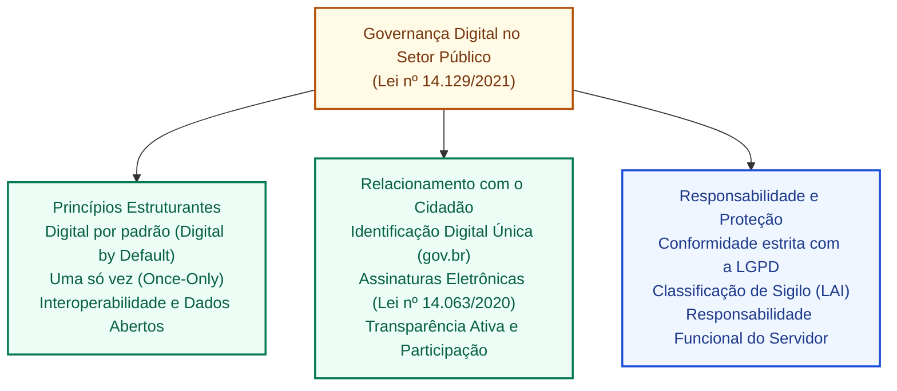
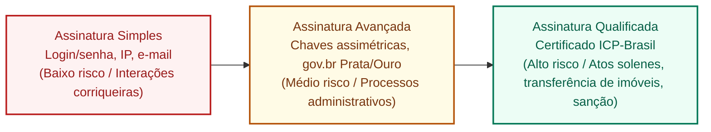

# Governança digital, governo eletrônico e responsabilidade no serviço público

**Concurso Câmara dos Deputados 2026, cargo 1, Divulgação Institucional, Cebraspe. Unidade CAM-TI-015 conforme arquitetura e inventário editorial.**

## Núcleo do conceito: a transformação digital do Estado democrático

A **Governança Digital** no setor público brasileiro representa a evolução qualitativa do conceito tradicional de *governo eletrônico* (e-Gov). Enquanto o governo eletrônico centrava-se na mera digitalização e disponibilização na web de serviços e formulários antes burocráticos em papel, a governança digital estrutura uma **relação estratégica e integrada** entre Estado, cidadãos e tecnologia, orientada pelos princípios da **transparência ativa, interoperabilidade de dados, participação social direta e responsabilidade no tratamento da informação pública**.

No âmbito do Poder Legislativo e da Administração Pública Federal, o marco de governança digital assenta-se na **Lei do Governo Digital (Lei nº 14.129/2021)**, na **Estratégia Nacional de Governo Digital (ENGD)**, na **Lei Geral de Proteção de Dados Pessoais (LGPD - Lei nº 13.709/2018)** e na **Lei de Acesso à Informação (LAI - Lei nº 12.527/2011)**.

---

## 1. Princípios e diretrizes da Lei do Governo Digital (Lei nº 14.129/2021)

A Lei nº 14.129/2021 estabelece as regras para a prestação digital de serviços públicos e para a modernização da gestão administrativa na União, Estados, DF e Municípios, destacando-se diretrizes de alta incidência nas provas do Cebraspe:

1. **Digital por Padrão (*Digital by Default*)**:
   - Os serviços públicos e processos administrativos devem ser concebidos, tramitados e disponibilizados originariamente em formato digital, preservando-se o atendimento presencial exclusivamente como canal de inclusão para cidadãos hipossuficientes ou sem letramento digital.
2. **Princípio do Cadastramento Único / "Uma Só Vez" (*Once-Only Principle*)**:
   - É vedado aos órgãos públicos exigir do cidadão ou empresa documentos, certidões ou dados que já estejam em poder da própria Administração Pública. A responsabilidade pela integração e obtenção do dado cabe ao Estado por meio de **interoperabilidade de sistemas**.
3. **Dados Abertos por Padrão (*Open Data by Default*)**:
   - Todas as bases de dados públicos custodiadas pelo governo devem ser abertas e legíveis por máquina (formatos CSV, JSON, XML), salvo quando protegidas por sigilo legal (segurança do Estado, segredo industrial ou intimidade pessoal).
4. **Interoperabilidade**:
   - Capacidade de sistemas distintos trocarem dados e transações de forma automatizada e padronizada (padrões de interoperabilidade de governo eletrônico - e-PING).
5. **Acessibilidade Universal**:
   - As interfaces digitais devem ser plenamente acessíveis a pessoas com deficiência, segundo as diretrizes de acessibilidade na web (e-MAG e WCAG).

---

## 2. Níveis de assinaturas eletrônicas no serviço público (Lei nº 14.063/2020)

Para conferir validade jurídica a manifestações eletrônicas sem burocracia excessiva, a Lei nº 14.063/2020 categorizou as assinaturas eletrônicas em três níveis hierárquicos:

| Tipo de Assinatura | Mecanismo Tecnológico | Nível de Confiança | Exemplos de Aplicação no Serviço Público |
| :--- | :--- | :--- | :--- |
| **Simples** | Associação de dados eletrônicos em formato simples (login e senha de usuário, confirmação por e-mail/SMS). | Básico / Baixo | Requerimentos simples, agendamento de atendimentos, manifestações em ouvidorias. |
| **Avançada** | Utiliza criptografia assimétrica associada de forma unívoca ao signatário; dados sob seu controle exclusivo; detecta alterações posteriores. Ex.: contas **gov.br nível Prata e Ouro**. | Intermediário / Alto | Tramitação de processos administrativos internos, pareceres técnicos, peticionamento eletrônico, contratos públicos ordinários. |
| **Qualificada** | Utiliza certificado digital padrão **ICP-Brasil** (com token criptográfico, smartcard ou nuvem segura). | **Elevado** (presunção relativa de veracidade em relação ao signatário; MP 2.200-2/2001, art. 10, § 1º) | Atos de chefia de poder, sanção e promulgação de leis, edição de medidas provisórias, alienação de imóveis públicos e atos com sigilo ultrassecreto. |

---

## 3. Harmonização entre Transparência (LAI) e Proteção de Dados (LGPD)

Um dos eixos mais cobrados pelo Cebraspe na carreira de Divulgação Institucional e Comunicação da Câmara é a aparente tensão entre a **Lei de Acesso à Informação (LAI - Lei nº 12.527/2011)** e a **Lei Geral de Proteção de Dados Pessoais (LGPD - Lei nº 13.709/2018)**:

### 3.1 A regra geral de compatibilidade
- A publicidade é o preceito geral; o sigilo é a exceção (*art. 5º, XXXIII da CF/88*);
- A LGPD **não impede nem revoga a LAI**. O art. 7º, III da LGPD trata especificamente do **tratamento e uso compartilhado de dados necessários à execução de políticas públicas** previstas em leis e regulamentos ou respaldadas por instrumentos próprios, observado o Capítulo IV; outros fundamentos legais e princípios também podem incidir sobre atividades públicas;
- **Dados Pessoais $\times$ Informações Institucionais**:
  - Salários, cargos, lotação, viagens a serviço e diárias de servidores públicos **são públicos por imperativo constitucional de transparência** (entendimento pacificado pelo STF no Tema 483 de Repercussão Geral);
  - Dados pessoais sensíveis (saúde, orientação sexual, convicção religiosa, dados biométricos) e dados estritamente privados (CPF, endereço residencial, telefone pessoal, dependentes) **devem ser protegidos e anonimizados/tarjados** antes da publicação de documentos oficiais.

---

## 4. Responsabilidade do agente público no ecossistema digital

O servidor público possui dever funcional de zelo com os ativos de informação, sistemas e credenciais que lhe são confiados (art. 116 da Lei nº 8.112/1990 e Código de Ética Profissional):

1. **Intransferibilidade de Credenciais**:
   - A senha e o token institucional são de uso estritamente pessoal e intransferível. O empréstimo de credencial para terceiros configura falta funcional grave e eventual infração disciplinar;
2. **Uso de E-mail Institucional e Recursos Corporativos**:
   - Documentos oficiais e comunicações de serviço devem tramitar pelas contas institucionais autorizadas (`@camara.leg.br`), sendo vedado o armazenamento de dados protegidos em serviços de nuvem pessoais não homologados (*Shadow IT*);
3. **Quebra de Sigilo e Invasão de Dispositivo**:
   - A extração indevida de dados de sistemas restritos ou o acesso imotivado a processos sigilosos atrai responsabilização administrativa disciplinar, civil (reparação por danos) e penal (crime de violação de sigilo funcional - art. 325 do CP, e invasão de dispositivo - art. 154-A do CP).

---

## 5. Casos progressivos de aplicação

### Caso 1: A exigência burocrática de certidão já em posse do Estado
- **Cenário**: Um cidadão solicita acesso a uma linha de financiamento cultural gerida pela Câmara dos Deputados. O setor administrativo emite uma exigência determinando que o cidadão protocole fisicamente a cópia autenticada de sua certidão de quitação eleitoral e certidão de nascimento.
- **Análise**: A exigência viola frontalmente a **Lei do Governo Digital (Lei nº 14.129/2021)** e o princípio *Once-Only*. Sendo a certidão eleitoral emitida pela própria Justiça Eleitoral (órgão do Estado brasileiro), a Câmara deve obter os dados diretamente por interoperabilidade entre bases públicas, sendo expressamente vedado exigir do usuário certidões que a Administração já possua.

### Caso 2: O dilema entre a folha de pagamento e o direito à privacidade
- **Cenário**: Uma entidade sindical ingressa com requerimento administrativo exigindo que a Câmara dos Deputados remova do Portal da Transparência o nome e o vencimento bruto dos servidores da área de comunicação, alegando que a divulgação fere o direito à privacidade assegurado pela LGPD.
- **Análise**: O requerimento deve ser indeferido. Conforme jurisprudência consolidada do STF (Tema 483) e diretrizes da CGU/ANPD, a divulgação do nome, cargo e remuneração de agentes públicos atende ao princípio constitucional da publicidade e ao interesse público primário. A LGPD não anula a LAI, desde que preservados dados estritamente privados (como descontos sindicais, empréstimos consignados ou dados bancários).

### Caso 3: Assinatura de ato normativo por conta gov.br
- **Cenário**: Em cenário hipotético, um chefe de Poder precisa assinar eletronicamente um ato normativo de sua competência, sujeito à exigência legal de assinatura qualificada. Um assessor sugere usar assinatura avançada de conta gov.br Prata, sem certificado ICP-Brasil. **Decreto legislativo não se sujeita à sanção presidencial**; por isso, não é exemplo adequado de ato a ser sancionado.
- **Análise**: Para atos normativos dos chefes de Poder abrangidos pelo art. 5º, § 2º, I, da Lei nº 14.063/2020, exige-se **assinatura eletrônica qualificada**, baseada em certificado ICP-Brasil. A assinatura avançada é admitida em outras hipóteses conforme o regime e o nível de exigência do ato; não se limita universalmente a gestão ordinária.

### Caso 4: O compartilhamento de senha no gabinete durante o recesso
- **Cenário**: Um analista entra em férias regulamentares e anota seu login de rede e senha em um post-it colado no monitor para que o estagiário possa despachar mensagens e acessar o sistema de protocolo legislativo.
- **Análise**: Infração grave à Política de Segurança da Informação e aos deveres funcionais da Lei nº 8.112/1990. A autenticidade e o não repúdio das operações eletrônicas ficam comprometidos. Cada agente deve possuir credencial própria e intransferível, com perfis de acesso estritamente calibrados por função (*RBAC*).

---

## 6. Questões inéditas comentadas (Padrão Cebraspe)

### Questão 1 (Cebraspe / Inédita)
> Conforme a Lei do Governo Digital (Lei nº 14.129/2021), a prestação de serviços públicos digitais deve orientar-se pelo princípio do cadastramento único, vedando-se aos órgãos e entidades públicas a exigência de documentos ou certidões que já constem de bases de dados do próprio Estado, cabendo à administração obter tais informações mediante mecanismos de interoperabilidade.

- **Gabarito**: **CERTO**
- **Fundamentação**: O art. 3º, XII, XIII e XIV, da Lei nº 14.129/2021 orienta a apresentação única de exigências, veda exigir prova de fato já comprovado por documento ou informação válida e promove interoperabilidade. O art. 24, IV, determina eliminar exigências desnecessárias de documentos prescindíveis, inclusive por compartilhamento de dados. **A aplicação concreta depende da abrangência do art. 2º, da validade da informação e das condições legais de acesso e compartilhamento**. A frase “bases de dados do próprio Estado” não deve ser tomada como obrigação técnica irrestrita de obter qualquer dado de qualquer ente, a qualquer tempo.

---

### Questão 2 (Cebraspe / Inédita)
> A Lei Geral de Proteção de Dados Pessoais (LGPD) impede a publicação, no Portal da Transparência, dos nomes completos e respectivos vencimentos dos ocupantes de cargos efetivos e em comissão do Poder Legislativo, devendo tais dados ser obrigatoriamente anonimizados em respeito à intimidade e à vida privada.

- **Gabarito**: **ERRADO**
- **Fundamentação**: O entendimento está superado pela jurisprudência do STF (Tema 483 de Repercussão Geral) e pelas orientações conjuntas da ANPD e da CGU. A remuneração, o cargo e o nome dos agentes públicos submetem-se ao regime de transparência ativa da LAI e ao princípio da publicidade (art. 37, *caput*, da CF/88), não constituindo violação à LGPD. O que deve ser protegido são deduções particulares, dados bancários e informações fiscais pessoais.

---

### Questão 3 (Cebraspe / Inédita)
> Segundo a disciplina legal das assinaturas eletrônicas na administração pública (Lei nº 14.063/2020), a assinatura eletrônica avançada é aquela emitida exclusivamente com base em certificados digitais fornecidos no âmbito da Infraestrutura de Chaves Públicas Brasileira (ICP-Brasil).

- **Gabarito**: **ERRADO**
- **Fundamentação**: A assinatura que exige obrigatoriamente certificado digital padrão **ICP-Brasil** é a assinatura eletrônica **QUALIFICADA** (a mais rigorosa). A assinatura eletrônica **AVANÇADA** baseia-se em chaves assimétricas ou outros mecanismos confiáveis de associação com o signatário (como as contas gov.br de níveis Prata e Ouro), dispensando o certificado ICP-Brasil.

---

### Questão 4 (Cebraspe / Inédita)
> O conceito de dados abertos no âmbito da governança digital pressupõe a disponibilização de dados públicos em formatos estruturados e legíveis por máquina, como CSV e JSON, garantindo-se o livre acesso, o reuso e a distribuição por qualquer cidadão, respeitadas as salvaguardas legais de sigilo e privacidade.

- **Gabarito**: **CERTO**
- **Fundamentação**: Dados abertos devem facilitar acesso, processamento automatizado e reutilização, com formatos adequados e licenças compatíveis. **CSV e JSON** são exemplos usuais de formatos estruturados, mas o formato isolado não basta: também importam documentação, acessibilidade e ausência de restrições indevidas, respeitados sigilo e proteção de dados.

---

### Questão 5 (Cebraspe / Inédita)
> No serviço público federal, a assinatura eletrônica simples, como o uso de login e senha em portais governamentais, é admitida de forma irrestrita para qualquer ato oficial, inclusive para a edição de atos normativos com força de lei e a transferência de domínio de bens imóveis da União.

- **Gabarito**: **ERRADO**
- **Fundamentação**: A Lei nº 14.063/2020, **art. 5º, §§ 1º e 2º**, limita o uso de assinatura simples a interações de menor impacto e prevê assinatura **qualificada** para atos assinados por chefes de Poder e autoridades ali indicadas, bem como para transferência e registro de bens imóveis, ressalvadas as exceções legais. Assim, é falso dizer que a assinatura simples é admitida **irrestritamente**. O artigo não estabelece uma proibição genérica com a expressão “todo ato normativo com força de lei”; verificar o **signatário** e a hipótese legal é mais preciso. Fonte: [Lei 14.063/2020, texto atualizado](https://www2.camara.leg.br/legin/fed/lei/2020/lei-14063-23-setembro-2020-790659-normaatualizada-pl.html).

---

### Questão 6 (Cebraspe / Inédita)
> O dever funcional do servidor público de manter o sigilo sobre assuntos da repartição abrange a proteção de suas credenciais de acesso, sendo a cessão de senha a estagiários ou terceiros conduta passível de apuração disciplinar, em razão da quebra da autenticidade e do não repúdio nos sistemas informatizados.

- **Gabarito**: **CERTO**
- **Fundamentação**: Compartilhar credenciais pessoais **prejudica a atribuição confiável das ações** e pode violar políticas de segurança e deveres funcionais, conforme vínculo e regulamento aplicáveis. A possibilidade de apuração disciplinar descrita no item é plausível, mas a consequência jurídica depende de investigação e enquadramento concretos; não se presume automaticamente autoria ou sanção apenas por uso da senha.

---

## 7. Heurísticas para a prova da Câmara dos Deputados

1. **Tríade de Assinaturas (Lei nº 14.063/2020)**:
   - **Simples**: login/senha, SMS, ouvidoria.
   - **Avançada**: gov.br Prata/Ouro, processos administrativos comuns.
   - **Qualificada**: **ICP-Brasil obrigatório**, atos solenes, chefia de poder, imóveis.
2. **LAI $\times$ LGPD**:
   - Transparência salarial de servidor = **PÚBLICA (LAI prevalece)**.
   - Dados íntimos/sensíveis/bancários do servidor = **Sujeitos à proteção de dados pessoais e às restrições legais de acesso**, conforme contexto; não há prevalência automática de uma lei sobre a outra.
3. **Lei do Governo Digital (Lei nº 14.129/2021)**:
   - Governo não pode pedir documento que ele mesmo já tem (*Once-Only*).
   - Dados públicos devem ser abertos por padrão (*Open Data by Default*).

---

## Fontes consultadas e vigência

- **Lei nº 14.129/2021**: Lei do Governo Digital.
- **Lei nº 14.063/2020**: Uso de assinaturas eletrônicas nas interações com o poder público.
- **Lei nº 13.709/2018 (LGPD)**: Artigo 7º, inciso III (Tratamento de dados pelo Poder Público).
- **Lei nº 12.527/2011 (LAI)**: Transparência ativa e acesso a dados governamentais.
- **STF, Tema 483 de Repercussão Geral**: Legitimidade da divulgação de vencimentos de servidores públicos na internet.

> **Revisão dirigida (11/11/2026):** ajustes com base nos achados TI-049 a TI-058 da auditoria da Câmara, distinguindo características gerais de implementações específicas. Persistem pendências de validação integral das questões e referências.

> **Validação jurídica, segunda passagem (11/11/2026):** Questão 1: o núcleo de simplificação documental e interoperabilidade é compatível com a [Lei 14.129/2021, arts. 3º e 24](https://www2.camara.leg.br/legin/fed/lei/2021/lei-14129-29-marco-2021-791203-normaatualizada-pl.html). **Gabarito CERTO preservado com ressalva de redação**, especialmente quanto à validade da prova, alcance dos órgãos e possibilidade jurídica/técnica de compartilhamento. A questão deverá ser reescrita antes de servir como referência literal de dispositivo.

> **Auditoria C/E, segunda passagem (11/11/2026):** seis questões examinadas, gabaritos mantidos **C, E, E, C, E, C** com ressalvas. Q5 teve a fundamentação confrontada com o **art. 5º da Lei 14.063/2020** para remover referência legal excessivamente genérica. Q1 conserva a ressalva anterior sobre condições de interoperabilidade, antes de uso como enunciado literal.
