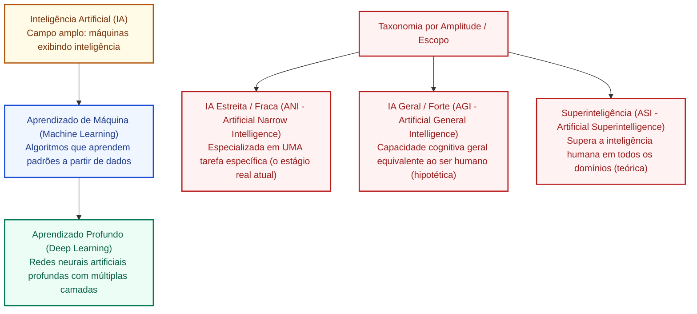

# Inteligência artificial: definição, evolução, taxonomia de sistemas e aplicações no setor público

**Concurso Câmara dos Deputados 2026, cargo 1, Divulgação Institucional, Cebraspe. Unidade CAM-TI-016 conforme arquitetura e inventário editorial.**

## Núcleo do conceito: o que é inteligência artificial

A **Inteligência Artificial (IA)** é o campo multidisciplinar da ciência da computação dedicado ao projeto, desenvolvimento e implementação de sistemas computacionais capazes de realizar tarefas que, se executadas por seres humanos, exigiriam processos cognitivos complexos — tais como percepção visual e auditiva, raciocínio lógico, tomada de decisão, resolução de problemas, compreensão de linguagem natural e aprendizagem a partir da experiência.

Historicamente cunhada em 1956 na célebre Conferência de Dartmouth por John McCarthy, Marvin Minsky, Nathaniel Rochester e Claude Shannon, a IA evoluiu de sistemas rígidos baseados em regras lógicas simbólicas (*sistemas especialistas*) para modelos orientados a dados (*Machine Learning* e *Deep Learning*).

No setor público e particularmente no Poder Legislativo, a IA é empregada como instrumento de **eficiência administrativa, automação de triagem processual e apoio à divulgação institucional**, orientando-se pelas diretrizes de governança da **Estratégia Brasileira de Inteligência Artificial (EBIA - Decreto nº 9.874/2019 e Portaria MCTI nº 4.617/2021)** e pelo debate legislativo do Marco Regulatório da IA no Brasil (PL 2.338/2023).

---

## 1. As três camadas de abstração: IA, Machine Learning e Deep Learning

Uma das pegadinhas conceituais mais recorrentes em provas da banca Cebraspe reside na **confusão entre os níveis hierárquicos** da inteligência computacional:

1. **Inteligência Artificial (IA)**:
   - É o **gênero / conceito guarda-chuva**. Compreende qualquer técnica que permita a um computador imitar o comportamento inteligente humano, abrangendo desde sistemas simbólicos baseados em árvores de decisão e regras *"se-então"* até algoritmos probabilísticos avançados.
2. **Aprendizado de Máquina (*Machine Learning* - ML)**:
   - É um **subcampo da IA**. Em vez de programar explicitamente cada regra determinística, o sistema é alimentado com grandes volumes de dados de exemplo e algoritmos estatísticos que aprendem a identificar padrões e a generalizar previsões de forma autônoma.
3. **Aprendizado Profundo (*Deep Learning* - DL)**:
   - É um **subcampo do Machine Learning**. Utiliza arquiteturas de **Redes Neurais Artificiais Profundas (*Deep Neural Networks*)**, caracterizadas por múltiplas camadas ocultas (*hidden layers*). O diferencial do Deep Learning é a sua capacidade de **extração automática de características (*feature engineering*)** a partir de dados brutos e não estruturados (imagens, áudio, vídeos e textos extensos), eliminando a necessidade de pré-processamento manual das variáveis preditoras.

---

## 2. Taxonomia dos sistemas de IA por capacidade e escopo

A doutrina divide a Inteligência Artificial sob dois eixos fundamentais: **amplitude funcional** e **grau de consciência/autonomia**.

### 2.1 Classificação quanto à Amplitude (Capacidade Cognitiva)
- **IA Estreita ou Fraca (*Artificial Narrow Intelligence* - ANI)**:
  - Projetada e treinada para executar **uma única tarefa específica ou um conjunto delimitado de atividades** com alto nível de precisão;
  - **Não possui consciência, intencionalidade ou compreensão de contexto fora de seu domínio de treino**;
  - *Status*: **É o único estágio de IA efetivamente existente e operacional na atualidade**. Exemplos reais: filtros de spam, corretores ortográficos, sistemas de reconhecimento facial, mecanismos de recomendação, o sistema Victor do STF, o Ulysses da Câmara dos Deputados e os modelos de linguagem como GPT-4;
- **IA Geral ou Forte (*Artificial General Intelligence* - AGI)**:
  - Sistema teórico capaz de compreender, aprender, adaptar-se e aplicar conhecimento em qualquer domínio intelectual com versatilidade, bom senso e autonomia cognitiva equivalentes aos de um ser humano adulto;
  - *Status*: **Conceito puramente hipotético e científico**, inexistente na prática atual;
- **Superinteligência Artificial (*Artificial Superintelligence* - ASI)**:
  - Nível teórico em que a capacidade cognitiva e criativa da máquina ultrapassa amplamente a mente humana em todos os campos (científico, social, filosófico e artístico).

### 2.2 Classificação funcional de Arend Hintze (Universidade Estadual de Michigan)
Classificação clássica muito adotada pela literatura técnica e explorada pelo Cebraspe:
1. **Máquinas Reativas**:
   - Não possuem memória nem utilizam experiências passadas para tomar decisões no presente. Avaliam apenas o cenário imediato e reagem com base em regras predefinidas (ex.: o computador *Deep Blue* da IBM que venceu Garry Kasparov no xadrez em 1997);
2. **Memória Limitada**:
   - Capazes de armazenar dados do passado imediato por um intervalo de tempo determinado para informar decisões correntes (ex.: carros autônomos que monitoram a velocidade dos veículos adjacentes nos últimos segundos; chatbots que retêm o histórico imediato do diálogo);
   - Representa a ampla maioria dos modelos de ML modernos;
3. **Teoria da Mente**:
   - Sistemas capazes de compreender emoções, crenças, intenções e expectativas humanas para interagir socialmente de forma empática e contextualizada (estágio em pesquisa e prototipação);
4. **Autoconsciência (*Self-Awareness*)**:
   - Máquinas dotadas de consciência de si mesmas, autopercepção e estados internos (conceito futurista e especulativo).

---

## 3. Paradigmas clássicos: IA Simbólica versus IA Conexionista

| Critério de Comparação | IA Simbólica (*Good Old-Fashioned AI* - GOFAI) | IA Conexionista / Estatística (Aprendizado de Máquina) |
| :--- | :--- | :--- |
| **Ponto de partida** | Regras lógicas explícitas, dedutivas e ontologias pré-programadas | Dados empíricos, padrões estatísticos e indução matemática |
| **Engenharia do conhecimento** | Humano especialista traduz o conhecimento em regras *"SE condição ENTÃO ação"* | O algoritmo ajusta pesos sinápticos e parâmetros ao ser exposto a exemplos |
| **Explicabilidade / Transparência** | **Elevada explicabilidade nativa**: trilha de decisão lógica rastreável e auditável passo a passo | **Efeito Caixa-Preta (*Black-Box*)**: decisões complexas em redes profundas com alta opacidade |
| **Tolerância a ruído** | Frágil e rígida: falha diante de dados ambíguos ou incompletos | Altamente resiliente a ruídos, variações textuais e dados imperfeitos |
| **Exemplo no Legislativo** | Tabela rígida de prazos e quóruns regimentais codificada em software | Classificação semântica de discursos e minutas por redes neurais |

---

## 4. Aplicações práticas de IA na Administração Pública e no Legislativo

No setor público brasileiro, a IA tem sido pioneira na automação de processos repetitivos de grande volume, destacando-se iniciativas consolidadas:

1. **Câmara dos Deputados — Sistema Ulysses**:
   - Ecossistema de IA voltado ao suporte do processo legislativo e da divulgação institucional. Realiza transcrição automática de discursos de plenário e audiências públicas, agrupamento semântico de proposições por afinidade temático-legislativa, classificação de emendas orçamentárias e elaboração de resumos preliminares para consulta cidadã;
2. **Supremo Tribunal Federal (STF) — Sistema Victor**:
   - Utiliza visão computacional e processamento de linguagem natural (PLN) para analisar recursos extraordinários, identificando automaticamente quais peças estão vinculadas a temas de **Repercussão Geral** já pacificados pela Corte;
3. **Tribunal de Contas da União (TCU) — Sistemas Alice e Sofia**:
   - *Alice* (Análise de Licitações e Editais): Varre editais publicados no Diário Oficial da União em busca de indícios de sobrepreço, restrição de competitividade e direcionamento licitatório;
   - *Sofia* (Sistema de Orientação sobre Fatos e Indícios para Auditoria): Apoia os auditores federais de controle externo apontando anomalias contratuais e relacionamentos societários ocultos entre licitantes.

---

## 5. Diretrizes da Estratégia Brasileira de Inteligência Artificial (EBIA)

Instituída pelo Governo Federal, a EBIA estabelece eixos fundamentais que orientam as políticas públicas de tecnologia no Brasil:
- **Centralidade no ser humano**: O desenvolvimento e a aplicação de sistemas de IA devem respeitar a dignidade humana, os direitos fundamentais, a não discriminação e a redução de desigualdades;
- **Governança responsável e supervisão humana (*Human-in-the-Loop*)**: Decisões públicas automatizadas de alto impacto sobre direitos e liberdades do cidadão devem prever mecanismos de supervisão, contestação e revisão por agentes humanos qualificados;
- **Transparência e Explicabilidade**: Os órgãos públicos devem informar com clareza aos cidadãos quando estiverem interagindo com sistemas de IA e fornecer explicações compreensíveis sobre os critérios que orientaram recomendações ou decisões automatizadas;
- **Segurança da Informação e Privacidade**: Conformidade estrita com as diretrizes da LGPD (Lei nº 13.709/2018), mitigando riscos de vazamentos e garantindo a anonimização de dados pessoais sensíveis.

---

## 6. Casos progressivos de aplicação

### Caso 1: A triagem de discursos de plenário
- **Cenário**: O departamento de jornalismo da Câmara recebe diariamente mais de 40 horas de gravações em áudio de discursos de parlamentares no plenário e nas comissões temáticas. Para viabilizar a cobertura informativa no portal de notícias, a equipe utiliza um sistema que transcreve o áudio para texto e classifica automaticamente as falas em eixos temáticos (Saúde, Educação, Orçamento, Meio Ambiente).
- **Análise**: O sistema utiliza Processamento de Linguagem Natural (PLN) e Aprendizado de Máquina pertencentes à categoria de **IA Estreita (ANI)**. O modelo não tem compreensão holística ou consciência da política brasileira; sua atuação restringe-se com alta eficácia à tarefa específica de conversão fonética e classificação temática para a qual foi alimentado e treinado.

### Caso 2: O sistema que decide sem explicar o motivo (Efeito Caixa-Preta)
- **Cenário**: A administração pública implementa uma rede neural profunda de *Deep Learning* para ranquear candidatos a bolsas de estudo institucionais. Um candidato indeferido ingressa com pedido via LAI solicitando a justificativa técnica exata e a pontuação detalhada de cada critério de sua rejeição. O setor de TI informa que o modelo possui bilhões de parâmetros matemáticos e não consegue emitir uma justificativa compreensível em palavras humanas.
- **Análise**: Conflito grave com os princípios de **Explicabilidade da EBIA** e da Lei do Governo Digital. Modelos conexionistas do tipo *Black-Box* não podem ser adotados no setor público para atos administrativos que interfiram na esfera de direitos individuais sem que haja mecanismos compensatórios de interpretabilidade e fundamentação legal pelo agente público responsável.

### Caso 3: Regras fixas regimentais versus Aprendizado de Máquina
- **Cenário**: Ao desenvolver o módulo de verificação de quórum de votação no regimento interno, a equipe de TI deve escolher entre criar um conjunto formal de regras lógicas programadas em código (*IF quórum < 257 THEN votação = suspensa*) ou treinar um algoritmo de regressão estatística com base nas últimas votações.
- **Análise**: A escolha correta e mandatória é a abordagem de **IA Simbólica / Regras Determinísticas**. O controle regimental de quórum é uma exigência normativa estrita, binária e imutável que não admite inferências probabilísticas ou margem estatística de erro inerente aos modelos de Aprendizado de Máquina.

### Caso 4: O mito da consciência artificial em robôs de atendimento
- **Cenário**: Durante uma audiência pública sobre inovação, um debatedor afirma que os novos assistentes virtuais de atendimento da Câmara já possuem intencionalidade própria, consciência de suas responsabilidades e empatia genuína para com as demandas dos cidadãos.
- **Análise**: A afirmação é tecnicamente incorreta. Os assistentes virtuais atuais pertencem à categoria de **IA de Memória Limitada / ANI**, gerando respostas baseadas no cálculo probabilístico da próxima palavra mais plausível (*Next Token Prediction*), sem qualquer traço de consciência, intencionalidade ou Teoria da Mente (*Self-Awareness*).

---

## 7. Questões inéditas comentadas (Padrão Cebraspe)

### Questão 1 (Cebraspe / Inédita)
> O Aprendizado de Máquina (*Machine Learning*) é um subcampo da Inteligência Artificial que se fundamenta na alimentação de sistemas com regras determinísticas rígidas pré-programadas por especialistas humanos, dispensando a necessidade de treinamento prévio por meio de dados históricos.

- **Gabarito**: **ERRADO**
- **Fundamentação**: O item promoveu uma clássica **inversão de paradigmas**. A abordagem baseada em regras rígidas pré-programadas por humanos sem aprendizado por dados é a **IA Simbólica** (sistemas especialistas tradicionais). O *Machine Learning* caracteriza-se justamente pelo oposto: os algoritmos **aprendem a partir de dados históricos empíricos**, ajustando seus parâmetros para identificar padrões sem que cada regra tenha sido explicitamente codificada pelo programador.

---

### Questão 2 (Cebraspe / Inédita)
> Os sistemas de inteligência artificial atualmente em operação no setor público e no mercado privado, tais como os modelos de processamento de linguagem natural e visão computacional, enquadram-se na categoria de Inteligência Artificial Estreita (*Artificial Narrow Intelligence* - ANI), dado que são especializados na execução de tarefas delimitadas e não detêm capacidades cognitivas gerais equivalentes às da mente humana.

- **Gabarito**: **CERTO**
- **Fundamentação**: Exato. Toda e qualquer IA existente e funcional no mundo atual (inclusive os modelos mais avançados de IA Generativa) constitui IA Estreita (ANI). A Inteligência Artificial Geral (AGI) permanece como conceito teórico e horizonte científico, sem realização fática.

---

### Questão 3 (Cebraspe / Inédita)
> O *Deep Learning* (Aprendizado Profundo) difere das técnicas tradicionais de *Machine Learning* por utilizar arquiteturas de redes neurais artificiais profundas com múltiplas camadas intermediárias, prescindindo da etapa humana de engenharia manual de características (*feature engineering*) para extrair padrões de dados complexos não estruturados.

- **Gabarito**: **CERTO**
- **Fundamentação**: Definição técnica precisa do diferencial do *Deep Learning*. Em ML clássico, o especialista humano precisava selecionar e extrair manualmente as variáveis relevantes do dado; em *Deep Learning*, as camadas ocultas da rede neural aprendem a extrair representações e características dos dados brutos (pixels de imagem, sinais de áudio ou textos) de forma hierárquica e automática.

---

### Questão 4 (Cebraspe / Inédita)
> De acordo com as diretrizes da Estratégia Brasileira de Inteligência Artificial (EBIA) e o princípio da supervisão humana (*Human-in-the-Loop*), é admitida a delegação integral e irrecorrível a sistemas automatizados de inteligência artificial da competência para proferir decisões administrativas que importem restrição de direitos fundamentais dos cidadãos.

- **Gabarito**: **ERRADO**
- **Fundamentação**: O princípio da governança responsável, a EBIA e as normas de direito público vedam a automação cega e irrecorrível em atos que afetem direitos e liberdades civis. É mandatória a presença de supervisão humana qualificada (*Human-in-the-Loop*) e a existência de instâncias de recurso e revisão por agentes humanos.

---

### Questão 5 (Cebraspe / Inédita)
> Conforme a classificação funcional de Arend Hintze, as máquinas reativas representam a modalidade mais avançada de inteligência artificial, sendo caracterizadas pela habilidade de armazenar memórias autobiográficas e desenvolver autopercepção reflexiva de sua existência no ambiente computacional.

- **Gabarito**: **ERRADO**
- **Fundamentação**: Erro completo na ordem taxonômica. As máquinas reativas representam a modalidade **mais básica e elementar** de IA (não possuem memória nem usam o passado, como o Deep Blue). A modalidade que envolve autopercepção reflexiva e consciência de si mesma é a **Autoconsciência (*Self-Awareness*)**, estágio superior e puramente teórico.

---

### Questão 6 (Cebraspe / Inédita)
> Sistemas de inteligência artificial aplicados no âmbito do Poder Legislativo, como o sistema Ulysses na Câmara dos Deputados, utilizam técnicas de processamento de linguagem natural para auxiliar na transcrição fonética de audiências e no agrupamento temático de proposições legislativas, atuando como ferramentas de apoio à tomada de decisão humana.

- **Gabarito**: **CERTO**
- **Fundamentação**: Descrição fática e precisa das atribuições dos sistemas modernos de IA no Congresso Nacional. A IA atua na automação de tarefas repetitivas e na organização do acervo de dados, preservando a competência decisória exclusiva dos parlamentares e agentes públicos.

---

## 8. Heurísticas para a prova da Câmara dos Deputados

1. **Relação de Continência**:
   $$\text{Deep Learning} \subset \text{Machine Learning} \subset \text{Inteligência Artificial}$$
   - Nem toda IA usa Machine Learning (a IA Simbólica usa regras dedutivas).
   - Todo Deep Learning é uma forma de Machine Learning.
2. **Capacidade Cognitiva no Cebraspe**:
   - Falou que *"a IA atual já é Geral (AGI) ou tem consciência própria"* $\rightarrow$ **ERRADO** (toda IA atual é **Estreita / ANI**).
   - Falou que *"o aprendizado de máquina depende de dados e ajuste estatístico de parâmetros"* $\rightarrow$ **CERTO**.
   - Falou que *"sistemas especialistas simbólicos dependem de regras se-então prévias"* $\rightarrow$ **CERTO**.
3. **Governança Pública (EBIA)**:
   - Exige sempre **supervisão humana (*Human-in-the-Loop*)**, explicabilidade e proibição de decisões discriminatórias automatizadas.

---

## Fontes consultadas e vigência

- **RUSSELL, Stuart; NORVIG, Peter**: *Inteligência Artificial: Uma Abordagem Moderna*. 4ª ed., Elsevier / GEN LTC.
- **Estratégia Brasileira de Inteligência Artificial (EBIA)**: Portaria MCTI nº 4.617/2021 e Decreto nº 9.874/2019.
- **Marco Regulatório de IA no Brasil**: Projeto de Lei nº 2.338/2023 (Senado Federal / Câmara dos Deputados).
- **HINTZE, Arend**: *Understanding the Four Types of AI*, Michigan State University.
- **Relatórios Técnicos do Tribunal de Contas da União (TCU)** e **Câmara dos Deputados**: Documentação dos sistemas Alice, Sofia, Victor e Ulysses.
