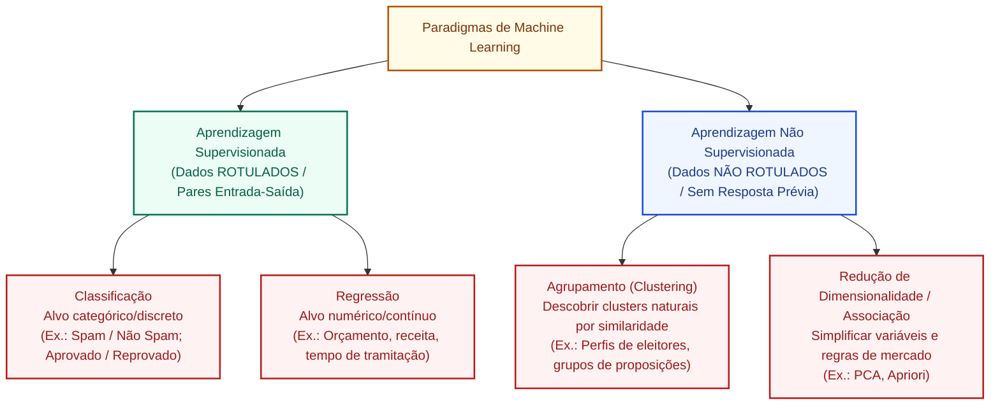

# Aprendizagem supervisionada e não supervisionada: algoritmos, tarefas, dados rotulados e métricas

**Concurso Câmara dos Deputados 2026, cargo 1, Divulgação Institucional, Cebraspe. Unidade CAM-TI-017 conforme arquitetura e inventário editorial.**

## Núcleo do conceito: os dois pilares clássicos do Machine Learning

No campo do **Aprendizado de Máquina (*Machine Learning*)**, a diferenciação primária entre as abordagens de treinamento baseia-se na **presença ou ausência de supervisão externa**, isto é, se o conjunto de dados fornecido ao algoritmo contém ou não as respostas corretas predeterminadas (denominadas **rótulos**, *labels* ou variáveis-alvo $y$).

Essa distinção é um dos temas mais recorrentes em provas de informática e tecnologia do **Cebraspe**, que exige do candidato precisão sobre:
1. A natureza dos dados de entrada (rotulados $\times$ não rotulados);
2. As tarefas típicas de cada modalidade (classificação/regressão $\times$ agrupamento/redução de dimensionalidade);
3. O catálogo canônico de algoritmos associados a cada paradigma;
4. As métricas matemáticas utilizadas para avaliar o desempenho do modelo preditivo.

---

## 1. Aprendizagem Supervisionada (*Supervised Learning*)

### 1.1 Definição e Mecânica Operacional
Na aprendizagem supervisionada, o algoritmo recebe um conjunto de dados de treino composto por **pares ordenados de entrada e saída**:
$$\mathcal{D}_{\text{treino}} = \{(x_1, y_1), (x_2, y_2), \dots, (x_n, y_n)\}$$
Onde $x_i$ representa o vetor de características (*features*, atributos preditores) e $y_i$ é o rótulo verdadeiro (*ground truth* ou variável dependente). O objetivo do modelo é induzir uma função matemática de mapeamento $f(x) \approx y$ capaz de **generalizar** com exatidão previsões para novos dados não vistos no treinamento.

### 1.2 As Duas Grandes Tarefas Supervisionadas
1. **Classificação**:
   - A variável-alvo $y$ é **discreta, qualitativa ou categórica**;
   - *Binária*: duas classes possíveis (ex.: email é spam ou não spam; emenda parlamentar é constitucional ou inconstitucional);
   - *Multiclasse*: três ou mais categorias mutuamente exclusivas (ex.: proposição legislativa classificada em Saúde, Educação, Tributário ou Meio Ambiente);
   - *Algoritmos clássicos*: Regressão Logística, Árvores de Decisão (*Decision Trees*), Florestas Aleatórias (*Random Forests*), Máquinas de Vetores de Suporte (*Support Vector Machines* - SVM), Naive Bayes e K-Vizinhos Mais Próximos ($k$-NN supervisionado).
2. **Regressão**:
   - A variável-alvo $y$ é **contínua, quantitativa ou numérica real**;
   - Prediz valores escalares (ex.: previsão do valor monetário arrecadado por uma taxa pública; estimativa do número de dias até a votação de um projeto de lei);
   - *Algoritmos clássicos*: Regressão Linear Simples e Múltipla, Ridge e Lasso Regression, Árvores de Regressão e Redes Neurais para regressão.

### 1.3 Avaliação de Modelos Supervisionados e Métricas
Para problemas de classificação, o Cebraspe explora intensamente a **Matriz de Confusão** e suas derivadas:

| Real \ Predito | Predito Positivo | Predito Negativo |
| :--- | :--- | :--- |
| **Real Positivo** | **Verdadeiro Positivo (VP)** | **Falso Negativo (FN)** *(Erro Tipo II)* |
| **Real Negativo** | **Falso Positivo (FP)** *(Erro Tipo I)* | **Verdadeiro Negativo (VN)** |

- **Acurácia (*Accuracy*)**: Proporção total de acertos sobre o total de amostras:
  $$\text{Acurácia} = \frac{VP + VN}{VP + VN + FP + FN}$$
  *Alerta Cebraspe*: A acurácia é uma métrica enganosa em conjuntos de dados desbalanceados (ex.: se 99% das transações são legítimas e 1% é fraude, um modelo ingênuo que sempre diz "legítimo" terá 99% de acurácia, mas é 100% inútil para pegar fraudes).
- **Precisão (*Precision*)**: Dos que o modelo previu como positivo, quantos eram de fato positivos?
  $$\text{Precisão} = \frac{VP}{VP + FP}$$
- **Revocação / Sensibilidade (*Recall / Sensitivity*)**: De todos os positivos reais existentes, quantos o modelo conseguiu capturar?
  $$\text{Revocação} = \frac{VP}{VP + FN}$$
- **F1-Score**: Média harmônica entre Precisão e Revocação, equilibrando os dois objetivos:
  $$\text{F1} = 2 \times \frac{\text{Precisão} \times \text{Revocação}}{\text{Precisão} + \text{Revocação}}$$

Para problemas de **Regressão**, avalia-se o resíduo (diferença entre o valor previsto $\hat{y}$ e o real $y$):
- **MAE (*Mean Absolute Error*)**: Média das diferenças absolutas;
- **MSE (*Mean Squared Error*)**: Média dos erros ao quadrado (penaliza severamente grandes erros);
- **RMSE (*Root Mean Squared Error*)**: Raiz do MSE (mantém a mesma unidade de medida da variável dependente);
- **$R^2$ (Coeficiente de Determinação)**: Compara o erro quadrático do modelo com o de uma referência que prevê a média observada. Seu valor pode ser **negativo**, especialmente na avaliação fora da amostra; não está universalmente restrito ao intervalo de 0 a 1.

---

## 2. Aprendizagem Não Supervisionada (*Unsupervised Learning*)

### 2.1 Definição e Mecânica Operacional
Na aprendizagem não supervisionada, o treinamento é conduzido **sem usar rótulos-alvo como sinais de supervisão**. Rótulos de referência podem existir para avaliação externa, mas não são usados pelo algoritmo para ensinar a tarefa:
$$\mathcal{D} = \{x_1, x_2, \dots, x_n\}$$
O algoritmo não recebe respostas prévias e não sabe *"o que procurar"*. Sua tarefa é **explorar a estrutura intrínseca, densidade e correlações dos dados** para descobrir padrões ocultos, agrupamentos naturais ou sintetizar representações simplificadas.

### 2.2 Principais Tarefas e Algoritmos Não Supervisionados
1. **Agrupamento (*Clustering*)**:
   - Divide os dados em grupos (*clusters*) com base na proximidade ou similaridade matemática (alta coesão interna e alta separação externa);
   - **K-Means**: Algoritmo particional baseado em centróides. Exige que o usuário defina previamente o número $k$ de clusters; calcula iterativamente a distância euclidiana das amostras até os centróides e recalcula o centro geométrico;
   - **DBSCAN (*Density-Based Spatial Clustering of Applications with Noise*)**: Agrupa pontos com base na densidade espacial. Vantagens vitais para prova: não exige a definição prévia de $k$ e é capaz de identificar *outliers* (ruídos) e clusters de formatos arbitrários não esféricos;
   - **Clustering Hierárquico (*Dendrogramas*)**: Aglomera amostras sucessivamente de baixo para cima (*bottom-up*) ou divide de cima para baixo (*top-down*).
2. **Redução de Dimensionalidade**:
   - Transforma um espaço com centenas de variáveis em um espaço com poucas variáveis preservando o máximo possível da variância original;
   - **PCA (*Principal Component Analysis* - Análise de Componentes Principais)**: Técnica linear que projeta os dados em eixos ortogonais não correlacionados (componentes principais);
   - *Finalidade prática*: Eliminar multicolinearidade, acelerar o treinamento de modelos e viabilizar a visualização gráfica em 2D ou 3D.
3. **Regras de Associação**:
   - Identifica relações de dependência frequente entre itens (análise de cesta de compras);
   - Algoritmo **Apriori**: mede suporte, confiança e *lift* entre itens associados.

---

## 3. Matriz comparativa sistemática entre os dois paradigmas

| Critério de Comparação | Aprendizagem Supervisionada | Aprendizagem Não Supervisionada |
| :--- | :--- | :--- |
| **Insumo de Dados** | Conjunto de dados **rotulado** ($x$ com rótulo $y$) | Conjunto de dados **não rotulado** (apenas $x$) |
| **Objetivo Primordial** | Prever um valor futuro ou classificar novas amostras em rótulos pré-existentes | Descobrir padrões intrínsecos, agrupamentos naturais ou reduzir dimensionalidade |
| **Feedback / Correção** | O modelo compara a sua previsão com o gabarito real e calcula o erro | Não há gabarito prévio nem feedback explícito de acerto/erro |
| **Principais Tarefas** | **Classificação** e **Regressão** | **Agrupamento (*Clustering*)**, **Redução de Dimensionalidade** e **Associação** |
| **Algoritmos Canônicos** | Regressão Linear/Logística, Árvores de Decisão, Random Forest, SVM, Naive Bayes, $k$-NN | K-Means, DBSCAN, Clustering Hierárquico, PCA, Apriori |
| **Custo de Obtenção de Dados** | **Muito alto**: rotular dados exige esforço humano e curadoria especializada | **Mais baixo**: dados brutos abundantes podem ser consumidos diretamente |
| **Métricas de Avaliação** | Acurácia, Precisão, Revocação, F1-Score, ROC-AUC, MSE, RMSE, $R^2$ | Coeficiente Silhouette, Índice Davies-Bouldin, Inércia (Elbow Method) |

---

## 4. O limiar intermediário: Aprendizagem Semissupervisionada e Auto supervisionada

Para evitar simplificações exageradas em prova, cabe destacar duas abordagens complementares:
1. **Aprendizagem Semissupervisionada (*Semi-Supervised*)**:
   - Utiliza uma **pequena quantidade de dados rotulados** combinada a um **grande volume de dados não rotulados**;
   - O algoritmo usa a porção rotulada para criar um classificador inicial preliminar e aplica esse modelo aos dados não rotulados para atribuir "pseudo-rótulos", refinando o aprendizado com custo financeiro e humano reduzido.
2. **Aprendizagem Autossupervisionada (*Self-Supervised*)**:
   - Técnica dominante no treinamento dos modelos de fundação e LLMs (como GPT e BERT);
   - Os alvos de treinamento são derivados dos próprios dados, como prever o **próximo token** a partir dos anteriores (modelos autorregressivos) ou prever **tokens mascarados** a partir do contexto (modelos do tipo BERT). São tarefas distintas e não devem ser misturadas num mesmo exemplo.

---

## 5. Casos progressivos de aplicação

### Caso 1: Detecção de notícias fraudulentas sobre votações legislativas
- **Cenário**: A equipe de Divulgação Institucional da Câmara constrói uma base de dados histórica contendo 10.000 publicações de redes sociais sobre projetos de lei, cada uma auditada manualmente e rotulada com as classes `"Fidedigna"` ou `"Desinformativa"`. Um algoritmo é treinado com essa base para analisar novas publicações em tempo real.
- **Análise**: Este é um caso puro de **Aprendizagem Supervisionada** na modalidade de **Classificação Binária**. O modelo opera sobre dados previamente rotulados por analistas humanos e tem por objetivo atribuir uma das duas categorias a novos textos recebidos.

### Caso 2: Identificação de perfis de engajamento de cidadãos no portal
- **Cenário**: O departamento de TI deseja entender como os milhões de usuários navegam pelo Portal da Câmara. A base possui dados de tempo de tela, páginas visitadas e termos pesquisados, mas ninguém sabe de antemão quais são os perfis de cidadãos existentes. O sistema roda um algoritmo K-Means e descobre a existência de três grupos distintos: pesquisadores acadêmicos, jornalistas políticos e cidadãos em busca de serviços do plenário.
- **Análise**: Exemplo clássico de **Aprendizagem Não Supervisionada** na modalidade de **Agrupamento (*Clustering*)**. Não havia rótulos preexistentes no banco de dados; o algoritmo encontrou sozinho a similaridade comportamental entre os perfis de navegação.

### Caso 3: Estimativa de custos orçamentários de novas proposições
- **Cenário**: Um órgão técnico da Câmara alimenta um modelo computacional com o texto de projetos de lei, número de beneficiários, índice de inflação e o impacto orçamentário real (em milhões de reais) apurado nos últimos 10 anos. O sistema agora recebe uma nova proposta legislativa e calcula uma estimativa de R$ 14,5 milhões de impacto anual.
- **Análise**: Trata-se de **Aprendizagem Supervisionada** na modalidade de **Regressão**, pois a variável-alvo prevista é um valor numérico contínuo (recursos orçamentários em reais).

### Caso 4: Compressão de variáveis de votação para visualização em mapa
- **Cenário**: Um analista possui uma tabela com os votos de 513 deputados em 2.000 matérias distintas ao longo da legislatura (uma matriz de 513 linhas por 2.000 colunas). Para plotar os parlamentares em um gráfico bidimensional (eixo X e eixo Y) e visualizar o alinhamento ideológico e proximidade partidária, ele aplica o algoritmo PCA.
- **Análise**: Aplicação de **Aprendizagem Não Supervisionada** na modalidade de **Redução de Dimensionalidade**. O PCA condensou 2.000 variáveis em 2 componentes principais sem necessitar de nenhum rótulo ideológico prévio fornecido aos dados.

---

## 6. Questões inéditas comentadas (Padrão Cebraspe)

### Questão 1 (Cebraspe / Inédita)
> A aprendizagem supervisionada difere da não supervisionada essencialmente pela presença de dados de treino rotulados, sendo a classificação e a regressão exemplos típicos de tarefas supervisionadas, ao passo que o agrupamento (*clustering*) constitui tarefa característica da aprendizagem não supervisionada.

- **Gabarito**: **CERTO**
- **Fundamentação**: O item sintetiza perfeitamente a divisão fundamental do Machine Learning. Havendo variável-alvo rotulada, a tarefa é supervisionada (classificação para alvos categóricos e regressão para alvos contínuos). Não havendo rótulo, a tarefa é não supervisionada, sendo o agrupamento a sua manifestação mais célebre.

---

### Questão 2 (Cebraspe / Inédita)
> Em problemas de classificação supervisionada, a acurácia é sempre a métrica mais confiável e recomendada para avaliar a eficácia de um modelo preditivo, independentemente do nível de desbalanceamento existente entre as classes do conjunto de dados.

- **Gabarito**: **ERRADO**
- **Fundamentação**: A palavra *"sempre"* denuncia a clássica pegadinha do Cebraspe. Em bases de dados desbalanceadas (como detecção de fraudes ou ataques cibernéticos raros), a acurácia mascara completamente o fracasso do modelo. Nessas situações, **precisão, revocação, F1 e outras métricas adequadas ao custo de cada erro** podem revelar falhas ocultas pela acurácia. A escolha depende do objetivo e da prevalência da classe positiva.

---

### Questão 3 (Cebraspe / Inédita)
> O algoritmo K-Means é uma técnica de aprendizagem supervisionada voltada para problemas de regressão linear que ajusta automaticamente uma reta de projeção aos dados para minimizar a soma dos resíduos quadráticos.

- **Gabarito**: **ERRADO**
- **Fundamentação**: Erro duplo de taxonomia. O **K-Means** é um algoritmo clássico de **aprendizagem NÃO supervisionada** voltado para tarefas de **agrupamento (*clustering*)**, e não de regressão. Quem ajusta retas com base na minimização de resíduos quadráticos (MQO) é a Regressão Linear.

---

### Questão 4 (Cebraspe / Inédita)
> A Análise de Componentes Principais (PCA) é uma técnica de aprendizagem não supervisionada empregada na redução de dimensionalidade de conjuntos de dados multivariados, preservando a maior quantidade possível de variância original das variáveis preditoras em novas dimensões ortogonais e não correlacionadas.

- **Gabarito**: **CERTO**
- **Fundamentação**: Definição impecável do PCA. O PCA opera sobre dados sem rótulo, transformando um conjunto de variáveis possivelmente correlacionadas em um conjunto menor de componentes principais linearmente não correlacionados.

---

### Questão 5 (Cebraspe / Inédita)
> A revocação (*recall*) afere a proporção de previsões positivas que estavam efetivamente corretas, enquanto a precisão (*precision*) quantifica a habilidade do modelo preditivo em identificar e recuperar todas as instâncias positivas reais existentes na base de dados.

- **Gabarito**: **ERRADO**
- **Fundamentação**: O enunciado promoveu uma **inversão de conceitos**:
  - A habilidade do modelo em acertar entre as amostras que ele classificou como positivas é a **Precisão** ($VP / (VP + FP)$);
  - A habilidade do modelo em localizar e capturar todas as amostras positivas reais existentes é a **Revocação / Sensibilidade** ($VP / (VP + FN)$).

---

### Questão 6 (Cebraspe / Inédita)
> Na aprendizagem semissupervisionada, combina-se uma quantidade relativamente modesta de dados previamente rotulados a um volume expressivo de dados não rotulados durante a fase de treinamento, visando a aprimorar a capacidade preditiva do sistema a um custo operacional inferior ao exigido pela rotulagem manual integral.

- **Gabarito**: **CERTO**
- **Fundamentação**: Conceituação precisa da aprendizagem semissupervisionada. Essa abordagem mitiga o gargalo da rotulagem humana manual (que é cara e lenta), aproveitando a abundância de dados brutos não anotados para refinar o espaço de decisão do modelo.

---

## 7. Heurísticas para a prova da Câmara dos Deputados

1. **Rótulo $\rightarrow$ O grande divisor de águas**:
   - Tem rótulo / resposta certa / gabarito $\rightarrow$ **Supervisionada**.
   - Não tem rótulo / busca padrões ocultos / grupos naturais $\rightarrow$ **Não Supervisionada**.
2. **Tarefa Supervisionada**:
   - O que o modelo prevê é categoria / classe / texto discreto (ex.: *"Aprovado"* ou *"Reprovado"*) $\rightarrow$ **Classificação**.
   - O que o modelo prevê é número contínuo / valor financeiro / tempo (ex.: R$ 54,20; 12,5 dias) $\rightarrow$ **Regressão**.
3. **Métricas de Classificação**:
   - Base desbalanceada $\rightarrow$ Fuja da *Acurácia*; use **Precisão, Revocação e F1-Score**.
   - Se falsos positivos têm custo elevado, considere priorizar **precisão**, sem ignorar revocação e taxa-base.
   - Se falsos negativos têm custo elevado, considere priorizar **revocação**, examinando também precisão e as consequências dos falsos positivos.

---

## Fontes consultadas e vigência

- **RUSSELL, Stuart; NORVIG, Peter**: *Inteligência Artificial: Uma Abordagem Moderna*. 4ª ed., Elsevier / GEN LTC.
- **BISHOP, Christopher M.**: *Pattern Recognition and Machine Learning*. Springer.
- **HASTIE, Trevor; TIBSHIRANI, Robert; FRIEDMAN, Jerome**: *The Elements of Statistical Learning*. 2ª ed., Springer.
- **Documentação Scikit-Learn**: *Supervised and Unsupervised Learning User Guide*.

> **Revisão técnica (11/11/2026):** corrigidos limites do $R^2$, distinção entre objetivos autossupervisionados e linguagem absoluta sobre métricas. O exemplo de 99% de acurácia em dados desbalanceados continua ilustrativo. Questões inéditas não equivalem a itens oficiais da banca.
