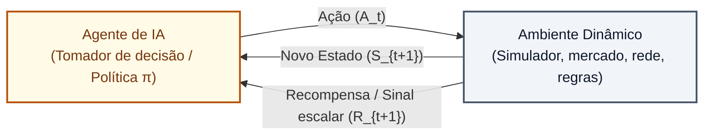
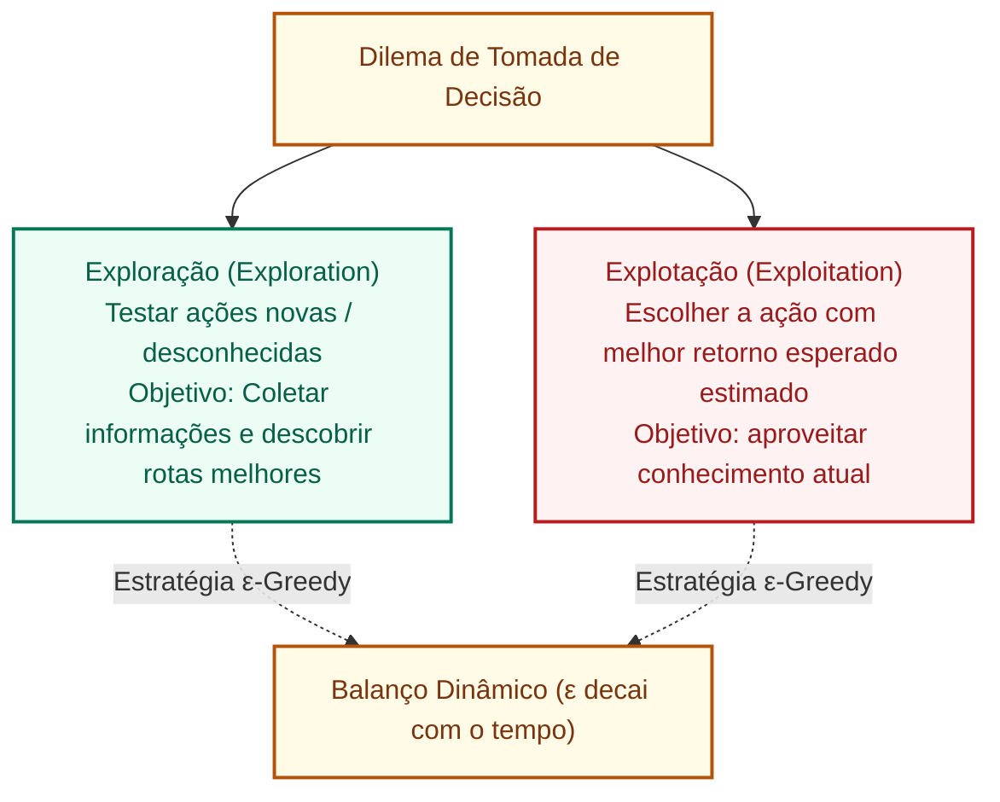

# Aprendizagem por reforço e comparação sistemática de modelos de machine learning

**Concurso Câmara dos Deputados 2026, cargo 1, Divulgação Institucional, Cebraspe. Unidade CAM-TI-018 conforme arquitetura e inventário editorial.**

## Núcleo do conceito: o paradigma da interação agente-ambiente

A **Aprendizagem por Reforço (*Reinforcement Learning* - RL)** constitui o terceiro paradigma fundamental do *Machine Learning*, distinguindo-se estruturalmente da aprendizagem supervisionada e da não supervisionada. Em vez de aprender a partir de dados históricos previamente rotulados (supervisionada) ou de buscar padrões estáticos e agrupamentos intrínsecos em conjuntos de dados brutos (não supervisionada), a aprendizagem por reforço baseia-se em um **processo dinâmico de tomada de decisão sequencial**, no qual um **agente computacional autônomo** aprende a atingir um objetivo interagindo diretamente com um **ambiente incerto por meio de tentativas, erros, recompensas e punições**.

No contexto de concursos do **Cebraspe** e aplicações contemporâneas na administração pública, o estudo de RL é cobrado sob quatro eixos rigorosos:
1. Os componentes formais do Processo de Decisão de Markov (MDP): agente, estado, ação, ambiente, recompensa e política;
2. O dilema fundamental entre Exploração (*Exploration*) e Explotação (*Exploitation*);
3. As técnicas de alinhamento com preferências humanas (RLHF - *Reinforcement Learning from Human Feedback*), uma das estratégias utilizadas para alinhar modelos de linguagem, ao lado de outras técnicas de ajuste por preferências;
4. A matriz comparativa consolidada entre os paradigmas de Machine Learning.

---

## 1. Formalização do Processo de Decisão de Markov (MDP)

A fundamentação matemática da aprendizagem por reforço assenta-se no arcabouço dos **Processos de Decisão de Markov (*Markov Decision Processes* - MDP)**, definido pela tupla $(S, A, P, R, \gamma)$:

1. **Agente (*Agent*)**:
   - A entidade computacional dotada de autonomia que percebe o ambiente e executa ações com o objetivo exclusivo de **maximizar o retorno cumulativo (soma de recompensas futuras)** ao longo do tempo.
2. **Ambiente (*Environment*)**:
   - O mundo externo com o qual o agente interage, processando as ações e respondendo com novos estados e sinais de reforço.
3. **Estado ($S_t \in S$)**:
   - A representação completa da situação atual do ambiente percebida pelo agente no instante temporal $t$.
4. **Ação ($A_t \in A$)**:
   - A decisão concreta ou comando executado pelo agente que altera o estado do ambiente.
5. **Recompensa ($R_{t+1} \in \mathbb{R}$)**:
   - Um valor numérico escalar imediato enviado pelo ambiente que avalia o sucesso ou fracasso da ação anterior (recompensa positiva para acertos; recompensa negativa ou custo para erros).
6. **Fator de Desconto ($\gamma \in [0, 1]$)**:
   - Parâmetro que pondera a relevância de recompensas imediatas versus recompensas de longo prazo. Um $\gamma$ próximo de 0 torna o agente imediatista (*míope*); um $\gamma$ próximo de 1 torna o agente previdente (*estratégico*).
7. **Política ($\pi(a|s)$)**:
   - A estratégia ou regra de comportamento do agente, mapeando cada estado $s$ a uma probabilidade de executar a ação $a$.
8. **Função Valor ($V(s)$ ou $Q(s, a)$)**:
   - Estima o retorno total esperado a partir de determinado estado, permitindo ao agente planejar ações que gerem recompensas cumulativas elevadas mesmo que a recompensa imediata seja nula ou negativa.

---

## 2. O Dilema Fundamental: Exploração (*Exploration*) $\times$ Explotação (*Exploitation*)

Um dos conceitos mais explorados pela banca Cebraspe em provas conceituais é o **trade-off entre Exploração e Explotação**:

- **Explotação (*Exploitation*)**:
  - O agente escolhe a ação que, segundo sua estimativa atual, oferece o **melhor retorno esperado**, que pode incluir recompensas futuras, e não apenas a recompensa imediata. O risco da explotação cega e prematura é ficar preso em **ótimos locais subótimos**, ignorando estratégias superiores que ainda não foram descobertas.
- **Exploração (*Exploration*)**:
  - O agente toma ações desconhecidas ou aparentemente menos vantajosas para explorar o ambiente e coletar novas informações. O risco da exploração excessiva é incorrer em custos desnecessários e perder recompensas certas.
- **Mecanismo de Equilíbrio ($\epsilon$-Greedy)**:
  - Com probabilidade $1 - \epsilon$, o agente explora a melhor ação conhecida (explotação); com probabilidade $\epsilon$, escolhe uma ação aleatória (exploração). Conforme o treinamento avança e o agente adquire experiência, o valor de $\epsilon$ diminui gradualmente (*epsilon decay*).

---

## 3. RLHF: Aprendizagem por Reforço com Feedback Humano

Na era dos Modelos de Linguagem de Grande Porte (LLMs), a aprendizagem por reforço ganhou protagonismo central através do **RLHF (*Reinforcement Learning from Human Feedback*)**:

1. **O Problema do Alinhamento**:
   - Um modelo de linguagem pré-treinado em bilhões de textos da internet aprende a prever o próximo token estatisticamente provável, mas frequentemente gera respostas tóxicas, incorretas, alucinadas ou inúteis;
2. **A Solução via RLHF**:
   - **Etapa 1 (Curadoria Humana)**: Anotadores humanos avaliam diferentes respostas geradas pelo modelo para a mesma pergunta, ranqueando-as da melhor para a pior com base em critérios de utilidade, veracidade e inocuidade (*Helpful, Honest, Harmless*);
   - **Etapa 2 (Modelo de Recompensa / *Reward Model*)**: Treina-se uma rede neural para prever a pontuação que um ser humano atribuiria a qualquer resposta;
   - **Etapa 3 (Otimização por RL)**: Em uma implementação clássica de RLHF, o modelo é ajustado por aprendizagem por reforço com sinais de um modelo de recompensa, usando algoritmos como *Proximal Policy Optimization* (PPO). O sinal reflete preferências humanas representadas pelo modelo de recompensa; **não garante detecção ou eliminação de alucinações**. Também existem métodos de alinhamento por preferências sem essa etapa de RL.

---

## 4. Matriz comparativa dos paradigmas de Machine Learning

| Critério de Comparação | Aprendizagem Supervisionada | Aprendizagem Não Supervisionada | Aprendizagem por Reforço |
| :--- | :--- | :--- | :--- |
| **Fonte e Insumo de Dados** | Conjunto de dados histórico **rotulado** ($\mathbf{x}, y$) | Conjunto de dados **não rotulado** (apenas $\mathbf{x}$) | **Ambiente dinâmico** e dados gerados por interação em tempo real |
| **Tipo de Sinal de Feedback** | **Gabarito explícito e imediato**: erro calculado entre a previsão e o rótulo real | **Sem feedback externo**: sem gabarito ou respostas de certo/errado | **Sinal escalar de recompensa ($R$)**: pode ser atrasado no tempo (*delayed reward*) |
| **Objetivo Primordial** | Prever classes ou valores contínuos a partir de novos dados | Encontrar padrões intrínsecos, agrupamentos naturais ou sintetizar variáveis | **Aprender uma sequência ótima de ações (política $\pi$)** para maximizar recompensa global |
| **Decisão Sequencial?** | Em tarefas supervisionadas clássicas, normalmente avalia-se a relação entrada-alvo; há também modelos supervisionados de sequências | Em tarefas não supervisionadas clássicas, identificam-se padrões sem rótulos-alvo; há também modelos sequenciais | **SIM**: a política escolhe ações que podem afetar estados e recompensas futuros |
| **Tarefas e Algoritmos Típicos** | Classificação (Árvores, SVM, Naive Bayes) e Regressão (Linear, Lasso) | Agrupamento (K-Means, DBSCAN) e Redução de Dimensionalidade (PCA) | Controle autônomo, robótica, jogos (AlphaGo), alinhamento de LLMs (Q-Learning, PPO, DQN) |
| **Principal Desafio / Gargalo** | Alto custo e viés da rotulagem humana manual | Dificuldade de validação objetiva e métricas interpretáveis | Instabilidade de convergência, alto custo de simulação e o dilema exploração/explotação |

---

## 5. Casos progressivos de aplicação

### Caso 1: A roteirização de entregas da mala direta institucional
- **Cenário**: A Câmara precisa roteirizar uma frota de veículos para entregar correspondências e publicações oficiais em centenas de órgãos públicos do Distrito Federal em horários de pico de trânsito. O sistema não dispõe de rotas predefinidas gravadas com rótulos ideais para cada dia de chuva ou manifestação. Um agente de IA é colocado em um simulador de tráfego e recebe pontuações positivas ao economizar tempo e combustível e penalidades severas ao atrasar a entrega ou infringir normas de trânsito.
- **Análise**: Este é um caso típico de **Aprendizagem por Reforço**. Não há pares de entrada e saída estáticos (supervisionado); o agente aprende a tomar decisões sequenciais (virar à direita, esperar, mudar de faixa) interagindo dinamicamente com o simulador de trânsito e buscando maximizar a pontuação cumulativa.

### Caso 2: O bot parlamentar que aprendeu a responder com cortesia
- **Cenário**: O assistente virtual de ouvidoria da Câmara gerava respostas tecnicamente corretas sobre a tramitação de projetos de lei, mas adotava linguagem excessivamente agressiva e burocrática em matérias polêmicas. Para resolver o problema, a equipe de comunicação submeteu pares de respostas a avaliações humanas e usou a pontuação para calibrar a política de geração de texto do modelo via RLHF.
- **Análise**: Aplicação de **Aprendizagem por Reforço com Feedback Humano (RLHF)**. O modelo não foi redigitado manualmente do zero; ele foi reorientado dinamicamente com base em sinais de recompensa modelados a partir de julgamentos humanos de cortesia e clareza.

### Caso 3: O algoritmo que ficou preso em uma estratégia medíocre
- **Cenário**: Um sistema de automação de campanhas digitais de conscientização cidadã testa dois designs de posts institucionais nas redes. O post A obtém 50 curtidas nas primeiras horas. O sistema passa a disparar 100% de seus recursos apenas no post A, ignorando o post B (que, se testado em outros horários, teria o potencial de atingir 5.000 pessoas).
- **Análise**: Ocorrência clássica de **Explotação Prematura (*Over-exploitation*)** por ausência de um mecanismo calibrado de Exploração (*Exploration*). O algoritmo fixou-se em um ótimo local imediato e deixou de descobrir alternativas muito superiores por não reservar uma fração $\epsilon$ de suas tentativas para novos testes.

### Caso 4: Triagem de emendas versus Controle de robô de limpeza
- **Cenário**: Em uma prova, o candidato deve classificar duas demandas: Demanda 1: identificar se uma emenda orçamentária é do tipo individual ou de bancada a partir de 50.000 emendas históricas arquivadas; Demanda 2: controlar a movimentação de um robô aspirador de pó pelo plenário para cobrir toda a área sem colidir com as bancadas.
- **Análise**: A Demanda 1 é puramente **Aprendizagem Supervisionada** (classificação categórica com dados históricos rotulados). A Demanda 2 é puramente **Aprendizagem por Reforço** (controle de agente móvel que toma decisões sequenciais no espaço com feedback de colisão/recompensa de limpeza).

---

## 6. Questões inéditas comentadas (Padrão Cebraspe)

### Questão 1 (Cebraspe / Inédita)
> Na aprendizagem por reforço, diferentemente da aprendizagem supervisionada, o agente não é instruído sobre qual ação específica deve executar diante de uma situação, mas deve descobrir por meio de tentativas quais ações resultam na maior recompensa acumulada ao longo do tempo.

- **Gabarito**: **CERTO**
- **Fundamentação**: Definição clássica e precisa de Aprendizagem por Reforço (Sutton & Barto). Enquanto na supervisionada o modelo recebe o gabarito explícito de cada exemplo, no reforço o agente opera por tentativa e erro guiado por um sinal escalar de recompensa que avalia o impacto de suas ações sequenciais.

---

### Questão 2 (Cebraspe / Inédita)
> O dilema entre exploração (*exploration*) e explotação (*exploitation*) na aprendizagem por reforço estabelece que o agente deve sempre escolher a ação que lhe proporcione a maior recompensa imediata conhecida, sob pena de incorrer em custos proibitivos de treinamento.

- **Gabarito**: **ERRADO**
- **Fundamentação**: Escolher sempre a ação com maior **recompensa imediata** não caracteriza necessariamente a melhor política, pois o objetivo típico é o **retorno acumulado esperado**. A explotação favorece a ação atualmente estimada como melhor, enquanto a exploração testa alternativas para melhorar a estimativa. O gabarito ERRADO decorre da prescrição universal de escolher sempre a recompensa imediata; o equilíbrio pode variar conforme a estratégia e o ambiente.

---

### Questão 3 (Cebraspe / Inédita)
> A técnica de RLHF (*Reinforcement Learning from Human Feedback*) utiliza a aprendizagem por reforço com base em pontuações de avaliadores humanos para alinhar o comportamento de grandes modelos de linguagem (LLMs), mitigando a geração de respostas nocivas, incorretas ou alucinadas.

- **Gabarito**: **CERTO**
- **Fundamentação**: O RLHF clássico pode treinar um modelo de recompensa a partir de avaliações/preferências humanas e utilizá-lo no ajuste de uma política por reforço (por exemplo, com PPO). Isso **pode melhorar o alinhamento comportamental**, mas não garante veracidade nem eliminação de alucinações. A eficácia depende das avaliações, do objetivo de otimização e dos testes aplicados. O gabarito CERTO deve ser entendido como possibilidade de mitigação, sem promessa universal.

---

### Questão 4 (Cebraspe / Inédita)
> O algoritmo K-Means e a técnica de Análise de Componentes Principais (PCA) constituem exemplos consolidados de algoritmos de aprendizagem por reforço amplamente empregados para a tomada de decisões sequenciais de políticas públicas.

- **Gabarito**: **ERRADO**
- **Fundamentação**: Erro grosseiro de categorização. O K-Means (agrupamento) e o PCA (redução de dimensionalidade) são ferramentas clássicas de **Aprendizagem NÃO Supervisionada**. Algoritmos típicos de Aprendizagem por Reforço incluem Q-Learning, Deep Q-Networks (DQN), SARSA e Proximal Policy Optimization (PPO).

---

### Questão 5 (Cebraspe / Inédita)
> Nos Processos de Decisão de Markov (MDP), o fator de desconto ($\gamma$) é empregado para ponderar a importância de recompensas futuras em relação às recompensas imediatas, sendo que um valor de $\gamma$ igual a zero faz com que o agente considere exclusivamente a recompensa obtida no instante imediatamente seguinte.

- **Gabarito**: **CERTO**
- **Fundamentação**: Propriedade matemática elementar do fator de desconto em MDPs. Como o retorno descontado é dado por $G_t = \sum_{k=0}^{\infty} \gamma^k R_{t+k+1}$, quando $\gamma = 0$, todos os termos futuros multiplicados por potências de zero são anulados, restando apenas a recompensa imediata $R_{t+1}$ (agente estritamente míope).

---

### Questão 6 (Cebraspe / Inédita)
> Tanto na aprendizagem supervisionada quanto na aprendizagem por reforço, assume-se que as amostras de dados são estatisticamente independentes e identicamente distribuídas (*i.i.d.*), inexistindo influência causal entre a decisão adotada em uma instância e o estado das instâncias subsequentes.

- **Gabarito**: **ERRADO**
- **Fundamentação**: Muitos modelos supervisionados introdutórios assumem observações *i.i.d.*, mas a hipótese não vale para todas as tarefas supervisionadas (por exemplo, séries temporais). Na aprendizagem por reforço, ações podem alterar a distribuição dos estados e recompensas futuros; logo, a afirmação de independência universal e ausência de influência sequencial é falsa.

---

## 7. Heurísticas para a prova da Câmara dos Deputados

1. **A tríade do Machine Learning no Cebraspe**:
   - Dados rotulados / pares entrada-saída $\rightarrow$ **Supervisionada** (Classificação/Regressão).
   - Dados sem rótulos / descoberta de clusters ou padrões ocultos $\rightarrow$ **Não Supervisionada** (K-Means/PCA).
   - Agente interativo / tentativas e erros / recompensas e punições sequenciais $\rightarrow$ **Aprendizagem por Reforço**.
2. **RLHF**:
   - Preferências humanas e otimização por reforço podem caracterizar **RLHF**; não presumir que a técnica puna cada alucinação ou garanta precisão factual.
3. **Exploration $\times$ Exploitation**:
   - Exploitation = aproveitar o que já sabe (lucro certo).
   - Exploration = arriscar no desconhecido para aprender mais.
   - O segredo é o **equilíbrio** (nem só um, nem só outro).

---

## Fontes consultadas e vigência

- **SUTTON, Richard S.; BARTO, Andrew G.**: *Reinforcement Learning: An Introduction*. 2ª ed., MIT Press.
- **RUSSELL, Stuart; NORVIG, Peter**: *Inteligência Artificial: Uma Abordagem Moderna*. 4ª ed., Elsevier / GEN LTC.
- **CHRISTIANO, Paul et al.**: *Deep Reinforcement Learning from Human Preferences* (Artigo seminal sobre RLHF).
- **OpenAI / Anthropic**: Documentação técnica sobre alinhamento e fine-tuning com PPO em modelos de fundação.

> **Revisão técnica (11/11/2026):** exploração/explotação são decisões sobre retorno esperado, e o RLHF clássico com PPO é uma implementação possível, sem garantia de correção factual. As comparações de paradigmas têm caráter didático e não excluem abordagens híbridas ou sequenciais.

> **Auditoria de questões C/E, segunda passagem (11/11/2026):** Q1–Q6 examinadas contra os conceitos do artigo. **Gabaritos mantidos (C, E, C, E, C, E)**, com ressalva expressa na Q3: RLHF pode mitigar respostas indesejadas, mas não garante eliminar erros factuais. As justificativas de exploração e premissa *i.i.d.* foram ajustadas.
