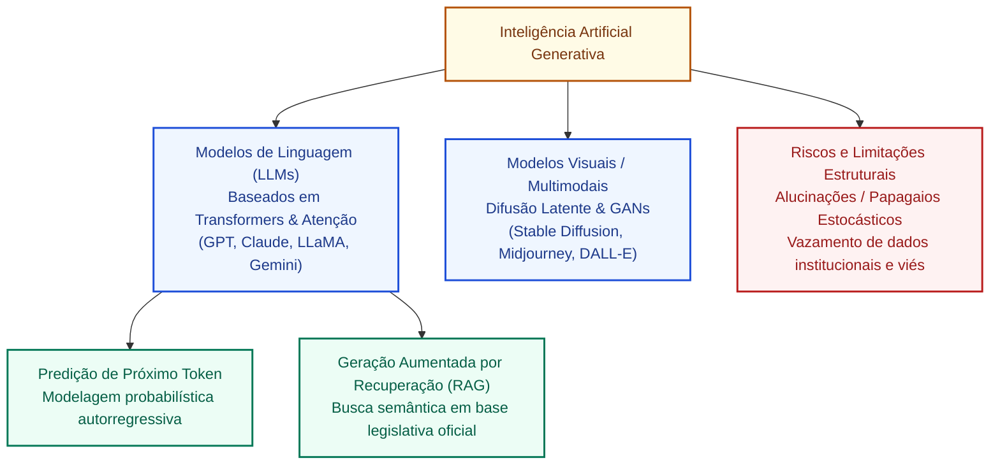
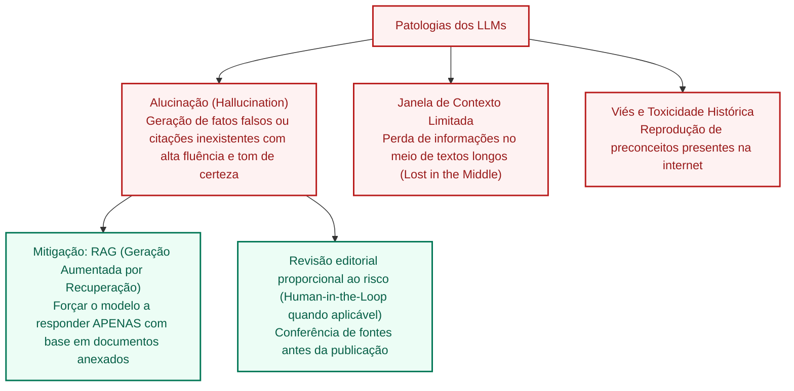

# Inteligência artificial generativa: arquiteturas, modelos de fundação, difusão, aplicações e alucinações

**Concurso Câmara dos Deputados 2026, cargo 1, Divulgação Institucional, Cebraspe. Unidade CAM-TI-019 conforme arquitetura e inventário editorial.**

## Núcleo do conceito: a virada paradigmática da IA discriminativa para a generativa

A **Inteligência Artificial Generativa (GenAI)** representa o salto tecnológico mais disruptivo da ciência da computação contemporânea. Uma **distinção útil, mas não exaustiva**, é entre modelos discriminativos, que podem estimar a probabilidade condicional $P(Y\mid X)$ de uma classe $Y$ diante de atributos $X$, e modelos generativos, que representam distribuições dos dados para gerar exemplos como textos, imagens, áudio ou código. Uma distribuição sobre os dados observados pode ser escrita $P(X)$; **quando há duas variáveis $X$ e $Y$, a distribuição conjunta é $P(X,Y)$**, não $P(X)$. Modelos preditivos e generativos podem compartilhar arquiteturas e finalidades; criatividade, originalidade e veracidade das saídas não são garantias matemáticas da geração.

No setor público e particularmente nas atividades de **Divulgação Institucional e Comunicação Social da Câmara dos Deputados**, a IA generativa atua na redação preliminar de sínteses legislativas, sumarização de relatórios orçamentários complexos e apoio à produção multimídia.

Para a banca **Cebraspe**, o domínio do tema exige o entendimento de cinco eixos essenciais:
1. A arquitetura **Transformer** e o mecanismo de **Autoatenção (*Self-Attention*)**;
2. Os Grandes Modelos de Linguagem (**LLMs**) e o conceito de **Modelos de Fundação**;
3. Modelos de difusão e redes adversárias generativas (**GANs**) para conteúdo visual;
4. As patologias cognitivas dos modelos: **alucinações (*hallucinations*)**, viés estocástico e degradação de contexto;
5. Estratégias de mitigação e ancoragem em fontes fidedignas (**RAG - *Retrieval-Augmented Generation***).

---

## 1. A revolução dos Transformers e o Mecanismo de Autoatenção

Antes de 2017, o processamento de texto em computadores dependia de Redes Neurais Recorrentes (RNNs) e LSTMs, que processavam as palavras estritamente **uma a uma, em ordem sequencial**. Essa abordagem sofria de dois gargalos fatais: esquecia o início de frases longas (*vanishing gradient*) e impedia o processamento em paralelo nas GPUs.

Em 2017, o artigo seminal do Google *"Attention Is All You Need"* (Vaswani et al.) introduziu a arquitetura **Transformer**, sustentada por dois pilares revolucionários:

### 1.1 Processamento Paralelo e Codificação Posicional
- O Transformer consome a frase inteira de uma só vez (*em paralelo*), em vez de palavra por palavra;
- Para que o modelo saiba a ordem dos termos, adiciona-se aos vetores de entrada uma **Codificação Posicional (*Positional Encoding*)**, permitindo que a GPU processe bilhões de tokens simultaneamente.

### 1.2 Mecanismo de Autoatenção (*Self-Attention*)
- A autoatenção permite que o modelo pondere a relevância de **todas as palavras da frase em relação a cada palavra específica**, independentemente da distância física que as separa no texto;
- *Exemplo clássico*: Na frase *"O animal não atravessou a rua porque **ele** estava cansado"*, o mecanismo de atenção calcula a relação matemática e atribui peso máximo ligando o pronome *"ele"* ao substantivo *"animal"*. Se a frase fosse *"...porque **ela** estava larga"*, a atenção ligaria o pronome à *"rua"*;
- Matematicamente, a atenção opera comparando vetores de **Query ($Q$)**, **Key ($K$)** e **Value ($V$)**:
  $$\text{Attention}(Q, K, V) = \text{softmax}\left(\frac{QK^T}{\sqrt{d_k}}\right)V$$

---

## 2. Grandes Modelos de Linguagem (LLMs) e Modelos de Fundação

### 2.1 O que é um LLM?
Um **LLM (*Large Language Model*)** é uma rede neural com dezenas ou centenas de bilhões de parâmetros, pré-treinada em volumes titânicos de texto da internet para atuar como um **preditor autorregressivo de próximo token**:
- O modelo **não pensa, não raciocina e não tem consciência**;
- Ele calcula continuamente uma distribuição de probabilidades condicionais:
  $$P(w_{t} \mid w_1, w_2, \dots, w_{t-1})$$
- Por essa razão, a literatura científica (Bender et al., 2021) costuma categorizar os LLMs como **"Papagaios Estocásticos" (*Stochastic Parrots*)**: sistemas que recombinam de forma estatisticamente convincente as correlações fonéticas e sintáticas dos dados em que foram alimentados, sem nenhuma apreensão semântica real ou intencionalidade própria sobre o mundo.

### 2.2 O Conceito de Modelo de Fundação (*Foundation Model*)
Cunhado pela Universidade de Stanford (Bommasani et al., 2021), designa modelos treinados em bases de dados amplas em escala massiva, geralmente por aprendizagem autossupervisionada, que podem ser adaptados e especializados (*fine-tuned*) para uma multiplicidade impressionante de tarefas a jusante (tradução, sumarização, redação legislativa, análise jurídica, extração de entidades).

---

## 3. Modelos Generativos Visuais: Difusão e GANs

Além do texto, a GenAI revolucionou a criação de mídia digital:

1. **Modelos de Difusão (*Diffusion Models*)**:
   - Padrão dominante da atualidade (Stable Diffusion, Midjourney, DALL-E);
   - Funcionamento em duas etapas:
     1. *Difusão Direta*: Adiciona-se ruído gaussiano a uma imagem de forma gradativa até que ela se torne puro ruído estático aleatório;
     2. *Difusão Reversa (Desnoising)*: A rede neural é treinada para remover o ruído passo a passo, reconstruindo uma imagem límpida condicionada ao texto digitado no prompt do usuário;
   - Superaram amplamente as arquiteturas anteriores em fidelidade visual e consistência de detalhes.
2. **Redes Adversárias Generativas (*Generative Adversarial Networks* - GANs)**:
   - Introduzidas por Ian Goodfellow em 2014;
   - Funcionam como um jogo de duas redes neurais que competem entre si:
     - O **Gerador**: Tenta criar imagens falsas indistinguíveis das reais;
     - O **Discriminador**: Tenta identificar quais imagens são reais (da base de fotos) e quais foram forjadas pelo gerador;
   - O treinamento atinge o equilíbrio de Nash quando o gerador produz amostras tão perfeitas que o discriminador não consegue diferenciá-las do mundo real ($P = 0,5$).

---

## 4. Patologias dos LLMs: Alucinações e Limites Estruturais

O Cebraspe exige que o servidor público conheça não apenas a utilidade, mas as **vulnerabilidades críticas** da IA generativa no serviço público:

### 4.1 O Fenômeno da Alucinação (*Hallucination*)
- **Definição**: Ocorrência em que o modelo de linguagem produz respostas gramaticalmente impecáveis, extremamente coerentes e convincentes, mas que são **factualmente falsas, inexistentes ou inventadas**;
- *Exemplos dramáticos no setor público*: Inventar precedentes jurídicos do STF que nunca foram julgados, citar artigos inexistentes da Constituição, atribuir votos contrários a parlamentares ou calcular somatórios orçamentários errados mantendo postura de absoluta certeza;
- *Causa matemática*: Como o modelo busca a sequência estatisticamente provável de palavras e não consulta um repositório determinístico de fatos, ele prioriza a fluência sintática em detrimento da veracidade fática.

### 4.2 Geração Aumentada por Recuperação (RAG - *Retrieval-Augmented Generation*)
É uma arquitetura importante para **reduzir o risco de alucinações** e fornecer evidências verificáveis, mas não garante que a recuperação, interpretação ou geração estejam corretas:
1. O usuário faz uma pergunta no chat (ex.: *"Qual o quórum para votar a PEC 45?"*);
2. O sistema faz uma **busca semântica vetorial** no banco de dados oficial da Câmara (Regimento Interno e Constituição Federal) e recupera os trechos exatos pertinentes;
3. O sistema monta um prompt dinâmico injetando os trechos oficiais recuperados e instrui o LLM: *"Responda à pergunta do usuário utilizando ESTRITAMENTE as informações dos documentos anexados acima. Se a resposta não estiver no texto, declare que não sabe."*

---

## 5. Casos progressivos de aplicação

### Caso 1: O release jornalístico com citação inventada
- **Cenário**: Um redator do portal de notícias da Câmara utiliza um modelo de linguagem aberto para agilizar a redação de uma reportagem sobre a aprovação de uma nova lei de proteção ambiental. O texto gerado é primoroso, mas inclui uma declaração textual do relator da matéria elogiando o Ministério da Fazenda. Posteriormente, constata-se que o parlamentar jamais proferiu aquela frase e que o modelo inventou o depoimento.
- **Análise**: Ocorrência clássica de **Alucinação (*Hallucination*)**. Por ser um previsor estatístico de tokens, o modelo gerou uma frase verossímil que combinava tematicamente com o contexto legislativo, mas que não correspondia à realidade fática. A falha mostra por que é importante estabelecer **verificação editorial de citações e fatos antes de publicar**, com revisão humana conforme o processo, a criticidade e as normas aplicáveis.

### Caso 2: Resumo de projetos de lei com arquitetura RAG
- **Cenário**: Para disponibilizar no aplicativo móvel da Câmara um botão que resuma proposições de mais de 200 páginas para os cidadãos, a área de TI recusa conectar o sistema diretamente ao ChatGPT comercial e projeta um pipeline de **RAG**.
- **Análise**: A arquitetura **RAG** permite recuperar trechos de documentos oficiais antes da geração e, assim, pode reduzir erros de atualização e de referência. Ainda é necessário avaliar a qualidade da busca, a versão dos documentos e a fidelidade do resumo, pois **RAG não impede alucinações**.

### Caso 3: Discriminação versus Geração de Texto
- **Cenário**: Em uma questão de prova, indaga-se se um sistema que analisa 100.000 mensagens de e-mail e rotula cada uma com a probabilidade de pertencer à categoria `"Fraude"` ou `"Legítimo"` é um exemplo de IA Generativa.
- **Análise**: A resposta é **NÃO**. Esse sistema é um modelo **Discriminativo / Preditivo** clássico de Aprendizagem Supervisionada ($P(Y|X)$). A IA Generativa modela a distribuição dos dados para produzir novos artefatos inéditos de saída (redigir um novo e-mail completo a partir de instruções).

### Caso 4: O debate sobre direito autoral e imagens parlamentares
- **Cenário**: A equipe de mídias sociais da Câmara gera ilustrações com ferramentas de Difusão (Midjourney) para campanhas de saúde pública. Cidadãos questionam se as imagens violam direitos autorais de artistas gráficos.
- **Análise**: O tema envolve a discussão jurídica global sobre o treinamento de modelos de difusão em bilhões de imagens protegidas da internet sem remuneração dos autores originais, e exige distinguir recomendações de governança, debates sobre direitos autorais e **propostas legislativas**, como as debatidas no PL 2.338/2023, de deveres jurídicos efetivamente vigentes. A existência de obrigação específica de rotulagem depende da norma aplicável.

---

## 6. Questões inéditas comentadas (Padrão Cebraspe)

### Questão 1 (Cebraspe / Inédita)
> A arquitetura *Transformer*, introduzida no artigo *Attention Is All You Need*, superou a limitação das redes neurais recorrentes tradicionais ao viabilizar o processamento em paralelo dos dados de entrada e introduzir o mecanismo de autoatenção (*self-attention*), o qual calcula a interdependência contextual entre todos os tokens de uma sequência, independentemente da distância física que os separa.

- **Gabarito**: **CERTO**
- **Fundamentação**: A autoatenção permite relacionar posições distantes e, no **treinamento de arquiteturas Transformer**, processar posições em paralelo em maior grau que RNNs tradicionais. Isso não elimina limites de contexto nem assegura lembrança perfeita; na **geração autorregressiva**, novos tokens continuam sendo produzidos sequencialmente. O núcleo do item permanece CERTO, considerando o processamento da entrada.

---

### Questão 2 (Cebraspe / Inédita)
> Os grandes modelos de linguagem (LLMs) operam como sistemas estritamente conceituais de dedução lógica e validação ontológica, sendo imunes a falhas factuais e incapazes de gerar informações falsas, uma vez que sua arquitetura garante a veracidade empírica de todas as premissas geradas.

- **Gabarito**: **ERRADO**
- **Fundamentação**: LLMs podem gerar afirmações factualmente incorretas com grande fluência. Muitos modelos de geração textual usam previsão probabilística de tokens e não possuem garantia arquitetural de verificação da verdade. Isso basta para refutar a imunidade a erros que o enunciado lhes atribui, sem precisar assumir uma tese filosófica definitiva sobre “entendimento”.

---

### Questão 3 (Cebraspe / Inédita)
> A técnica de Geração Aumentada por Recuperação (RAG - *Retrieval-Augmented Generation*) consiste na integração de mecanismos de busca semântica em repositórios de dados externos confiáveis ao processo de geração de texto de um modelo de linguagem, atuando como importante contramedida contra o fenômeno das alucinações.

- **Gabarito**: **CERTO**
- **Fundamentação**: RAG combina recuperação de informações externas e geração, podendo melhorar a fundamentação factual e reduzir alucinações quando a busca e as fontes são adequadas. A busca **não precisa ser exclusivamente semântica** e documentos recuperados não asseguram que a resposta os interprete corretamente. O gabarito CERTO é defensável no sentido de *exemplo de arquitetura e contramedida possível*, não como definição exaustiva ou garantia.

---

### Questão 4 (Cebraspe / Inédita)
> Diferentemente dos modelos discriminativos, que aprendem a fronteira de decisão matemática para separar dados em categorias predefinidas calculando $P(Y \mid X)$, os modelos generativos buscam modelar a distribuição conjunta dos dados $P(X)$, viabilizando a síntese e a criação de novas instâncias e artefatos de conteúdo.

- **Gabarito**: **NÃO HOMOLOGADO (redação matemática imprecisa)**
- **Fundamentação**: A distinção geral entre **modelos discriminativos** (por exemplo, modelar $P(Y\mid X)$) e **generativos** (modelar $P(X)$ ou uma distribuição conjunta $P(X,Y)$, conforme a tarefa) é útil. Porém, o enunciado chama **$P(X)$ de distribuição conjunta**, o que é matematicamente incorreto sem explicitar outras variáveis. A questão original deve ser reformulada antes de integrar simulados. **Redação sugerida:** “Enquanto classificadores discriminativos podem modelar $P(Y\mid X)$, modelos generativos procuram representar uma distribuição dos dados, como $P(X)$ ou, em classificação generativa, $P(X,Y)$, permitindo amostrar novas instâncias.” **Gabarito da versão reformulada: CERTO.**

---

### Questão 5 (Cebraspe / Inédita)
> Os modelos de difusão empregados na geração de imagens operam por meio do treinamento simultâneo e antagônico de duas redes neurais denominadas gerador e discriminador, que competem em um jogo de soma zero até atingir o equilíbrio de Nash.

- **Gabarito**: **ERRADO**
- **Fundamentação**: O enunciado descreve as **Redes Adversárias Generativas (GANs)**, introduzidas por Ian Goodfellow em 2014. Os **Modelos de Difusão** operam por um princípio matemático completamente distinto: a adição progressiva de ruído estático gaussiano aos dados (difusão direta) e o posterior aprendizado da remoção sequencial desse ruído (*denoising* / difusão reversa) para sintetizar imagens nítidas a partir de ruído aleatório.

---

### Questão 6 (Cebraspe / Inédita)
> A publicação de resumos informativos e matérias jornalísticas elaboradas por sistemas de inteligência artificial generativa no portal da Câmara dos Deputados prescinde de revisão humana prévia caso o modelo utilizado conte com mais de cem bilhões de parâmetros, dada a garantia matemática de ausência de viés algorítmico em redes dessa magnitude.

- **Gabarito**: **ERRADO**
- **Fundamentação**: O aumento no número de parâmetros **não elimina o viés algorítmico nem impede alucinações**. Pelo contrário, modelos maiores podem gerar alucinações ainda mais sofisticadas e difíceis de detectar à primeira vista. A revisão de conteúdo institucional sensível é uma medida prudente de governança e controle de qualidade; **não se deve inferir obrigação legal universal de revisão humana prévia** apenas pelo uso de IA generativa.

---

## 7. Heurísticas para a prova da Câmara dos Deputados

1. **Discriminativo $\times$ Generativo**:
   - Classificar, prever nota, separar em grupos, detectar se é spam $\rightarrow$ **Discriminativo**.
   - Criar texto novo, pintar imagem, escrever código, compor áudio $\rightarrow$ **Generativo**.
2. **Transformers e Autoatenção**:
   - Processamento **em paralelo** (todas as palavras ao mesmo tempo com codificação posicional).
   - Mecanismo de **Autoatenção** = conecta o pronome ao seu sujeito real na frase, mesmo distante.
3. **Alucinações e RAG**:
   - Alucinação = falar coisa falsa com postura de professor com certeza absoluta.
   - Solução técnica para governança no serviço público = **RAG** (ancoragem em base oficial própria) + **Revisão Humana (*Human-in-the-Loop*)**.
4. **Difusão $\times$ GAN**:
   - Gerador $\times$ Discriminador em duelo/competição $\rightarrow$ **GAN**.
   - Adicionar ruído e depois limpar ruído (*denoising*) $\rightarrow$ **Modelos de Difusão**.

---

## Fontes consultadas e vigência

- **VASWANI, Ashish et al.**: *Attention Is All You Need* (2017). NeurIPS.
- **BOMMASANI, Rishi et al.**: *On the Opportunities and Risks of Foundation Models* (2021). Stanford University.
- **BENDER, Emily M. et al.**: *On the Dangers of Stochastic Parrots: Can Language Models Be Too Big?* (2021). FAccT.
- **GOODFELLOW, Ian et al.**: *Generative Adversarial Nets* (2014). NeurIPS.
- **LEWIS, Patrick et al.**: *Retrieval-Augmented Generation for Knowledge-Intensive NLP Tasks* (2020). NeurIPS.
- **Estratégia Brasileira de Inteligência Artificial (EBIA)**: Portaria MCTI nº 4.617/2021.

> **Revisão técnica e jurídica (11/11/2026):** RAG reduz riscos, mas não elimina alucinações; requisitos de revisão humana e de transparência dependem do caso e do regime aplicável. Exemplos institucionais são hipotéticos. Alterações harmonizadas com as ressalvas já identificadas na auditoria de IA da Câmara.

> **Auditoria de questões C/E, segunda passagem (11/11/2026):** Q1, Q2, Q3, Q5 e Q6 mantêm os gabaritos (C, E, C, E, E) com ressalvas técnicas nos comentários. **Q4 retirada de homologação por chamar $P(X)$ de distribuição conjunta**, oferecendo enunciado corrigido. Manter a questão original no histórico, mas não a usar sem reescrita.

---

## Questão substituta S21-4: probabilidades em modelos generativos

> Em um problema de classificação com atributos `X` e classe `Y`, um classificador discriminativo pode modelar diretamente `P(Y|X)`, enquanto um modelo generativo para essa tarefa pode modelar a distribuição conjunta `P(X,Y)`; já `P(X)` é uma distribuição marginal de `X`.

**Gabarito: CERTO (inédita, substitui a Questão 4 bloqueada).** A distribuição **conjunta** atribui probabilidades a combinações de valores de duas ou mais variáveis. A distribuição **marginal** resulta de somar ou integrar a conjunta sobre as demais variáveis: `P(X)=∑_y P(X,y)`, em caso discreto. A **condicional** é `P(Y|X)=P(X,Y)/P(X)` quando o denominador é positivo.

**Caso aplicado:** para classificar uma solicitação como reclamação ou dúvida, o discriminativo pode prever a classe a partir das palavras; um classificador generativo pode estimar probabilidades de textos condicionadas às classes e aplicar a regra de Bayes. Já um gerador de textos sem classes pode modelar uma distribuição sobre sequências de texto, sem precisar de `Y`.

**Contraexemplo:** “`P(X)` é necessariamente a distribuição conjunta de `X` e `Y`” é **ERRADO**. Essa era a imprecisão do item original.

**Fonte acadêmica:** [Stanford CS229: Generative Learning Algorithms, notas de aula](https://cs229.stanford.edu/notes2022fall/cs229-notes2.pdf). **Relação:** [[3 - Materias/Informatica/19 - aprendizagem supervisionada e nao supervisionada algoritmos e metricas|Classificação supervisionada]].

**Rastreabilidade:** a Questão 4 anterior permanece **NÃO HOMOLOGADA**.
