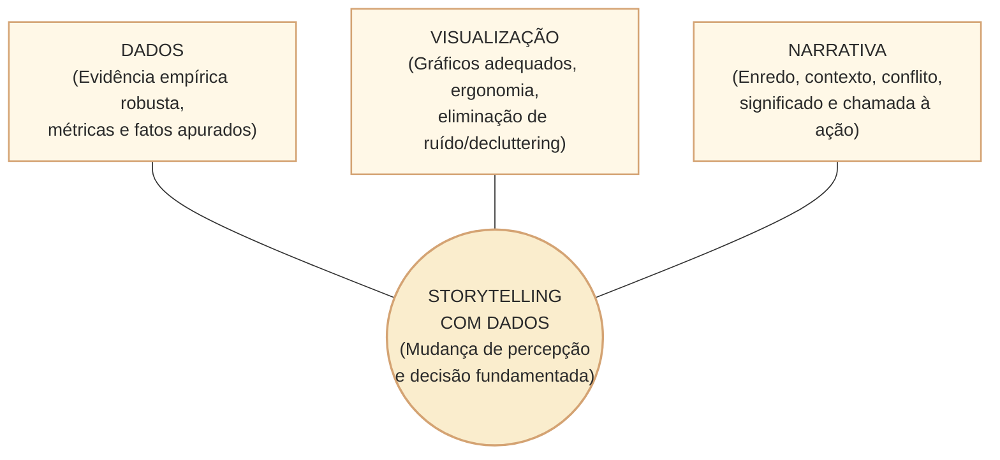
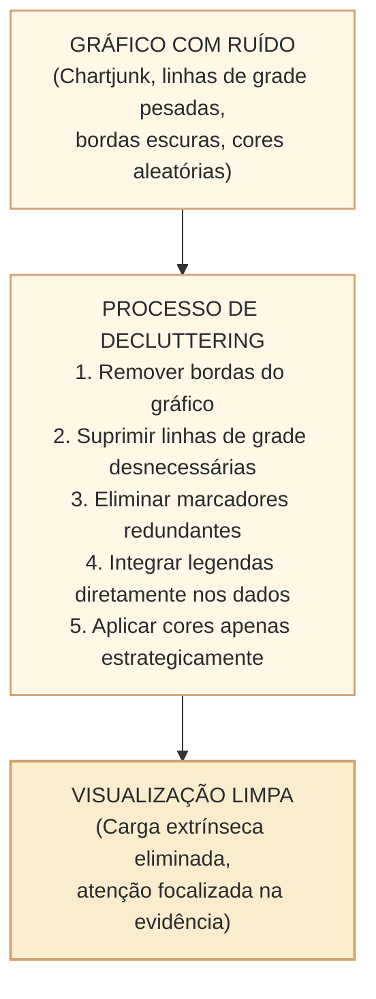
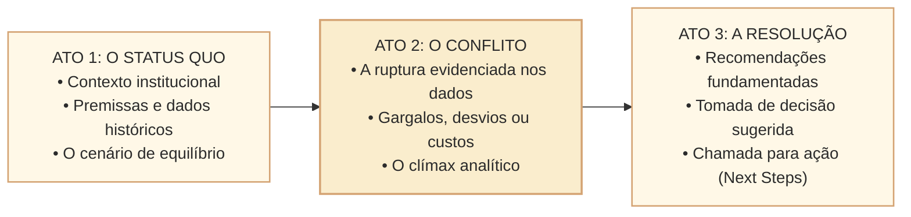
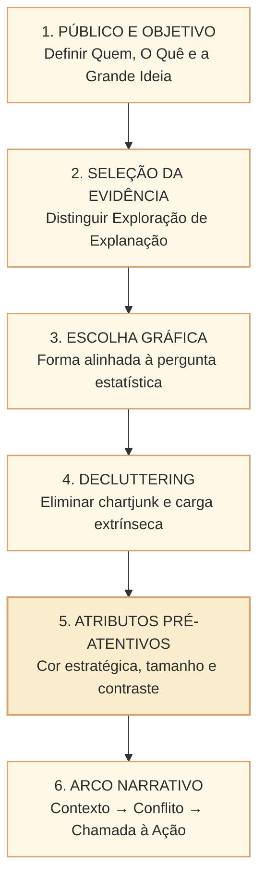

# Storytelling com dados: estrutura narrativa, contexto, decluttering e eficácia comunicativa

O volume maciço de dados públicos gerados pelos órgãos do Estado — proposições legislativas, execução orçamentária, folhas de pagamento, relatórios de auditoria e votações nominais — é inerte se não for compreendido e apropriado pela sociedade e pelos tomadores de decisão. Nesse cenário, o **storytelling com dados (*data storytelling*)** consolida-se como a disciplina técnica de articular **dados quantitativos confiáveis**, **visualizações cognitivamente eficazes** e **estruturas narrativas lógicas** para transformar fatos numéricos em compreensão, engajamento e tomada de ação fundamentada.

Em concursos públicos de alto nível para a área de comunicação e tecnologia da informação, como a Câmara dos Deputados (banca Cebraspe), o tema transcende a mera confecção de gráficos bonitos. Exigem-se o domínio da distinção entre análise exploratória e explanatória, a aplicação dos atributos pré-atentivos para guiar o olhar humano, a eliminação metódica da sobrecarga cognitiva (*decluttering* e carga cognitiva de Sweller), a estrutura do arco narrativo clássico adaptado a dados e os limites éticos inegociáveis de fidedignidade exigidos no setor público.

---

## 1. Fundamentos: a tríade do Storytelling com Dados

Segundo a formulação contemporânea de **Cole Nussbaumer Knaflic** (*Storytelling with Data*) e autores de visualização e comunicação analítica (como Stephen Few e Edward Tufte), o storytelling com dados opera na interseção de três dimensões complementares:

1. **Dados (*Data*)**: a base factual apurada, saneada e agregada. Sem rigor metodológico nos dados, o storytelling degenera em desinformação ou retórica vazia (*data manipulation*).
2. **Visualização (*Visuals*)**: a representação gráfica que traduz abstrações numéricas em formas geométricas perceptíveis pelo córtex visual humano.
3. **Narrativa (*Narrative*)**: a estruturação textual e lógica que contextualiza os números, explicita comparações e associações, apresenta hipóteses explicativas e mostra por que o fenômeno importa para a audiência. **Uma narrativa não demonstra, sozinha, relação causal:** essa conclusão requer método e evidências adequados.

---

## 2. Análise Exploratória versus Análise Explanatória

Um dos erros conceituais mais comuns e severamente penalizados em provas de concurso é a confusão entre **análise exploratória** e **comunicação explanatória**:

| Dimensão | Análise Exploratória (*Exploratory*) | Comunicação Explanatória (*Explanatory*) |
| :--- | :--- | :--- |
| **Finalidade principal** | Compreender os dados, descobrir padrões, testar hipóteses, detectar outliers. | Transmitir um achado específico e fundamentado a uma audiência para gerar decisão. |
| **Público-alvo** | O próprio analista de dados, cientista ou pesquisador. | A sociedade, o cidadão, o gestor público, os parlamentares ou jornalistas. |
| **Metáfora didática** | *A caça aos tesouros:* revirar 100 conchas na praia até encontrar duas ostras com pérolas. | *Apresentar as pérolas:* exibir com clareza as duas pérolas encontradas, sem despejar as 100 conchas na mesa. |
| **Complexidade visual** | Painéis dinâmicos, dezenas de filtros interativos, histogramas crus, múltiplos gráficos simultâneos. | Visualizações limpas, com foco direcionado, anotações contextuais e hierarquia visual evidente. |
| **Postura do comunicador** | "O que os dados estão me revelando?" | "Qual é a mensagem central que meu público precisa compreender para agir?" |

> **Atenção para a prova (Cebraspe):** descarregar um painel de BI complexo e repleto de filtros interativos em uma apresentação executiva para a Mesa Diretora da Câmara é um erro metodológico clássico de apresentar análise *exploratória* quando se exigia síntese *explanatória*.

---

## 3. O Contexto: Audiência, Mensagem e Tomador de Decisão

Antes de abrir qualquer ferramenta gráfica ou desenhar um gráfico, Knaflic preconiza que o comunicador de dados deve responder rigorosamente a três perguntas essenciais:

1. **Quem (*Who*)**: quem é a audiência primária? Qual o seu nível de familiaridade técnica com os dados? Trata-se de cidadãos leigos acessando o portal de transparência, jornalistas parlamentares ou os relatores de uma Comissão Mista de Orçamento?
2. **O quê (*What*)**: o que você precisa que o público saiba ou faça? Qual é a ação concreta requerida? Qual a decisão institucional embasada pelos dados?
3. **Como (*How*)**: quais dados, gráficos e encadeamento lógico são necessários para sustentar essa evidência?

### O "Teste dos Três Minutos" e a "Ideia em uma Frase" (*Big Idea*)

- **O Teste dos Três Minutos**: se o comunicador tiver apenas 3 minutos para apresentar a síntese sem projetar nenhum slide, ele consegue articular com clareza o problema, a evidência dos dados e a ação requerida?
- **A Grande Ideia (*The Big Idea*)**: condensar o cerne da comunicação em uma única sentença gramatical completa que contenha: (1) o ponto de vista articulado; (2) o que está em jogo; e (3) a ação ou recomendação proposta.

---

## 4. Carga Cognitiva e *Decluttering* (Eliminação da Desordem)

A mente humana processa informações visuais por meio da memória de trabalho, cuja capacidade de retenção simultânea é limitada (teoria da Carga Cognitiva de John Sweller). Quando um gráfico está repleto de elementos gráficos desnecessários, ocorre o que Edward Tufte denominou **lixo gráfico (*chartjunk*)**.

### Tipos de Carga Cognitiva na Visualização

1. **Carga Intrínseca**: o esforço mental inerente à complexidade do próprio conceito em análise (ex.: entender a regra de teto fiscal ou a tramitação regimental complexa). Essa carga deve ser respeitada e explicada didaticamente.
2. **Carga Pertinente (*Germane*)**: o esforço mental construtivo dedicado a integrar as novas informações à estrutura de conhecimento prévio do leitor.
3. **Carga Extrínseca**: o esforço mental desperdiçado em decifrar elementos visuais mal desenhados, excesso de cores, fontes espalhafatosas, bordas grossas ou redundâncias. **O objetivo do decluttering é reduzir a carga extrínseca desnecessária, não garantir que ela chegue literalmente a zero.**

### Princípios Gestalt Aplicados à Redução de Carga

Os princípios da percepção visual da Psicologia da Gestalt explicam como o cérebro agrupa estímulos:
- **Proximidade**: elementos próximos espacialmente são percebidos como pertencentes ao mesmo grupo (rotular o valor logo ao lado da barra elimina o esforço de alternar o olhar entre a barra e a legenda distante).
- **Semelhança**: elementos que compartilham mesma cor, forma ou tamanho são vistos como correlatos.
- **Continuidade**: o olhar segue trajetórias suaves e contínuas (eixos com linhas limpas).
- **Fechamento**: o cérebro completa mentalmente formas fechadas (dispensando bordas pesadas e caixas ao redor do gráfico).
- **Conexão**: pontos ligados por linhas contínuas são interpretados como uma sequência estruturada.

---

## 5. Atributos Pré-Atentivos: Direcionando o Foco da Audiência

Os chamados **atributos pré-atentivos** são características como contraste, posição, orientação e cor que podem ser detectadas rapidamente em determinadas tarefas visuais. A rapidez depende do estímulo, da quantidade de elementos, do contexto e da experiência do observador; não constitui um mecanismo universal anterior a toda percepção deliberada. O comunicador técnico utiliza esses atributos intencionalmente para criar **hierarquia visual** e responder à pergunta: *"para onde o leitor deve olhar primeiro?"*

| Atributo Pré-Atentivo | Aplicação Prática no Storytelling | Exemplo Típico em Dados Legislativos |
| :--- | :--- | :--- |
| **Cor de destaque (*Hue*)** | Deixar 9 barras em cinza-claro (neutro de fundo) e colorir apenas a barra de interesse em azul institucional ou âmbar. | Destacar a comissão permanente com maior tempo médio de tramitação entre as 30 comissões da Câmara. |
| **Intensidade da cor (*Saturation*)** | Usar tons suaves para dados históricos e saturação viva para a projeção do ano corrente. | Diferenciar execução orçamentária liquidada da projeção até o final do exercício financeiro. |
| **Tamanho (*Size*)** | Aumentar a espessura da linha que representa a média da Câmara em comparação às linhas tênues de cada bancada. | Gráfico de evolução temporal com múltiplas séries simultâneas. |
| **Espessura da linha (*Width*)** | Negritar ou engrossar o traço da meta orçamentária fixada pela LDO. | Linha de referência horizontal de cumprimento de meta fiscal. |
| **Posicionamento espacial (*Position*)** | Posicionar o indicador mais crítico no quadrante superior esquerdo (ordem natural de leitura ocidental em Z ou F). | Card de KPI resumindo o volume total de emendas aprovadas no exercício. |
| **Orientação e Forma (*Shape*)** | Utilizar marcadores diferenciados ou caixas delimitadoras apenas para eventos anômalos. | Destaque geométrico para uma votação com obstrução total em plenário. |

 > **Regra de Sobriedade Cromática:** no storytelling técnico, cores adicionais devem ter função informativa, de acessibilidade ou de hierarquia; cores meramente decorativas podem aumentar o ruído quando a posição e os rótulos já distinguem as categorias. Se todas as barras de um gráfico representam categorias com rótulo textual legível, pintá-las com cores diferentes do arco-íris adiciona ruído cognitivo desnecessário. A cor é uma ferramenta analítica de ênfase.

---

## 6. A Estrutura da Narrativa de Dados: O Arco Dramático

Uma forma possível de storytelling adota a estrutura dramática clássica (originária de Aristóteles e consagrada pelo triângulo de Gustav Freytag), traduzida para o contexto corporativo e governamental em uma progressão de três atos fundamentais:

1. **Ato 1: O Contexto e o Ponto de Partida (*Setup*)**: apresenta-se o cenário de partida, a meta estabelecida e os parâmetros normativos (ex.: *"Em um cenário fictício, a Câmara estabeleceria a meta de reduzir o tempo de tramitação de proposições legislativas prioritárias em 20% ao longo da legislatura"*).
2. **Ato 2: O Conflito e a Evidência dos Dados (*Tension / Conflict*)**: revela-se a tensão ou o problema por meio da evidência visual. É o momento em que os dados mostram a divergência entre o esperado e o observado (ex.: *"Na simulação, os dados construídos para o exercício indicariam aumento de 35% no tempo médio de retenção em um período fictício de 18 meses; a interpretação dependeria do denominador, da amostra e do método de cálculo"*).
3. **Ato 3: A Resolução e a Chamada à Ação (*Resolution & Call to Action*)**: conecta a evidência analítica às providências práticas (ex.: *"Uma hipótese de intervenção seria redistribuir relatorias e testar pautas temáticas; uma projeção de redução de 28 dias dependeria de modelo e evidências que este exemplo não fornece"*).

---

## 7. Ética e Integridade na Visualização de Dados Públicos

No setor público, a integridade da comunicação visual é relevante para os princípios constitucionais da **publicidade** e da **moralidade administrativa** (art. 37 da CF/88). Uma representação enganosa pode suscitar problemas éticos e jurídicos, mas a configuração de infração específica depende de conduta, contexto e norma incidente. O comunicador de dados deve repudiar práticas capciosas de indução a erro:

- **Truncamento deliberado do eixo zero em gráficos de barras**: como a área do retângulo codifica o valor numérico, truncar a base faz uma diferença de 2% parecer visualmente um aumento de 300%. Em gráficos de barras que representam magnitude por comprimento, iniciar o eixo quantitativo em zero é a **regra geral de integridade visual**; qualquer quebra deve ser explicitada e justificada, preferindo-se outro gráfico quando ela distorcer a comparação.
- **Duplo eixo Y com escalas desproporcionais**: forçar o cruzamento visual de duas linhas com magnitudes incomparáveis para sugerir falsa correlação ou equivalência de crescimento.
- **Gráficos 3D ou com perspectiva**: distorcem ângulos e áreas, conferindo destaque desmedido a fatias frontais e obscurecendo fatias traseiras.
- **Seleção tendenciosa de período (*cherry-picking*)**: recortar intencionalmente uma janela temporal estreita para simular tendência positiva ou negativa que se desfaz quando analisada na série histórica completa.
- **Omissão de margens de erro e fontes**: publicar pesquisas de opinião pública ou indicadores de avaliação de políticas sem declarar amostra, metodologia e intervalo de confiança.

---

## 8. Casos Práticos no Contexto da Câmara dos Deputados

### Caso 1: Divulgação do Índice de Participação Cidadã nas Audiências Públicas

* **Cenário**: A Secretaria de Transparência da Câmara precisa divulgar o crescimento do engajamento popular por meio do portal e-Democracia.
* **Abordagem Incorreta (Exploratória/Poluída)**: Gerar um gráfico de pizza 3D com 25 fatias coloridas representando cada tipo de evento e despejar uma tabela de 1.000 linhas com todos os comentários dos cidadãos.
* **Abordagem Correta de Storytelling**:
  - *Contexto*: A expansão das ferramentas de votação interativa nas comissões.
  - *Evidência Visual*: Um gráfico de linhas limpo, com eixo temporal contínuo (2020 a 2026), destacando em cor de ênfase o salto de perguntas enviadas a partir da integração com dispositivos móveis.
  - *Anotações Contextuais*: Textos explicativos inseridos diretamente sobre a curva nos pontos de inflexão de reformas regimentais.

### Caso 2: Apresentação da Distribuição de Gastos com a Cota Parlamentar (CEAP)

* **Cenário**: A Diretoria-Geral apresenta aos membros da Mesa Diretora a distribuição das despesas de passagens aéreas e locação de escritórios.
* **Abordagem Incorreta**: Gráfico de dispersão caótico com 513 pontos dispersos sem identificação e sem indicação de medianas ou limites regimentais.
* **Abordagem Correta**:
  - Utilização de *box plots* paralelos (*side-by-side*) por região geográfica ou porte de bancada, explicitando a mediana e a dispersão dos 50% centrais dos deputados.
  - Aplicação de cor de destaque unicamente sobre pontos que ultrapassaram o limite de alerta institucional, acompanhados de justificativa textual da auditoria interna.

### Caso 3: Relatório de Produtividade Legislativa das Comissões Permanentes

* **Cenário**: Um relatório executivo para o Presidente da Câmara sobre o volume de pareceres emitidos pelas comissões temáticas.
* **Abordagem**:
  - Gráfico de barras horizontais ordenado decrescentemente pelo número de pareceres votados (o que facilita a leitura dos extensos nomes regimentais das comissões no eixo vertical).
  - Todas as barras em cinza-escuro neutro, com exceção da Comissão de Constituição e Justiça e de Cidadania (CCJC) e da Comissão de Finanças e Tributação (CFT), coloridas em tom âmbar para ilustrar que **no cenário hipotético**, essas duas comissões representariam mais de 45% de um conjunto fictício de pareceres (conflito e evidência analítica para apoiar a alocação de mais consultores legislativos).

---

## 9. Questões de Concurso Comentadas (Padrão Cebraspe C/E)

### Questão 1
*(Inédita: estilo Cebraspe / Comunicação e TI)*
> Em projetos de comunicação visual baseados em dados, a análise exploratória e a comunicação explanatória possuem finalidades distintas: a primeira visa à descoberta e à investigação dos dados pelo próprio analista, enquanto a segunda foca em transmitir uma mensagem específica e fundamentada para um público-alvo determinado, de modo a orientar a tomada de decisão.

* **Gabarito**: **CERTO**.
* **Comentário**: Na análise exploratória, o analista investiga padrões, perguntas e possíveis explicações. Na comunicação explanatória, seleciona evidências para apresentar um achado sustentado a um público específico. Uma narrativa pode orientar decisões, mas **não substitui a checagem da qualidade e dos limites dos dados**.

---

### Questão 2
*(Inédita: estilo Cebraspe / Gestão Pública)*
> Para garantir a atratividade estética de um relatório analítico, recomenda-se a aplicação irrestrita do lixo gráfico (*chartjunk*), como molduras decorativas tridimensionais, padrões de preenchimento tracejados e uma paleta com cores distintas para cada barra do gráfico, independentemente de sua função analítica.

* **Gabarito**: **ERRADO**.
* **Comentário**: O conceito de *chartjunk* (formulado por Edward Tufte) refere-se a todo elemento decorativo desnecessário que compete pela atenção do leitor e eleva a carga cognitiva extrínseca sem agregar informação. O princípio do storytelling com dados preconiza o *decluttering* (eliminação da desordem), mantendo apenas os elementos estritamente indispensáveis à compreensão da evidência.

---

### Questão 3
*(Inédita: estilo Cebraspe / Tecnologia da Informação)*
> Cor, tamanho, posição e contraste podem orientar rapidamente a atenção em certas tarefas visuais e são recursos úteis para criar hierarquia na apresentação de dados; sua eficácia depende do contexto, da legibilidade e da interpretação dos leitores.

* **Gabarito**: **CERTO**.
* **Comentário**: Cor, tamanho, orientação, posição e contraste podem ser percebidos rapidamente e ajudar a estabelecer hierarquia visual. Contudo, **nem todo atributo é processado pré-atentivamente em qualquer tarefa**, e a redação sobre “córtex visual” e “nível subconsciente” simplifica mecanismos perceptivos. O gabarito CERTO é aceitável como descrição didática do uso de atributos visuais, **com ressalva de precisão neurocientífica**.

---

### Questão 4
*(Inédita: estilo Cebraspe / Comunicação Social)*
> No contexto do setor público, é plenamente legítimo suprimir o ponto zero do eixo de valores em gráficos de colunas para enfatizar variações percentuais ínfimas entre órgãos orçamentários, não caracterizando distorção visual nem infração ao princípio da fidedignidade da informação pública.

* **Gabarito**: **ERRADO**.
* **Comentário**: Em barras e colunas que comparam magnitudes por **comprimento**, recomenda-se uma linha de base zero para preservar proporções. Truncar o eixo pode exagerar variações, de modo que não se pode afirmar legitimidade plena **sem risco de distorção**, como faz o item. A existência de infração jurídica concreta depende de norma aplicável e contexto, não de uma regra gráfica isolada.

---

### Questão 5
*(Inédita: estilo Cebraspe / Análise de Dados)*
> A grande ideia (*big idea*), no planejamento de uma narrativa de dados, consiste em formular um parágrafo descritivo de todas as variáveis do banco de dados, sem emitir posicionamento ou indicar as medidas práticas recomendadas à audiência.

* **Gabarito**: **ERRADO**.
* **Comentário**: A *big idea* deve articular um ponto de vista claro e conciso, enunciando o que está em jogo e qual providência é recomendada. Não é uma mera ficha catalográfica ou listagem neutra de colunas e tabelas, mas a tese central articulada da comunicação explanatória.

---

### Questão 6
*(Inédita: estilo Cebraspe / Comunicação Institucional)*
> O arco narrativo clássico, composto por contextualização (status quo), conflito evidenciado pelos dados e resolução (chamada à ação), pode ser empregado estruturalmente em relatórios analíticos da administração pública para conectar diagnósticos empíricos a planos de intervenção institucional.

* **Gabarito**: **CERTO**.
* **Comentário**: A estrutura em contexto, problema e resolução **pode** organizar uma comunicação explanatória. Os dados sustentam a descrição de um fenômeno conforme sua qualidade, sem necessariamente **provar causas** ou demonstrar que determinada intervenção produzirá o resultado desejado. O plano de ação deve explicitar pressupostos e limites da inferência.

---

## 10. Resumo Estruturado para Revisão Rápida

- **Exploratório vs. Explanatório**: Exploratório é a busca de padrões pelo analista; Explanatório é a comunicação clara de um achado específico para a audiência agir.
- **Carga Cognitiva**: Minimizar a carga extrínseca (lixo visual, grades pesadas, cores aleatórias) para liberar a atenção para a carga intrínseca e pertinente.
- **Atributos Pré-Atentivos**: Cor de destaque, tamanho, contraste e posição espacial podem orientar a atenção rapidamente, conforme o contexto.
- **Regra da Sobriedade**: Em barras e colunas que codificam magnitude pelo comprimento, começar pelo zero é a recomendação geral de integridade gráfica. Cores devem privilegiar significado, hierarquia visual e acessibilidade, evitando ornamentos que prejudiquem a leitura.
- **Três Atos**: Contextualização institucional $\rightarrow$ Tensão/Ruptura apontada pelos dados $\rightarrow$ Resolução com proposta fundamentada.

> **Nota editorial (11/11/2026):** percentuais, projeções e exemplos institucionais desta nota são **cenários hipotéticos de ensino**, não dados oficiais da Câmara dos Deputados. Princípios de boa visualização orientam a prática profissional; a existência de infração jurídica deve ser avaliada à luz de norma aplicável e circunstâncias concretas. A revisão corresponde aos achados TI-025 a TI-027 da auditoria da Câmara.

> **Auditoria C/E, segunda passagem (11/11/2026):** seis questões examinadas; gabaritos preservados **C, E, C, E, E, C**, com ressalvas na Q3 sobre percepção visual, na Q4 sobre eixo zero e na Q6 sobre inferência causal e relato institucional. São itens inéditos, sem certificação como questões oficiais.
