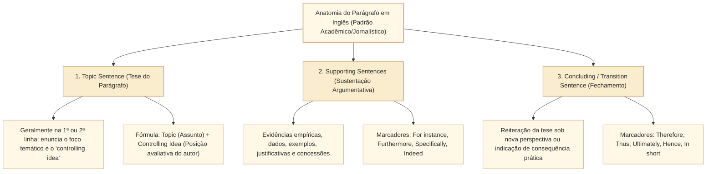
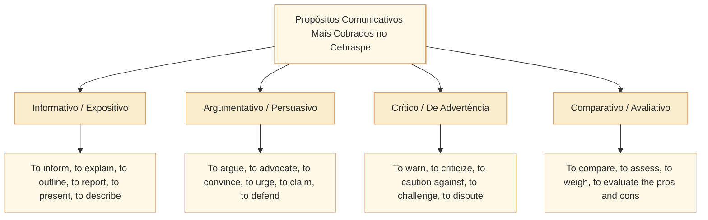

# Como localizar assunto, tese e propósito comunicativo em textos em língua inglesa no padrão Cebraspe

## 1. Situação-problema: a confusão entre o tópico temático geral, a ideia central e a intenção do autor

Textos em provas de língua inglesa podem incluir reportagens, textos acadêmicos, relatórios, ensaios e outros gêneros. A origem e o gênero de cada texto devem ser identificados no caderno específico: **não há base aqui para afirmar que todas as provas Cebraspe usem exclusivamente textos autênticos desses veículos**. Os excertos deste artigo são exemplos autorais didáticos.

Considere o seguinte excerto sobre inteligência artificial e parlamentos abertos:

> *"While artificial intelligence offers parliamentary administrations unprecedented capabilities to transcribe debates and summarize legislative drafts in real time, it would be an illusion to assume that algorithmic processing can replace the deliberative core of representative democracy. Automated synthesis inherently privileges statistical frequency over nuanced institutional compromise. Therefore, public institutions must deploy these technologies not to automate political judgment, but rather to expand citizen scrutiny and enhance the traceability of parliamentary outputs."*

Se o Cebraspe propuser itens de compreensão global sobre esse parágrafo, as assertivas frequentemente explorarão **três níveis de leitura que não se confundem**:

1. **Assunto / Tópico Geral (*Topic / Subject Matter*):** É a resposta à pergunta *"Sobre o que é o texto?"*. No caso, o uso de inteligência artificial nas administrações parlamentares. O erro comum é tomar o assunto amplo como se fosse a tese específica do autor.
2. **Ideia Central / Tese Defendida (*Main Idea / Central Claim / Thesis*):** É a resposta à pergunta *"Qual é o posicionamento valorativo e o argumento nuclear que o autor defende?"*. No excerto, a tese é explícita: **a IA não pode substituir a deliberação política humana, devendo ser canalizada para a transparência e a fiscalização cidadã**.
3. **Propósito Comunicativo / Intenção (*Author's Purpose / Communicative Function*):** É a resposta à pergunta *"Para que o autor escreveu esse texto?"*. O propósito predominante não é meramente descrever uma ferramenta (função informativa pura), mas sim **alertar para os riscos éticos e argumentar a favor de diretrizes normativas para o uso da tecnologia no parlamento**.

Esta unidade instrumentaliza o candidato para dominar as técnicas de **leitura rápida e estratégica (*skimming* e *scanning*)**, dissecar a **arquitetura do parágrafo analítico em inglês (*topic sentence, supporting sentences, concluding sentence*)**, identificar a **tipologia de propósitos comunicativos** cobrada pelo Cebraspe e blindar-se contra os distratores clássicos de extrapolação e detalhe secundário.

---

## 2. A anatomia do parágrafo analítico em língua inglesa: Topic Sentence e dinâmica informacional

Diferentemente de certos estilos dissertativos da tradição neolatina — que frequentemente desenvolvem longas contextualizações históricas antes de enunciar a tese —, a prosa acadêmica e jornalística anglo-saxônica é predominantemente **dedutiva e linear**.

### 2.1. A estrutura da *Topic Sentence*

A *topic sentence* é a oração mais importante de cada parágrafo. Ela é composta invariavelmente por dois elementos:
$$\text{Topic Sentence} = \underbrace{\text{Topic (Assunto geral do parágrafo)}}_{\text{Ex.: Automated synthesis}} + \underbrace{\text{Controlling Idea (Ideia controladora / julgamento do autor)}}_{\text{Ex.: inherently privileges statistical frequency over nuance}}$$

* **Posições típicas no texto:**
  1. **Logo na primeira frase (padrão mais comum, 80% dos casos):** Apresenta imediatamente a proposição que será defendida.
  2. **Na segunda frase (após abertura concessiva):** O parágrafo inicia com uma ressalva ou visão de senso comum (*"Many analysts believe X..."*) e apresenta a tese real na segunda frase introduzida por conectivo de contraste (*"However, Y is actually the case"*).
  3. **Na última frase (padrão indutivo):** O parágrafo empilha evidências e fatos para concluir com a tese nas linhas finais (*"Therefore, ..."*).

---

## 3. Skimming versus Scanning: técnicas de leitura instrumental em prova

Em provas de concurso de alta complexidade com tempo escasso, **ler palavra por palavra traduzindo mentalmente para o português é a receita para o fracasso**. O candidato deve alternar deliberadamente entre duas técnicas complementares:

| Técnica de Leitura Instrumental | Definição Operacional | Como Executar em Prova | Quando Utilizar no Cebraspe |
| :--- | :--- | :--- | :--- |
| **SKIMMING** *(Leitura Panorâmica / Flutuante)* | Leitura rápida e visualmente seletiva voltada para **captar a ideia global, a macroestrutura e o tom do autor**, sem se prender a minúcias vocabulares. | 1. Leia o **título** e o **subtítulo** (*headline/subhead*); 2. Leia integralmente o **primeiro parágrafo** (introdução); 3. Leia a **primeira frase (*topic sentence*)** de cada parágrafo intermediário; 4. Leia integralmente o **último parágrafo** (conclusão). | **Obrigatório antes de responder a qualquer item.** Permite responder a questões sobre *main idea*, *thesis*, *overall purpose* e tom geral do texto. |
| **SCANNING** *(Varredura Seletiva / Busca Localizada)* | Busca visual pontual e direcionada para **localizar uma informação específica** (dados numéricos, nomes de pessoas/instituições, termos entre aspas, datas ou palavras-chave do comando da questão). | 1. Identifique no item a **palavra-âncora** (*anchor word*); 2. Percorra o texto em zigue-zague ou verticalmente **sem ler o significado**, procurando apenas a forma gráfica da âncora; 3. Ao encontrar, leia atentamente a oração inteira e as orações imediatamente anterior e posterior. | **Obrigatório para itens factuais**, que citam linhas específicas (*"According to line X..."*), vocábulos específicos ou detalhes técnicos. |

---

## 4. O propósito comunicativo do autor (*Author's Purpose*) e o tom textual

O **propósito comunicativo** reflete a função sociocomunicativa primordial do texto. Ao descrever a intenção do autor, exercícios de compreensão podem usar verbos como *inform, argue, criticize, warn* ou *recommend*. Trata-se de um repertório analítico útil, **não de lista fixa ou estatisticamente comprovada da banca**:

### 4.1. Tabela de verbos de comando para *Purpose*

| Verbo em Inglês | Tradução e Matiz Semântico | Quando o Gabarito é CERTO | Quando o Gabarito é ERRADO (Distrator) |
| :--- | :--- | :--- | :--- |
| **To outline / To overview** | Delinear, apresentar um panorama geral, resumir os pontos principais. | Quando o texto apresenta de forma neutra as etapas, diretrizes ou características de um processo. | Quando o texto toma partido explícito e combate veementemente uma tese. |
| **To advocate / To champion** | Defender abertamente uma causa, pleitear, militar a favor de. | Quando o autor propõe reformas concretas e expressa julgamentos de valor categóricos (*"must", "should"*). | Quando o autor apenas relata fatos de forma estritamente neutra e imparcial. |
| **To caution against / To warn** | Alertar para riscos, prevenir contra efeitos colaterais adversos. | Quando o foco do texto está em apontar vulnerabilidades, brechas de segurança ou consequências danosas. | Quando o texto exalta de forma unicamente entusiástica as vantagens de uma tecnologia. |
| **To assess / To evaluate** | Avaliar, ponderar prós e contras, sopesar impactos. | Quando o texto confronta benefícios e limitações antes de sugerir um balanço final. | Quando o texto se limita a narrar uma sequência cronológica de eventos sem julgamento. |
| **To refute / To debunk** | Refutar, desmistificar, desmentir uma crença comum. | Quando o objetivo do autor é demonstrar que uma hipótese ou mito disseminado é falso ou insustentável. | Quando o autor concorda com a visão tradicional ou apenas acrescenta novos dados. |

---

## 5. A taxonomia dos distratores clássicos em itens de compreensão do Cebraspe

Ao formular itens C/E sobre a ideia central ou o propósito comunicativo, o Cebraspe raramente constrói assertivas absurdas. Quatro mecanismos de erro podem ser usados para construir e avaliar itens de interpretação. **São categorias pedagógicas, não padrões matemáticos ou frequências comprovadas da banca**:

1. **O Distrator do Detalhe Secundário (*True but Minor Detail*):** A assertiva reproduz uma informação que é **rigorosamente verdadeira segundo o texto**, mas que constitui apenas um dado factual isolado ou um exemplo ilustrativo, e **não a tese central** ou o propósito do autor.
   * *Pegadinha:* O candidato lê, reconhece a frase no texto e marca Certo, errando a questão porque o comando perguntava sobre a *main idea* ou o *primary purpose*.
2. **O Distrator da Extrapolação / Generalização (*Overstatement / Broadening*):** A assertiva pega uma constatação limitada a um escopo específico e a expande indevidamente para a totalidade (*all, every, always, entirely*), transformando uma possibilidade (*may, could*) em certeza inelutável (*will, must*).
3. **O Distrator da Inversão de Polaridade ou Causalidade (*Contradiction / Misattribution*):** A assertiva inverte quem causou o quê, ou atribui ao autor uma opinião que ele na verdade citou como sendo de seus adversários teóricos (confusão entre voz do autor e voz citada).
4. **O Distrator da Interpretação Estreita Demais (*Too Narrow Scope*):** A assertiva resume apenas o que foi dito no primeiro ou no segundo parágrafo, ignorando a virada argumentativa ocorrida no restante do texto.

---

## 6. Caso prático progressivo: análise passo a passo de texto legislativo em inglês

Leia o texto a seguir, adaptado do padrão típico de provas do Cebraspe para a Câmara dos Deputados:

> *(Text for items 1 through 6)*
> 
> Paragraph 1:
> The growing demand for institutional transparency has compelled democratic parliaments worldwide to rethink their communication strategies. Traditional press releases and televised plenary broadcasts, while still necessary, no longer suffice to satisfy an increasingly digital and fragmented public that expects immediate, interactive, and transparent access to public data.
> 
> Paragraph 2:
> In response to this paradigm shift, legislative bodies are aggressively investing in automated open-data platforms and citizen-engagement applications. These computational ecosystems enable real-time tracking of legislative amendments, algorithmic summarization of budgetary allocations, and decentralized public consultations. Proponents argue that such mechanisms substantially lower the barrier to civic participation and curb executive dominance by empowering civil society with granular evidence.
> 
> Paragraph 3:
> However, digital openness is not without institutional pitfalls. Unmediated access to raw parliamentary data can inadvertently fuel disinformation campaigns if computational summaries strip legislative provisions of their legal nuances. Moreover, algorithms trained on historical legislative outputs risk perpetuating systemic biases in policy evaluation. Hence, technical modernization must be subordinated to rigorous editorial oversight and robust data-governance frameworks, ensuring that algorithmic efficiency strengthens, rather than hollows out, democratic accountability.

### Aplicação das técnicas de leitura instrumental:
* **Skimming:**
  * Parágrafo 1: Abertura contextual. As comunicações tradicionais não bastam mais para a sociedade digital.
  * Parágrafo 2: Solução adotada (plataformas de dados abertos e IA) e benefícios apontados pelos defensores (*proponents*).
  * Parágrafo 3: **A virada crítica do autor (**conectivo **However** na abertura). Riscos de desinformação e vieses. Conclusão normativa com **Hence**: a modernização técnica precisa de governança e supervisão editorial para proteger a democracia.
* **Tese central sintetizada:** A abertura digital e a automação de dados parlamentares são indispensáveis, mas trazem riscos graves de desinformação e viés se não forem acompanhadas de governança e supervisão editorial humana.
* **Propósito comunicativo:** Alertar para os riscos da transparência digital desprovida de controle institucional e defender salvaguardas de governança nos parlamentos.

---

## 7. Itens comentados no padrão Cebraspe (Certo/Errado)

*(Inédita: estilo Cebraspe / Câmara dos Deputados – Analista Legislativo)*
> **Com base no texto acima, julgue os itens a seguir:**

**Item 1.** *(Inédita: estilo Cebraspe / Câmara dos Deputados – Analista Legislativo)* The primary purpose of the text is to criticize the adoption of open-data platforms by legislative bodies, advocating the restoration of traditional communication methods such as televised plenary broadcasts.
* **Gabarito:** **ERRADO**.
* **Fundamentação:** O texto **não critica a adoção em si** das plataformas de dados abertos nem advoga o retorno exclusivo aos métodos tradicionais. Pelo contrário: no primeiro parágrafo, afirma expressamente que os métodos tradicionais *"no longer suffice"* (não bastam mais); e, no terceiro parágrafo, defende que a tecnologia deve ser subordinada à governança e supervisão para que funcione bem, e não abolida. A assertiva distorce completamente o propósito comunicativo do autor.

**Item 2.** *(Inédita: estilo Cebraspe / Câmara dos Deputados – Analista Legislativo)* According to the text, the main idea of paragraph 2 is that computational ecosystems developed by parliaments have conclusively eliminated executive dominance over the legislative branch.
* **Gabarito:** **ERRADO**.
* **Fundamentação:** Distrator clássico de extrapolação e mudança de atribuição: (1) o texto afirma que os defensores argumentam que tais mecanismos reduzem a barreira e contêm o domínio do Executivo (*"Proponents argue that such mechanisms ... curb executive dominance"*), e não que isso seja um fato definitivo comprovado pelo autor; (2) o verbo *"curb"* significa conter, refrear, limitar, o que não equivale de modo algum a *"conclusively eliminated"* (eliminar de forma definitiva e absoluta).

**Item 3.** *(Inédita: estilo Cebraspe / Câmara dos Deputados – Analista Legislativo)* It can be correctly inferred from the text that the author's argument shifts in paragraph 3 from a descriptive presentation of technological solutions to a cautionary analysis of their potential risks.
* **Gabarito:** **CERTO**.
* **Fundamentação:** O conector adversativo **However** no início do terceiro parágrafo marca formalmente a virada argumentativa (*shift*): os parágrafos 1 e 2 descrevem a demanda e as soluções tecnológicas adotadas pelos parlamentos; o parágrafo 3 passa a analisar criticamente as armadilhas institucionais (*"institutional pitfalls"*), advertindo para os riscos de desinformação e vieses algorítmicos.

**Item 4.** *(Inédita: estilo Cebraspe / Câmara dos Deputados – Analista Legislativo)* The central thesis defended by the author is that technical modernization in parliamentary communication should be governed by institutional safeguards so as to prevent distortions and preserve democratic integrity.
* **Gabarito:** **CERTO**.
* **Fundamentação:** Esta assertiva captura com perfeição a tese central do texto enunciada no fechamento do parágrafo 3: *"technical modernization must be subordinated to rigorous editorial oversight and robust data-governance frameworks, ensuring that algorithmic efficiency strengthens, rather than hollows out, democratic accountability"*. A ideia central é exatamente subordinar a eficiência técnica a salvaguardas institucionais para evitar distorções.

**Item 5.** *(Inédita: estilo Cebraspe / Câmara dos Deputados – Analista Legislativo)* In paragraph 1, the statement that traditional communication strategies "no longer suffice" expresses the central thesis of the entire passage, while the subsequent paragraphs merely provide technical details of television broadcasting.
* **Gabarito:** **ERRADO**.
* **Fundamentação:** A afirmação de que os meios tradicionais não bastam é apenas a premissa introdutória do problema no parágrafo 1, e não a tese central de todo o texto. Ademais, os parágrafos seguintes **não** fornecem detalhes técnicos de transmissões de televisão, mas sim abordam plataformas de dados abertos, IA e governança digital. A assertiva reduz indevidamente o escopo do texto ao seu ponto de partida.

**Item 6.** *(Inédita: estilo Cebraspe / Câmara dos Deputados – Analista Legislativo)* The tone of the passage can be accurately characterized as balanced and analytical, as the author acknowledges the benefits of digital transparency before discussing its unintended vulnerabilities.
* **Gabarito:** **CERTO**.
* **Fundamentação:** O tom do texto não é nem panfletário/ingênuo (tecnoutópico) nem ludista/reacionário (antitecnológico). Trata-se de uma análise equilibrada (*balanced and analytical*), que reconhece os ganhos operacionais e democráticos da transparência digital no parágrafo 2 para, em seguida, ponderar criticamente as vulnerabilidades e propor soluções regulatórias no parágrafo 3.

---

## 8. Relações com outros conceitos e notas da biblioteca

* **Leitura instrumental, tese e inferências (base preexistente):** [[3 - Materias/Ingles/01 - leitura instrumental tese e inferencias|01 • Leitura instrumental, tese e inferências]].
* **Fatores de textualidade, macroestrutura e progressão temática em Língua Portuguesa (paralelo teórico):** [[3 - Materias/Portugues/12 - texto contexto e producao de sentido|12 • Texto, contexto e produção de sentido (CAM-LP-001)]] e [[3 - Materias/Portugues/13 - tema tese e progressao tematica|13 • Tema, tese e progressão temática (CAM-LP-002)]].
* **Próximo passo na trilha de Inglês (Informações explícitas, inferências e limites da dedução):** Unidade `CAM-ING-002`.

## 9. Referências teóricas e metodológicas

* SWALES, John M.; FEAK, Christine B. **Academic Writing for Graduate Students: Essential Tasks and Skills**. 3. ed. Ann Arbor: University of Michigan Press, 2012. (Capítulos sobre *Problem-Solution Texts* e *Data Commentary*).
* GRELLET, Françoise. **Developing Reading Skills: A Practical Guide to Reading Comprehension Exercises**. Cambridge: Cambridge University Press, 1981.
* CEBRASPE. **Bancos de Provas e Padrões de Resposta de Língua Inglesa: Nível Superior (Câmara dos Deputados, Senado Federal, STJ, IPEA, MPO, Diplomacia)**. Brasília, 2018–2024.
* ALEXANDER, L. G. **Longman English Grammar**. London: Longman, 1988.
