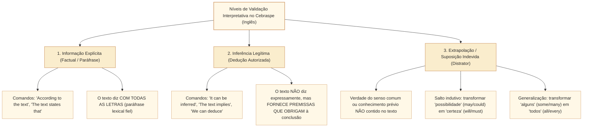
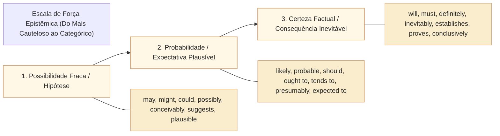

# Informações explícitas, inferências e limites da dedução em língua inglesa no padrão Cebraspe

## 1. Situação-problema: a fronteira sutil entre dedução legítima, probabilidade e extrapolação indevida

Uma dificuldade relevante em leitura de textos ingleses é a **calibração inferencial**: separar o que foi expresso, o que pode ser inferido e o que depende de hipótese ou conhecimento prévio. Não há levantamento de respostas de candidatos aqui que permita afirmar que essa seja a principal causa de erros nas provas da Cebraspe.

Considere o seguinte trecho sobre processos legislativos e orçamentários:

> *"The finance committee approved the multi-year expenditure framework, but only after inserting a clause that restricts discretionary disbursements whenever annual tax revenues fall short of official forecasts. Although government representatives insisted that this constraint could jeopardize key infrastructure projects, legislative auditors noted that unchecked fiscal deficits had previously triggered severe inflationary pressures."*

Analise três assertivas no estilo C/E formuladas sobre esse trecho:

1. **Assertiva 1 (Informação Explícita / Paráfrase direta):** *"The multi-year expenditure framework was endorsed with a condition that limits discretionary spending in the event of revenue underperformance."*
   * **Julgamento:** **CERTO**. O texto afirma explicitamente que o comitê aprovou (*approved = endorsed*) o marco plurianual com a restrição de liberar gastos discricionários (*discretionary disbursements = discretionary spending*) caso as receitas tributárias fiquem abaixo das previsões (*fall short of official forecasts = in the event of revenue underperformance*). Trata-se de **paráfrase factual fidedigna**.
2. **Assertiva 2 (Inferência Legítima e Fundamentada):** *"It can be inferred from the text that the restriction on discretionary disbursements was introduced as a preventive measure against future inflationary risks stemming from fiscal imbalances."*
   * **Julgamento:** **CERTO**. Os auditores legislativos justificaram a restrição lembrando que déficits descontrolados já haviam desencadeado pressões inflacionárias no passado. A ligação entre a cláusula de contingenciamento e a prevenção do risco inflacionário é uma **inferência necessária e fundamentada** nas evidências textuais.
3. **Assertiva 3 (Extrapolação Indevida / Certeza Inexistente):** *"The text indicates that government infrastructure projects will inevitably be halted during the upcoming fiscal year due to the newly approved clause."*
   * **Julgamento:** **ERRADO (Extrapolação modal e factual)**. O texto diz apenas que representantes do governo insistiram que a restrição **poderia** colocar em risco (*could jeopardize*) projetos-chave de infraestrutura, e que a restrição só opera **se** as receitas ficarem abaixo da previsão (*whenever revenues fall short*). A assertiva transforma uma possibilidade condicional em fato certo e inevitável (*will inevitably be halted*), além de generalizar para todos os projetos de infraestrutura do governo.

Esta unidade aprofunda a **matriz operacional do Cebraspe para validação inferencial em língua inglesa**: o contraste entre informação literal, paráfrase legítima, inferência lógica e extrapolação; os marcadores linguísticos de modalização epistêmica (*hedging*); e os limites da dedução autorizada pelo texto.

---

## 2. A matriz de três camadas: Fato Explícito, Inferência Válida e Suposição/Extrapolação

Para resolver com segurança itens que começam com *"According to the text"*, *"It is stated in the text"*, *"It can be inferred from the text"* ou *"The author implies that"*, o candidato deve separar o enunciado em **três camadas ontológicas**:

### 2.1. A regra de ouro da inferência no Cebraspe

> **Regra de Ouro:** Uma inferência só é correta se for **logicamente necessária ou fortemente autorizada pelas premissas do texto**. Se a conclusão depender de uma premissa externa oculta (que você sabe por ser um cidadão bem informado ou jurista, mas que o autor em nenhum momento mencionou), **o item é ERRADO por extrapolação**.

---

## 3. Os ativadores linguísticos de pressuposição e inferência em língua inglesa

Assim como em português, o inglês acadêmico e institucional utiliza marcadores lexicais e gramaticais que podem sinalizar informações apresentadas como dadas. A pressuposição depende do contexto e não constitui certificação factual:

| Ativador Linguístico em Inglês | Categoria Gramatical | O que o termo torna PRESUPPOSTO / INFERÍVEL | Exemplo no Contexto Legislativo |
| :--- | :--- | :--- | :--- |
| **Change of state verbs** | Verbos de mudança de estado (*stop, cease, discontinue, resume, begin, start*) | A existência ou cessação prévia do estado ou da prática. | *"The committee **stopped** holding closed-door hearings."* $\rightarrow$ **Pressupõe que**, anteriormente, a comissão realizava audiências a portas fechadas. |
| **Iterative adverbs and prefixes** | Advérbios e prefixos iterativos (*again, no longer, still, re-*) | A reiteração ou persistência de um evento ao longo do tempo. | *"The opposition **no longer** boycotts the voting sessions."* $\rightarrow$ **Pressupõe que**, no passado, a oposição boicotava as votações. |
| **Factive verbs and predicates** | Predicados factivos (*realize, acknowledge, regret, be aware of, reveal, expose*) | O conteúdo da subordinada é apresentado como pressuposto pelo enunciador; isso não constitui verificação independente do fato no mundo externo. | *"The government **acknowledged that** public debt had exceeded legal thresholds."* $\rightarrow$ O enunciador trata o excesso de dívida como informação dada; o leitor não pode afirmar sua veracidade externa apenas pela escolha verbal. |
| **Definite descriptions and cleft sentences** | Descrições definidas e estruturas clivadas (*It was X that...*) | A descrição definida costuma tratar um referente como identificável; uma clivada destaca informação diante de conteúdo pressuposto. Exclusividade não decorre automaticamente de toda clivada. | *"It was **the audit report** that prompted the parliamentary inquiry."* $\rightarrow$ Apresenta como dado que o relatório motivou a investigação, colocando-o em foco. Outros fatores não são excluídos sem contexto. |
| **Counterfactual conditionals** | Orações condicionais contrafactuais (*Third Conditional: If + had + past participle, would have...*) | Em leitura contrafactual típica, o enunciador apresenta a condição como não realizada e o resultado como não ocorrido; a implicação pragmática depende do contexto. | *"If the speaker **had scheduled** the bill for a vote, it **would have passed**."* $\rightarrow$ **Leitura contrafactual usual:** o enunciador trata o agendamento como não ocorrido e imagina a aprovação sob outra condição. A forma gramatical não é prova documental do histórico legislativo. |

---

## 4. O sistema de *Hedging* e a calibração modal: certeza, probabilidade e possibilidade

Em prosa científica e em relatórios internacionais, os autores evitam afirmações categóricas absolutas, recorrendo à técnica do **hedging** (linguagem de reserva epistêmica, cautela ou moderação). O Cebraspe ataca impiedosamente o candidato que não percebe essa gradação:

### 4.1. Como o Cebraspe fabrica distratores mudando o *Hedging*

| No Texto Original (Cauteloso) | Na Assertiva da Prova (Distorcida) | Veredito e Justificativa no Cebraspe |
| :--- | :--- | :--- |
| *"The adoption of AI tools **may improve** document retrieval."* | *"The adoption of AI tools **will necessarily enhance** document retrieval."* | **ERRADO.** Trocou possibilidade fraca (*may*) por certeza inelutável (*will necessarily*). |
| *"Evidence **suggests** a link between transparency and lower corruption."* | *"The text **proves** that transparency eliminates corruption."* | **ERRADO.** Trocou indício sugestivo (*suggests*) por prova cabal (*proves*), e atenuou a relação causal para erradicação total (*eliminates*). |
| *"Voters **tend to punish** politicians who violate fiscal pledges."* | *"Politicians who violate fiscal pledges **are always rejected** at the polls."* | **ERRADO.** Trocou tendência estatística (*tend to*) por regra universal invariável (*always*). |
| *"Disinformation **can potentially undermine** electoral legitimacy."* | *"Electoral legitimacy **has already been destroyed** by disinformation."* | **ERRADO.** Trocou risco potencial futuro/abstrato (*can potentially*) por dano consumado (*has already been destroyed*). |

---

## 5. Relações de causalidade versus mera correlação no discurso analítico

Uma confusão que pode aparecer em itens de compreensão é tomar **coocorrência temporal ou associação (correlação)** como **relação de causa e efeito (causalidade)**. A frequência desse mecanismo em provas não foi estimada:

* **Conectores e verbos de CAUSALIDADE ESTRITA:**
  * *causes, triggers, drives, leads to, results in, accounts for, is attributable to, stems from, because of, due to, owing to, as a result of*.
* **Conectores e verbos de MERA CORRELAÇÃO / COEXISTÊNCIA:**
  * *is associated with, is linked to, correlates with, accompanies, coincides with, is observed alongside, occurs in tandem with*.
* **A armadilha clássica:** Se o texto diz que *"The increase in digital consultations **coincided with** higher legislative amendments"*, o autor constatou que os dois fenômenos ocorreram na mesma época. Afirmar no item que *"The rise in digital consultations **caused** the increase in legislative amendments"* é **ERRADO**, pois correlação não autoriza deduzir causalidade direta.

---

## 6. Caso prático progressivo: leitura analítica e dedução em relatório institucional

Considere o seguinte excerto inspirado em relatórios da OCDE sobre parlamentos digitais:

> *(Text for items 1 through 6)*
> 
> "A comprehensive assessment of open parliament initiatives across fifteen democracies reveals that making legislative voting records publicly available online does not, by itself, translate into higher civic trust. Although digital accessibility substantially increased website traffic and media citations, public surveys conducted three years after implementation showed no statistically significant shift in citizens' overall perception of political integrity. Analysts point out that when transparency reveals systemic legislative gridlock or partisan acrimony without providing avenues for substantive citizen participation, it may paradoxically heighten public cynicism. Therefore, transparency mechanisms achieve democratic legitimacy only when coupled with institutional responsiveness and genuine deliberative channels."

### Desmontagem lógica e semântica:
1. **Fato constatado:** Publicar votações na internet aumentou tráfego e citações na imprensa (*explícito*), mas **não** produziu aumento na confiança pública (*explícito*).
2. **Hipótese explicativa dos analistas:** Quando a transparência apenas expõe paralisia ou briga partidária sem dar canais reais de participação, ela **pode paradoxalmente aumentar o cinismo público** (*possibilidade/risco*: *"may paradoxically heighten"*).
3. **Conclusão normativa:** A transparência só atinge legitimidade democrática **se for associada a** responsividade e deliberação (*condição necessária* introduzida por *"only when coupled with"*).

---

## 7. Itens comentados no padrão Cebraspe (Certo/Errado)

*(Inédita: estilo Cebraspe / Câmara dos Deputados – Analista Legislativo)*
> **Com base no texto acima, julgue os itens a seguir:**

**Item 1.** *(Inédita: estilo Cebraspe / Câmara dos Deputados – Analista Legislativo)* According to the text, publishing legislative voting records online led to an immediate increase in website traffic and media coverage, but failed to generate a measurable improvement in citizens' trust in political institutions.
* **Gabarito:** **ERRADO**.
* **Fundamentação:** O texto confirma aumento substancial de tráfego e citações na mídia, mas não informa que esse aumento foi **imediato** (*immediate*). Também apresenta ausência de mudança estatisticamente significativa na percepção geral de integridade política após três anos, sem medir diretamente toda a confiança nas instituições. O acréscimo temporal sem apoio textual torna a paráfrase indevida.

**Item 2.** *(Inédita: estilo Cebraspe / Câmara dos Deputados – Analista Legislativo)* It can be correctly inferred from the passage that unmediated exposure to legislative gridlock is guaranteed to produce public cynicism in any democratic society.
* **Gabarito:** **ERRADO**.
* **Fundamentação:** Distrator clássico de quebra de *hedging*: o texto afirma com cautela que expor o impasse legislativo sem participação *"may paradoxically heighten public cynicism"* (pode paradoxalmente aumentar o cinismo). A assertiva substitui a possibilidade atenuada (*may*) por uma certeza universal categórica (*"is guaranteed to produce ... in any democratic society"*).

**Item 3.** *(Inédita: estilo Cebraspe / Câmara dos Deputados – Analista Legislativo)* The author implies that digital transparency, in the absence of substantive institutional responsiveness, can have counterproductive consequences for democratic perceptions.
* **Gabarito:** **CERTO**.
* **Fundamentação:** Inferência legítima e precisa. O texto sustenta que a transparência isolada *"may paradoxically heighten public cynicism"* (aumentar o cinismo) e conclui que ela só ganha legitimidade *"when coupled with institutional responsiveness"*. Dizer que ela pode ter consequências contraproducentes (*counterproductive consequences*) para a percepção democrática é a síntese exata da inferência autorizada pelo autor.

**Item 4.** *(Inédita: estilo Cebraspe / Câmara dos Deputados – Analista Legislativo)* Based on the survey findings mentioned in the text, it is correct to conclude that the fifteen surveyed democracies experienced a severe decline in political participation following the launch of open parliament initiatives.
* **Gabarito:** **ERRADO**.
* **Fundamentação:** Extrapolação factual pura. O texto afirma que as pesquisas mostraram *"no statistically significant shift in citizens' overall perception of political integrity"* (isto é, estabilidade na percepção, sem mudança significativa). Não há nenhuma menção no texto a um *"declínio severo na participação política"*. A assertiva inventa um resultado que não existe nos dados apresentados.

**Item 5.** *(Inédita: estilo Cebraspe / Câmara dos Deputados – Analista Legislativo)* The phrase "only when coupled with" establishes a necessary condition for transparency mechanisms to achieve democratic legitimacy.
* **Gabarito:** **CERTO**.
* **Fundamentação:** Análise lógico-semântica impecável. A locução condicional restritiva **only when** (apenas quando / somente se) introduz uma **condição estritamente necessária** na lógica proposicional: sem responsividade institucional e canais deliberativos, a legitimidade democrática não é alcançada.

**Item 6.** *(Inédita: estilo Cebraspe / Câmara dos Deputados – Analista Legislativo)* The text demonstrates that media organizations were solely responsible for framing parliamentary data in a negative light, thereby directly causing the stagnation of civic trust.
* **Gabarito:** **ERRADO**.
* **Fundamentação:** Falsa atribuição causal. O texto afirma apenas que as citações na mídia aumentaram (*"increased ... media citations"*); em nenhum momento o texto afirma que a imprensa foi a *"única responsável"* (*solely responsible*) nem que ela distorceu os dados de forma negativa. A explicação apontada pelos analistas reside no próprio funcionamento do parlamento (*"systemic legislative gridlock or partisan acrimony"*) e na falta de canais de participação.

---

## 8. Relações com outros conceitos e notas da biblioteca

* **Como localizar assunto, tese e propósito em textos em inglês:** [[3 - Materias/Ingles/07 - como localizar assunto tese e proposito em textos em ingles|07 • Como localizar assunto, tese e propósito (CAM-ING-001)]].
* **Informação explícita, pressuposto e inferência em Língua Portuguesa (fundamentação teórica de Ducrot):** [[3 - Materias/Portugues/14 - informacao explicita pressuposto e inferencia|14 • Informação explícita, pressuposto e inferência (CAM-LP-003)]].
* **Paráfrase, equivalência e escopo:** [[3 - Materias/Ingles/06 - parafrase equivalencia semantica e escopo|06 • Paráfrase, equivalência semântica e escopo]].
* **Próximo passo na trilha de Inglês (Coesão referencial e referentes de pronomes):** Unidade `CAM-ING-003`.

## 9. Referências teóricas e metodológicas

* HYLAND, Ken. **Hedging in Scientific Research Articles**. Amsterdam: John Benjamins, 1998. (Estudo fundamental sobre modalização epistêmica e atenuação em textos acadêmicos).
* LEVINSON, Stephen C. **Pragmatics**. Cambridge: Cambridge University Press, 1983. (Capítulos sobre Pressuposição e Implicatura Conversacional).
* CEBRASPE. **ANATEL 2024, caderno 961_ANATEL_CB1_01**, itens 16–23, com item 19 anulado. [Prova oficial](https://cdn.cebraspe.org.br/concursos/anatel_24/arquivos/961_ANATEL_CB1_01.PDF) e [gabarito definitivo](https://cdn.cebraspe.org.br/concursos/anatel_24/arquivos/GAB_DEFINITIVO_961_ANATEL_CB1_01.PDF). Referência identificada para inferência e extrapolação, não fonte dos itens inéditos deste artigo.
* SWALES, John M. **Genre Analysis: English in academic and research settings**. Cambridge: Cambridge University Press, 1990.
