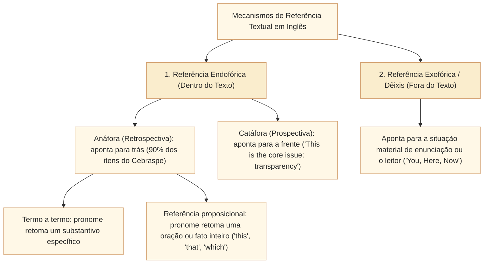
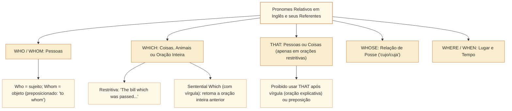

# Coesão referencial e identificação de referentes pronominais em textos em inglês no padrão Cebraspe

## 1. Situação-problema: a armadilha mecânica do "substantivo mais próximo"

Em quase todas as provas de Língua Inglesa do Cebraspe para carreiras de nível superior, há itens do tipo:

> *"In line X, the pronoun **'it'** refers to..."*
> *"The word **'which'** (l. Y) introduces an adjectival clause that qualifies..."*
> *"The demonstrative pronoun **'this'** refers back to the entire situation described in the previous sentence."*

Considere o seguinte trecho sobre deliberação orçamentária e controle parlamentar:

> *"When the budget oversight committee evaluated the multi-million technology procurement contract presented by executive officials, **they** discovered several computational inconsistencies in **its** baseline indicators, **which** immediately prompted **them** to suspend the funding allocation."*

Se um candidato tentar resolver as referências pronominais desse período guiando-se pela regra ingênua da **proximidade física**, ele fatalmente errará:

1. O pronome sujeito ***they*** não retoma o termo imediatamente anterior (*"executive officials"*), mas sim o sujeito do período — o comitê de fiscalização orçamentária (*"the budget oversight committee"*), tratado como substantivo coletivo no plural ou referindo-se aos seus membros.
2. O pronome possessivo ***its*** retoma o contrato de aquisição tecnológica (*"the multi-million technology procurement contract"*), e não os membros do comitê ou os funcionários do Executivo.
3. Neste contexto, o relativo não restritivo ***which*** é interpretado como comentário sobre a descoberta de inconsistências, e não como retomada de *indicators* isoladamente. **A vírgula, sozinha, não decide o antecedente**: relativas não restritivas também podem retomar sintagmas nominais computacionais nos indicadores.
4. O pronome objeto ***them*** retoma novamente os membros do comitê de fiscalização orçamentária (*"budget oversight committee"*), que foram impelidos a suspender a liberação dos recursos.

Esta unidade sistematiza toda a mecânica da **coesão referencial em língua inglesa** no padrão Cebraspe: a distinção entre referência endofórica (anáfora e catáfora) e exofórica (dêixis); os pronomes pessoais e possessivos (*it, its, they, their*); os pronomes demonstrativos anafóricos (*this, that, these, those*); os pronomes relativos (*who, which, that, whose, whom*); e as armadilhas de orações relativas com *sentential which*.

---

## 2. Vetores de referência textual: endófora, anáfora, catáfora e dêixis

A coesão referencial garante que o leitor consiga rastrear as entidades do discurso sem repetições monótonas e sem ambiguidades. Em língua inglesa, os vetores seguem a mesma divisão ontológica dos estudos linguísticos modernos:

---

## 3. Pronomes pessoais e possessivos neutros: *IT* e *THEY*

### 3.1. As três funções sintáticas de *IT*

O pronome **IT** é o mais polissêmico e traiçoeiro da língua inglesa em provas do Cebraspe, pois pode desempenhar três funções radicalmente distintas:

1. **Pronome anafórico referencial (tem referente nominal claro no texto):**
   * *"The **legislative bill** was drafted in 2024, but **it** was only debated this month."* $\rightarrow$ *it* = *the legislative bill*.
2. **Pronome impessoal / sujeito vazio (*Dummy 'It' / Empty Subject*):**
   * Usado para cumprir a exigência estrutural da língua inglesa de que toda oração deve ter sujeito explícito (ao contrário do português, que admite oração sem sujeito). Ocorre com tempo meteorológico, horas, distâncias e construções impessoais:
     * *"**It** is raining."* (Está chovendo).
     * *"**It** is three o'clock."* (São três horas).
     * *"**It** is necessary to approve the budget."* (É necessário aprovar o orçamento).
   * **Pegadinha clássica do Cebraspe:** A banca pergunta: *"The pronoun 'it' in line X refers back to the word 'budget'"*. Se for um *dummy it* (*"It is vital that..."*), o item é **ERRADO**, pois o pronome não tem referente anafórico no texto anterior.
3. **Pronome clivado enfático (*Cleft Sentence 'It'*):**
   * Usado para dar realce a um constituinte oracional específico:
     * *"**It** was **the Speaker of the House** who signed the decree."* $\rightarrow$ O pronome *It* faz parte da estrutura clivada de realce (*It was X that/who...*).

### 3.2. A concordância de número com *THEY / THEIR*

* **Plural tradicional:** Retoma entidades plurais (pessoas, instituições ou coisas): *"The **amendments** were rejected because **they** lacked funding."*
* **Singular Epiceno (*Singular 'They'*):** Na prosa contemporânea formal (reconhecida pelos dicionários Oxford, Cambridge e manuais de estilo como APA e Chicago), ***they / them / their*** é legitimamente empregado para referir-se a uma **pessoa singular indeterminada** ou de gênero não especificado (*someone, anyone, everyone, the applicant, the citizen*):
  * *"Every **citizen** has the right to access public data if **they** request it."*
  * *"If a **deputy** wishes to speak, **they** must register in advance."*

---

## 4. Pronomes demonstrativos: *THIS, THAT, THESE, THOSE* e a referência proposicional

| Pronome Demonstrativo | Função e Vetor no Texto | O que retoma ou projeta | Exemplo no Contexto Parlamentar |
| :--- | :--- | :--- | :--- |
| **THIS** (singular) | **Anáfora imediata** (fato recém-mencionado) ou **Catáfora** (anuncia o próximo termo). | Frequentemente retoma **uma frase ou ideia inteira** (*sentential reference*). | *"Public debt rose by 12%. **This** alarmed the fiscal council."* (*This* = o aumento de 12% da dívida pública). |
| **THAT** (singular) | **Anáfora distante** ou **substituição nominal** para evitar repetição (frequentemente seguido de *of*). | Equivale a *"aquele / aquela"*, substituindo um substantivo já mencionado. | *"The budget of the Senate is smaller than **that** of the Chamber."* (*that* = *the budget*). |
| **THESE** (plural) | **Anáfora imediata de elementos plurais**. | Retoma termos ou classes no plural recém-citados. | *"Transparency, oversight, and integrity: **these** are the core pillars."* |
| **THOSE** (plural) | **Substituição de plural** (frequentemente antes de *of* ou *who*). | Equivale a *"aqueles / aquelas / os / as"*. | *"Only **those who** attended the hearing may vote."* (*those* = os parlamentares/pessoas que). |

* **Atenção especial à Referência Proposicional com *THIS* e *THAT*:**
  Quando o Cebraspe perguntar a que o pronome *This* se refere, **desconfie de assertivas que apontam um único substantivo isolado**. Na esmagadora maioria das vezes, *This* resume a **proposição inteira** (a causa, o evento ou o resultado expresso na oração precedente).

---

## 5. Pronomes relativos e o *Sentential WHICH*

Os pronomes relativos conectam orações e exercem simultaneamente função de conector e de termo anafórico:

### 5.1. O *Sentential WHICH* (Oração Relativa Proposicional)

Esta é uma das questões mais clássicas do Cebraspe em provas de nível superior:

* Quando ***which*** vem após vírgula e introduz comentário sobre o acontecimento anterior, pode retomar **a proposição inteira**; também pode retomar um **nome ou sintagma nominal**. A distinção decorre do sentido da oração relativa e da compatibilidade com cada antecedente, não apenas da vírgula. Compare *The report, which was approved yesterday, is final* (retoma *report*) e *The committee rejected the report, which surprised the chair* (o fato da rejeição causa surpresa). No exemplo seguinte, o pronome retoma a ação ou situação descrita na oração principal**:
  * *"The president vetoed the tax reform, **which** surprised the party leaders."*
  * **Pergunta do Cebraspe:** *"In the sentence above, the word 'which' refers to 'the tax reform'"*.
  * **Gabarito:** **ERRADO**. O que surpreendeu os líderes partidários não foi *"a reforma tributária"* em si, mas sim **o ato de o presidente ter vetado a reforma tributária** (*the fact that the president vetoed the tax reform*).

### 5.2. A regra proibitiva de *THAT* após vírgula ou preposição

Em inglês formal, diferentemente do português (onde usamos *que* entre vírgulas), o pronome relativo **THAT** é estritamente **restritivo** (*defining relative clause*):
* **Proibição 1:** Jamais se usa *THAT* em orações relativas explicativas (separadas por vírgulas). Usa-se *which* (para coisas) ou *who* (para pessoas):
  * **Correto:** *"The report, **which** was approved yesterday, is final."*
  * **Incorreto:** *"The report, that was approved yesterday, is final."*
* **Proibição 2:** Jamais se coloca preposição imediatamente antes de *THAT*:
  * **Correto:** *"The project **in which** we invested"* ou *"The project **that** we invested **in**"*.
  * **Incorreto:** *"The project in that we invested"*.

---

## 6. Caso prático progressivo: rastreamento de cadeias coesivas em texto sobre cibersegurança

Analise o excerto abaixo, acompanhando a numeração das linhas e as cadeias de referência:

> *(Text for items 1 through 6)*
> 
> [1] When hostile state actors launched a coordinated cyberattack against the national data
> [2] infrastructure of several Eastern European parliaments, **they** targeted not only voting
> [3] databases but also internal legislative archives. The perpetrators sought to exfiltrate
> [4] confidential draft reports and leak **them** selectively to partisan media outlets. **This**
> [5] strategy aimed to manufacture false scandals and erode public trust in parliamentary
> [6] integrity. In response, parliamentary cybersecurity teams deployed advanced behavioral
> [7] analytics across **their** network perimeters. While **these** successfully detected subsequent
> [8] unauthorized intrusion attempts, administrators recognized that software alone cannot
> [9] neutralize threats **whose** origins lie in human negligence or social engineering, **which**
> [10] underscores the urgent need for continuous staff training.

### Rastreamento das cadeias anafóricas:
1. Linha 2 — ***they***: Retoma *"hostile state actors"* (sujeito plural da linha 1).
2. Linha 4 — ***them***: Retoma *"confidential draft reports"* (objeto direto plural da linha 3-4).
3. Linha 4 — ***This strategy***: Anáfora encapsuladora/rotuladora. Sintetiza a ação descrita nas linhas 3-4: o plano de roubar relatórios confidenciais e vazá-los seletivamente.
4. Linha 7 — ***their***: Pronome possessivo plural referindo-se a *"parliamentary cybersecurity teams"* (linha 6).
5. Linha 7 — ***these***: Pronome demonstrativo plural substantivo. Retoma *"advanced behavioral analytics"* (linha 6-7).
6. Linha 9 — ***whose***: Pronome relativo possessivo referindo-se a *"threats"* (as origens das ameaças).
7. Linha 9 — ***which***: Leitura proposicional de *which*, sustentada pelo comentário de consequência no contexto. Retoma toda a proposição das linhas 8-9: o fato de que o software sozinho não consegue neutralizar ameaças decorrentes de negligência humana ou engenharia social.

---

## 7. Itens comentados no padrão Cebraspe (Certo/Errado)

*(Inédita: estilo Cebraspe / Câmara dos Deputados – Analista Legislativo)*
> **Com base no texto acima, julgue os itens a seguir:**

**Item 1.** *(Inédita: estilo Cebraspe / Câmara dos Deputados – Analista Legislativo)* In line 2, the pronoun **they** refers back to "Eastern European parliaments" (l. 2).
* **Gabarito:** **ERRADO**.
* **Fundamentação:** Distrator mecânico de proximidade. O pronome sujeito *they* (l. 2) refere-se aos agentes causadores do ataque — *"hostile state actors"* (l. 1) —, que atacaram as bases de votação e os arquivos parlamentares. Afirmar que se refere aos parlamentos do Leste Europeu inverteria o papel de agressor e vítima no texto.

**Item 2.** *(Inédita: estilo Cebraspe / Câmara dos Deputados – Analista Legislativo)* The pronoun **them** (l. 4) corefers with "confidential draft reports" (l. 3-4).
* **Gabarito:** **CERTO**.
* **Fundamentação:** Análise referencial exata. O verbo bitransitivo *leak* (vazar) tem como objeto direto o pronome *them*, que substitui e retoma o sintagma nominal plural anterior *"confidential draft reports"* (*"leak them selectively"* = vazar os relatórios preliminares confidenciais seletivamente).

**Item 3.** *(Inédita: estilo Cebraspe / Câmara dos Deputados – Analista Legislativo)* The demonstrative noun phrase **"This strategy"** (l. 4-5) encapsulates the preceding clause, referring to the act of exfiltrating draft reports and leaking them selectively to the press.
* **Gabarito:** **CERTO**.
* **Fundamentação:** Trata-se de uma **anáfora encapsuladora** (rotulação referencial). A expressão *This strategy* resume em um único sintagma nominal toda a manobra tática descrita no período anterior (infiltrar-se para roubar relatórios confidenciais e vazá-los seletivamente para veículos partidários).

**Item 4.** *(Inédita: estilo Cebraspe / Câmara dos Deputados – Analista Legislativo)* In line 7, the word **these** refers to "Eastern European parliaments" (l. 2).
* **Gabarito:** **ERRADO**.
* **Fundamentação:** O pronome demonstrativo plural *these* (l. 7) funciona como sujeito da oração concessiva *"While these successfully detected subsequent unauthorized intrusion attempts"* (Enquanto estes detectaram com sucesso as tentativas subsequentes de intrusão). O que detectou as tentativas de intrusão foram os sistemas analíticos avançados (*"advanced behavioral analytics"*, l. 6-7) implementados pelas equipes de segurança, e não os parlamentos em si.

**Item 5.** *(Inédita: estilo Cebraspe / Câmara dos Deputados – Analista Legislativo)* The relative pronoun **whose** (l. 9) introduces a relationship of possession, indicating that the origins belong to or emanate from the "threats" mentioned immediately before.
* **Gabarito:** **CERTO**.
* **Fundamentação:** O pronome relativo **whose** estabelece relação de posse ou pertinência (*"threats whose origins"* = ameaças cujas origens), ligando o substantivo antecedente *threats* ao substantivo subsequente *origins*.

**Item 6.** *(Inédita: estilo Cebraspe / Câmara dos Deputados – Analista Legislativo)* In line 9, the relative pronoun **which** refers exclusively to the noun phrase "social engineering".
* **Gabarito:** **ERRADO**.
* **Fundamentação:** Pegadinha clássica do *sentential which*. O pronome *which* (l. 9) é precedido por vírgula e introduz a oração *"which underscores the urgent need for continuous staff training"*. O que enfatiza a necessidade urgente de treinamento contínuo de pessoal não é a *"engenharia social"* isolada, mas sim **o fato de que os softwares sozinhos não conseguem neutralizar ameaças que se originam de negligência humana** (*the fact that software alone cannot neutralize human-driven threats*).

---

## 8. Relações com outros conceitos e notas da biblioteca

* **Referência textual, anáfora, catáfora e dêixis em Língua Portuguesa (paralelo teórico direto):** [[3 - Materias/Portugues/18 - referencia textual anafora catafora e deixis|18 • Referência textual: anáfora, catáfora e dêixis (CAM-LP-007)]].
* **Substituição, elipse e coesão lexical:** [[3 - Materias/Portugues/19 - substituicao elipse repeticao e coesao lexical|19 • Substituição, elipse, repetição e coesão lexical (CAM-LP-008)]].
* **Base preexistente de inglês sobre pronomes:** [[3 - Materias/Ingles/03 - referencia pronominal e coesao lexical|03 • Referência pronominal e coesão lexical]].
* **Próximo passo na trilha de Inglês (Conectivos: adição, oposição, causa, condição e concessão):** Unidade `CAM-ING-004`.

## 9. Referências teóricas e metodológicas

* BIBER, Douglas et al. **Longman Grammar of Spoken and Written English**. London: Longman, 1999. (Capítulo sobre *Pronouns and Reference Patterns*).
* HALLIDAY, M. A. K.; HASAN, Ruqaiya. **Cohesion in English**. London: Longman, 1976. (Obra fundadora da teoria da coesão e referência endofórica).
* HEWINGS, Martin. **Advanced Grammar in Use**. 3. ed. Cambridge: Cambridge University Press, 2013.
* CEBRASPE. **Provas e Gabaritos Comentados de Língua Inglesa**. Brasília: Cebraspe, 2018–2024.
