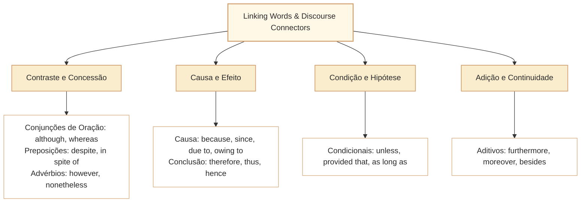

# Conectivos: Relações Lógicas, Articulação de Sentido e Sequenciação Discursiva em Inglês

Nas provas de Língua Inglesa elaboradas pelo Cebraspe para carreiras de nível superior (como o cargo de Analista Legislativo da Câmara dos Deputados), o domínio das **linking words** (conjunções, locuções prepositivas e advérbios de transição discursiva) constitui um dos núcleos de maior incidência. A banca não se limita a exigir a mera tradução literal de termos; sua metodologia avalia a **função lógico-semântica** operada pelo articulador no período e no parágrafo, bem como as **restrições sintáticas de regência** que condicionam o emprego de cada estrutura.

Uma das armadilhas mais refinadas do Cebraspe consiste em propor a substituição mútua de conectores que expressam o mesmo valor nocional geral (por exemplo, valor concessivo), mas que exigem complementos sintáticos distintos: uma conjunção subordinativa subordinante introduz uma oração com verbo conjugado (*clause*), ao passo que uma locução prepositiva exige como complemento um sintagma nominal (*noun phrase*) ou uma forma em *-ing* (gerúndio substantivado). Alterar o conector sem ajustar a oração acarreta erro gramatical crasso, independentemente da equivalência conceitual.

---

## 1. Classificação Funcional e Relações Lógico-Semânticas

Os articuladores textuais estruturam as ideias e guiam o leitor na progressão argumentativa. Dividem-se didaticamente em categorias de sentido fundamentais:

### 1.1. Concessão e Oposição/Contraste

A **oposição simples** confronta duas realidades sem juízo de frustração ou quebra de expectativa (*A é X, ao passo que B é Y*). A **concessão**, por sua vez, introduz uma premissa real ou hipotética que não é suficiente para impedir ou anular a conclusão da oração principal (*embora ocorra X, Y ainda se efetiva*):

- **Oposição Simples (Contraste Bilateral):**
  - *whereas*, *while*: contrastam duas situações paralelas sem anulação mútua.
    - *The Chamber of Deputies passed the bill, whereas the Senate rejected its core provisions.* (A Câmara aprovou o projeto, ao passo que o Senado rejeitou suas disposições centrais).
- **Concessão Subordinada (com Oração / *Clause*):**
  - *although*, *even though*, *though*: introduzem oração concessiva com sujeito e verbo. **Não incluir *inasmuch as* como concessivo**: normalmente indica causa (*because/since*) ou limite (*to the extent that*). Exemplos: *Inasmuch as the evidence is incomplete, the decision is provisional* (causa); *The proposal is acceptable inasmuch as it preserves transparency* (na medida em que).
    - *Although the committee faced severe political disagreements, the members reached a bipartisan consensus.*
- **Concessão Prepositiva (com Substantivo, Pronome ou Gerúndio):**
  - *despite*, *in spite of*, *notwithstanding*: exigem sintagma nominal ou gerúndio. Não admitem oração finita introduzida diretamente por verbo conjugado, a menos que acompanhados da locução *the fact that*.
    - *Despite severe political disagreements, the members reached a consensus.* (Correto).
    - *Despite the committee faced severe disagreements...* (Incorreto - erro grave de regência sintática).
    - *Despite the fact that the committee faced severe disagreements...* (Correto).
- **Transição Discursiva Coordenada / Adverbial (Ponto e Vírgula / Nova Frase):**
  - *however*, *nevertheless*, *nonetheless*, *still*: podem atuar como advérbios conectores na transição entre frases; a pontuação depende da construção. **Yet** também funciona como conjunção coordenativa adversativa: *The report was brief, yet it answered the central question*. Nesse uso, liga duas orações coordenadas; não deve ser tratado indistintamente como advérbio *however*.
    - *The committee faced severe political disagreements; however, the members reached a consensus.*

### 1.2. Causa, Motivo e Fundamentação

A relação de causalidade indica a origem, o fundamento ou o motivo determinante de um fato expresso na oração principal:

- **Conjunções Causais (introduzem Oração):**
  - *because*, *since*, *as*: conectam orações finitas. Note que *since* e *as* acumulam valor causal e temporal, exigindo distinção contextual.
    - *Since the deadline for public consultation had expired, the rapporteur submitted the final legislative text.* (Como o prazo... havia expirado).
- **Locuções Prepositivas Causais (introduzem Substantivo / Gerúndio):**
  - *because of*, *due to*, *owing to*, *on account of*, *thanks to*: exigem núcleo nominal ou gerúndio.
    - *The parliamentary session was adjourned due to technical failures in the electronic voting system.*

### 1.3. Consequência, Conclusão e Dedução

Indicam o resultado lógico decorrente de premissas enunciadas anteriormente:

- *therefore*, *thus*, *hence*, *consequently*, *as a result*, *accordingly*:
  - *The statutory deadline was strictly observed; therefore, no administrative nullity can be claimed.*
  - Atenção ao advérbio *hence* e *thus*, que frequentemente introduzem orações reduzidas ou termos condensados (*The minister resigned, thus precipitating a cabinet reshuffle*).

### 1.4. Condição e Hipótese

Estabelecem os limites e requisitos para a verificação de um fato:

- *if* (se); *provided that* / *providing that* (desde que, contanto que); *as long as* / *so long as* (desde que, enquanto durar a condição); *unless* (a menos que, a não ser que = *if... not*).
  - *Unless the quorum is verified by the presiding officer, no vote shall be valid.* (= Se o quórum não for verificado...).
  - Armadilha do Cebraspe: afirmar que *unless* equivale a *if*, omitindo o sentido negativo intrínseco. *Unless the quorum is verified* $\neq$ *If the quorum is verified*.

### 1.5. Adição e Continuidade Argumentativa

Acrescentam argumentos que corroboram a tese em desenvolvimento:

- *furthermore*, *moreover*, *in addition*, *besides*, *additionally*, *what is more*:
  - *The proposed reform reduces bureaucratic delays; moreover, it enhances budgetary transparency.*

---

## 2. A Fronteira Crítica: Conjunção Subordinativa vs. Preposição

O quadro a seguir sintetiza as equivalências conceituais e as divergências de exigência sintática, ponto central das propostas de reescrita da banca:

| Relação Lógica | Conjunção (Exige Oração / Sujeito + Verbo) | Preposição (Exige Substantivo / Gerúndio) | Advérbio Conectivo (Transição Interfrasal) |
| :--- | :--- | :--- | :--- |
| **Concessão** | *although*, *even though*, *though* | *despite*, *in spite of*, *notwithstanding* | *however*, *nevertheless*, *nonetheless* |
| **Causa** | *because*, *since*, *as* | *because of*, *due to*, *owing to*, *on account of* | *for this reason* |
| **Oposição / Contraste** | *whereas*, *while* | *in contrast to*, *unlike* | *in contrast*, *on the other hand* |
| **Condição** | *if*, *provided that*, *unless* | *in case of*, *in the event of*, *without* | *otherwise* |
| **Adição** | *and* | *in addition to*, *besides*, *as well as* | *furthermore*, *moreover*, *additionally* |

> [!WARNING]
> **Atenção à substituição de *although* por *despite*:**
> Se o Cebraspe sugerir substituir *Although inflation rose in the second quarter...* por *Despite inflation rose in the second quarter...*, o item está **ERRADO** por violação gramatical. A substituição só seria lícita se a oração fosse nominalizada: *Despite the rise in inflation in the second quarter...* ou *Despite inflation rising in the second quarter...*.

---

## 3. Ambiguidade Contextual e Pólissemia de Conectores

Alguns conectores assumem papéis sintáticos e semânticos distintos a depender da estrutura em que se inserem:

1. **Since:**
   - *Temporal:* indica ponto de partida no tempo passado com reflexo no presente (*The House has examined this topic since 2018*).
   - *Causal:* sinônimo de *because* ou *as* (*Since the committee lacked a quorum, the hearing was postponed*).
2. **While / Whilst:**
   - *Temporal:* simultaneidade de ações (*The speaker addressed the plenary while deputies analyzed the amendments*).
   - *Adversativo / Contrastivo:* sinônimo de *whereas* (*While some members favored deregulation, others demanded stricter public oversight*).
3. **As:**
   - *Temporal:* simultaneidade pontual (*He entered as the bell rang*).
   - *Causal:* visto que, como (*As there was no consensus, deliberations were suspended*).
   - *Comparativo:* tanto quanto (*as transparent as required*).
   - *Conformativo:* conforme (*as stated in the internal regulations*).

---

## 4. Questões Comentadas no Estilo Cebraspe

### Questão 1
*(Inédita: estilo Cebraspe / Câmara dos Deputados – Analista Legislativo)*

*Text segment: "Although the constitutional amendment received broad support in the special committee, its approval in the plenary required intense negotiations among party leaders."*

**Item:** The connector "Although" introduces a clause that expresses a condition without which the constitutional amendment could not have been drafted.

- ( ) Certo
- ( ) Errado

**Gabarito: Errado**  
**Comentário:** "Although" introduz uma oração subordinada com valor lógico de **concessão**, e não de **condição**. A concessão expressa uma circunstância real (o amplo apoio na comissão especial) que contrasta com a necessidade de intensas negociações no plenário, mas que não a impediu. Trata-se da clássica confusão de categorias lógico-semânticas promovida pela banca.

---

### Questão 2
*(Inédita: estilo Cebraspe / Câmara dos Deputados – Analista Legislativo)*

*Text segment: "The rapporteur introduced severe disclosure requirements; furthermore, the proposal established administrative sanctions for non-compliance."*

**Item:** The discourse marker "furthermore" could be correctly replaced with "in addition to" without any further grammatical alterations in the text.

- ( ) Certo
- ( ) Errado

**Gabarito: Errado**  
**Comentário:** "Furthermore" é um advérbio de transição que introduz uma oração coordenada independente. "In addition to", por sua vez, é uma locução prepositiva que exige complemento nominal ou gerúndio. Substituir "furthermore" por "in addition to" sem alterar a estrutura da oração seguinte geraria incorreção gramatical (*...; in addition to, the proposal established...* é agramatical). O item explora a fronteira entre advérbio conectivo e locução prepositiva.

---

### Questão 3
*(Inédita: estilo Cebraspe / Câmara dos Deputados – Analista Legislativo)*

*Text segment: "While public communication departments must ensure immediate transparency, they are also constrained by strict data privacy regulations."*

**Item:** In the sentence above, the connective "While" establishes a contrast between the institutional duty of transparency and the regulatory constraints on data privacy.

- ( ) Certo
- ( ) Errado

**Gabarito: Certo**  
**Comentário:** No contexto, "While" atua como conector contrastivo/concessivo (equivalente a *whereas* ou *although*), estabelecendo a tensão entre o dever de transparência imediata e os limites impostos pelas normas de proteção de dados pessoais. Não se trata de uma simples relação temporal cronológica, mas de uma contraposição de princípios normativos.

---

### Questão 4
*(Inédita: estilo Cebraspe / Câmara dos Deputados – Analista Legislativo)*

*Text segment: "The plenary session was suspended due to the lack of an official quorum for deliberating constitutional changes."*

**Item:** The phrase "due to" indicates the reason why the plenary session was suspended and could be replaced with "because of" without altering the grammatical correctness or the original meaning of the sentence.

- ( ) Certo
- ( ) Errado

**Gabarito: Certo**  
**Comentário:** Tanto "due to" quanto "because of" funcionam como locuções prepositivas que introduzem causa/motivo acompanhadas de sintagma nominal ("the lack of an official quorum"). A substituição preserva a integridade sintática e a relação de causalidade expressa no trecho original.

---

### Questão 5
*(Inédita: estilo Cebraspe / Câmara dos Deputados – Analista Legislativo)*

*Text segment: "Unless the parliamentary inquiry committee presents substantial documentary evidence, its concluding report will carry little juridical weight."*

**Item:** The meaning of the clause "Unless the parliamentary inquiry committee presents substantial documentary evidence" would be fully preserved if it were rewritten as "If the parliamentary inquiry committee presents substantial documentary evidence".

- ( ) Certo
- ( ) Errado

**Gabarito: Errado**  
**Comentário:** O conector "Unless" possui valor condicional negativo equivalente a "If... not" (*A menos que a comissão apresente...* = *Se a comissão não apresentar...*). Substituí-lo por "If" afirmativo inverte o polo de polaridade da condição, subvertendo a lógica argumentativa do período.

---

### Questão 6
*(Inédita: estilo Cebraspe / Câmara dos Deputados – Analista Legislativo)*

*Text segment: "Despite significant budget cuts in administrative communications, the agency expanded its public awareness campaigns through digital platforms."*

**Item:** The connector "Despite" introduces an idea of cause, indicating that the budget cuts directly motivated the agency to expand its digital awareness campaigns.

- ( ) Certo
- ( ) Errado

**Gabarito: Errado**  
**Comentário:** "Despite" introduz uma **concessão** (um obstáculo ou circunstância adversa que não impediu o fato principal), e não a causa motriz. O corte de verbas foi uma dificuldade superada pela expansão digital, e não a causa geradora direta dessa iniciativa. O item comete uma transposição indevida entre causalidade e concessão.

---

## 5. Relações com Outros Artigos e Síntese de Revisão

- **Pré-requisitos e Vínculos Teóricos:**
  - [[3 - Materias/Ingles/07 - como localizar assunto tese e proposito em textos em ingles|CAM-ING-001]]: A identificação do propósito comunicativo depende do reconhecimento dos conectores que articulam a tese central.
  - [[3 - Materias/Ingles/08 - informacoes explicitas inferencias e limites da deducao|CAM-ING-002]]: A calibração de conclusões baseia-se no rigor dos conectores de causalidade e concessão.
  - [[3 - Materias/Ingles/09 - coesao referencial e referentes de pronomes|CAM-ING-003]]: Coesão referencial e sequencial operam em conjunto na tessitura discursiva.
  - [[3 - Materias/Ingles/11 - vocabulario contextual polissemia e falsos cognatos em ingles|CAM-ING-005]]: Análise de conectores com múltiplos sentidos (*since*, *while*, *as*) e falsos amigos estruturais.
