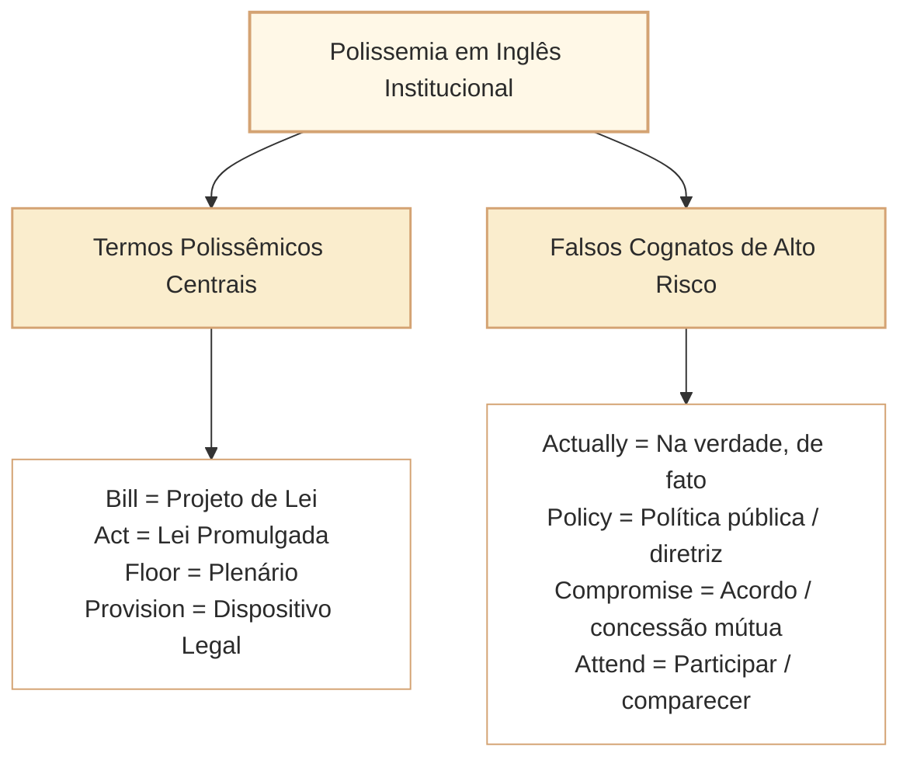

# Vocabulário Contextual, Polissemia e Falsos Cognatos em Textos Institucionais em Inglês

Nas provas de Língua Inglesa do Cebraspe para carreiras legislativas e de controle (como o cargo de Analista Legislativo da Câmara dos Deputados), as questões lexicais não demandam conhecimento enciclopédico descontextualizado ou memorização de listas arcaicas de vocábulos. A banca avalia a capacidade do candidato de **determinar a acepção precisa de uma palavra ou expressão com base na sua função discursiva e no domínio temático do texto** (direito público, governança, auditoria, relações internacionais e comunicação social).

Dois fenômenos centrais dominam as questões do Cebraspe:
1. **A polissemia de termos do vocabulário geral aplicados ao ambiente técnico-institucional**, nos quais palavras cotidianas assumem acepções especializadas indispensáveis para a compreensão do processo legislativo e da gestão pública.
2. **Os falsos cognatos (*false friends*) de alta densidade semântica**, em que a semelhança gráfica com termos da Língua Portuguesa induz o leitor a inferências falsas sobre decisões, competências ou condutas administrativas.

---

## 1. Polissemia no Domínio Legislativo e Institucional

No contexto parlamentar e de políticas públicas, vocábulos de uso comum adquirem significados específicos estritos. A tabela abaixo sintetiza os principais termos polissêmicos explorados pelo Cebraspe:

| Termo em Inglês | Sentido Cotidiano Comum | Acepção Técnico-Legislativa / Institucional | Exemplo no Contexto Parlamentar |
| :--- | :--- | :--- | :--- |
| **Bill** | Conta, fatura, cédula | **Projeto de lei**, proposição legislativa | *The committee approved the bill concerning digital privacy.* |
| **Act** | Ação, ato cênico, teatro | **Lei aprovada e promulgada**, diploma legal | *The Freedom of Information Act mandates public proactive disclosure.* |
| **House** | Casa (moradia familiar) | **Câmara legislativa**, casa parlamentar | *The bill will now be debated by the lower house.* |
| **Floor** | Chão, piso, andar | **Plenário** (espaço de deliberação coletiva) | *The legislation reached the floor for a final roll-call vote.* |
| **Table (verbo)** | Colocar sobre a mesa | **No inglês britânico:** apresentar formalmente. **No inglês norte-americano:** adiar/engavetar. | *The deputy tabled a series of amendments to the draft proposal.* |
| **Provision** | Provisão, mantimentos | **Dispositivo legal**, cláusula, determinação normativa | *The bill includes provisions for civil administrative liability.* |
| **Relief** | Alívio, consolo | **Tutela jurisdicional**, provimento judicial, reparação | *The applicants sought injunctive relief before the constitutional court.* |
| **Issue (subst. e v.)** | Edição de revista; emitir | **Questão / controvérsia temática**; expedir certidão ou ato | *The committee debated the issue of artificial intelligence ethics.* |
| **Hearing** | Audição, capacidade auditiva | **Audiência pública**, oitiva formal | *A public hearing was convened to consult civil society.* |
| **Standing** | De pé, duradouro | **Legitimidade ativa / jurídica** (*locus standi*) | *The NGO lacked legal standing to challenge the administrative act.* |

---

## 2. Falsos Cognatos Críticos no Setor Público (*False Friends*)

Os falsos cognatos constituem um dos instrumentos prediletos do Cebraspe para induzir o candidato ao erro. A tradução intuitiva baseada no português corrompe a interpretação da frase:

### 2.1. Termos com Tradução Incorreta Frequente

1. **Actually:**
   - *Significado real:* Na verdade, de fato, em realidade.
   - *Falso sentido induzido:* Atualmente (que em inglês é *currently*, *at present*, *nowadays*).
   - *Exemplo:* *The minister did not reject the proposal; actually, she suggested expanding its scope.*

2. **Policy:**
   - *Significado real:* Política pública, diretriz institucional, norma interna de conduta.
   - *Falso sentido induzido:* A política partidária/eleitoral geral (que em inglês é *politics*) ou força policial (*police*).
   - *Exemplo:* *The Chamber revised its institutional policy on public data governance.*

3. **Compromise:**
   - *Significado real:* Acordo conciliatório com concessões recíprocas; (ou comprometer/colocar em risco a segurança).
   - *Falso sentido induzido:* Compromisso de agenda, consulta ou encontro (que em inglês é *appointment*, *commitment* ou *engagement*).
   - *Exemplo:* *The legislative leaders reached a political compromise to pass the budgetary guidelines.*

4. **Attend:**
   - *Significado real:* Comparecer a, participar de, assistir presencialmente (a uma reunião/audiência).
   - *Falso sentido induzido:* Atender (um telefone ou cidadão, que é *answer*, *assist* ou *serve*).
   - *Exemplo:* *All committee members attended the extraordinary public hearing.*

5. **Demand (subst. e verbo):**
   - *Significado real:* Exigir categoricamente, reivindicar com autoridade; exigência.
   - *Falso sentido induzido:* Simples demanda ou pedido voluntário suave (frequentemente traduzido como *request* ou *ask*).

6. **Eventually:**
   - *Significado real:* Com o tempo, ao final de tudo, a longo prazo, inevitavelmente.
   - *Falso sentido induzido:* Eventualmente, às vezes, de modo esporádico (que em inglês é *occasionally*, *at times* ou *sporadically*).
   - *Exemplo:* *The controversial bill was debated for months and was eventually approved by the plenary.*

7. **Intend:**
   - *Significado real:* Ter a intenção de, planejar, pretender.
   - *Falso sentido induzido:* Entender (que é *understand*).

8. **Pretend:**
   - *Significado real:* Fingir, simular, aparentar o que não é.
   - *Falso sentido induzido:* Pretender (que é *intend*).
   - *Exemplo:* *The rapporteur did not pretend that the reform would solve all structural deficits.*

9. **Notice (subst. e verbo):**
   - *Significado real:* Aviso prévio, notificação, comunicação oficial; notar, perceber.
   - *Falso sentido induzido:* Notícia jornalística (que em inglês é *news* ou *report*).
   - *Exemplo:* *The public consultation was initiated after formal notice was published.*

10. **Resume:**
    - *Significado real:* Retomar, reiniciar algo após uma interrupção.
    - *Falso sentido induzido:* Resumir (que em inglês é *summarize*); ou currículo profissional (*résumé*).
    - *Exemplo:* *Deliberations will resume immediately after the quorum verification.*

11. **Prejudice:**
    - *Significado real:* Preconceito, discriminação; ou dano processual/jurídico (*without prejudice* = sem prejuízo de).
    - *Falso sentido induzido:* Prejuízo financeiro comum (que é *loss*, *financial loss* ou *damage*).

---

## 3. Estratégias Cebraspe na Cobrança de Vocabulário Contextual

Ao enfrentar itens de vocabulário e equivalência lexical elaborados pelo Cebraspe, observe as seguintes diretrizes metodológicas:

1. **Substituição Contextual em Teste:** Quando o item afirmar que a palavra $X$ pode ser substituída por $Y$ no texto sem prejuízo semântico e gramatical, não avalie apenas os verbetes de dicionário isolados. Reinsira mentalmente a palavra proposta no texto e confira:
   - Se a regência prepositiva continua adequada (*depend on*, *aim at*, *comply with*).
   - Se a nuance de certeza ou imposição foi alterada (*demand* $\neq$ *request*; *mandate* $\neq$ *allow*).
   - Se o campo semântico é estritamente compatível (*policy* $\neq$ *politics*).
2. **Armadilha do Significado Mais Raro ou Mais Básico:** O Cebraspe frequentemente seleciona a acepção cotidiana de um termo polissêmico e pergunta se ela se aplica a um trecho técnico. Exemplo: afirmar que *tabled* significa que o projeto foi "discutido em uma mesa de trabalho", quando o texto trata da formalização da proposição (*submitted formally*).
3. **Preservação de Escopo e Tom Institucional:** A substituição de um verbo formal por um sinônimo coloquial ou vulgarizante costuma ser classificada como incorreta se descaracterizar a natureza do gênero institucional em apreço.

---

## 4. Questões Comentadas no Estilo Cebraspe

### Questão 1
*(Inédita: estilo Cebraspe / Câmara dos Deputados – Analista Legislativo)*

*Text segment: "The Digital Access Act entered into force last year, while a separate bill on platform liability is still under parliamentary consideration."*

**Item:** In the sentence above, "Act" designates a law already in force, whereas "bill" designates proposed legislation still under consideration.

- ( ) Certo
- ( ) Errado

**Gabarito: Certo**  
**Comentário:** No contexto descrito, *Act* designa uma lei em vigor e *bill* um projeto ainda em tramitação. A distinção exige atenção à jurisdição: aprovação por uma única casa legislativa não transforma automaticamente um *bill* em *act*. Além disso, *to table a bill* pode indicar apresentação para debate no inglês britânico, enquanto em contextos norte-americanos *to table* frequentemente significa adiar ou retirar da pauta. O novo texto-base evita essa ambiguidade.

---

### Questão 2
*(Inédita: estilo Cebraspe / Câmara dos Deputados – Analista Legislativo)*

*Text segment: "The communications officer stated that the department does not actually intend to reduce transparency in the release of committee reports."*

**Item:** The word "actually" could be replaced with "currently" without causing any alteration to the original meaning of the text.

- ( ) Certo
- ( ) Errado

**Gabarito: Errado**  
**Comentário:** "Actually" é um falso cognato que significa "na verdade", "de fato" (*in reality*, *in fact*), enfatizando uma declaração verídica em contraposição a um rumor ou impressão errônea. Não equivale a "currently" (atualmente, no presente momento). A substituição deturparia inteiramente o sentido da oração.

---

### Questão 3
*(Inédita: estilo Cebraspe / Câmara dos Deputados – Analista Legislativo)*

*Text segment: "After an extensive public consultation, the parliamentary committee eventually approved the regulatory framework for institutional communication."*

**Item:** According to the text, the approval of the regulatory framework occurred only on an occasional or sporadic basis.

- ( ) Certo
- ( ) Errado

**Gabarito: Errado**  
**Comentário:** "Eventually" é um falso amigo clássico: significa "com o tempo", "ao final", "finalmente" (*in the end*, *ultimately*), indicando o desfecho definitivo após longo processo deliberativo. O item tentou explorar a falsa homofonia com "eventualmente" do português, atribuindo erroneamente a ideia de esporadicidade ou eventualidade transitória.

---

### Questão 4
*(Inédita: estilo Cebraspe / Câmara dos Deputados – Analista Legislativo)*

*Text segment: "To ensure that all institutional stakeholders were heard, civil society representatives attended the extraordinary hearing convened by the presidency."*

**Item:** The term "attended" in the fragment indicates that the representatives provided administrative assistance to the presidency during the event.

- ( ) Certo
- ( ) Errado

**Gabarito: Errado**  
**Comentário:** O verbo *attend* significa "estar presente em", "comparecer a", "assistir presencialmente a" um ato ou reunião (*were present at*). Não significa "atender" no sentido de prestar assistência funcional, apoio ou prestar serviço administrativo (que seria *served*, *assisted* ou *helped*).

---

### Questão 5
*(Inédita: estilo Cebraspe / Câmara dos Deputados – Analista Legislativo)*

*Text segment: "The presiding officer suspended the floor debate due to a disorder in the public galleries, announcing that proceedings would resume at nine o'clock tomorrow morning."*

**Item:** The verb "resume" is used in the text to express the action of continuing the parliamentary proceedings after a temporary interruption.

- ( ) Certo
- ( ) Errado

**Gabarito: Certo**  
**Comentário:** *To resume* significa exatamente retomar, reiniciar uma atividade após uma interrupção temporária. O item preserva a acepção exata do vocábulo no contexto institucional, afastando o sentido de resumir/sintetizar (*to summarize*).

---

### Questão 6
*(Inédita: estilo Cebraspe / Câmara dos Deputados – Analista Legislativo)*

*Text segment: "The committee leadership engaged in intense political negotiations, ultimately reaching a compromise that harmonized conflicting partisan interests."*

**Item:** In the sentence above, the word "compromise" indicates that the leadership took an official oath of commitment that obligated all parties to support the bill unconditionally.

- ( ) Certo
- ( ) Errado

**Gabarito: Errado**  
**Comentário:** *Compromise* no contexto político-institucional designa um **acordo construído mediante concessões mútuas** (*a settlement of differences in which each side makes concessions*), e não um juramento de compromisso incondicional (*unconditional commitment/pledge*). A banca explora o falso cognato parcial entre "compromise" e "compromisso".

---

## 5. Relações com Outros Artigos e Síntese de Revisão

- **Pré-requisitos e Vínculos Teóricos:**
  - [[3 - Materias/Ingles/07 - como localizar assunto tese e proposito em textos em ingles|CAM-ING-001]]: O vocabulário específico define o enquadramento temático e a identificação do objetivo comunicativo.
  - [[3 - Materias/Ingles/08 - informacoes explicitas inferencias e limites da deducao|CAM-ING-002]]: A precisão lexical impede falsas inferências induzidas por falsos cognatos.
  - [[3 - Materias/Ingles/10 - conectivos relacoes logicas e sequenciacao discursiva em ingles|CAM-ING-004]]: A polissemia de articuladores discursivos (*since*, *while*, *as*) exige avaliação contextual semelhante à dos substantivos e verbos.
  - [[3 - Materias/Ingles/06 - parafrase equivalencia semantica e escopo|CAM-ING-011]]: Substituições lexicais devem manter equivalência semântica e correção gramatical no gênero discursivo da administração pública.
