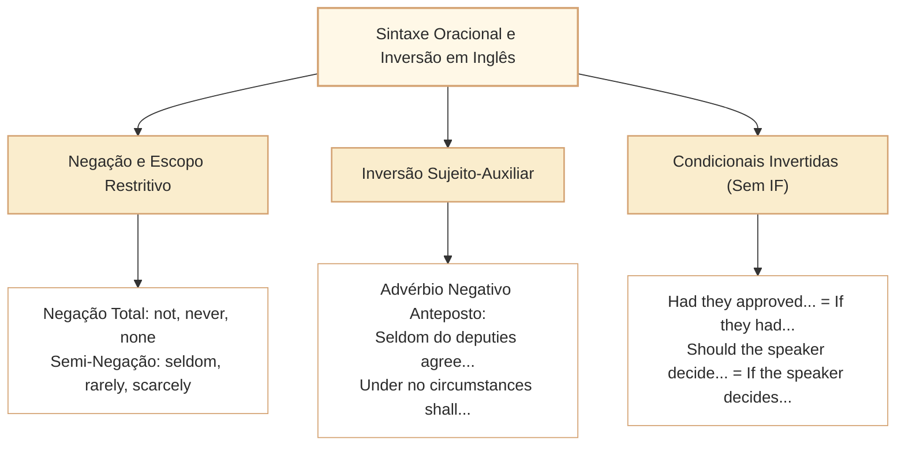

# Estrutura de Frases, Negação, Interrogação e Inversão Sintática em Inglês

Nas provas de Língua Inglesa do Cebraspe para carreiras legislativas de nível superior, a sintaxe da oração constitui um terreno fértil para a elaboração de itens de alto nível discriminatório. Em vez de cobrar meras regras mecânicas de tempo verbal ou conjugação, a banca avalia o reconhecimento de **estruturas oracionais complexas**, o impacto de **operadores negativos de escopo restritivo** e o emprego de **inversões sintáticas formais** e condicionais elípticas comuns em relatórios legislativos, tratados e discursos parlamentares.

Em textos institucionais e formais, a ordem canônica sujeito-verbo-objeto (*S-V-O*) é frequentemente alterada para fins de ênfase enfática, coesão discursiva ou formalidade estilística. Compreender como a inversão do sujeito com o verbo auxiliar é ativada por advérbios de polaridade negativa (*seldom, rarely, hardly, scarcely, under no circumstances*) e como as orações condicionais sem *if* (*Had the committee known...*, *Should there be...*) operam é indispensável para evitar erros de interpretação e julgamento de equivalência oracional.

---

## 1. A Ordem Canônica e Modificadores Complexos

A Língua Inglesa é estruturalmente configuracional, dependendo da ordem rígida dos constituintes para estabelecer as funções sintáticas de sujeito e objeto:

```
[Sujeito Oracional Complexo] + [Verbo Auxiliar/Modal + Verbo Principal] + [Objeto Direto / Indireto] + [Adjuntos Circunstanciais]
```

Em textos legislativos e relatórios de auditoria, o sujeito é frequentemente expandido por orações relativas restritivas, sintagmas preposicionais encadeados ou orações reduzidas de particípio:

> *The special parliamentary committee [established to investigate administrative malfeasance in public procurement contracts across federal agencies] has concluded its hearings.*

No exemplo acima, a extensão do sujeito sintático (*The special parliamentary committee...*) pode induzir o candidato desatento a atribuir o verbo transitivo *has concluded* a um dos substantivos intervenientes (*contracts*, *agencies*), gerando falsas conclusões sobre quem realizou a ação.



---

## 2. Negação Sintática, Escopo e Semi-Negativos

A negação em inglês não se restringe à partícula adverbial *not*. Expressões negativas ou restritivas alteram o escopo da oração e, em posição inicial enfática, podem exigir inversão; sua frequência específica na banca não foi medida:

| Advérbio Semi-Negativo | Equivalência em Português | Efeito Semântico e Sintático |
| :--- | :--- | :--- |
| **Seldom / Rarely** | Raramente, quase nunca | Indica baixa frequência contextual, sem percentual fixo; em posição inicial enfática, requer inversão. |
| **Barely / Scarcely / Hardly** | Mal, apenas, dificilmente | Indica suficiência limítrofe ou quase impossibilidade. |
| **Little (advérbio)** | Pouco, quase nada | Negação virtual de conhecimento ou percepção (*Little did they know...*). |
| **Nowhere / No sooner** | Em nenhum lugar / Mal (acabara de) | Negação espacial ou correlação temporal imediata (*No sooner had... than...*). |
| **Under no circumstances / In no way** | Sob nenhuma hipótese / De modo algum | Negação de alcance geral, podendo expressar proibição conforme modal e contexto; em posição inicial enfática, exige inversão. |

> [!IMPORTANT]
> **A Regra de Escopo:**
> Em inglês padrão formal, a **concordância negativa** de construções como *The committee didn't find no irregularities*, presente em certas variedades com o sentido de ausência de irregularidades, costuma ser evitada. Isso não torna toda dupla negação incorreta: *It is not uncommon* é padrão e significa que algo não é incomum. A frase *The court barely accepted the argument* descreve aceitação no limite, não rejeição efetiva. Interprete a variedade, o escopo e a polaridade.

---

## 3. Inversão Sintática Enfática (Ordem Auxiliar-Sujeito)

Quando uma expressão negativa ou restritiva é deslocada para o início absoluto do período para criar ênfase retórica formal, a oração principal **obrigatoriamente adota a ordem interrogativa** (Verbo Auxiliar + Sujeito + Verbo Principal):

### 3.1. Fórmula Geral da Inversão Negativa

$$\text{[Advérbio / Locução Negativa Anteposta]} + \text{[Auxiliar / Modal / BE]} + \text{[Sujeito]} + \text{[Verbo Principal / Complemento]}$$

- **Ordem Direta:**  
  *Members of parliament **rarely approve** sweeping constitutional reforms without extended committee hearings.*
- **Ordem Invertida Enfática:**  
  *Rarely **do members of parliament approve** sweeping constitutional reforms without extended committee hearings.*

- **Ordem Direta:**  
  *Public officials **must not disclose** confidential whistleblower identities under any circumstances.*
- **Ordem Invertida Enfática:**  
  *Under no circumstances **may public officials disclose** confidential whistleblower identities.*

- **Ordem Direta:**  
  *The administration had **hardly initiated** the public consultation when legal challenges emerged.*
- **Ordem Invertida Enfática:**  
  *Hardly **had the administration initiated** the public consultation when legal challenges emerged.*

### 3.2. Estrutura Correlativa: *Not only... but also...*

Quando *Not only* inicia o período, a primeira oração sofre inversão, mantendo-se a segunda em ordem direta:

> *Not only **did the Chamber pass** the freedom of information bill, but it also **established** an independent oversight board.*

---

## 4. Inversão em Orações Condicionais (Elisão do *IF*)

Em textos institucionais e jurídicos formais, a conjunção condicional *if* pode ser omitida. Quando isso ocorre, o verbo auxiliar desloca-se para o início da oração, assumindo o papel de operador condicional. Essa estrutura é comum no Cebraspe:

1. **Primeira Condicional Formal (com *Should*):**
   - *Com if:* *If the presiding officer decides to suspend the session, leaders will be notified.*
   - *Com inversão (sem if):* *Should the presiding officer decide to suspend the session, leaders will be notified.*
   - *Significado:* Caso o presidente decida / Se porventura decidir.

2. **Segunda Condicional Formal (com *Were*):**
   - *Com if:* *If the bill were unconstitutional, the Supreme Court would strike it down.*
   - *Com inversão (sem if):* *Were the bill unconstitutional, the Supreme Court would strike it down.*
   - *Estrutura com infinitivo:* *Were the committee to approve the expenditure, fiscal targets would be breached.* (= *If the committee approved...*).

3. **Terceira Condicional Formal (com *Had*):**
   - *Com if:* *If the rapporteur had consulted the technical staff, the legal defect would have been avoided.*
   - *Com inversão (sem if):* *Had the rapporteur consulted the technical staff, the legal defect would have been avoided.*
   - *Significado:* Se o relator houvesse consultado / Tivesse o relator consultado.

---

## 5. Questões Comentadas no Estilo Cebraspe

### Questão 1
*(Inédita: estilo Cebraspe / Câmara dos Deputados – Analista Legislativo)*

*Text segment: "Rarely has the Chamber of Deputies witnessed such a unified consensus on legislative administrative restructuring."*

**Item:** In the sentence above, the auxiliary verb "has" precedes the subject "the Chamber of Deputies" because the sentence begins with the restrictive negative adverb "Rarely".

- ( ) Certo
- ( ) Errado

**Gabarito: Certo**  
**Comentário:** O item descreve com perfeita exatidão a regra de inversão sintática formal da Língua Inglesa. Quando advérbios de frequência negativa ou restritiva (*rarely, seldom, scarcely*) são antepostos no início do período para ênfase estilística, o verbo auxiliar antecipa-se obrigatoriamente ao sujeito gramatical.

---

### Questão 2
*(Inédita: estilo Cebraspe / Câmara dos Deputados – Analista Legislativo)*

*Text segment: "Had the budgetary oversight committee identified the irregular procurement practices earlier, the misuse of public funds would have been substantially prevented."*

**Item:** The clause "Had the budgetary oversight committee identified the irregular procurement practices earlier" is grammatically equivalent to "If the budgetary oversight committee had identified the irregular procurement practices earlier".

- ( ) Certo
- ( ) Errado

**Gabarito: Certo**  
**Comentário:** Trata-se da clássica estrutura de condicional hipotética pretérita (Terceira Condicional) com elisão da conjunção subordinativa *if*. A inversão do auxiliar *had* para o início da oração substitui com exata equivalência sintática e semântica a oração iniciada por *if*.

---

### Questão 3
*(Inédita: estilo Cebraspe / Câmara dos Deputados – Analista Legislativo)*

*Text segment: "Under no circumstances should parliamentary administrative staff disclose proprietary technical data obtained during oversight audits."*

**Item:** The text asserts that parliamentary administrative staff are occasionally permitted to disclose proprietary technical data, provided that doing so serves the public interest.

- ( ) Certo
- ( ) Errado

**Gabarito: Errado**  
**Comentário:** A locução prepositiva negativa "Under no circumstances" expressa uma proibição absoluta e categórica (*sob hipótese alguma*). Afirmar que os servidores estão "ocasionalmente autorizados" (*occasionally permitted*) contraria frontalmente o teor normativo da oração, transformando um impedimento incondicional em permissão facultativa.

---

### Questão 4
*(Inédita: estilo Cebraspe / Câmara dos Deputados – Analista Legislativo)*

*Text segment: "Should the plenary fail to reach a quorum for constitutional amendments, deliberations must be automatically adjourned."*

**Item:** The modal auxiliary "Should" indicates in the context a strong moral recommendation made by the legislative presidency.

- ( ) Certo
- ( ) Errado

**Gabarito: Errado**  
**Comentário:** Na posição inicial de oração subordinada, "Should" não está exercendo a função de conselho ou recomendação moral (*ought to*). Ele atua como operador condicional formal com elisão de *if* (*Should the plenary fail...* = *If the plenary fails/should fail...*). O item comete uma transposição errônea de funções sintáticas do verbo modal.

---

### Questão 5
*(Inédita: estilo Cebraspe / Câmara dos Deputados – Analista Legislativo)*

*Text segment: "Not only did the special commission publish its technical findings, but it also recommended administrative sanctions against the contracting authorities."*

**Item:** Without altering the meaning of the original sentence, the initial segment could be correctly rewritten in standard direct order as: "The special commission not only published its technical findings".

- ( ) Certo
- ( ) Errado

**Gabarito: Certo**  
**Comentário:** Na ordem direta padrão, o operador *not only* posiciona-se imediatamente antes do verbo principal conjugado no passado simples (*published*), dispensando o verbo auxiliar *did* (que só é exigido na inversão inicial enfática). O sentido original e a gramaticalidade são plenamente preservados.

---

### Questão 6
*(Inédita: estilo Cebraspe / Câmara dos Deputados – Analista Legislativo)*

*Text segment: "The rapporteur scarcely obtained the necessary signatures to validate the urgent constitutional motion."*

**Item:** The sentence indicates that the rapporteur easily and comfortably gathered an overwhelming number of signatures to support the motion.

- ( ) Certo
- ( ) Errado

**Gabarito: Errado**  
**Comentário:** O advérbio "scarcely" é um semi-negativo que expressa grande dificuldade e margem mínima (*mal obteve*, *quase não obteve*). Afirmar que o relator reuniu as assinaturas de forma fácil e confortável (*easily and comfortably*) inverte totalmente a polaridade semântica do período.

---

## 6. Relações com Outros Artigos e Síntese de Revisão

- **Pré-requisitos e Vínculos Teóricos:**
  - [[3 - Materias/Ingles/08 - informacoes explicitas inferencias e limites da deducao|CAM-ING-002]]: Compreensão de polaridade e escopo negativo para delimitar inferências textuais lícitas.
  - [[3 - Materias/Ingles/10 - conectivos relacoes logicas e sequenciacao discursiva em ingles|CAM-ING-004]]: A elisão de *if* e o emprego de *unless* articulam-se com a inversão condicional.
  - [[3 - Materias/Ingles/13 - tempos verbais aspecto e sequencia temporal em ingles|CAM-ING-007]]: A concordância dos tempos verbais nas condicionais invertidas (*Had + past participle* com *would have + participle*).
  - [[3 - Materias/Ingles/15 - modalizacao possibilidade obrigacao deducao e conselho em ingles|CAM-ING-009]]: Funções de modais (*should*, *must*, *were*) em inversões enfáticas e de polidez formal.
