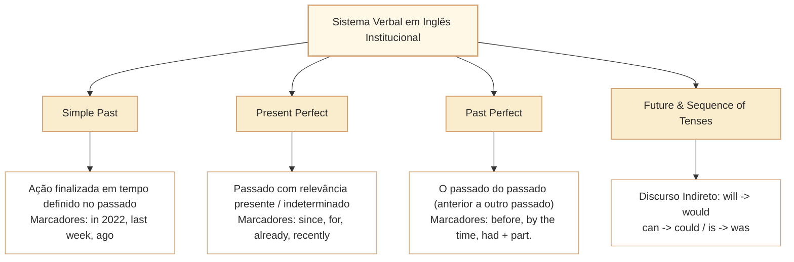

# Tempos Verbais, Aspecto e Sequência Temporal em Textos Institucionais em Inglês

Nas provas de Língua Inglesa do Cebraspe para carreiras de nível superior (como o cargo de Analista Legislativo da Câmara dos Deputados), o domínio das estruturas verbais transcende a mera conjugação mecânica ou a identificação de sufixos regulares e irregulares. A banca fundamenta seus itens na **distinção entre tempo gramatical (*tense*) e aspecto verbal (*aspect*)**, na **conexão entre eventos passados e o momento da enunciação (*present relevance*)** e na **sequência canônica de tempos (*sequence of tenses*)** em relatórios oficiais, auditorias e discursos legislativos.

O contraste mais explorado pelo Cebraspe reside na oposição entre o **Simple Past** (fato pontual, concluído e delimitado em momento pretérito específico) e o **Present Perfect** (ação iniciada no passado com continuidade, impacto direto no presente ou sem marco temporal definido). Tratar uma ação descrita no Present Perfect como um evento isolado sem qualquer repercussão contemporânea, ou tentar inserir marcadores temporais pontuais do passado (*yesterday, in 2021, three days ago*) com o Present Perfect, constitui erro recorrente explorado nos distratores da banca.

---

## 1. Tempo Gramatical (*Tense*) vs. Aspecto Verbal (*Aspect*)

Para interpretar com precisão o discurso formal em inglês, é essencial compreender que o sistema verbal opera pela combinação de tempo e aspecto:

- **Tempo (*Tense*):** Localização do evento no eixo cronológico em relação ao momento da fala (Passado, Presente ou Futuro).
- **Aspecto (*Aspect*):** O modo como a ação verbal é encarada pelo enunciador em relação à sua duração, conclusão ou permanência:
  - **Simples (*Simple*):** Apresenta o evento sem marcar explicitamente seu desenvolvimento interno; pode descrever hábitos, fatos gerais ou acontecimentos pontuais e temporários.
  - **Contínuo/Progressivo (*Continuous/Progressive*):** A ação é retratada em curso, temporária ou incompleta.
  - **Perfeito (*Perfect*):** A ação é vista como anterior a um determinado ponto de referência, estabelecendo uma ponte temporal.
  - **Perfeito Contínuo (*Perfect Continuous*):** Enfatiza a duração contínua de um processo que desemboca no ponto de referência.

---

## 2. A Fronteira Crítica: *Simple Past* vs. *Present Perfect*

A tabela a seguir sistematiza as diferenças estruturais e semânticas indispensáveis para as questões do Cebraspe:

| Dimensão | Simple Past (*Past Simple*) | Present Perfect (*Present Perfect Simple*) |
| :--- | :--- | :--- |
| **Estrutura** | Verbo no passado simples (*approved, conducted, wrote*) | *have / has* + Particípio Passado (*has approved, have conducted*) |
| **Localização Temporal** | **Tempo Definido e Fechado** no passado. | **Tempo Indefinido** ou **Período Incompleto** que alcança o presente. |
| **Relação com o Presente** | Fato encerrado; sem vínculo direto com o estado atual. | **Relevância Presente (*Present Relevance*)**: consequências imediatas no presente. |
| **Marcadores Típicos** | *yesterday, in 2019, last month, two years ago, when the session started*. | *since (2020), for (five years), already, yet, so far, recently, lately, ever*. |
| **Exemplo no Parlamento** | *The Chamber **approved** the original statute in 2015.* (Fato histórico datado). | *The Chamber **has approved** three amendments to strengthen transparency.* (Impacto atual). |

> [!WARNING]
> **A Incompatibilidade de Marcador Temporal Específico:**
> Na norma culta cobrada pelo Cebraspe, orações com *Present Perfect* **não admitem adjuntos adverbiais que indiquem tempo pretérito pontual e fechado**. A frase *The committee has published the report yesterday* é agramatical. O correto é *The committee published the report yesterday* ou *The committee has recently published the report*.

---

## 3. O Passado do Passado: *Past Perfect* (*Had* + Particípio)

O **Past Perfect** localiza um evento ocorrido **antes de outro evento passado já mencionado**, estabelecendo uma hierarquia cronológica inequívoca entre duas ações pretéritas:

$$\text{[Evento A - Mais Antigo: Past Perfect (had + part.)]} \longrightarrow \text{[Evento B - Mais Recente: Simple Past]}$$

- **Exemplo:**  
  *By the time the plenary session **began** (Evento B - Simple Past), the special committee **had already finalized** its technical report (Evento A - Past Perfect).*
- **Pegadinha da Banca:** Afirmar que a inversão dos tempos verbais preservaria a ordem cronológica real dos acontecimentos. Se a frase for reescrita como *When the session had begun, the committee finalized...*, a ordem factual é subvertida, tornando o item incorreto.

---

## 4. Sequência dos Tempos no Discurso Indireto (*Sequence of Tenses*)

Em textos institucionais e notícias sobre o Legislativo, declarações e relatórios são frequentemente transpostos para o discurso indireto (*reported speech*). Quando o verbo introdutório está no passado (*The president stated, the rapporteur declared*), o **backshift** é frequente para situar a fala no passado. Contudo, não é universal nem obrigatório: pode ser omitido, por exemplo, quando a informação permanece verdadeira ou quando o futuro mencionado continua à frente do momento de quem relata. Compare *She said that the portal would open in December* (futuro visto a partir da fala passada) com *She said that the portal will open in December* (abertura ainda futura para quem relata). As linhas abaixo mostram transformações possíveis, e não as únicas aceitáveis:

| Discurso Direto (Original) | Discurso Indireto com Verbo Introdutório no Passado |
| :--- | :--- |
| **Simple Present:** *"The bill **is** constitutional."* | *The legal adviser confirmed that the bill **was** constitutional.* |
| **Present Continuous:** *"We **are reviewing** the budget."* | *The deputies said they **were reviewing** the budget.* |
| **Simple Past / Present Perfect:** *"The House **approved** / **has approved** it."* | *The speaker announced that the House **had approved** it.* |
| **Future (Will):** *"The committee **will debate** the amendment."* | *The chair noted that the committee **would debate** the amendment.* |
| **Modal (Can / May):** *"The citizen **can access** public records."* | *The ombudsman explained that the citizen **could access** public records.* |

---

## 5. Questões Comentadas no Estilo Cebraspe

### Questão 1
*(Inédita: estilo Cebraspe / Câmara dos Deputados – Analista Legislativo)*

*Text segment: "The Chamber of Deputies has expanded its digital public consultation mechanisms since the enactment of the institutional modernization directive."*

**Item:** The verbal form "has expanded" indicates that the expansion of the digital consultation mechanisms was completed at a specific, isolated point in the past, with no continuous effects or development up to the present moment.

- ( ) Certo
- ( ) Errado

**Gabarito: Errado**  
**Comentário:** O *Present Perfect* com *since* considera o período desde a diretriz até o presente, sem localizar toda a expansão em um ponto passado isolado. Contudo, **não prova que as obras de expansão estejam ininterruptamente em andamento nem especifica efeitos concretos atuais**. A assertiva erra ao impor conclusão definitiva em um ponto passado e negar qualquer vínculo com o período presente. Referência: [Cambridge Grammar, *present perfect simple*](https://dictionary.cambridge.org/grammar/british-grammar/present-perfect-simple-i-).

---

### Questão 2
*(Inédita: estilo Cebraspe / Câmara dos Deputados – Analista Legislativo)*

*Text segment: "In 2021, the special committee investigated allegations of administrative irregularities in public contracts."*

**Item:** Without violating the grammatical standards of written English, the verbal form "investigated" could be replaced with "has investigated".

- ( ) Certo
- ( ) Errado

**Gabarito: Errado**  
**Comentário:** A oração contém um adjunto adverbial de tempo específico e concluído no passado ("In 2021"). O *Present Perfect* ("has investigated") é incompatível com marcadores temporais pretéritos fechados na norma culta padrão. A substituição proposta acarreta erro gramatical.

---

### Questão 3
*(Inédita: estilo Cebraspe / Câmara dos Deputados – Analista Legislativo)*

*Text segment (hipotético, sem afirmação de rito jurídico real): "Before the new institutional policy was officially issued, legislative technicians had reviewed every article to prevent syntactic ambiguities."*

**Item:** The use of "had reviewed" indicates that the technical review preceded the official issuance of the institutional policy.

- ( ) Certo
- ( ) Errado

**Gabarito: Certo**  
**Comentário:** O *Past Perfect* ("had reviewed") expressa com exatidão a anterioridade relativa em relação a outro fato passado ("was officially issued"), cumprindo a função de indicar a ação mais antiga da sequência temporal pretérita.

---

### Questão 4
*(Inédita: estilo Cebraspe / Câmara dos Deputados – Analista Legislativo)*

*Text segment: "The ombudsman affirmed: 'The public communication portal will guarantee unconditional accessibility to all institutional broadcasts.'"*

**Item:** In reported speech, if the statement is introduced by "The ombudsman affirmed that the public communication portal...", the verbal form "will guarantee" must always be replaced with "would guarantee" for the resulting sentence to be grammatically correct.

- ( ) Certo
- ( ) Errado

**Gabarito: Errado**  
**Comentário:** *Would guarantee* é uma transformação possível e comum após *affirmed*, mas *will guarantee* também pode ser mantido se a garantia ainda disser respeito a um futuro vigente na perspectiva de quem relata. A assertiva torna obrigatório um recuo que depende do contexto. Sem marco temporal para a narração indireta, não se pode exigir a substituição como condição de correção gramatical.

---

### Questão 5
*(Inédita: estilo Cebraspe / Câmara dos Deputados – Analista Legislativo)*

*Text segment: "Parliamentary observers have noted that transparency levels fluctuate during electoral periods."*

**Item:** In the sentence above, "have noted" indicates that the observers' notes are strictly restricted to an event that happened centuries ago and has no relevance to modern governance.

- ( ) Certo
- ( ) Errado

**Gabarito: Errado**  
**Comentário:** O *Present Perfect* "have noted" confere relevância presente à constatação dos observadores, trazendo o juízo emitido para o horizonte contemporâneo do debate sobre governança. Trata-se de extrapolação grosseira do enunciado.

---

### Questão 6
*(Inédita: estilo Cebraspe / Câmara dos Deputados – Analista Legislativo)*

*Text segment: "By the end of the current legislative session, the ethics commission will have concluded all pending administrative inquiries."*

**Item:** The verbal tense "will have concluded" expresses an action that is projected to be fully accomplished prior to a specified point in the future.

- ( ) Certo
- ( ) Errado

**Gabarito: Certo**  
**Comentário:** A locução "will have concluded" está no *Future Perfect* (futuro perfeito / ação anterior a um marco futuro), cuja função exata é indicar a conclusão integral de uma ação antes de um marco temporal futuro delimitado ("By the end of the current legislative session").

---

## 5.1. Laboratório temporal: quando o relato muda a informação

**Texto inédito e ficcional, preparado para treino:**

> The regional archive digitized its oldest collection in 2021. Since then, staff members have corrected several indexing errors and have been updating records that require additional checks. Last week, the director said that the archive would publish a revised catalogue in December. By the end of the year, the team expects to have reviewed the remaining files, but it has not promised that every document will be available online.

A primeira frase situa a digitalização em um passado delimitado: *in 2021*. O *present perfect* de *have corrected* conecta correções ao período iniciado naquele momento, sem afirmar que cada correção continua em execução. *Have been updating* enfatiza processo em desenvolvimento. *Would publish* é relato retrospectivo de uma divulgação futura em relação ao momento da fala. *Expects to have reviewed* informa uma expectativa sobre conclusão até uma referência futura, sem confirmar resultado.

**Caso progressivo:** *The archive digitized its oldest collection in 2021* afirma o evento passado. *The archive has digitized its oldest collection* não localiza esse evento em 2021 e o apresenta em relação ao presente. *The archive has been digitizing its oldest collection* destaca uma atividade prolongada, sem afirmar por si só que toda a coleção foi concluída.

**Item adicional A (inédito, C/E).** The passage states that digitization of the oldest collection occurred in a specified past year.

**Gabarito: Certo.** *Digitized ... in 2021* situa o fato em 2021.

**Item adicional B (inédito, C/E).** The form *have corrected* proves that the same corrections are continuously taking place without interruption.

**Gabarito: Errado.** O *present perfect simple* conecta eventos ao intervalo que chega ao presente, mas não garante ação contínua e ininterrupta.

**Item adicional C (inédito, C/E).** The director's reported statement necessarily establishes that the revised catalogue had already been published when the director spoke.

**Gabarito: Errado.** *Would publish ... in December* é futuro visto a partir da fala relatada; não expressa publicação anterior.

**Item adicional D (inédito, C/E).** According to the passage, the archive has guaranteed online access to every remaining document by the end of the year.

**Gabarito: Errado.** O texto limita-se a uma expectativa de revisão e nega promessa de disponibilização integral.

**Fonte de consulta:** [Cambridge Dictionary, present perfect simple](https://dictionary.cambridge.org/grammar/british-grammar/present-perfect-simple-i-) e [reported speech](https://dictionary.cambridge.org/grammar/british-grammar/reported-speech-indirect-speech).

---

## 6. Relações com Outros Artigos e Síntese de Revisão

- **Pré-requisitos e Vínculos Teóricos:**
  - [[3 - Materias/Ingles/08 - informacoes explicitas inferencias e limites da deducao|CAM-ING-002]]: A temporalidade precisa dos verbos é fundamental para determinar a validade temporal de inferências textuais.
  - [[3 - Materias/Ingles/10 - conectivos relacoes logicas e sequenciacao discursiva em ingles|CAM-ING-004]]: Conectores temporais (*since, while, before, until, by the time*) regem e condicionam os tempos verbais do período.
  - [[3 - Materias/Ingles/12 - estrutura de frases negacao interrogacao e inversao sintatica em ingles|CAM-ING-006]]: O *Past Perfect* atua nas condicionais elípticas de terceira ordem (*Had the committee known...*).
  - [[3 - Materias/Ingles/14 - voz ativa passiva e foco informacional em ingles|CAM-ING-008]]: A conjugação do verbo auxiliar *BE* na voz passiva obedece estritamente às regras de tempo e aspecto aqui estabelecidas.
