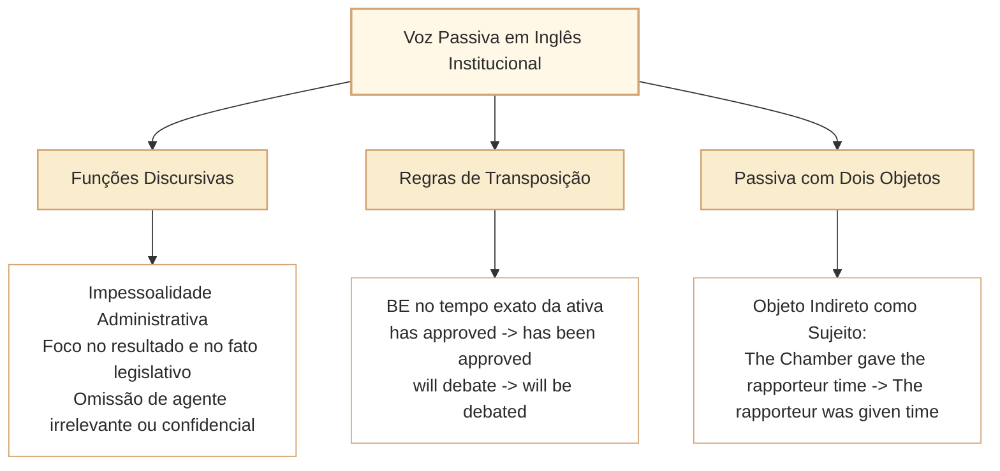

# Voz Ativa, Passiva e Foco Informacional em Textos Institucionais em Inglês

Nas provas de Língua Inglesa do Cebraspe para carreiras de nível superior, a alternância entre **voz ativa (*active voice*)** e **voz passiva (*passive voice*)** não é tratada como um mero exercício mecânico de transposição gramatical. A banca explora os efeitos discursivos dessa escolha na **distribuição do dinamismo comunicativo**, na **gestão do foco informacional (*theme and rheme*)**, na **impessoalização de atos administrativos** e na **omissão deliberada do agente da ação (*agent omission*)** em relatórios oficiais e auditorias públicas.

Em textos legislativos e governamentais, a voz passiva é predominante porque o foco recai sobre o ato praticado, a proposição aprovada ou a política pública implementada, e não sobre a pessoa física dos burocratas ou parlamentares. O Cebraspe testa com rigor:
1. Se a transposição entre as vozes preserva o tempo gramatical e o aspecto verbal originais (a conjugação do verbo auxiliar *BE*);
2. Se a conversão passiva é lícita em verbos intransitivos ou preposicionados;
3. Se o agente da passiva (*by-agent*) foi indevidamente distorcido ou inferido sem suporte textual.

---

## 1. Estrutura Canônica da Voz Passiva e Foco Informacional

A transformação passiva redistribui as funções sintáticas da oração, convertendo o paciente/objeto da ativa no sujeito gramatical que abre o período:

```
[Voz Ativa]:  [Agente / Sujeito] + [Verbo Transitivo] + [Paciente / Objeto Direto]
                     ↓                                         ↓
[Voz Passiva]: [Paciente / Sujeito] + [BE no mesmo tempo/modo] + [Particípio Passado] + [by + Agente Opcional]
```



### 1.1. Motivações Discursivas para o Emprego da Voz Passiva

Em relatórios de auditoria, pareceres constitucionais e imprensa legislativa, a voz passiva é preferida por razões funcionais precisas:

1. **Impessoalidade e Objetividade:** Destaca a ação institucional e o interesse público (*The annual budget report was published*), evitando a personificação individualizada de decisões burocráticas.
2. **Desconhecimento ou Irrelevância do Agente:** Quando a identidade do agente não é conhecida com precisão ou não acrescenta informação útil (*The computer servers were targeted by an external cyberattack*).
3. **Coesão e Continuidade Temática (*Information Packaging*):** Mantém como sujeito gramatical o elemento que já vinha sendo debatido no parágrafo (*theme*), empurrando a informação nova para o final (*rheme*).
4. **Proteção de Fontes e Diplomacia:** Evita atribuir culpa direta a indivíduos específicos (*Procedural deadlines were not met* em vez de *The clerk missed the deadline*).

---

## 2. Tabela de Transposição de Tempos Verbais para a Voz Passiva

O erro técnico mais explorado pelo Cebraspe consiste em alterar o tempo ou aspecto verbal durante a transposição da voz ativa para a passiva. O verbo auxiliar **BE** deve assumir **rigorosamente o mesmo tempo e aspecto do verbo principal da voz ativa**:

| Tempo / Aspecto | Voz Ativa | Voz Passiva (Sujeito + BE conjugado + Past Participle) |
| :--- | :--- | :--- |
| **Simple Present** | *The committee **approves** the bill.* | *The bill **is approved** by the committee.* |
| **Simple Past** | *The committee **approved** the bill.* | *The bill **was approved** by the committee.* |
| **Present Continuous** | *The committee **is reviewing** the bill.* | *The bill **is being reviewed** by the committee.* |
| **Past Continuous** | *The committee **was reviewing** the bill.* | *The bill **was being reviewed** by the committee.* |
| **Present Perfect** | *The committee **has finalized** the report.* | *The report **has been finalized** by the committee.* |
| **Past Perfect** | *The committee **had finalized** the report.* | *The report **had been finalized** by the committee.* |
| **Future (Will)** | *The committee **will debate** the reform.* | *The reform **will be debated** by the committee.* |
| **Modais (Modal Verbs)** | *The plenary **must verify** the quorum.* | *The quorum **must be verified** by the plenary.* |

> [!WARNING]
> **Atenção ao aspecto contínuo na passiva:**
> Se a voz ativa for *The auditors are analyzing the expenditures*, a passiva legítima é *The expenditures are being analyzed*. Propor *The expenditures are analyzed* elimina o aspecto progressivo/contínuo da ação, alterando o sentido do texto original e tornando o item do Cebraspe **ERRADO**.

---

## 3. Particularidades da Voz Passiva no Padrão Cebraspe

### 3.1. Verbos Ditransitivos (Dois Objetos: Direto e Indireto)

Ao contrário do português, em que apenas o objeto direto pode ser alçado a sujeito da passiva, o inglês permite que **o objeto indireto de pessoa (*recipient*) assuma a posição de sujeito**, sendo essa a construção preferida pelo Cebraspe por sua naturalidade formal:

- **Ativa:** *The Presidency granted **the rapporteur** (Obj. Indireto) **an extension** (Obj. Direto).*
- **Passiva com Objeto Indireto como Sujeito (Padrão mais frequente):**  
  *The rapporteur **was granted** an extension by the Presidency.* (O relator recebeu uma prorrogação).
- **Passiva com Objeto Direto como Sujeito:**  
  *An extension **was granted to** the rapporteur by the Presidency.*

### 3.2. Passiva Preposicionada (*Prepositional Passive*)

Verbos acompanhados de preposição fixa (*phrasal verbs* e *prepositional verbs*) mantêm a preposição **imediatamente após o particípio** na voz passiva:

- **Ativa:** *The committee **dealt with** the ethical allegations.*
- **Passiva:** *The ethical allegations **were dealt with** by the committee.*
- **Ativa:** *Observers **called for** immediate administrative scrutiny.*
- **Passiva:** *Immediate administrative scrutiny **was called for** by observers.*
- O Cebraspe costuma sugerir a supressão indevida da preposição final (*The allegations were dealt...*), o que torna a sentença agramatical.

---

## 4. Questões Comentadas no Estilo Cebraspe

### Questão 1
*(Inédita: estilo Cebraspe / Câmara dos Deputados – Analista Legislativo)*

*Text segment: "The special commission is currently examining the proposed constitutional amendments to ensure alignment with fiscal responsibility standards."*

**Item:** The sentence "The proposed constitutional amendments are currently being examined by the special commission" maintains the original meaning and grammatical correctness of the excerpt.

- ( ) Certo
- ( ) Errado

**Gabarito: Errado**  
**Comentário:** *Are currently being examined* preserva a forma progressiva na passiva, com concordância correta e agente expresso. Porém, a reescrita elimina a finalidade **to ensure alignment with fiscal responsibility standards**. Assim, a frase proposta é gramatical, mas não conserva integralmente o conteúdo informativo original. Uma transformação fiel manteria a finalidade: *The proposed constitutional amendments are currently being examined by the special commission to ensure alignment with fiscal responsibility standards.*

---

### Questão 2
*(Inédita: estilo Cebraspe / Câmara dos Deputados – Analista Legislativo)*

*Text segment: "The presiding officer granted the opposition leaders additional time to analyze the budgetary revisions."*

**Item:** In the sentence "The opposition leaders were granted additional time to analyze the budgetary revisions", the grammatical shift to the passive voice results in an error because only direct objects can function as grammatical subjects in English passive structures.

- ( ) Certo
- ( ) Errado

**Gabarito: Errado**  
**Comentário:** Na Língua Inglesa, os verbos ditransitivos admitem com perfeição e preferência que o objeto indireto de pessoa (*the opposition leaders*) seja alçado a sujeito da voz passiva (*The opposition leaders were granted additional time*). A assertiva do item é falsa ao aplicar uma restrição típica da gramática tradicional da Língua Portuguesa à sintaxe do inglês.

---

### Questão 3
*(Inédita: estilo Cebraspe / Câmara dos Deputados – Analista Legislativo)*

*Text segment: "Administrative technicians have finalized the security audit on the electronic voting terminals."*

**Item:** The meaning and grammatical tense of the text segment would be strictly preserved if it were rewritten as: "The security audit on the electronic voting terminals was finalized by administrative technicians".

- ( ) Certo
- ( ) Errado

**Gabarito: Errado**  
**Comentário:** A voz ativa original emprega o *Present Perfect* ("have finalized"), que denota relevância presente. A proposta de reescrita transpôs a oração para o *Simple Past* passivo ("was finalized"), apagando o aspecto perfeito original e quebrando a correspondência estrita de tempos verbais. A forma correta seria "has been finalized".

---

### Questão 4
*(Inédita: estilo Cebraspe / Câmara dos Deputados – Analista Legislativo)*

*Text segment: "Internal auditors must strictly monitor discretionary procurement expenditures throughout the fiscal year."*

**Item:** The fragment can be correctly converted into the passive voice as: "Discretionary procurement expenditures must strictly be monitored by internal auditors throughout the fiscal year."

- ( ) Certo
- ( ) Errado

**Gabarito: Certo**  
**Comentário:** A transposição passiva de verbos com modal (*must monitor*) é realizada por meio da estrutura *modal + be + particípio* (*must be monitored*). O advérbio "strictly" pode intercalar-se entre o modal e o auxiliar sem prejuízo sintático. O paciente converteu-se em sujeito e o agente foi explicitado por "by internal auditors".

---

### Questão 5
*(Inédita: estilo Cebraspe / Câmara dos Deputados – Analista Legislativo)*

*Text segment: "The parliamentary inquiry committee has carefully looked into the whistleblower allegations."*

**Item:** In the passive voice, the sentence is correctly rewritten as: "The whistleblower allegations have been carefully looked by the parliamentary inquiry committee."

- ( ) Certo
- ( ) Errado

**Gabarito: Errado**  
**Comentário:** O verbo *look into* é um *prepositional verb* inseparável que significa investigar/examinar. Na transposição passiva, a preposição *into* **deve ser obrigatoriamente retida** após o particípio: "The whistleblower allegations have been carefully looked **into** by...". A omissão da preposição corrompe a gramaticalidade e o significado do verbo.

---

### Questão 6
*(Inédita: estilo Cebraspe / Câmara dos Deputados – Analista Legislativo)*

*Text segment: "Official legislative summaries were disseminated to the press without partisan interference."*

**Item:** In the sentence above, the passive voice is employed to highlight the action and the distributed material, leaving the specific individual agents unexpressed.

- ( ) Certo
- ( ) Errado

**Gabarito: Certo**  
**Comentário:** O item descreve com perfeita propriedade a função discursiva da voz passiva com omissão de agente (*agentless passive*): priorizar o fato institucional (a divulgação dos sumários) e assegurar o tom impessoal característico da comunicação pública, dispensando a identificação dos servidores que efetuaram a transmissão.

---

## 5. Relações com Outros Artigos e Síntese de Revisão

- **Pré-requisitos e Vínculos Teóricos:**
  - [[3 - Materias/Ingles/08 - informacoes explicitas inferencias e limites da deducao|CAM-ING-002]]: A voz passiva sem agente impede a inferência indevida de que um ator específico praticou o ato.
  - [[3 - Materias/Ingles/12 - estrutura de frases negacao interrogacao e inversao sintatica em ingles|CAM-ING-006]]: Foco informacional e estruturação temática da oração em inglês.
  - [[3 - Materias/Ingles/13 - tempos verbais aspecto e sequencia temporal em ingles|CAM-ING-007]]: A conservação do tempo e do aspecto de *BE* durante a transposição passiva.
  - [[3 - Materias/Ingles/15 - modalizacao possibilidade obrigacao deducao e conselho em ingles|CAM-ING-009]]: Voz passiva com verbos modais (*must be verified*, *should be implemented*).
