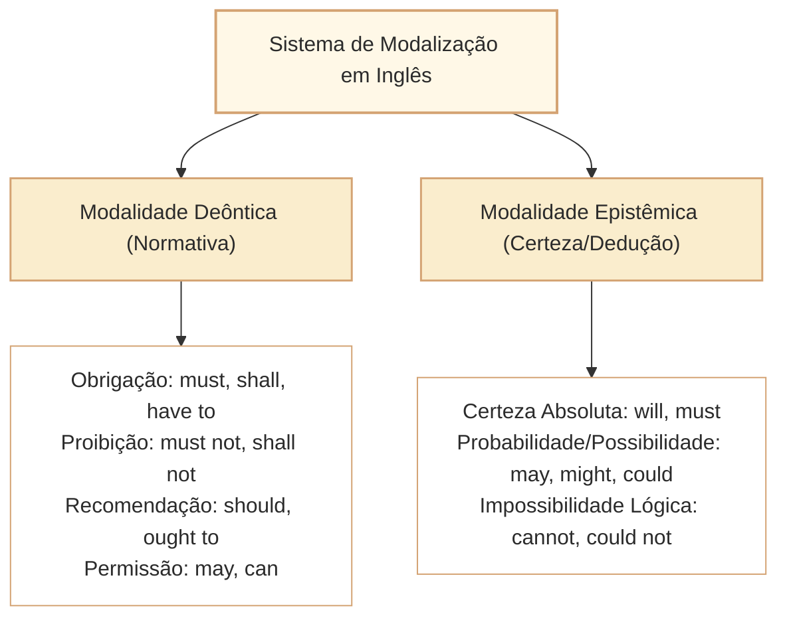

# Modalização em Inglês: Possibilidade, Obrigação, Dedução Lógica e Gradação de Certeza

Nas provas de Língua Inglesa do Cebraspe para carreiras de nível superior (como o cargo de Analista Legislativo da Câmara dos Deputados), o estudo dos **verbos modais (*modal verbs*)** e de seus equivalentes semi-modais (*semi-modals*) não visa à memorização mecânica de regras de conjugação. A banca concentra suas questões na **calibração da força assertiva**, na **distinção entre modalidade epistêmica (grau de certeza/probabilidade do enunciador) e modalidade deôntica (permissão, dever, obrigação e proibição)** e no fenômeno do **hedging** (estratégias de moderação e prudência acadêmica e institucional).

O mecanismo de distração predileto do Cebraspe em questões de interpretação e paráfrase consiste em **alterar o grau de modalização do texto original**:
- Transformar uma **mera possibilidade hipotética** (*may, might, could*) em uma **consequência inelutável ou certeza absoluta** (*will, must, certainly*);
- Transformar uma **obrigação jurídica vinculante** (*shall, must*) em uma **recomendação moral facultativa** (*should, ought to*);
- Interpretar uma **dedução lógica forte sobre fato pretérito** (*must have been*) como uma **obrigação que deveria ter sido cumprida no passado** (*should have been*).

---

## 1. Classificação Fundamental: Modalidade Deôntica vs. Epistêmica

Os mesmos verbos modais podem assumir valores deônticos (normativos) ou epistêmicos (probabilísticos), a depender estritamente do contexto sintático e pragmático:

### 1.1. Modalidade Deôntica: A Conduta e a Norma

Regula o comportamento social, os deveres funcionais e as proibições regimentais:

- **Obrigação Impositiva Forte / Vinculante:**
  - *Must:* Expressa obrigação interna ou determinação imperativa direta (*The committee must submit its findings*).
  - *Have to:* Expressa obrigação externa decorrente de lei, regulamento ou circunstância fática (*Deputies have to register their attendance electronically*).
  - *Shall (em textos legais e tratados):* Denota mandamento legal imperativo com força cogente (*The Chamber of Deputies shall convene annually...*). Em textos normativos, *shall* $\neq$ simples futuro coloquial; equivale a *must/is obligated to*.
- **Proibição Categórica:**
  - *Must not / May not / Shall not:* Expressam vedação absoluta (*Public servants must not disclose classified records*).
- **Conselho, Recomendação e Dever Moral (Não Coercitivo):**
  - *Should / Ought to:* Indicam conduta recomendável, conveniente ou ética, mas desprovida de coerção punitiva imediata (*The rapporteur should seek broader consensus before the vote*).
- **Permissão Formal:**
  - *May:* Permissão outorgada por autoridade ou regulamento (*Citizens may attend public committee hearings*).
  - *Can:* Permissão informal ou capacidade fática/institucional (*Deputies can request copies of the bill*).

### 1.2. Modalidade Epistêmica: O Conhecimento e a Certeza

Mede a convicção do enunciador a respeito da veracidade de uma proposição:

| Verbo Modal Epistêmico | Grau de Certeza do Enunciador | Tradução Funcional | Exemplo no Contexto Institucional |
| :--- | :--- | :--- | :--- |
| **Must** | **Quase Certeza / Dedução Lógica Forte (95%)** | *Certamente é / Deve ser (com base em indícios sólidos)* | *The signature is authentic; the president **must be** aware of the decree.* |
| **Will** | **Certeza Factual / Predição Firme (100%)** | *Certamente ocorrerá / Ocorrerá* | *The plenary **will confirm** the vote tomorrow morning.* |
| **Should / Ought to** | **Expectativa Razoável / Probabilidade (70%)** | *É provável que / Espera-se que* | *The printing of the official gazette **should be** finished by midnight.* |
| **May** | **Possibilidade Factual Plausível (50%)** | *Pode ser que / É possível que* | *The legislative debate **may trigger** public demonstrations.* |
| **Might / Could** | **Possibilidade Hipotética / Remota (35%)** | *Poderia ser que / Há uma remota chance de* | *New amendments **might alter** the fiscal balance.* |
| **Cannot / Can't** | **Impossibilidade Lógica Categórica (0%)** | *Não pode ser que / É impossível que* | *The quorum **cannot be** valid; only ten deputies were present.* |

---

## 2. A Fronteira Crítica dos Modais Perfeitos (*Modals + Have + Participle*)

Quando os modais se combinam com a estrutura perfeita (*have + past participle*), eles avaliam eventos passados. O Cebraspe explora com rigor a distinção entre **dedução lógica pretérita** e **crítica a uma conduta que não ocorreu**:

### 2.1. Dedução Lógica sobre o Passado
- **Must have + particípio:** *Dedução lógica quase certa sobre fato pretérito*.
  - *The amendment was approved unanimously; party leaders **must have negotiated** behind closed doors.* (Os líderes partidários com certeza negociaram / devem ter negociado).
- **Cannot / Could not have + particípio:** *Impossibilidade lógica no passado*.
  - *The rapporteur **cannot have signed** the text yesterday; he was abroad.* (É impossível que o relator tenha assinado).

### 2.2. Avaliação Deôntica de Conduta Não Ocorrida
- **Should have + particípio:** *Obrigação ou recomendação que NÃO foi cumprida no passado (expressa falha, crítica ou arrependimento)*.
  - *The administration **should have consulted** the civil society before publishing the decree.* (Deveria ter consultado, mas não consultou).
- **Could have + particípio:** *Capacidade ou oportunidade que existiu, mas NÃO foi aproveitada*.
  - *The committee **could have invited** external experts, but chose not to.* (Poderia ter convidado, mas preferiu não fazê-lo).

> [!WARNING]
> **Armadilha clássica do Cebraspe:**
> Confundir *must have finalized* com *should have finalized*. O primeiro afirma que o relatório com certeza foi finalizado; o segundo lamenta que o relatório não foi finalizado no momento oportuno. O polo de veracidade factual é exatamente oposto.

---

## 3. O Fenômeno do *Hedging* no Discurso Institucional

Em redações formais, tratados e artigos acadêmicos, os autores recorrem sistematicamente ao *hedging* para evitar alegações categóricas desprovidas de prova cabal. O Cebraspe testa se o candidato reconhece essa contenção epistemológica ou se comete o erro de extrapolação:

- **Recursos Típicos de Hedging:**
  - Modais de possibilidade: *may*, *might*, *could*.
  - Verbos epistêmicos: *suggest*, *indicate*, *appear to*, *tend to*.
  - Advérbios de moderação: *possibly*, *arguably*, *largely*, *relatively*.
  - Expressões de probabilidade: *is likely to*, *there is reason to believe*.

Ao julgar itens do Cebraspe: **se o texto afirma que uma reforma *may stimulate the economy*, um item que assevera que a reforma *will certainly stimulate the economy* está rigorosamente ERRADO**.

---

## 4. Questões Comentadas no Estilo Cebraspe

### Questão 1
*(Inédita: estilo Cebraspe / Câmara dos Deputados – Analista Legislativo)*

*Text segment: "The audit identified that the agency should have conducted an environmental impact assessment prior to authorizing the infrastructure contract."*

**Item:** According to the text, the agency successfully carried out an environmental impact assessment before granting the contract.

- ( ) Certo
- ( ) Errado

**Gabarito: Errado**  
**Comentário:** A locução modal perfeita "should have conducted" expressa um dever ou recomendação que **não foi cumprida** no passado (*deveria ter realizado, mas não realizou*). Afirmar que a agência realizou a avaliação com sucesso inverte frontalmente o sentido factual da sentença.

---

### Questão 2
*(Inédita: estilo Cebraspe / Câmara dos Deputados – Analista Legislativo)*

*Text segment: "The constitutional court ruled that administrative authorities may not restrict access to official legislative documents unless classified by statute."*

**Item:** The modal verb "may" in "may not restrict" denotes a physical inability of administrative authorities to process public records.

- ( ) Certo
- ( ) Errado

**Gabarito: Errado**  
**Comentário:** A expressão "may not" atua no campo da modalidade deôntica, expressando uma **proibição normativa / jurídica** (*não lhes é permitido restringir*), e não uma incapacidade física ou fática de processamento. Trata-se de uma confusão entre permissão/proibição normativa e capacidade material.

---

### Questão 3
*(Inédita: estilo Cebraspe / Câmara dos Deputados – Analista Legislativo)*

*Text segment: "Given that the electronic voting system registered zero dissenting votes, the party leaders must have secured an extraordinary political agreement."*

**Item:** The clause "the party leaders must have secured an extraordinary political agreement" conveys a strong logical deduction based on the observed voting outcome.

- ( ) Certo
- ( ) Errado

**Gabarito: Certo**  
**Comentário:** No contexto, "must have secured" expressa uma dedução lógica de alta probabilidade (*modalidade epistêmica pretérita*): diante do fato incontroverso de zero votos contrários, o enunciador conclui com quase certeza que os líderes fecharam um acordo prévio. O item define com precisão a função do modal.

---

### Questão 4
*(Inédita: estilo Cebraspe / Câmara dos Deputados – Analista Legislativo)*

*Text segment: "Emerging digital communication tools might improve citizen engagement with parliamentary committees."*

**Item:** The author categorically guarantees that the adoption of emerging digital communication tools will inevitably enhance citizen participation in committee debates.

- ( ) Certo
- ( ) Errado

**Gabarito: Errado**  
**Comentário:** O verbo modal "might" expressa uma possibilidade hipotética cautelosa (*hedging*), e não uma certeza inelutável. O item comete uma clássica falha de extrapolação modal ao afirmar que o autor "garante categoricamente" (*categorically guarantees*) ou que a melhoria ocorrerá "inevitavelmente" (*will inevitably enhance*).

---

### Questão 5
*(Inédita: estilo Cebraspe / Câmara dos Deputados – Analista Legislativo)*

*Text segment: "Article 12: The Ombudsman shall publish a quarterly transparency balance sheet detailing all citizen complaints."*

**Item:** In the legal provision above, the auxiliary "shall" expresses an imperative legal obligation rather than a mere prediction of future events.

- ( ) Certo
- ( ) Errado

**Gabarito: Certo**  
**Comentário:** Na redação legislativa e regulamentar em Língua Inglesa (*legal English*), o modal "shall" é o operador canônico de comando impositivo com força vinculante (*shall = is mandatory / must*). Ele não expressa uma simples previsão cronológica de futuro, mas sim uma obrigação jurídica indeclinável.

---

### Questão 6
*(Inédita: estilo Cebraspe / Câmara dos Deputados – Analista Legislativo)*

*Text segment: "The rapporteur could not have known about the confidential annex, as it was only delivered to the archive this morning."*

**Item:** The phrase "could not have known" indicates that the rapporteur was strictly prohibited by administrative rules from examining the confidential annex.

- ( ) Certo
- ( ) Errado

**Gabarito: Errado**  
**Comentário:** "Could not have known" expressa uma **impossibilidade lógica/fática pretérita** (era impossível que ele soubesse, visto que o documento só chegou hoje), e não uma **proibição normativa disciplinar** (que seria expressa por *was not allowed to* ou *could not examine*). O item confunde impossibilidade lógica com interdição normativa.

---

## 5. Relações com Outros Artigos e Síntese de Revisão

- **Pré-requisitos e Vínculos Teóricos:**
  - [[3 - Materias/Ingles/08 - informacoes explicitas inferencias e limites da deducao|CAM-ING-002]]: Calibração de inferências com base em marcadores de *hedging* e modais.
  - [[3 - Materias/Ingles/12 - estrutura de frases negacao interrogacao e inversao sintatica em ingles|CAM-ING-006]]: O emprego de *Should* e *Were* em inversões condicionais sem *if*.
  - [[3 - Materias/Ingles/13 - tempos verbais aspecto e sequencia temporal em ingles|CAM-ING-007]]: A transposição de tempos verbais e modais no discurso indireto (*can $\rightarrow$ could*, *may $\rightarrow$ might*, *will $\rightarrow$ would*).
  - [[3 - Materias/Ingles/14 - voz ativa passiva e foco informacional em ingles|CAM-ING-008]]: Voz passiva com verbos modais (*must be verified*, *should be disclosed*).
