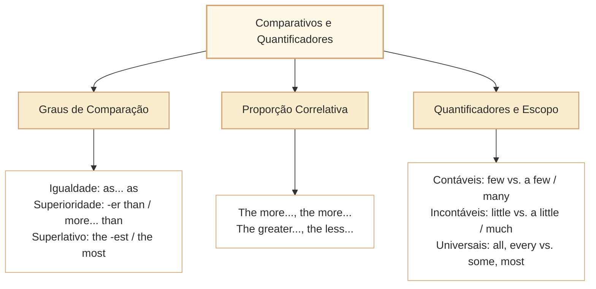

# Comparativos, Quantificadores e Delimitadores de Escopo em Inglês

Nas provas de Língua Inglesa do Cebraspe para carreiras de nível superior (como o cargo de Analista Legislativo da Câmara dos Deputados), as questões que envolvem **estruturas comparativas**, **graus de adjetivos e advérbios** e **quantificadores nominais** representam um dos mecanismos mais refinados para a formulação de itens de alta discriminação. Em vez de avaliar meras regras morfológicas de sufixação (*-er / -est* vs. *more / most*), a banca investiga a **amplitude do escopo informacional**, a **rigidez dos quantificadores lógicos** e a **manutenção da equivalência proporcional** em processos de paráfrase e reescrita textual.

Os distratores do Cebraspe nesse domínio fundamentam-se prioritariamente em três desvios sistemáticos:
1. **Transposição indevida de quantificadores existenciais ou parciais para quantificadores universais absolutos** (converter *some / many / most* em *all / every / any*);
2. **Subversão da polaridade em quantificadores contáveis e incontáveis de escopo negativo ou positivo** (o contraste crítico entre *few* e *a few*, e entre *little* e *a little*);
3. **Inversão da proporção em estruturas correlativas comparativas** (*the more..., the more...* vs. *the more..., the less...*).

---

## 1. Estruturas Comparativas e Superlativas

A comparação em inglês estabelece relações de igualdade, superioridade, inferioridade e proporcionalidade entre entidades, políticas ou dados orçamentários:

### 1.1. Graus de Comparação e Restrições de Referência

- **Igualdade:**  
  *as + adjetivo/advérbio + as* (afirmativa) e *not as / not so + adjetivo + as* (negativa).
  - *Digital public consultation is **as effective as** traditional town hall meetings.*
  - Na negativa (*Digital consultation is not as expensive as physical hearings*), estabelece-se implicitamente uma relação de inferioridade da primeira em relação à segunda (*Digital is less expensive than physical*), operação relevante para avaliar reescritas e inferências em inglês.
- **Superioridade Relativa:**
  - Adjetivos curtos (1 ou 2 sílabas com *-y*): acréscimo de *-er than* (*faster, stricter, simpler, narrower*).
  - Adjetivos longos (2 ou mais sílabas): *more + adjetivo + than* (*more comprehensive than, more transparent than*).
- **Superlativo Relativo:**
  - Identifica o ponto culminante dentro de um grupo delimitado (*the strictest protocol*, *the most rigorous audit*). Exige obrigatoriamente a presença do artigo definido *the* (ou pronome possessivo equivalente).
  - O Cebraspe testa se a afirmação de que algo é o *mais rigoroso de um grupo delimitado* autoriza inferir que ele é o *mais rigoroso do mundo inteiro*, o que constitui extrapolação indevida de escopo.

### 1.2. A Estrutura Proporcional Dupla: *The + Comparativo..., The + Comparativo...*

Essa estrutura correlativa expressa uma relação de dependência funcional de causa e efeito recíprocos entre duas variáveis (*quanto mais..., mais...* ou *quanto mais..., menos...*):

$$\text{The [mais/menos A]..., the [mais/menos B]...}$$

- *The more transparent the legislative process is, the greater citizen trust becomes.* (Quanto mais transparente for o processo, maior se tornará a confiança do cidadão).
- *The stricter the procurement regulations are, the less discretionary the spending becomes.* (Quanto mais estritas forem as normas, menos discricionário se tornará o gasto).
- **Pegadinha da Banca:** Inverter o sentido proporcional na paráfrase. O Cebraspe sugere que *The greater the oversight, the lower the fraud* significaria que *o aumento da fiscalização acarreta a proliferação da fraude*.

---

## 2. Quantificadores Lógicos e a Fronteira do Escopo

A delimitação precisa de quantidade e escopo é o filtro mais sensível nas questões de interpretação da banca:

### 2.1. O Contraste Crítico: *Few* vs. *A Few* e *Little* vs. *A Little*

A presença ou ausência do artigo indefinido *a* altera radicalmente a polaridade semântica da frase:

| Quantificador | Substantivo Compatível | Valor Semântico / Polaridade | Significado Prático |
| :--- | :--- | :--- | :--- |
| **Few** | Contável no Plural (*deputies, bills*) | **Negativo / Escassez Crítica** | Quase nenhum, raríssimos, insuficientes. |
| **A few** | Contável no Plural (*deputies, bills*) | **Positivo / Existência Suficiente** | Alguns, um pequeno número, vários. |
| **Little** | Incontável (*evidence, progress, time*) | **Negativo / Escassez Crítica** | Quase nada, insuficiente, escasso. |
| **A little** | Incontável (*evidence, progress, time*) | **Positivo / Existência Suficiente** | Algum, uma certa quantia, algo. |

- **Exemplo 1:**  
  *The committee had **few reasons** to suspect administrative fraud.*  
  $\rightarrow$ Significa: O comitê quase não tinha motivos; não havia suspeita significativa (valor negativo).
- **Exemplo 2:**  
  *The committee had **a few reasons** to suspect administrative fraud.*  
  $\rightarrow$ Significa: O comitê tinha alguns motivos concretos de suspeita (valor positivo).
- Um item que substitua *few* por *a few* (ou *little* por *a little*) e afirme preservação integral de sentido exige atenção à perspectiva do enunciador: a troca normalmente altera a orientação avaliativa, ainda que ambas as expressões se refiram a pequenas quantidades.

### 2.2. A Escala de Quantificadores e Delimitadores de Escopo

**Quantificadores não são uma régua de porcentagens fixas.** *All/every* têm alcance universal no domínio relevante; *none/no* negam ocorrências nesse domínio; *most* indica mais da metade dos elementos contáveis pertinentes. *Many*, *several*, *some*, *few* e *little* dependem do contexto, do conjunto de referência e da natureza contável ou incontável do substantivo. *Few* indica quantidade pequena com orientação negativa; *a few* apresenta uma quantidade pequena como existente ou suficiente no contexto. Não atribua faixas percentuais a essas expressões.

- **Generalização Abusiva (*Overgeneralization*):**  
  Se o texto afirma: *Most parliamentarians agreed with the budgetary cut*, um item que assevera: *All parliamentarians agreed...* ou *Every parliamentarian approved...* está **ERRADO**.
- **Restrição Abusiva (*Underspecification*):**  
  Se o texto afirma *All government agencies must disclose procurement data*, dizer apenas *Some government agencies are required...* pode ser logicamente compatível (o universal inclui casos particulares), embora **não reproduza a abrangência** da regra. Um item só será necessariamente errado se afirmar que *only some* órgãos estão sujeitos à obrigação, ou negar a obrigação de outros.

---

## 3. Delimitadores de Escopo e Operadores Restritivos

Operadores adverbiais e prepositivos delimitam estritamente o universo de aplicação de uma regra:

1. **Exclusão Categórica:** *solely, exclusively, strictly, only*.
   - *The fund may be used **solely** for infrastructure projects.* (Qualquer outro uso constitui desvio de finalidade).
2. **Inclusão com Reserva:** *primarily, mainly, largely, predominantly*.
   - *The committee focuses **primarily** on digital privacy.* (Outros temas correlatos não estão terminantemente banidos).
3. **Ressalva / Exceção:** *except for, apart from, with the exception of, barring*.
   - *All amendments were rejected, **barring** the fiscal clause.* (= com exceção da cláusula fiscal).

---

## 4. Questões Comentadas no Estilo Cebraspe

### Questão 1
*(Inédita: estilo Cebraspe / Câmara dos Deputados – Analista Legislativo)*

*Text segment: "The parliamentary inquiry found little documentary evidence to corroborate the allegations of bribery against the agency leadership."*

**Item:** According to the text, the parliamentary inquiry succeeded in uncovering a substantial amount of documentary evidence that proved the bribery allegations.

- ( ) Certo
- ( ) Errado

**Gabarito: Errado**  
**Comentário:** O quantificador "little" acompanhado de substantivo incontável ("documentary evidence") possui polaridade negativa, significando "quase nenhuma evidência" (*hardly any evidence*). Afirmar que a comissão descobriu uma "quantidade substancial de provas" (*a substantial amount of evidence*) inverte frontalmente o sentido do quantificador.

---

### Questão 2
*(Inédita: estilo Cebraspe / Câmara dos Deputados – Analista Legislativo)*

*Text segment: "Few legislators were willing to endorse the austerity amendments without compensatory social investments."*

**Item:** The phrase "Few legislators" indicates that almost no legislators supported the amendments unconditionally, and it could not be replaced with "A few legislators" without modifying the core meaning of the sentence.

- ( ) Certo
- ( ) Errado

**Gabarito: Errado**  
**Comentário:** *Few* indica uma quantidade pequena, em avaliação restritiva, mas o texto relata parlamentares **dispostos a endossar sem investimentos sociais compensatórios** (*were willing to endorse ... without compensatory social investments*). Não comprova que esses parlamentares efetivamente apoiaram ou votaram pelas emendas. Além disso, *few* não corresponde a um percentual fixo nem equivale necessariamente a *almost none*. A troca por *a few* altera a orientação pragmática, mas essa segunda parte não salva a primeira inferência indevida do item.

---

### Questão 3
*(Inédita: estilo Cebraspe / Câmara dos Deputados – Analista Legislativo)*

*Text segment: "The more transparent the committee deliberations are, the less vulnerable the legislative process is to undue corporate lobbying."*

**Item:** The sentence suggests that an increase in the transparency of committee deliberations directly results in a decrease in the vulnerability of the legislative process to undue lobbying.

- ( ) Certo
- ( ) Errado

**Gabarito: Errado**  
**Comentário:** *The more ..., the less ...* expressa covariação ou associação proporcional entre transparência e vulnerabilidade. A estrutura **não prova, por si só, causalidade direta**. O item acrescenta *directly results in*, convertendo uma relação formulada no enunciado em causa demonstrada. Sem evidência adicional, essa inferência é excessiva.

---

### Questão 4
*(Inédita: estilo Cebraspe / Câmara dos Deputados – Analista Legislativo)*

*Text segment: "Most administrative units in the lower house have already implemented digital signature protocols for official memos."*

**Item:** It can be deduced from the text that all administrative units in the lower house have adopted digital signature protocols.

- ( ) Certo
- ( ) Errado

**Gabarito: Errado**  
**Comentário:** O texto utiliza o quantificador majoritário "Most" (*a maioria das unidades*). Concluir que "all" (*todas as unidades*) adotaram o protocolo é uma falácia de generalização indevida (extrapolação de escopo), mecanismo clássico de formulação de distratores do Cebraspe.

---

### Questão 5
*(Inédita: estilo Cebraspe / Câmara dos Deputados – Analista Legislativo)*

*Text segment: "The public communication agency was tasked with producing educational material exclusively aimed at secondary school students."*

**Item:** The adverb "exclusively" indicates that the educational material was designed to serve secondary school students as well as undergraduate university researchers.

- ( ) Certo
- ( ) Errado

**Gabarito: Errado**  
**Comentário:** O operador restritivo "exclusively" circunscreve o público-alvo única e restritivamente aos estudantes do ensino secundário, excluindo qualquer outro segmento. Estender a destinação do material a pesquisadores universitários de graduação viola diretamente a restrição de escopo imposta pelo advérbio.

---

### Questão 6
*(Inédita: estilo Cebraspe / Câmara dos Deputados – Analista Legislativo)*

*Text segment: "Digital broadcasting of committee hearings is not as costly as maintaining traditional analog regional offices."*

**Item:** The text implies that maintaining traditional analog regional offices is more costly than the digital broadcasting of committee hearings.

- ( ) Certo
- ( ) Errado

**Gabarito: Certo**  
**Comentário:** Em inglês corrente, *is not as costly as* apresenta o custo da transmissão digital como inferior ao da manutenção dos escritórios. Nesse contexto comparativo natural, *the offices are more costly* é uma paráfrase aceitável. A construção não fornece valores numéricos de custo, e a análise não deve atribuir a ela uma prova matemática independente do uso e do contexto. Compare *A is not as costly as B* (desigualdade normalmente implicada) com *A is no more costly than B* (A pode ser igual ou menos custoso).

---

## 5. Relações com Outros Artigos e Síntese de Revisão

- **Pré-requisitos e Vínculos Teóricos:**
  - [[3 - Materias/Ingles/08 - informacoes explicitas inferencias e limites da deducao|CAM-ING-002]]: Quantificadores definem os limites seguros da dedução lógica e evitam generalizações abusivas.
  - [[3 - Materias/Ingles/10 - conectivos relacoes logicas e sequenciacao discursiva em ingles|CAM-ING-004]]: Conectivos de proporção e comparação (*as... as*, *whereas*, *while*).
  - [[3 - Materias/Ingles/15 - modalizacao possibilidade obrigacao deducao e conselho em ingles|CAM-ING-009]]: Articulação entre quantificadores (*all, some, none*) e operadores modais (*must, may, cannot*).
  - [[3 - Materias/Ingles/06 - parafrase equivalencia semantica e escopo|CAM-ING-011]]: Preservação do escopo quantitativo e dos graus comparativos em processos de reescrita oracional.
