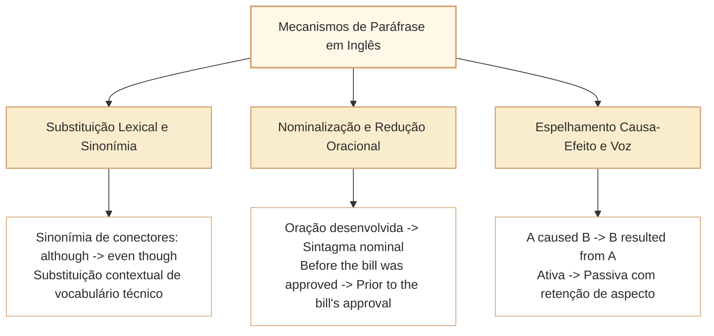

# Paráfrase, Equivalência Semântica e Mudança de Sentido em Inglês

Nas provas de Língua Inglesa elaboradas pelo Cebraspe para carreiras legislativas e de controle (como o cargo de Analista Legislativo da Câmara dos Deputados), as questões de **paráfrase e reescrita de segmentos textuais** constituem a expressão máxima da avaliação integrada de competências linguísticas. Nelas convergem a sintaxe da oração, a precisão lexical, a regência prepositiva, a preservação do tempo/aspecto verbal e a estrita manutenção das relações lógico-semânticas do texto original.

O comando clássico da banca — *"The sentence '...' could be rewritten as '...' without alteration of its original meaning or violation of grammatical correctness"* — exige do candidato um exame minucioso em duas etapas independentes:
1. **O Filtro da Correção Gramatical:** A nova redação atende a todas as regras da norma culta em inglês (concordância sujeito-verbo, regência prepositiva, estrutura oracional e ordem das palavras)?
2. **O Filtro da Equivalência Semântica e Pragmática:** A reescrita preserva o sentido denotativo, o foco informacional (*theme/rheme*), o grau de modalização (*hedging*), a polaridade lógica e o escopo dos quantificadores, sem incorrer em generalização excessiva, atenuação indevida ou inversão de papéis de causa e efeito?

---

## 1. Mecanismos Legítimos de Paráfrase no Padrão Cebraspe

Uma paráfrase válida no padrão Cebraspe é aquela que reformula a superfície do texto mantendo inalterado o seu núcleo proposicional e as suas condições de verdade (*truth conditions*):



### 1.1. Substituição Lexical com Preservação de Regência
A troca de um termo por um sinônimo funcional exige atenção imediata à preposição regida pelo novo verbo, substantivo ou adjetivo:
- *The committee **complies with** international oversight standards.*  
  $\equiv$ *The committee **adheres to** international oversight standards.* (Correto: *adhere to* = *comply with*).
- Se a banca propuser *The committee **abides to**...*, o item está incorreto por erro gramatical, pois a regência culta exige *abide by*.

### 1.2. Nominalização (*Nominalization*) e Compactação Sintática
Consiste em transformar uma oração completa (com verbo conjugado) em um sintagma nominal equivalente, conferindo maior densidade informativa ao texto:
- *Because the plenary **delayed the vote**, legislative negotiations were stalled.*  
  $\equiv$ *Due to **the plenary's delay in voting**, legislative negotiations were stalled.*
- *Although the economic environment **fluctuated unpredictably**, the agency maintained its operations.*  
  $\equiv$ *Despite **unpredictable economic fluctuations**, the agency maintained its operations.*

### 1.3. Espelhamento de Relações Conversas de Causa e Consequência
A reorganização das orações de causa e efeito mediante o emprego de verbos de sentido inverso (*result in* $\leftrightarrow$ *result from*; *lead to* $\leftrightarrow$ *stem from*; *trigger* $\leftrightarrow$ *arise from*):
- *Lack of budgetary transparency **leads to** severe institutional mistrust.*  
  $\equiv$ *Severe institutional mistrust **stems from / results from** lack of budgetary transparency.*

---

## 2. Tipologia de Erros Frequentes nos Distratores do Cebraspe

Ao analisar assertivas de reescrita, o candidato deve verificar sistematicamente se ocorreu alguma das seguintes alterações sub-reptícias de sentido:

| Tipo de Desvio Semântico | O que o Texto Original Afirma | O que a Proposta de Reescrita Altera | Veredito no Cebraspe |
| :--- | :--- | :--- | :--- |
| **Mudança de Modalidade / Certeza** | *The policy **may reduce** spending.* | *The policy **will inevitably reduce** spending.* | **ERRADO** (extrapolação de possibilidade para certeza). |
| **Inversão de Causa e Efeito** | *Public protests **provoked** the reform.* | *The reform **provoked** public protests.* | **ERRADO** (inversão da relação de causalidade). |
| **Subversão de Quantificador** | *The committee found **few defects**.* | *The committee found **a few defects**.* | **ERRADO** (mudança de escassez negativa para existência positiva). |
| **Extrapolação de Escopo** | *The measure applies to **most agencies**.* | *The measure applies to **all agencies**.* | **ERRADO** (generalização abusiva). |
| **Quebra de Regência Prepositiva** | *They succeeded **in passing** the bill.* | *They succeeded **to pass** the bill.* | **ERRADO** (erro gramatical crasso de regência). |
| **Perda do Aspecto Verbal** | *Auditors **are examining** the logs.* | *Auditors **examine** the logs.* | **ERRADO** (perda da ideia de ação em curso). |

---

## 3. Protocolo de Resolução de Itens de Reescrita no Cebraspe

Para garantir acerto sistemático, aplique o seguinte algoritmo mental em quatro etapas:

```
Passo 1: Verificação da Correção Gramatical da Proposta
         Há erro de concordância? A preposição está certa? A ordem das palavras é válida?
                   ↓ (Se houver erro gramatical -> ITEM ERRADO)
Passo 2: Verificação do Tempo e Aspecto Verbal
         O tempo foi alterado? Perdeu-se o aspecto contínuo (-ing) ou perfeito (have + part.)?
                   ↓ (Se houve distorção aspectual -> ITEM ERRADO)
Passo 3: Verificação da Força Modal e dos Quantificadores
         Possibilidade virou certeza? Most virou all? Few virou a few?
                   ↓ (Se houve ampliação/redução de escopo -> ITEM ERRADO)
Passo 4: Verificação da Relação Lógica e Foco Informacional
         A causa continuou sendo causa? A concessão continuou sendo concessão?
                   ↓
              ITEM CERTO
```

---

## 4. Questões Comentadas no Estilo Cebraspe

### Questão 1
*(Inédita: estilo Cebraspe / Câmara dos Deputados – Analista Legislativo)*

*Text segment: "Although the special committee faced intense political resistance, it succeeded in approving the structural reform before the legislative recess."*

**Item:** Without altering the meaning of the original text or violating grammatical rules, the sentence could be rewritten as: "Despite facing intense political resistance, the special committee succeeded in approving the structural reform before the legislative recess."

- ( ) Certo
- ( ) Errado

**Gabarito: Certo**  
**Comentário:** A reescrita operou uma transposição legítima de conjunção subordinativa (*Although + oração com verbo finito*) para locução prepositiva concessiva (*Despite + gerúndio*). O sujeito da oração reduzida é o mesmo da principal (*the special committee*), a regência do verbo *succeeded in* foi rigorosamente preservada e o sentido de concessão e anterioridade temporal permaneceu idêntico.

---

### Questão 2
*(Inédita: estilo Cebraspe / Câmara dos Deputados – Analista Legislativo)*

*Text segment: "The premature disclosure of the preliminary audit report caused widespread public outrage across the country."*

**Item:** The original meaning and grammatical correctness of the excerpt would be fully preserved if it were rewritten as: "Widespread public outrage across the country resulted in the premature disclosure of the preliminary audit report."

- ( ) Certo
- ( ) Errado

**Gabarito: Errado**  
**Comentário:** No texto original, o vazamento prematuro foi a **causa** que gerou a indignação pública (**consequência**). A proposta de reescrita inverteu a relação causal ao empregar a locução "resulted in" (que introduz a consequência), afirmando falsamente que a indignação pública é que causou o vazamento prematuro. Para manter o sentido original, o verbo deveria ser *resulted from* ou *stemmed from*.

---

### Questão 3
*(Inédita: estilo Cebraspe / Câmara dos Deputados – Analista Legislativo)*

*Text segment: "Public administrators must strictly abide by the principles of administrative transparency established in the Constitution."*

**Item:** The sentence could be correctly paraphrased as: "Public administrators must strictly comply with the principles of administrative transparency established in the Constitution."

- ( ) Certo
- ( ) Errado

**Gabarito: Certo**  
**Comentário:** O verbo *comply with* é sinônimo funcional exato de *abide by* (obedecer a, cumprir rigorosamente, acatar). Ambos regem suas respectivas preposições corretas (*abide by* e *comply with*), e a força deontológica de dever vinculante expressa pelo modal *must* foi perfeitamente preservada.

---

### Questão 4
*(Inédita: estilo Cebraspe / Câmara dos Deputados – Analista Legislativo)*

*Text segment: "Technological upgrades may significantly reduce the operational costs associated with parliamentary publishing."*

**Item:** The segment would maintain its original meaning if rewritten as: "Technological upgrades will definitely eliminate the operational costs associated with parliamentary publishing."

- ( ) Certo
- ( ) Errado

**Gabarito: Errado**  
**Comentário:** A reescrita comete dois erros graves de distorção de sentido:
1. Converteu a modalidade de mera possibilidade (*may reduce*) em certeza absoluta e categórica (*will definitely*);
2. Substituiu a redução de custos (*reduce*) por eliminação total dos custos (*eliminate*). O item exemplifica a típica extrapolação e mudança indevida de força semântica promovida pela banca.

---

### Questão 5
*(Inédita: estilo Cebraspe / Câmara dos Deputados – Analista Legislativo)*

*Text segment: "The Chamber of Deputies has consistently updated its institutional communication channels to enhance citizen engagement."*

**Item:** The sentence could be rewritten as: "To enhance citizen engagement, institutional communication channels have consistently been updated by the Chamber of Deputies."

- ( ) Certo
- ( ) Errado

**Gabarito: Certo**  
**Comentário:** A proposta deslocou a oração de finalidade ("To enhance citizen engagement") para o início do período e transpôs a oração principal da voz ativa para a passiva analítica. O tempo e aspecto verbal foram conservados com precisão no *Present Perfect* passivo (*has consistently updated* $\rightarrow$ *have consistently been updated*), o agente foi mantido (*by the Chamber of Deputies*) e a equivalência proposicional é total.

---

### Questão 6
*(Inédita: estilo Cebraspe / Câmara dos Deputados – Analista Legislativo)*

*Text segment: "The committee approved the budgetary amendment because the rapporteur had presented an extensive fiscal impact study."*

**Item:** Both the meaning and the original syntactic structure would remain unchanged if the sentence were rewritten as: "The rapporteur had presented an extensive fiscal impact study; consequently, the committee approved the budgetary amendment."

- ( ) Certo
- ( ) Errado

**Gabarito: Errado**  
**Comentário:** A reescrita conserva a sequência causal sugerida pelo original: o estudo antecedeu a aprovação e é apresentado como sua razão. Contudo, **não preserva a estrutura gramatical** exigida expressamente pelo item. A primeira frase contém oração subordinada introduzida por *because*; a segunda usa duas orações independentes ligadas semanticamente pelo advérbio conectivo *consequently*. A equivalência de sentido, isoladamente, não comprova manutenção da estrutura sintática.

---

## 4.1. Três critérios distintos de equivalência em reescrita

Para julgar reescritas, identifique **qual propriedade o enunciado exige preservar**. Correção gramatical, conteúdo proposicional e estrutura sintática são critérios diferentes.

**Caso-base original:** *The editors postponed the publication because the source needed further verification.*

**Variação 1, voz passiva:** *The publication was postponed by the editors because the source needed further verification.* Conserva os participantes, a causa e o tempo verbal, mas muda a voz e o foco da frase. É uma paráfrase de conteúdo, não reprodução da mesma estrutura.

**Variação 2, omissão:** *The publication was postponed by the editors.* A frase é gramatical e conserva a decisão principal, mas retira a causa expressa pelo original. Se a exigência for preservação de **todo o sentido**, há perda informativa.

**Variação 3, modalidade:** *The editors may postpone the publication because the source needs further verification.* Agora a decisão é somente possível e ocorre em perspectiva temporal diferente: a proposição mudou.

**Item adicional A (inédito, C/E).** Variation 1 preserves the core event and its stated cause, despite changing the voice and the syntactic arrangement.

**Gabarito: Certo.** A passiva mantém quem adiou, o que foi adiado e o motivo; apenas redistribui a informação na oração.

**Item adicional B (inédito, C/E).** Variation 2 is a complete semantic equivalent of the original because both sentences are grammatically correct.

**Gabarito: Errado.** Correção gramatical não restitui a causa omitida; as duas frases não preservam integralmente a informação.

**Item adicional C (inédito, C/E).** Variation 3 maintains the original assertion that the editors actually postponed the publication.

**Gabarito: Errado.** *May postpone* introduz possibilidade, enquanto *postponed* afirma uma decisão passada; a troca também altera a relação temporal.

**Relação com outros artigos:** consulte [[3 - Materias/Ingles/14 - voz ativa passiva e foco informacional em ingles|voz passiva e foco]] para os auxiliares e [[3 - Materias/Ingles/15 - modalizacao possibilidade obrigacao deducao e conselho em ingles|modalização]] para a força assertiva. Este exercício é autoral e não reproduz item oficial.

---

## 5. Relações com Outros Artigos e Síntese de Revisão

- **Pré-requisitos e Vínculos Teóricos:**
  - [[3 - Materias/Ingles/08 - informacoes explicitas inferencias e limites da deducao|CAM-ING-002]]: Delimitação de inferências para atestar a fidelidade semântica da paráfrase.
  - [[3 - Materias/Ingles/10 - conectivos relacoes logicas e sequenciacao discursiva em ingles|CAM-ING-004]]: A equivalência de conectivos na conversão entre subordinação e coordenação.
  - [[3 - Materias/Ingles/14 - voz ativa passiva e foco informacional em ingles|CAM-ING-008]]: Transposição entre vozes mantendo a integridade aspectual e o foco temático.
  - [[3 - Materias/Ingles/15 - modalizacao possibilidade obrigacao deducao e conselho em ingles|CAM-ING-009]]: Manutenção rigorosa do grau epistêmico e deôntico em reescritas.
  - [[3 - Materias/Ingles/16 - comparativos quantificadores e delimitadores de escopo em ingles|CAM-ING-010]]: Conservação de quantificadores e delimitadores de escopo informacional.
