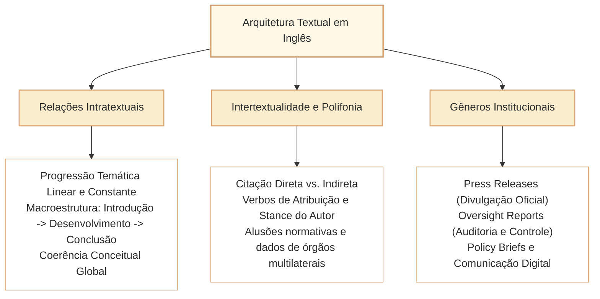

# Relações Intratextuais, Intertextualidade e Gêneros Contemporâneos em Inglês

Nas provas de Língua Inglesa do Cebraspe para carreiras legislativas de alto nível — especificamente para o cargo de Analista Legislativo da Câmara dos Deputados (Divulgação Institucional) —, o domínio da leitura instrumental atinge seu ápice na compreensão das **relações intratextuais (articulação interna entre seções, parágrafos e enunciados)**, da **intertextualidade explícita e implícita (diálogo com fontes externas, normas e autoridades)** e das **convenções pragmáticas dos gêneros discursivos contemporâneos** (comunicados oficiais, relatórios de *oversight*, artigos de opinião, notas de imprensa, posts institucionais em mídias digitais e pareceres técnicos).

A banca não concebe o texto como um aglomerado estático de frases isoladas, mas como uma **unidade de interação sociocomunicativa intencional**. O candidato é avaliado quanto à sua capacidade de:
1. Mapear o diálogo polifônico entre a voz do autor e as vozes citadas (*attribution, citation, stance*);
2. Reconhecer a função e o suporte pragmático de cada gênero textual institucional;
3. Avaliar a coerência global e a progressão temática sustentada ao longo de múltiplos parágrafos;
4. Identificar referências cruzadas e remissões a tratados, convenções e relatórios multilaterais.

---

## 1. Relações Intratextuais: Coerência Global e Progressão Temática

As relações intratextuais dizem respeito aos laços formais e semânticos que mantêm o texto coeso e orientam o leitor do início ao fim:

### 1.1. Modelos de Progressão Temática no Parágrafo
- **Progressão Linear Simples:** O rema (*rheme* / informação nova) de uma frase converte-se no tema (*theme* / ponto de partida conhecido) da frase subsequente.
  - *The special commission approved the institutional integrity framework [Rema 1]. This framework [Tema 2] establishes independent verification channels...*
- **Progressão com Tema Constante:** O mesmo tema é mantido como sujeito de várias orações sucessivas, acrescentando-se diferentes remas informativos.
- **Progressão por Hipertema (Derivação Temática):** Um tema amplo enunciado no parágrafo introdutório (*e.g., modern parliamentary challenges*) é fragmentado em subtemas abordados nos parágrafos seguintes (*cybersecurity, citizen apathy, budget constraints*).

### 1.2. Coerência Global e Quebra de Consistência
Itens de interpretação podem confrontar a conclusão do texto com uma premissa intermediária. Se o candidato ler apenas a frase isolada indicada no enunciado, poderá cair no erro de descontextualização (*out-of-context misinterpretation*). O sentido de qualquer segmento é condicionado pela tese global sustentada pelo texto.

---

## 2. Intertextualidade, Atribuição e a Postura do Autor (*Authorial Stance*)

Em relatórios legislativos e artigos de imprensa, o autor raramente fala de forma monocórdica. Ele introduz declarações de ministros, peritos, dados de relatórios e jurisprudência de tribunais:

### 2.1. Verbos de Atribuição (*Reporting Verbs*) e Neutralidade vs. Juízo de Valor
A escolha do verbo de elocução pelo autor revela sua adesão, ceticismo ou neutralidade em relação à voz citada:

| Categoria do Verbo | Exemplos Típicos | Efeito Pragmático e Postura do Autor |
| :--- | :--- | :--- |
| **Neutros / Informativos** | *state, report, explain, observe, point out, note* | O autor relata o fato ou declaração sem emitir juízo de valor pessoal sobre sua veracidade. |
| **Adesão / Corroboração** | *demonstrate, prove, establish, confirm, clarify* | O verbo apresenta a afirmação como sustentada ou demonstrada segundo a voz enunciadora, sem substituir a conferência independente de provas. |
| **Distanciamento / Ceticismo** | *claim, allege, purport, assert, contend* | Marca atribuição a outra voz; pode envolver reserva, mas ceticismo e falta de prova não são consequências automáticas em todo contexto. |
| **Recomendação / Proposição** | *advocate, propose, urge, recommend, suggest* | A voz citada propõe uma medida de política pública que não constitui norma vigente. |

> [!IMPORTANT]
> **A Pegadinha de *Claim* e *Allege* no Cebraspe:**
> Se o texto afirma: *The official claimed that procurement rules were followed*, um item que assevera: *The author proves that procurement rules were strictly respected* está **ERRADO**. O verbo *claim* atribui a afirmação ao agente, sem apresentar por si só prova cabal. O texto pode fornecer evidências em outro trecho; leia o contexto antes de julgar.

---

## 3. Gêneros Textuais Contemporâneos no Setor Público e Legislativo

As provas da Câmara dos Deputados utilizam textos representativos dos gêneros autênticos da comunicação social e institucional contemporânea:

1. **Press Release / Comunicado de Imprensa:**
   - *Finalidade:* Divulgar atos, aprovações de leis ou posicionamentos oficiais da Casa à sociedade e aos veículos de comunicação.
   - *Traços Estilísticos:* Clareza, concisão, pirâmide invertida (fato essencial no *lead*), citações de porta-vozes (*spokespersons*) e tom factual positivo.
2. **Oversight & Audit Report (Relatório de Fiscalização e Controle):**
   - *Finalidade:* Apresentar diagnósticos técnicos sobre conformidade orçamentária, eficiência de políticas públicas e integridade.
   - *Traços Estilísticos:* Linguagem formal de alta densidade terminológica, voz passiva frequente, neutralidade expositiva e conclusões lastreadas em evidências empíricas.
3. **Policy Brief / Nota Técnica de Políticas Públicas:**
   - *Finalidade:* Sintetizar problemas complexos e fornecer recomendações práticas a parlamentares e tomadores de decisão.
   - *Traços Estilísticos:* Estrutura em tópicos, delimitação do problema (*executive summary*), análise de riscos e recomendações acionáveis.
4. **Institutional Social Media Post / Comunicação Digital Pública:**
   - *Finalidade:* Promover o engajamento cívico e a prestação de contas (*public accountability*) em plataformas digitais.
   - *Traços Estilísticos:* Linguagem acessível, frases mais curtas, chamadas para ação (*call to action*) e uso funcional de recursos multimodais.

---

## 4. Questões Comentadas no Estilo Cebraspe

### Questão 1
*(Inédita: estilo Cebraspe / Câmara dos Deputados – Analista Legislativo)*

*Text segment: "In its latest annual report, the international governance observatory noted that digital consultation platforms strengthen legislative legitimacy; however, the author contends that such mechanisms often fail to engage marginalized demographics."*

**Item:** The author fully endorses the conclusions of the international governance observatory, maintaining that digital consultation platforms have successfully solved all representation deficits in modern parliaments.

- ( ) Certo
- ( ) Errado

**Gabarito: Errado**  
**Comentário:** O conector adversativo "however" introduz a postura cética e contraposta do próprio autor ("the author contends"), que problematiza o otimismo do relatório ao alertar que as plataformas falham em engajar grupos marginalizados. O autor não corrobora plenamente o relatório e muito menos afirma que os déficits de representação foram todos solucionados.

---

### Questão 2
*(Inédita: estilo Cebraspe / Câmara dos Deputados – Analista Legislativo)*

*Text segment: "The ministry spokesperson claimed that all cybersecurity protocols had been updated prior to the unauthorized data extraction."*

**Item:** The use of the verb "claimed" indicates that the information regarding the cybersecurity update is presented as an assertion made by the spokesperson, without the text providing independent verification of its absolute truth.

- ( ) Certo
- ( ) Errado

**Gabarito: Certo**  
**Comentário:** O item descreve com perfeita precisão a função pragmática do verbo de elocução "claim" (*reporting verb* de distanciamento). Ele assinala que a declaração reflete a versão da autoridade, sem que o enunciador ou o texto afiancem sua veracidade factual como fato consumado.

---

### Questão 3
*(Inédita: estilo Cebraspe / Câmara dos Deputados – Analista Legislativo)*

*Text segment (exemplo ficcional de comunicado institucional, em sistema bicameral): "FOR IMMEDIATE RELEASE: The Parliament has completed the legislative approval of a bill on artificial intelligence in public administration. The bill has now been sent to the head of state for assent."*

**Item:** Based on its structural conventions and communicative purpose, the text excerpt is characteristic of a press release designed to inform the media and the general public about a recent legislative outcome.

- ( ) Certo
- ( ) Errado

**Gabarito: Certo**  
**Comentário:** O cabeçalho *FOR IMMEDIATE RELEASE*, a apresentação imediata do fato central e o tom informativo caracterizam um *press release* (comunicado para imprensa). O exemplo é **ficcional** e não descreve um ato real da Câmara. O fluxo indicado aplica-se apenas ao cenário jurídico hipotético descrito; a tramitação brasileira exige atenção às duas Casas, às hipóteses de revisão e ao rito aplicável, não permitindo inferir sanção automática após aprovação por uma Casa.

---

### Questão 4
*(Inédita: estilo Cebraspe / Câmara dos Deputados – Analista Legislativo)*

*Text segment: "The audit team demonstrated that the procurement procedures suffered from substantial structural deficiencies."*

**Item:** The verb "demonstrated" suggests that the findings of the audit team are merely speculative hypotheses that lack documentary evidence.

- ( ) Certo
- ( ) Errado

**Gabarito: Errado**  
**Comentário:** O verbo "demonstrated" pertence à classe dos verbos de atribuição com juízo de fato/comprovação (*factive/corroborative reporting verbs*). Ele apresenta as constatações como demonstradas pela equipe, e não como especulação sem apoio. O verbo isolado não informa quais documentos foram utilizados nem garante a validade externa das conclusões.

---

### Questão 5
*(Inédita: estilo Cebraspe / Câmara dos Deputados – Analista Legislativo)*

*Text segment: "Echoing the guidelines established in the OECD Convention on Combating Bribery, the parliamentary committee incorporated stricter compliance obligations into the draft legislation."*

**Item:** The text reveals an explicit intertextual relationship, showing that the domestic parliamentary committee aligned its legislative proposal with an international normative benchmark.

- ( ) Certo
- ( ) Errado

**Gabarito: Certo**  
**Comentário:** A expressão *Echoing the guidelines established in the OECD Convention...* estabelece uma **relação intertextual explícita** entre o projeto e as diretrizes mencionadas. O texto descreve alinhamento temático, mas não demonstra que a convenção seja fundamento jurídico direto da proposição ou que a comissão tenha deliberado formalmente adotá-la. O C/E se sustenta pela retomada textual e pelo paralelo normativo indicado.

---

### Questão 6
*(Inédita: estilo Cebraspe / Câmara dos Deputados – Analista Legislativo)*

*Text segment: "While technical policy briefs prioritize concise, actionable data for decision-makers, academic treatises on public law privilege exhaustive theoretical debate and doctrinal systematization."*

**Item:** According to the text, technical policy briefs and academic treatises on public law share identical communicative purposes, differing only in the font style employed in their publication.

- ( ) Certo
- ( ) Errado

**Gabarito: Errado**  
**Comentário:** O texto estabelece uma contraposição explícita ("While...") entre os propósitos comunicativos de cada gênero: as notas técnicas (*policy briefs*) priorizam síntese concisa e dados acionáveis voltados à tomada de decisão imediata, ao passo que tratados acadêmicos privilegiam debate teórico exaustivo e sistematização doutrinária. A assertiva subverte completamente a distinção pragmática entre os gêneros textuais.

---

## 4.1. Laboratório de leitura: três versões do mesmo fato (exercícios inéditos)

Os textos abaixo são **ficcionais e escritos para treinamento**, não comunicados reais da Câmara nem questões oficiais. Compare a informação que cada gênero apresenta, a fonte a quem atribui uma conclusão e o que permanece incerto.

**Texto A: nota pública de uma comissão (press release)**

> The committee published a summary of the digital-accessibility consultation on Tuesday. The summary reports that 240 people submitted comments. The chair said that the comments would inform the next draft, but did not announce a date for publication.

**Texto B: notícia independente (news brief)**

> A parliamentary committee released a consultation summary this week. According to the committee, 240 submissions were received. Several accessibility groups welcomed the publication but argued that the summary did not specify how their recommendations would affect the proposed rules.

**Texto C: comentário de acompanhamento (monitoring note)**

> The publication marks a step toward a more transparent process. However, the number of submissions alone does not show whether the consultation was representative. A revised draft has not yet been published, and its possible effects remain uncertain.

**Variação progressiva:** A informa o que a instituição divulgou; B conserva o número, mas identifica a fonte (*according to the committee*) e inclui a avaliação de terceiros; C distingue transparência do processo e representatividade, sem afirmar que a consulta foi ineficaz. Compare *would inform* (declaração sobre intenção futura) com *affected* (efeito já demonstrado): não são intercambiáveis.

**Item A (inédito, C/E):** All three texts confirm that exactly 240 citizens took part in the consultation.

**Gabarito: Errado.** O Texto A relata **240 pessoas** que enviaram comentários, mas não comprova que todas sejam cidadãs da jurisdição; o Texto B informa **240 submissões segundo a comissão**, sem demonstrar que vieram de 240 pessoas distintas. O Texto C não confirma total algum. Assim, os três textos não comprovam em conjunto que exatamente 240 cidadãos participaram. Distinguir *people*, *comments*, *submissions* e *citizens* é essencial para evitar mudança de unidade de contagem.

**Item B (inédito, C/E):** Text B attributes the number of submissions to the committee rather than presenting an independent count.

**Gabarito: Certo.** *According to the committee* identifica a origem da informação e não indica auditoria autônoma do número.

**Item C (inédito, C/E):** Text C asserts that the consultation was unrepresentative because the number of submissions was low.

**Gabarito: Errado.** C afirma que o número isolado **não demonstra** representatividade. Não qualifica 240 como pequeno nem conclui que a consulta foi não representativa.

**Item D (inédito, C/E):** The chair's statement in Text A establishes that the next draft was already published on Tuesday.

**Gabarito: Errado.** *Would inform the next draft* expressa intenção ou expectativa relativa à próxima versão. A registra expressamente que nenhuma data de publicação foi anunciada; C acrescenta que a versão revista ainda não foi publicada.

**Método de resposta:** localizar a expressão que sustenta o julgamento; identificar quem a afirma; separar o evento concluído, a previsão e a hipótese. A diferença entre os textos exemplifica **intertextualidade por retomada e reinterpretação**, não contradição necessária.

---

## 4.2. Contraste de gêneros: pesquisa, notícia e opinião

Os três trechos a seguir são **criações originais e ficcionais**, não fontes reais nem questões oficiais. Observe o que cada gênero faz com a mesma informação.

**Texto A: nota de pesquisa**

> In a preliminary survey, 45 of the 90 respondents reported reading local news at least once a week. The sample was recruited through an online invitation and should not be treated as representative of the entire city.

**Texto B: notícia**

> A preliminary online survey found that half of its respondents read local news weekly. The researchers cautioned that the results cannot be generalized to the whole city, given the recruitment method.

**Texto C: comentário de opinião**

> The survey is a useful starting point for discussing local information habits. Still, a debate about the city's media needs should not rely exclusively on responses collected through an online invitation.

**Diferença de função:** A apresenta dados, tamanho e limite metodológico; B relata a pesquisa e **atribui** a ressalva aos pesquisadores; C avalia como a informação deveria entrar em um debate público. Nenhum deles prova hábitos da população total. *A useful starting point* expressa valor atribuído pelo comentarista, sem confirmar validade estatística externa.

**Item adicional A (inédito, C/E).** Text B states that 50 percent of the city's entire population reads local news at least once a week.

**Gabarito: Errado.** Metade dos respondentes não equivale à metade dos habitantes; B explicita o limite de generalização.

**Item adicional B (inédito, C/E).** Text C evaluates how the survey should be used in a public debate, while Text A primarily reports data and a methodological limitation.

**Gabarito: Certo.** O texto opinativo recomenda cautela no uso do levantamento; a nota de pesquisa apresenta observações e ressalva metodológica.

**Item adicional C (inédito, C/E).** The wording *The researchers cautioned* in Text B attributes the warning to the researchers.

**Gabarito: Certo.** *Cautioned* introduz voz de fonte e não demonstra análise independente do jornalista.

**Item adicional D (inédito, C/E).** According to Text A, the online invitation guaranteed a random, representative sample of city residents.

**Gabarito: Errado.** A exclui essa inferência ao registrar que a amostra não deve representar a cidade inteira.

**Leitura transferível:** diferencie (1) afirmação de dados, (2) atribuição de fala, (3) avaliação do autor e (4) evidência de representatividade. Este caso retoma [[3 - Materias/Ingles/08 - informacoes explicitas inferencias e limites da deducao|inferência]] e [[3 - Materias/Ingles/07 - como localizar assunto tese e proposito em textos em ingles|propósito comunicativo]].

---

## 5. Relações com Outros Artigos e Síntese de Revisão da Trilha

- **Fechamento e Integração da Trilha de Língua Inglesa (12/12):**
  - [[3 - Materias/Ingles/07 - como localizar assunto tese e proposito em textos em ingles|Como localizar assunto, tese e propósito comunicativo em textos em língua inglesa no padrão Cebraspe]]: Skimming, scanning e localização de teses em gêneros informativos.
  - [[3 - Materias/Ingles/08 - informacoes explicitas inferencias e limites da deducao|Informações explícitas, inferências e limites da dedução em língua inglesa no padrão Cebraspe]]: Calibração de inferências e limites dedutivos.
  - [[3 - Materias/Ingles/09 - coesao referencial e referentes de pronomes|Coesão referencial e identificação de referentes pronominais em textos em inglês no padrão Cebraspe]]: Tessitura intratextual anafórica e catafórica.
  - [[3 - Materias/Ingles/10 - conectivos relacoes logicas e sequenciacao discursiva em ingles|Conectivos: Relações Lógicas, Articulação de Sentido e Sequenciação Discursiva em Inglês]]: Articuladores discursivos e progressão lógica.
  - [[3 - Materias/Ingles/11 - vocabulario contextual polissemia e falsos cognatos em ingles|Vocabulário Contextual, Polissemia e Falsos Cognatos em Textos Institucionais em Inglês]]: Precisão lexical no domínio legislativo e institucional.
  - [[3 - Materias/Ingles/12 - estrutura de frases negacao interrogacao e inversao sintatica em ingles|Estrutura de Frases, Negação, Interrogação e Inversão Sintática em Inglês]]: Sintaxe oracional e inversões enfáticas.
  - [[3 - Materias/Ingles/13 - tempos verbais aspecto e sequencia temporal em ingles|Tempos Verbais, Aspecto e Sequência Temporal em Textos Institucionais em Inglês]]: Tempos e aspecto na amarração temporal do texto.
  - [[3 - Materias/Ingles/14 - voz ativa passiva e foco informacional em ingles|Voz Ativa, Passiva e Foco Informacional em Textos Institucionais em Inglês]]: Empacotamento de informação e voz passiva.
  - [[3 - Materias/Ingles/15 - modalizacao possibilidade obrigacao deducao e conselho em ingles|Modalização em Inglês: Possibilidade, Obrigação, Dedução Lógica e Gradação de Certeza]]: Modais, deôntica/epistêmica e postura do autor (*hedging*).
  - [[3 - Materias/Ingles/16 - comparativos quantificadores e delimitadores de escopo em ingles|Comparativos, Quantificadores e Delimitadores de Escopo em Inglês]]: Restrições de escopo e proporcionalidade.
  - [[3 - Materias/Ingles/17 - parafrase equivalencia semantica e mudanca de sentido em ingles|Paráfrase, Equivalência Semântica e Mudança de Sentido em Inglês]]: Reescrita oracional e preservação de sentido.
  - **Nesta unidade (CAM-ING-012):** síntese macroestrutural, intertextualidade e gêneros públicos.
