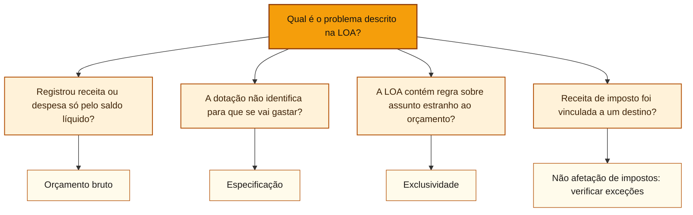

# Princípios orçamentários e vedações constitucionais

## Núcleo do conceito

A **Lei Orçamentária Anual (LOA)** informa quanto o governo espera arrecadar e quais despesas estão autorizadas para um ano. Uma **dotação orçamentária** é um valor autorizado na LOA para realizar uma despesa determinada. Por exemplo, uma dotação pode reservar R$ 200 mil para comprar equipamentos para escolas.

Os **princípios orçamentários** ajudam a verificar se essa lei foi elaborada corretamente. Cada princípio responde a uma pergunta diferente. Para acertar uma questão, identifique **qual parte do orçamento está sendo examinada**: o que entrou, os valores registrados, o detalhamento dos gastos, o conteúdo da lei ou o destino do dinheiro.

## Qual princípio está sendo cobrado?

Leia primeiro a situação concreta. Depois, associe a pergunta à regra.

| O que acontece no orçamento? | Regra que você deve verificar |
| :--- | :--- |
| O governo organiza os orçamentos fiscal, da seguridade social e de investimento na mesma LOA. | **Unidade:** os orçamentos do ente compõem um conjunto. |
| Uma receita ou despesa que deveria constar da LOA fica de fora. | **Universalidade:** o orçamento deve abranger as receitas e despesas orçamentárias exigidas. |
| A lei autoriza despesas para um exercício financeiro. | **Anualidade:** a autorização se refere ao exercício, em regra de janeiro a dezembro. |
| Uma receita de R$ 10 milhões aparece como R$ 7 milhões porque foi abatida uma despesa de R$ 3 milhões. | **Orçamento bruto:** mostrar receitas e despesas por seus valores totais, sem deduções indevidas. |
| Há uma verba única para pagar, indistintamente, pessoal, materiais e serviços, sem o detalhamento legal. | **Especificação:** identificar para que a despesa foi autorizada. |
| A LOA contém artigo criando uma secretaria, em vez de tratar do orçamento. | **Exclusividade:** limitar os assuntos da LOA ao que a Constituição permite. |
| A prefeitura determina um destino obrigatório para receita de impostos. | **Não afetação de impostos:** verificar a proibição de vincular impostos e suas exceções constitucionais. |
| Um empréstimo ou uma despesa ultrapassa limites previstos na Constituição. | **Vedações do art. 167:** identificar qual operação foi proibida e a ressalva aplicável. |

### Quatro situações da mesma prefeitura

**Orçamento bruto: quanto aparece na lei?** A prefeitura prevê arrecadar **R$ 10 milhões** e gastar **R$ 3 milhões** em uma transferência. Na LOA, registra apenas a diferença, **R$ 7 milhões**. Assim, parte do dinheiro que entra e sai desaparece da apresentação. Os dois valores deveriam ser mostrados separadamente, conforme as regras aplicáveis.

**Especificação: sabemos em que será gasto?** A prefeitura registra os R$ 10 milhões de receita e os R$ 3 milhões de despesa, mas autoriza uma única dotação para pagar, sem distinção, salários, materiais e serviços. Agora os valores aparecem, mas o gasto não está suficientemente identificado. A regra relevante é a especificação, ressalvadas as hipóteses legais de dotação global.

**Exclusividade: a LOA pode tratar desse assunto?** A prefeitura apresenta valores e dotações corretamente, mas acrescenta à LOA um artigo criando uma nova secretaria. Criar um órgão é assunto de organização administrativa, não uma previsão de receita nem uma fixação de despesa. Esse dispositivo esbarra na exclusividade.

**Não afetação: o imposto pode ter esse destino obrigatório?** A prefeitura determina que toda a arrecadação de um imposto seja reservada a uma despesa específica. A questão passa a ser se essa vinculação é permitida pela Constituição. Há uma proibição geral para **impostos**, mas existem exceções, como saúde e educação.

Os quatro problemas são independentes. Uma LOA pode respeitar orçamento bruto e, ainda assim, violar a exclusividade. **Uma regra não substitui a outra.**

### Diagrama: identifique primeiro o problema

**Como usar:** o diagrama ajuda a reconhecer a regra principal do enunciado; depois é necessário conferir as **exceções** e as condições legais em cada seção abaixo.

## Unidade, universalidade e anualidade

**Perguntas diferentes:** unidade examina integração; universalidade examina abrangência; anualidade examina o período. A mesma LOA pode atender aos três critérios sem que eles se tornem sinônimos.

O art. 2º da **Lei nº 4.320/1964** exige unidade, universalidade e anualidade. A **unidade ou totalidade** orienta a integração do orçamento de cada ente; a **universalidade** diz respeito à inclusão das receitas e despesas devidas; a **anualidade** estabelece a referência a um exercício financeiro.

| Princípio | Pergunta correta | Confusão a evitar |
| :--- | :--- | :--- |
| Unidade/totalidade | Como as peças orçamentárias de um ente se integram? | Supor que a LOA federal não pode ter três orçamentos |
| Universalidade | Quais receitas e despesas devem ser incluídas? | Trocar abrangência por ausência de classificações |
| Anualidade | A que exercício se refere a autorização? | Imaginar que nenhuma política pode durar mais de um ano |

### Unidade: a LOA inclui três orçamentos

A Constituição, art. 165, § 5º, estabelece que a **LOA federal** compreende os orçamentos **fiscal, da seguridade social e de investimento das estatais**. A separação informacional em três orçamentos não viola automaticamente o princípio da unidade. O critério é a estruturação no sistema orçamentário do mesmo ente.

A iniciativa das leis orçamentárias cabe ao Executivo, enquanto a deliberação parlamentar é parte do processo. Unidade não significa que todas as funções de elaboração, autorização, execução e fiscalização caibam ao mesmo Poder.

### Universalidade: inclusão, não ausência de classificação

A Lei nº 4.320/1964, arts. 3º e 4º, dispõe sobre o conjunto das receitas e despesas incluídas na lei orçamentária. Uma receita pode estar no orçamento da seguridade e uma despesa no orçamento fiscal, sem deixar de integrar a LOA. A separação por esfera, função ou órgão serve à **discriminação**, não à exclusão.

A universalidade deve ser lida junto às regras de receita **orçamentária e extraorçamentária**: um depósito temporário de terceiro não é receita orçamentária só porque movimentou a conta bancária do ente.

### Anualidade e vigência de créditos

O **exercício financeiro** coincide com o **ano civil** no Brasil (Lei nº 4.320/1964, art. 34). A LOA autoriza a programação de um exercício. O PPA mantém horizonte de quatro anos, e ações de políticas públicas podem continuar por vários exercícios com dotações anuais sucessivas.

Uma exceção relevante: a Constituição, art. 167, § 2º, permite reabrir no exercício seguinte saldos de **créditos especiais e extraordinários**, se autorizados nos **últimos quatro meses** do exercício anterior. Isso não converte a LOA em autorização plurianual. A regra é detalhada em [[3 - Materias/Orcamento Publico/05 - creditos adicionais e emendas parlamentares|créditos adicionais]].

## Orçamento bruto e especificação

**Fronteira:** orçamento bruto olha para os **valores integrais**, enquanto especificação olha para o **detalhamento da autorização**. A apresentação por valores brutos não dispensa discriminar a despesa.

### Orçamento bruto: registrar pelos totais

O art. 6º da Lei nº 4.320/1964 exige que receitas e despesas apareçam **pelos totais, sem deduções**. O propósito é revelar a dimensão real de cada fluxo financeiro sujeito ao orçamento.

Exemplo: se um ente arrecada R$ 10 milhões e deve transferir R$ 3 milhões a outro, apresentar apenas R$ 7 milhões pode ocultar receita e despesa que deveriam estar registradas separadamente. A transferência não deve sumir da análise por ter sido abatida do ingresso.

**Orçamento bruto não significa receita livre para gastar.** O registro de um valor integral é diferente da discussão sobre a sua **vinculação legal**.

**Caso para separar os princípios:** a prefeitura prevê arrecadar **R$ 20 milhões**, mas coloca apenas **R$ 18 milhões** no orçamento porque abateu previamente **R$ 2 milhões de despesas de arrecadação**. A falha central é de **orçamento bruto**: a receita e a despesa devem aparecer pelos **valores integrais**, em vez de serem compensadas. A pergunta da especificação é diferente: **as dotações identificam adequadamente a natureza e a finalidade dos gastos?** Registrar R$ 20 milhões de receita não resolve, por si só, um detalhamento inadequado da despesa.

### Especificação: não criar dotação indiferenciada

O art. 5º da mesma lei impede dotações globais para cobrir indistintamente despesas com pessoal, materiais, serviços e transferências, com a ressalva legal do art. 20 e seu parágrafo único. A identificação da finalidade e da categoria facilita a autorização e a fiscalização.

**A ressalva do art. 20 merece leitura literal:** seus investimentos devem ser discriminados por projetos de obras e outras aplicações; o parágrafo único admite **dotações globais, classificadas como despesas de capital, para programas especiais de trabalho que, por sua natureza, não possam seguir as normas gerais de execução da despesa**. Essa é uma hipótese específica, não autorização geral para misturar pessoal, serviços e materiais numa dotação genérica. A existência de outras reservas e regimes legalmente admitidos exige examinar a norma aplicável; não concluir que toda agregação é proibida.

**A dotação global não dispensa toda informação:** o **art. 22, IV, da Lei nº 4.320/1964** exige que a **proposta orçamentária** especifique os programas especiais custeados por dotações globais, apresentando **metas**, **estimativas dos custos das obras e serviços** e **justificativas econômica, financeira, social e administrativa**. O contraste é este: o art. 5º impõe a **regra geral de discriminação**; o art. 20, parágrafo único, abre uma **exceção para programas especiais**; o art. 22, IV, mantém **exigências de informações na proposta**. [Texto da Lei nº 4.320/1964](https://legis.senado.leg.br/norma/546169/publicacao/34620275).

**Três frases para testar a fronteira:** “toda dotação global é vedada” é falsa diante da exceção legal. “todo programa pode receber dotação global” também é falsa, pois o art. 20 exige condição específica. “a dotação global exclui a indicação de metas e custos na proposta” é falsa diante do art. 22, IV. O **programa especial de trabalho** dessa regra não deve ser confundido automaticamente com a **ação do tipo projeto** da classificação programática ou com o **GND 4, Investimentos**.

Também é importante distinguir classificação da LOA de detalhamento utilizado na execução. Ver [[3 - Materias/Orcamento Publico/04 - classificacoes da receita e da despesa|natureza, função e elemento de despesa]].

## Exclusividade e suas duas exceções constitucionais

**Exclusividade: o que pode constar na LOA?**

A LOA é uma **lei com assunto delimitado**. Sua tarefa principal é **prever as receitas** (quanto se espera arrecadar) e **fixar as despesas** (quanto se autoriza gastar). A **exclusividade** impede que essa lei seja usada para aprovar regras sem ligação com essas duas tarefas.

**Exemplo de conteúdo permitido:** a LOA prevê R$ 12 milhões de arrecadação e fixa R$ 4 milhões para despesas de educação. **Exemplo de conteúdo proibido:** a mesma LOA contém um artigo que cria uma nova secretaria municipal e define as atribuições de seus cargos. A organização administrativa precisa de tratamento legislativo próprio. Estar no mesmo documento do orçamento não transforma essa mudança em matéria orçamentária.

A Constituição Federal, no **art. 165, § 8º**, permite que a LOA contenha **duas autorizações adicionais**, mesmo que não sejam, por si, a previsão de uma receita ou a fixação de uma despesa:

**Primeira exceção: autorizar a abertura de créditos suplementares.** Crédito suplementar é o reforço de uma dotação **que já existe**. Imagine que a LOA autorize R$ 200 mil para merenda escolar e, durante o ano, esse valor se mostre insuficiente. A própria LOA pode ter autorizado previamente a abertura de créditos suplementares, dentro das condições legais. **Autorizar a abertura não significa que o valor já foi acrescentado**, nem que foi empenhado ou pago.

**Segunda exceção: autorizar a contratação de operações de crédito.** Operação de crédito é, por exemplo, um empréstimo tomado pelo governo. A LOA pode conter autorização para contratá-lo, **inclusive por antecipação de receita orçamentária (ARO)**, observadas as normas aplicáveis. Essa autorização **não é a contratação do empréstimo**. E, mesmo admitida a autorização na LOA, o **ingresso de uma ARO continua extraorçamentário**: são perguntas diferentes.

**Por que a Constituição fala em crédito suplementar, mas não em crédito especial nessa exceção?** Os nomes são parecidos, mas resolvem problemas distintos:

- **Suplementar:** aumenta uma dotação já existente.
- **Especial:** cria crédito para uma despesa sem dotação orçamentária específica.

A exceção do art. 165, § 8º, menciona **a autorização para créditos suplementares**, e não uma autorização genérica para créditos especiais. Créditos especiais seguem as regras próprias de autorização legislativa e abertura, explicadas em [[3 - Materias/Orcamento Publico/05 - creditos adicionais e emendas parlamentares|Créditos adicionais]].

**Uma confusão de prova:** o art. 167, III, trata de outro assunto, a **regra de ouro**. Nessa regra aparecem créditos **suplementares ou especiais**, com requisitos próprios. O fato de uma palavra aparecer nas duas normas não permite transportar a exceção de uma para a outra.

**Para decidir em itens C/E:** criar secretaria na LOA viola a exclusividade; autorizar créditos suplementares ou operações de crédito na LOA **pode ser permitido**. O julgamento exige conferir o conteúdo do dispositivo e os requisitos legais, não apenas a presença das palavras “crédito” ou “autorização”. [Constituição Federal, art. 165, § 8º](https://portal.stf.jus.br/constituicao-supremo/artigo.asp?abrirArtigo=165&abrirBase=CF).

## Não afetação de impostos e as exceções

**Pergunta central:** a receita de **impostos** pode ser vinculada a órgão, fundo ou despesa? A classificação por fonte/destinação registra o regime aplicável; o princípio define uma restrição constitucional sobre determinadas vinculações.

A Constituição, art. 167, IV, proíbe, como regra, a **vinculação de receita de impostos a órgão, fundo ou despesa**. A palavra **impostos** é decisiva: não se trata de uma proibição genérica de vinculação de todo ingresso, como taxas, contribuições ou preços públicos.

O próprio inciso ressalva, entre outras situações, a **repartição constitucional do produto da arrecadação**, a aplicação de recursos em **saúde** e **educação**, atividades da **administração tributária** e garantias às operações de crédito por antecipação de receita. O § 4º do art. 167 prevê outras possibilidades específicas.

A destinação de valores à manutenção e desenvolvimento do ensino dentro do regime constitucional não viola a não afetação: é **exceção prevista na própria Constituição**.

**Fronteira com fonte de recursos:** a vinculação é uma **regra jurídica de destinação**; a **classificação por fonte/destinação** registra e permite controlar as regras aplicáveis a receitas e despesas. Veja [[3 - Materias/Orcamento Publico/04 - classificacoes da receita e da despesa|classificações orçamentárias]].

## Outras vedações do art. 167

O artigo 167 reúne hipóteses distintas; o número do inciso pode ser decisivo para julgar a proposição.

| Regra | O que não confundir |
| :--- | :--- |
| Proibição de iniciar programas ou projetos não incluídos na LOA | Estar no PPA não elimina a exigência da autorização orçamentária anual |
| Proibição de despesa acima dos créditos orçamentários ou adicionais | Dotação não é sinônimo de caixa nem de pagamento |
| **Regra de ouro**: operações de crédito não devem superar despesas de capital | Não é sinônimo de meta de resultado primário |
| Proibição de abrir créditos suplementares ou especiais sem autorização e indicação de recursos | Crédito extraordinário tem regime constitucional próprio |
| Proibição de créditos ilimitados | O crédito deve ter limites orçamentários |
| Proibição de transposição, remanejamento ou transferência sem autorização legislativa | Há ressalvas constitucionais específicas; examinar o dispositivo completo |

### Regra de ouro: limite e ressalva

A **regra de ouro** (art. 167, III) compara o montante de **operações de crédito** com o de **despesas de capital**. A Constituição admite ressalva mediante créditos **suplementares ou especiais**, com **finalidade precisa**, aprovados pelo Poder Legislativo por **maioria absoluta**. Maioria absoluta é condição diferente de maioria simples.

Essa regra não é equivalente a “orçamento equilibrado”, a resultado primário zero ou ao teto de despesas. O fato de uma despesa ser de capital também não dispensa a necessidade de autorização e controle.

### Remanejamento, transposição e transferência

O art. 167, VI, contém regra geral de autorização legislativa prévia para deslocamentos entre categorias de programação ou órgãos. O § 5º prevê hipótese específica relacionada a **ciência, tecnologia e inovação**, que não pode ser ampliada por analogia a toda despesa.

Classificar o instrumento de movimentação depende do caso e das normas pertinentes. A nova dotação ainda exige a forma adequada de autorização e de registro.

## Como a banca pode cobrar

Questões C/E podem deslocar a definição de **universalidade** para **unidade**; estender a não afetação a **toda receita tributária**; afirmar que a LOA não pode conter mais de um orçamento; trocar **regra de ouro** por **resultado primário**. Em exclusividade, o distrator mais importante é confundir **autorização para créditos suplementares** (permitida na LOA) com **créditos especiais** (fora dessa exceção específica), ou achar que autorizar um empréstimo significa contratá-lo.

São mecanismos didáticos plausíveis, não estatísticas de incidência já comprovadas em provas reais Cebraspe.

## Exemplos comentados

A LOA de uma entidade federal discrimina dotações fiscais e de seguridade. Um parecer afirma que essa divisão compromete a unidade do orçamento. **Erro:** a própria Constituição prevê essa estrutura. O controle adequado pergunta se ambas as esferas estão integradas à lei e corretamente classificadas.

Uma lei orçamentária prevê arrecadação de R$ 8 milhões e gastos de R$ 8 milhões, mas inclui uma regra alterando a estrutura de uma secretaria. Mesmo que os valores estejam registrados de forma correta, o conteúdo estranho à previsão de receitas e fixação de despesas pode ferir a **exclusividade**. Equilíbrio aparente não corrige o vício.

## Questões comentadas: treino didático C/E

**Item 1.** O princípio da unidade impede que a lei orçamentária federal contenha separadamente os orçamentos fiscal e da seguridade social. **Gabarito: Errado.** A Constituição organiza três orçamentos na LOA. Unidade não exige suprimir as esferas.

**Item 2.** A regra geral de não vinculação recai sobre receitas de impostos e admite ressalvas constitucionais, como a destinação à saúde e à educação. **Gabarito: Certo.** O erro típico é ampliar o objeto para toda receita sem conferir o art. 167, IV.

**Item 3.** A regra de ouro admite, nas condições constitucionais, operações de crédito acima das despesas de capital autorizadas por créditos suplementares ou especiais com finalidade precisa e aprovação legislativa por maioria absoluta. **Gabarito: Certo.** O art. 167, III, prevê a ressalva com requisitos acumulados.

São **itens inéditos para aprendizagem**, sem afirmar equivalência a provas reais ou desempenho do estudante.

## Heurísticas

**Unidade:** estrutura do orçamento. **Universalidade:** abrangência. **Anualidade:** período. **Orçamento bruto:** valores integrais. **Especificação:** detalhamento. **Exclusividade:** conteúdo da LOA. **Não afetação:** destino de **impostos**.

Quando um item mencionar “vedado”, localizar o **inciso constitucional e suas exceções**. A maior fonte de erro não costuma ser o nome da regra, mas seu escopo.

## Relações e fontes

- [[3 - Materias/Orcamento Publico/04 - classificacoes da receita e da despesa|Classificações da receita e da despesa]]: discriminação e fonte.
- [[3 - Materias/Orcamento Publico/05 - creditos adicionais e emendas parlamentares|Créditos adicionais]]: exclusividade, anualidade e art. 167.
- [[3 - Materias/Financas Publicas/financas-publicas|Finanças Públicas]]: resultado primário e dívida, que são objetos diferentes da regra de ouro.

Fontes normativas: [Lei nº 4.320/1964, arts. 2º a 8º e 34](https://legis.senado.leg.br/norma/546169/publicacao/34620275), [Constituição Federal, arts. 165 e 167](https://legis.senado.leg.br/norma/579494/publicacao/16434817), [MCASP 11ª edição, Parte I](https://www.gov.br/tesouronacional/pt-br/contabilidade-e-custos/manuais/manual-de-contabilidade-aplicada-ao-setor-publico-mcasp-1). Recorte inicial: P3.2.2 da síntese local CGU. Exceções específicas e regimes especiais exigem consulta ao dispositivo vigente na aula.

**Estado:** artigo preparado; nenhuma sessão de estudo, retenção ou resultado competitivo foi inferido.
