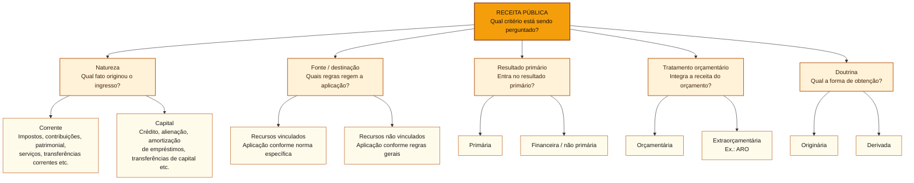

# Classificação da receita: natureza, fonte e resultado primário

## Núcleo: primeiro a pergunta, depois a classificação

A prefeitura arrecada impostos, aluga um imóvel, vende um terreno ou contrai empréstimo. Há **quatro perguntas independentes**: (1) o ingresso integra o orçamento? (2) qual operação gerou o dinheiro? (3) quais regras orientam seu uso? (4) ele entra no resultado primário? Para responder, use **tratamento orçamentário**, **natureza da receita**, **fonte/destinação** e **indicador de resultado primário**, respectivamente.

Ao examinar a natureza, siga sua **estrutura interna** (categoria econômica → origem → espécie → detalhamentos). Corrente e capital são categorias de natureza; primária e financeira são categorias de resultado fiscal. A classificação doutrinária originária/derivada forma ainda **outro** conjunto, e não um nível adicional da codificação da receita.

**Caso em quatro alterações:** IPTU recebido: receita corrente de impostos e, em regra, primária. Aluguel de prédio público: continua corrente e, em regra, primária, mas a **origem da natureza** muda para patrimonial. Venda do mesmo prédio: receita de capital por alienação de bens, em regra primária, com restrições legais de aplicação. Empréstimo comum: receita de capital por operação de crédito, **financeira**. Uma ARO, por sua vez, é ingresso **extraorçamentário**, em razão do tratamento próprio dessa operação. A intenção de usar o dinheiro ilegalmente não altera retroativamente a natureza do ingresso.

## Receita: categoria econômica e natureza

### Mapa visual: como classificar uma receita

As classificações abaixo respondem a **perguntas diferentes** sobre o mesmo ingresso. As opções de cada ramo são exemplos ou categorias próprias daquele critério, não etapas sucessivas. No site, use **ampliar** para explorar o diagrama.

**Fronteira para a prova:** corrente/capital pertence à **natureza**; primária/financeira pertence ao **resultado fiscal**; orçamentária/extraorçamentária pertence ao **tratamento do ingresso**. A fonte/destinação identifica restrições e possibilidades de aplicação, não a origem econômica. O par originária/derivada é **doutrinário**, não um nível da codificação oficial.

A natureza descreve a **origem econômica e legal do ingresso**, em níveis progressivos: categoria, origem, espécie e detalhamentos. A Lei nº 4.320/1964, art. 11, distingue:

| Categoria econômica | Exemplos usuais | Fronteira |
| :--- | :--- | :--- |
| **Receitas correntes** | Impostos, taxas, contribuições, serviços, receita patrimonial, transferências correntes | Não se confunde com “receita primária” |
| **Receitas de capital** | Operações de crédito, alienação de bens, amortização de empréstimos concedidos, transferências de capital | Nem toda receita de capital é sinônimo de receita financeira |

As **origens** agrupam ingressos dentro de cada categoria. Receita tributária e de contribuições pode envolver subdivisões específicas nos manuais, que não devem ser confundidas com a classificação doutrinária de **receitas originárias e derivadas**.

### Vocabulário das origens da receita: o que efetivamente entra no caixa?

A palavra **receita** descreve um ingresso **para quem recebe**. Um mesmo pagamento pode ser **despesa de um ente** e **receita de outro**. O nome da origem identifica **de onde veio o dinheiro e a operação que o gerou**, não necessariamente onde será aplicado. A exceção importante são as **transferências**, cuja classificação entre corrente e de capital depende da finalidade das despesas que os recursos se destinam a financiar (Lei nº 4.320/1964, art. 11).

| Origem | O que significa | Exemplo e distinção |
| :--- | :--- | :--- |
| **Contribuições** (corrente) | Valores cobrados com fundamento legal específico, como contribuições sociais e de intervenção no domínio econômico | Contribuição previdenciária. Não confundir com **contribuição de melhoria**, tributo classificado com impostos e taxas |
| **Receita patrimonial** (corrente) | Ganho pela exploração ou remuneração de patrimônio público | Aluguel de prédio público ou dividendos de participação societária. **Alugar** o imóvel é diferente de **vendê-lo** |
| **Receita de serviços** (corrente) | Valores cobrados pela prestação de serviços remunerados pelo ente público | Tarifa/preço público por serviço prestado. **Preço público** não é automaticamente **taxa tributária** |
| **Transferência corrente** | Recurso recebido de outra pessoa pública ou privada, **sem contraprestação direta ao transferidor**, destinado a financiar **despesas correntes**, como manutenção e funcionamento | Recurso recebido por município para custear serviços e comprar materiais de consumo em unidades de saúde |
| **Operação de crédito** (capital) | Entrada obtida porque o poder público **contrai uma dívida**, por empréstimo ou emissão de títulos | Estado toma empréstimo para financiar obra: entra dinheiro, mas nasce obrigação de pagar a dívida. A **antecipação de receita orçamentária (ARO)** segue tratamento **extraorçamentário** próprio |
| **Alienação de bens** (capital) | Venda ou outra transferência onerosa de bens ou direitos do patrimônio público, convertendo-os em dinheiro | Prefeitura vende imóvel ou veículo de sua propriedade. A receita **não é aluguel**; o art. 44 da LRF restringe seu uso em despesas correntes |
| **Amortização de empréstimos** (capital) | **Devolução do principal** de empréstimo que o **próprio ente público havia concedido** a alguém | Município havia emprestado R$ 100 mil e recebe R$ 20 mil de principal: isso é receita de capital. **Juros recebidos** são receita corrente na classificação pertinente |
| **Transferência de capital** | Recurso recebido de outra pessoa pública ou privada, **sem contraprestação direta ao transferidor**, destinado a financiar **despesas de capital**, como investimentos ou inversões financeiras | Município recebe recursos vinculados à construção de um hospital, e não ao custeio regular do hospital |

**O que significa “sem contraprestação direta ao transferidor”?** Contraprestação é um bem ou serviço entregue **em troca do pagamento**, diretamente a quem paga. Numa transferência, o recebedor não precisa fornecer um bem ou serviço ao ente que lhe repassou os recursos. Exemplo: a União transfere recursos a um município para construir uma escola destinada à população. A escola não é uma contraprestação prestada à União.

**Atenção à pegadinha:** ausência de contraprestação direta **não significa ausência de obrigações**. O município pode estar obrigado a aplicar o dinheiro na finalidade prevista, executar a obra e prestar contas à União. **Contraprestação direta ao transferidor** e **obrigação de aplicar e comprovar o uso dos recursos** são conceitos diferentes.

Há ainda **receitas agropecuárias** (exploração econômica de atividades vegetais e animais pelo ente), **industriais** (produção ou comercialização industrial pelo ente) e **outras receitas correntes ou de capital** (ingressos que não se enquadram nas demais origens, segundo o classificador vigente).

**Comparação no mesmo hospital:** receber transferência para comprar medicamentos e manter o atendimento é **transferência corrente**; receber transferência destinada à **construção** do hospital é **transferência de capital**. Em ambos os casos, a categoria é analisada sob a perspectiva do **ente recebedor**. O instrumento e a destinação legal devem ser conferidos: não classificar toda transferência entre governos automaticamente como de capital.

**Outro contraste:** se o Estado **toma** empréstimo, registra **operação de crédito**. Se o Estado **emprestou** e recebe de volta o principal, registra **amortização de empréstimos concedidos**. Se vende um imóvel, registra **alienação**; se apenas recebe aluguel do imóvel, registra **receita patrimonial**. São fatos econômicos diferentes, ainda que todos façam entrar dinheiro.

Para distinguir **origem da receita** de **fonte/destinação**, consulte [[3 - Materias/Orcamento Publico/04 - classificacoes da receita e da despesa#Fonte/destinação de recursos × natureza da receita|as regras de vinculação]]. Para distinguir a **operação de crédito comum** da **ARO**, veja [[3 - Materias/Orcamento Publico/07 - receitas publicas e estagios#Operações de crédito × antecipação de receita (ARO)|o tratamento extraorçamentário]].

### Originária × derivada

**Doutrina jurídica** é o conjunto de estudos, interpretações e conceitos elaborados por especialistas em Direito para compreender e organizar as normas jurídicas. Uma classificação doutrinária ajuda a explicar um fenômeno; **não tem, por si só, a força de uma lei**. A importância da doutrina para a interpretação do Direito é explicada por [Maria Helena Diniz, *Fontes do direito*](https://enciclopediajuridica.pucsp.br/verbetes/fontes-do-direito/).

Na doutrina, receitas **originárias** decorrem, em regra, da exploração do patrimônio ou de atividades econômicas do Estado; receitas **derivadas** decorrem do poder de imposição, como tributos. A distinção pergunta **de que maneira o Estado obtém o dinheiro**. Já a classificação **oficial por natureza** responde **que operação produziu o ingresso** e possui categoria econômica, origem e espécie, entre outros níveis.

| Fato | Classificação doutrinária | Natureza oficial da receita |
| :--- | :--- | :--- |
| Aluguel de imóvel público | Originária | Receita corrente patrimonial |
| Imposto sobre a propriedade predial e territorial urbana (IPTU) | Derivada | Receita corrente de impostos |
| Venda de imóvel público | Originária, em regra | Receita de capital por alienação de bens |

**Heurística:** *originária* não é sinônimo de *patrimonial*. A expressão **receita originária** pertence à doutrina; a palavra **origem** na classificação por natureza nomeia outro nível de organização das receitas. Os critérios podem descrever o mesmo recebimento sem conflito. Ver também [[3 - Materias/Orcamento Publico/lembretes-e-distincoes-para-prova|Lembretes e distinções para a prova]].

### Receita orçamentária × ingresso extraorçamentário

O **ingresso orçamentário** incorpora a execução da receita e é classificado nas rubricas aplicáveis. Uma **entrada extraorçamentária** tende a ser temporária, com obrigação de devolução ou repasse, sem produzir receita orçamentária no mesmo sentido.

**Operações de crédito** contratadas para financiamento público são, em regra, receitas **orçamentárias de capital**. Já a operação de crédito por **antecipação de receita orçamentária (ARO)** é tratada como ingresso **extraorçamentário**, por sua função específica de gestão de caixa. O fato de as duas operações serem empréstimos não as coloca no mesmo tratamento orçamentário.

Os estágios **previsão, lançamento, arrecadação e recolhimento** pertencem a outra dimensão: cronologia de realização da receita. Uma receita não é “corrente” ou “de capital” porque se encontra num desses estágios.

### Exemplo contrastivo: dois empréstimos, duas classificações

Um ente contrata financiamento para **construir um laboratório durante os próximos exercícios**. A entrada oriunda de operação de crédito comum, observadas as normas pertinentes, constitui **receita orçamentária de capital**. Em outro cenário, o ente realiza uma **operação de crédito por antecipação de receita orçamentária (ARO)** para enfrentar insuficiência **temporária de caixa** enquanto aguarda arrecadação: trata-se de **ingresso extraorçamentário** na classificação aplicável.

As duas operações podem envolver captação de dinheiro, mas a distinção para a prova não depende só da palavra *empréstimo*: a **finalidade e a espécie da operação** determinam seu tratamento. Tampouco se deve confundir o ingresso da ARO com a própria receita tributária que futuramente será arrecadada; são fatos distintos, sujeitos às regras específicas da Lei nº 4.320/1964 e da LRF.

## Fonte/destinação de recursos × natureza da receita

A **natureza** responde: *qual fato econômico originou o ingresso?* A **fonte/destinação** responde: *quais são as regras de aplicação desses recursos e em que despesas poderão ser utilizados?*

A fonte/destinação reúne receitas com **normas de aplicação semelhantes** e é empregada tanto na receita quanto na despesa, permitindo verificar o financiamento de ações e suas vinculações. Uma mesma ação pode ser financiada por fontes distintas, quando legalmente permitido.

Exemplo: duas entradas patrimoniais com natureza semelhante podem ter destinações diferentes, a depender das regras aplicáveis. A origem econômica não determina automaticamente o vínculo. Da mesma forma, “fonte de recurso” não equivale a “origem da receita” na estrutura por natureza.

**Atenção:** a vedação constitucional de vincular receitas de **impostos** tem exceções específicas; a existência do classificador de fonte não autoriza inventar uma vinculação. Ver [[3 - Materias/Orcamento Publico/03 - principios orcamentarios e vedacoes constitucionais|não afetação e suas exceções]].

## Primária × financeira: efeito no resultado primário

O **identificador de resultado primário** distingue receitas que entram no cálculo do resultado primário das que ficam fora dele, conforme a regra fiscal aplicável. É uma classificação **independente** da categoria econômica corrente/capital.

Não é correto resolver automaticamente por equivalência:
- toda receita corrente seria primária;
- toda receita de capital seria financeira;
- toda receita financeira seria ingresso extraorçamentário.

Essas proposições confundem **três dimensões diferentes**. Juros, financiamento e operações de capital precisam ser identificados pelas regras específicas do indicador. Consulte [[3 - Materias/Financas Publicas/financas-publicas|Finanças Públicas]] para o cálculo e a interpretação dos resultados fiscais.

### Caso progressivo: a escola, a dívida e o resultado fiscal

A prefeitura precisa construir uma escola. Se contrata um **empréstimo comum** para financiar a obra, registra **receita orçamentária de capital**, na origem operações de crédito. Se contrata uma **ARO** para cobrir falta temporária de caixa enquanto aguarda a arrecadação, tem **ingresso extraorçamentário**. O fato de ambos exigirem devolução não permite classificá-los igualmente.

Agora altere a operação: o município **aluga** um imóvel de sua propriedade. O aluguel é **receita corrente patrimonial**; a receita também pode ser denominada **originária** na classificação doutrinária. Se **vende** o imóvel, registra **receita de capital por alienação de bens**. Nesse segundo caso, a natureza da entrada permanece a mesma ainda que o gestor pretenda usá-la indevidamente: a restrição à aplicação em despesa corrente, com a exceção legal de previdência, é matéria do **art. 44 da LRF**, observada na destinação dos recursos.

Por fim, uma mesma receita pode ser **de capital e primária** (alienação de bem, em regra) ou **de capital e financeira** (operação de crédito comum). A receita de juros de aplicação financeira costuma ser **corrente e financeira**, enquanto o IPTU é **corrente e primária**. As duas duplas têm critérios próprios: corrente/capital é categoria econômica; primária/financeira diz respeito ao resultado fiscal.

| Ingresso | Tratamento/natureza | Resultado primário, em regra |
| :--- | :--- | :--- |
| IPTU | Receita orçamentária corrente, impostos | Primária |
| Aluguel de prédio público | Receita orçamentária corrente, patrimonial | Primária |
| Venda de terreno | Receita orçamentária de capital, alienação de bens | Primária |
| Empréstimo comum | Receita orçamentária de capital, operação de crédito | Financeira |
| ARO para insuficiência temporária de caixa | Ingresso extraorçamentário | Não é receita orçamentária primária |

Esse quadro é um **contraste entre critérios**, e não autorização para usar livremente os recursos. Para cada ingresso, conferir a fonte/destinação e as restrições legais efetivas.

## Questões comentadas: distinções entre conjuntos (treino didático C/E)

**Item 1.** Como a alienação de um bem público gera receita de capital, seu ingresso é necessariamente financeiro para efeito do resultado primário. **Gabarito: Errado.** A natureza capital não define o indicador primário; alienação é, em regra, primária.

**Item 2.** O ingresso de operação de crédito comum e o de ARO podem receber o mesmo tratamento orçamentário apenas porque ambos exigem devolução. **Gabarito: Errado.** ARO possui tratamento extraorçamentário próprio, enquanto crédito comum é, em regra, receita orçamentária de capital.

Itens inéditos e didáticos, sem alegação de calibração com prova real.

## Relações e fontes

- [[3 - Materias/Orcamento Publico/04 - classificacoes da receita e da despesa|Mapa transversal de classificações]].
- [[3 - Materias/Orcamento Publico/03 - principios orcamentarios e vedacoes constitucionais|Princípios e não afetação de impostos]]; [[3 - Materias/Orcamento Publico/07 - receitas publicas e estagios|Estágios da receita]].
- [Lei nº 4.320/1964, art. 11](https://legis.senado.leg.br/norma/546169/publicacao/34620275); [LRF, art. 44](https://www.planalto.gov.br/ccivil_03/leis/lcp/lcp101.htm); [MTO 2026](https://www1.siop.planejamento.gov.br/mto/doku.php/mto2026); [MCASP 11ª edição](https://www.gov.br/tesouronacional/pt-br/contabilidade-e-custos/manuais/manual-de-contabilidade-aplicada-ao-setor-publico-mcasp-1).

