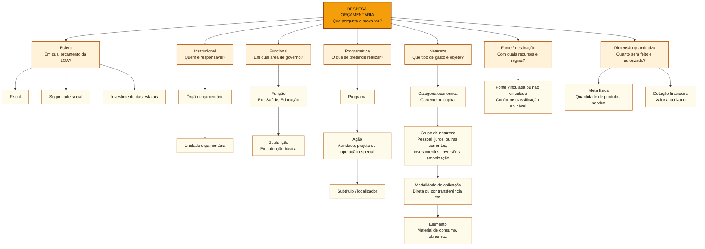

# Classificação da despesa: esfera, função, programa e natureza

## Núcleo: que pergunta cada registro de despesa responde?

Uma obra na escola recebe vários identificadores **ao mesmo tempo**. O órgão/unidade responde **quem**; a função/subfunção responde **em qual área**; programa/ação/subtítulo responde **o que o governo fará**; categoria econômica/GND/modalidade/elemento responde **que tipo e objeto de gasto**; fonte responde **com quais recursos e regras**; esfera aponta **em qual orçamento da LOA**; meta física e dotação indicam **entrega prevista e valor autorizado**.

**Caso progressivo:** construir seis salas é um **projeto** na programação e, em regra, **Investimentos** no Grupo de Natureza da Despesa (GND). Mude somente o objeto do gasto para manutenção rotineira: a natureza tende a ser **Outras Despesas Correntes**, enquanto a área Educação e a unidade responsável podem permanecer iguais. Mude novamente a forma de execução: se o próprio município contrata e paga a empresa, pode haver **Aplicações Diretas** mesmo que o serviço seja feito por terceiro. Modalidade de aplicação não é modalidade de licitação.

## Despesa: perguntas qualitativas e quantitativas

### Mapa visual: cada classificação da despesa e suas opções

Cada ramo caracteriza a **mesma despesa por um ângulo distinto**. Os níveis dentro de cada ramo, quando houver, formam sua hierarquia específica. O quadro reúne opções para reconhecer o critério em enunciados de prova.

**Atenção:** as categorias dentro de natureza seguem uma sequência; esfera, natureza, função e programa **não** seguem uma sequência entre si. O exemplo de opções não substitui os códigos e desdobramentos vigentes no MTO. A meta física mede o produto previsto ou realizado, enquanto a dotação é expressa em dinheiro.

| Dimensão | Pergunta | Componentes |
| :--- | :--- | :--- |
| **Esfera** | Em qual orçamento da LOA federal? | Fiscal, seguridade ou investimento das estatais |
| **Institucional** | Quem é responsável pela programação? | Órgão orçamentário e unidade orçamentária |
| **Funcional** | Em qual área de atuação governamental? | Função e subfunção |
| **Programática** | Qual objetivo e ação serão realizados? | Programa, ação e subtítulo |
| **Natureza** | Que tipo econômico de gasto e objeto? | Categoria econômica, grupo, modalidade de aplicação, elemento |
| **Fonte/destinação** | Qual recurso financiará a despesa e sob que regras? | Fonte de recursos |
| **Física e financeira** | Quantos bens ou serviços e qual dotação? | Meta física e valor |

Esses elementos não competem pela mesma posição. O registro da despesa possui várias dimensões ao mesmo tempo.

### Exemplo guiado: um mesmo gasto visto por várias classificações

Considere um **caso hipotético**, sem códigos de programação oficiais: o Ministério da Saúde prevê comprar diretamente seringas descartáveis para uma ação de vacinação. A mesma despesa recebe diferentes classificações, porque cada uma responde a uma pergunta:

| Pergunta | Classificação | Resposta no exemplo |
| :--- | :--- | :--- |
| Em qual orçamento da LOA? | **Esfera** | Seguridade social, por se tratar de ação de saúde |
| Quem responde pela programação? | **Institucional** | Órgão Ministério da Saúde e unidade orçamentária correspondente |
| Qual a área de governo? | **Funcional** | Saúde (função); subfunção conforme a programação |
| Qual política e ação? | **Programática** | Programa hipotético de imunização; ação de vacinação |
| Que despesa será feita? | **Natureza** | Corrente → Outras Despesas Correntes → Aplicações Diretas → Material de Consumo |
| Que recursos podem financiá-la? | **Fonte/destinação** | A fonte orçamentária e suas regras legais de aplicação |
| Quanto será entregue e autorizado? | **Dimensões física e financeira** | Quantidade de seringas e valor da dotação |

As sete respostas aparecem **lado a lado**, no registro de uma despesa. Não são sete degraus da mesma hierarquia. Dentro de **natureza**, por outro lado, há níveis ordenados: categoria econômica, grupo, modalidade e elemento. “Ministério” ou “secretaria” é informação institucional; “programa” e “ação” são informação programática.

**Teste de fronteira:** uma universidade federal compra papel e depois constrói um laboratório. Em regra, as duas despesas ficam no **orçamento fiscal**. A compra de papel é corrente; a construção é de capital, no GND Investimentos. A esfera permaneceu igual, enquanto a natureza mudou. Já a construção de uma unidade pública do SUS pode ser despesa de capital no **orçamento da seguridade social**.

### Esfera × natureza da despesa

A **esfera** identifica orçamento **fiscal**, **seguridade social** ou **investimento das estatais**, segundo o art. 165, § 5º, da Constituição. A **categoria econômica**, por sua vez, separa gastos **correntes** e de **capital**.

Uma obra pública em hospital administrado diretamente pela União pode ser despesa **de capital** no **orçamento da seguridade social**. Capital não equivale à esfera de investimento das empresas estatais.

Nas empresas estatais, é preciso distinguir **controle acionário** de **dependência financeira**: ter a maioria do **capital social votante** define uma empresa **controlada** (LRF, art. 2º, II), mas não a torna automaticamente **dependente**. Esta última condição envolve o recebimento de recursos do ente controlador para pagar pessoal, custeio ou despesas de capital, com exceção legal relativa a aumento da participação acionária (LRF, art. 2º, III). Em regra, estatais **dependentes** integram o orçamento **fiscal ou da seguridade**, e os investimentos das **não dependentes**, o orçamento **de investimento**. Veja a [[3 - Materias/Orcamento Publico/02 - ppa ldo e loa#Empresa controlada × estatal dependente × estatal não dependente|distinção, seus três critérios e o exemplo comparativo]].

### Classificação institucional: órgão × unidade orçamentária

Na União, a classificação institucional é formada por **órgão orçamentário** e **unidade orçamentária (UO)**. O órgão pode agrupar várias unidades; a unidade recebe dotações e responde pelo programa de trabalho no formato orçamentário. A UO não precisa coincidir exatamente com uma repartição administrativa física: fundos e encargos podem ter representação própria.

A pergunta institucional é **“quem?”**, e não “para quê?” ou “em qual área de política pública?”.

**Caso de classificação:** uma **universidade federal** recebe dotação para o **programa hipotético de permanência estudantil**, que inclui uma ação de apoio aos alunos. A universidade ou unidade orçamentária responsável pertence à **classificação institucional**; o programa e a ação, à **programática**. Não é preciso conhecer o código da unidade para acertar a fronteira: primeiro perguntar **quem responde pela programação**, depois **qual objetivo e ação** serão executados.

### Classificação funcional: função × subfunção

A **função** é o nível mais amplo de agregação da despesa por área de governo: Educação, Saúde, Legislativa, Cultura e outras. A **subfunção** indica uma agregação inferior, mais relacionada à natureza da atuação.

A classificação permite **matricialidade**: subfunção combinada com função distinta daquela a que está mais tipicamente associada. Exemplo de estrutura descrita no MTO: uma ação de apoio pré-escolar a dependentes de servidores de órgão legislativo pode combinar função **Legislativa** e subfunção **Educação Infantil**. A subfunção não fica necessariamente vinculada à função de mesmo campo temático.

Esse princípio de combinação possui regras especiais para certas despesas, como as classificadas em Encargos Especiais. Portanto, não presumir liberdade irrestrita de combinação.

### Classificação programática: programa × ação × subtítulo

O **programa** organiza esforços relacionados a objetivos de política pública. A **ação orçamentária** identifica o que será feito. O **subtítulo** contribui para localizar a execução ou os beneficiários.

Há três tipos clássicos de ação:

| Tipo | Característica | Exemplo didático |
| :--- | :--- | :--- |
| **Projeto** | Operação delimitada no tempo, geralmente voltada à expansão ou aperfeiçoamento da atuação | Construção de escola |
| **Atividade** | Ação contínua de manutenção das atividades governamentais | Funcionamento de unidades escolares |
| **Operação especial** | Despesa da qual não resulta diretamente bem ou serviço típico da ação produtiva estatal | Serviço da dívida, conforme programação |

**Projeto não determina automaticamente GND Investimentos.** Tipo de ação e natureza do gasto são dimensões separadas. Também não se deve transformar “subfunção” em “programa”: uma indica área de atuação, o outro organiza a política e sua estratégia de entrega.

### Caso progressivo: ação, GND e pagamento da dívida

A prefeitura **constrói seis novas salas**: na dimensão programática, trata-se de um **projeto**; na natureza da despesa, a obra integra o **GND 4: Investimentos**. Quando mantém **aulas e serviços escolares regulares**, a ação pode ser uma **atividade**. Já o **pagamento do principal de uma dívida** pode figurar como **operação especial**, enquanto a natureza do gasto é **despesa de capital, GND 6: Amortização da Dívida**. O nome da ação não determina seu GND: um mesmo projeto pode executar gastos de grupos diferentes.

A prefeitura paga uma parcela bancária que contém **R$ 100 mil de principal e R$ 20 mil de juros**. O principal é **GND 6, despesa de capital**; os juros são **GND 2: Juros e Encargos da Dívida, despesa corrente**. A classificação de receita de capital atribuída ao empréstimo na contratação não se transfere para os juros do pagamento.

A distinção entre **projeto, atividade e operação especial** responde à natureza e à finalidade da **ação orçamentária**. A distinção entre **Investimentos, Inversões Financeiras e Amortização da Dívida** responde à **natureza econômica da despesa**.

### Natureza da despesa: categoria, GND, modalidade e elemento

A natureza da despesa responde **qual é o tipo e o objeto do gasto**. A classificação inclui:

| Nível | O que identifica | Exemplo |
| :--- | :--- | :--- |
| **Categoria econômica** | Despesa corrente ou de capital | Capital |
| **Grupo de Natureza de Despesa (GND)** | Grupo econômico: pessoal e encargos, juros e encargos da dívida, outras correntes, investimentos, inversões financeiras ou amortização da dívida | Investimentos |
| **Modalidade de aplicação** | Se os recursos serão aplicados diretamente ou transferidos e por qual modalidade | Aplicações diretas |
| **Elemento** | Objeto que se pretende adquirir ou contratar | Equipamentos e material permanente |

**Leitura passo a passo:** a **categoria econômica** separa despesas correntes e de capital; dentro dela, o **Grupo de Natureza de Despesa (GND)** aproxima gastos economicamente semelhantes; a **modalidade de aplicação** indica quem aplicará os recursos ou como serão transferidos; o **elemento** identifica o objeto adquirido ou contratado.

| Categoria econômica | Grupos de Natureza de Despesa (GND) |
| :--- | :--- |
| **Correntes** | Pessoal e Encargos Sociais; Juros e Encargos da Dívida; Outras Despesas Correntes |
| **De capital** | Investimentos; Inversões Financeiras; Amortização da Dívida |

**Lembrete dos números:** os GNDs **1, 2 e 3** são correntes; **4, 5 e 6** são de capital. O grupo indica **a categoria econômica ampla** do gasto, enquanto o elemento indica **o objeto** que se adquire ou paga. Elemento pode abranger bens, serviços e outros objetos, não se limita a coisas intangíveis. A síntese está em [[3 - Materias/Orcamento Publico/lembretes-e-distincoes-para-prova|Lembretes e distinções para a prova]].

“Corrente” é categoria econômica, e **não quer dizer frequente**. “Capital” também não significa gasto de grande valor. Pagar juros da dívida é despesa corrente; devolver o principal é despesa de capital (Amortização da Dívida). Construir um laboratório ou adquirir equipamento novo pode entrar em **Investimentos**; certas compras de imóveis sem vinculação à execução de obras e certas participações societárias são **Inversões Financeiras**. A classificação exata depende das condições legais: comprar algo pronto **não transforma qualquer bem em inversão financeira**.

**O terceiro nível, modalidade de aplicação, tem outra lógica:** se o ministério compra diretamente as seringas, a modalidade é **Aplicações Diretas**. Se a União transfere recursos para um município executar a despesa, a modalidade pode ser **Transferências a Municípios**, segundo o instrumento aplicável. Isso não equivale a dizer que “aplicação direta é investimento”: os grupos e a modalidade respondem a perguntas independentes.

**O quarto nível, elemento, dá nome orçamentário ao objeto:** seringas e papel podem ser **Material de Consumo**; computadores e equipamentos duradouros, **Equipamentos e Material Permanente**. “Seringa” é o bem concreto; “Material de Consumo” é o elemento no classificador. **GND ≠ elemento; modalidade ≠ elemento; modalidade de aplicação ≠ modalidade de licitação.**

**GND não é elemento.** O GND **investimentos** agrupa gastos de capital; “equipamentos e material permanente” especifica um **elemento**. Modalidade de **aplicação** não é modalidade de **licitação**.

A **despesa com serviço corrente de limpeza** pode ter classificação por função Educação e, ao mesmo tempo, GND **Outras Despesas Correntes**, com elemento de serviço aplicável. Sua função não modifica a natureza econômica.

### Fronteiras progressivas: obra, imóvel e modalidade de aplicação

Na escola, **manutenção rotineira** (pintura simples, troca de lâmpadas, reparos habituais) é, em regra, **despesa corrente**, em Outras Despesas Correntes. A **ampliação com novas salas** é **despesa de capital**, em Investimentos. O fato de os dois serviços ocorrerem no mesmo imóvel não determina uma classificação única. Intervenções estruturais e obras devem ser examinadas conforme seu objeto efetivo.

Se a prefeitura compra **terreno necessário à execução da obra**, a aquisição integra **Investimentos (GND 4)**. Se compra **prédio existente e já em utilização**, sem vínculo com execução de obras, a aquisição se enquadra em **Inversões Financeiras (GND 5)**, observadas as condições normativas. A compra de **computadores novos** normalmente é Investimentos: o critério não é simplesmente comprar algo pronto.

Se o município **contrata e paga diretamente a construtora**, a modalidade é **Aplicações Diretas (90)**, mesmo que a obra seja fisicamente executada por empresa privada. Não confundir **contratação de serviço** com **repasse de recursos para outra entidade aplicá-los**. Na mesma obra, o GND pode ser Investimentos e o **elemento** pode ser Obras e Instalações. Na compra de computadores, o GND continua Investimentos, mas o elemento passa a Equipamentos e Material Permanente.

### Transferência: despesa de quem envia × receita de quem recebe

Considere duas perspectivas da **mesma transferência hipotética**: a União envia recursos a um município para custear atendimento em saúde, e o município recebe esse dinheiro para executar a ação. **Na União**, o gasto precisa ser examinado como **despesa**: a modalidade de aplicação pode indicar *Transferências a Municípios*. **No município**, o ingresso é examinado como **receita orçamentária**: quando destinado ao financiamento de despesas correntes, corresponde a transferência corrente, observadas as regras de classificação.

Se os recursos recebidos forem destinados **à construção de um equipamento público**, pode haver, no orçamento municipal, **receita de transferência de capital**. Isso não transforma “Transferências a Municípios” em categoria econômica de receita: a modalidade responde **como o ente que paga aplica os recursos**, enquanto a natureza da receita responde **qual ingresso o ente recebedor registra**. Em casos concretos, é preciso verificar instrumento, finalidade e classificadores do exercício. A classificação da receita recebida **não decorre automaticamente do nome da modalidade** na despesa de quem transfere.

**Regra de prova:** antes de classificar, identifique **quem é o ente** e se a questão observa a **despesa de quem transfere** ou a **receita de quem recebe**. Essa troca de ponto de vista permite um distrator com nomes tecnicamente verdadeiros, mas usados na categoria errada.

### Dimensões física e financeira da programação

**Meta física** indica quantidade de entregas programadas. **Dotação financeira** identifica valor autorizado segundo a programação. Se foram previstos 500 atendimentos e entregues 350, o resultado deve ser examinado com dados físicos e financeiros, além do contexto de implementação.

A dotação não comprova empenho, pagamento nem resultado da política. O tema se relaciona a [[3 - Materias/Avaliacao de Politicas Publicas/avaliacao-de-politicas-publicas|monitoramento e avaliação]], mas a execução da despesa não substitui avaliação de impacto.

### Ponte para os estágios da execução

Se o orçamento autoriza **R$ 1,5 milhão** para construir **seis salas**, a **dotação** responde *quanto se pode gastar* e a **meta física** responde *o que se pretende entregar*. Se quatro salas forem concluídas, a entrega física é de **4/6**, ainda que a despesa tenha tido execução financeira integral. A simples existência da dotação **não comprova** contratação, empenho, liquidação ou pagamento.

Os estágios **empenho, liquidação e pagamento** têm procedimento próprio no [[3 - Materias/Orcamento Publico/08 - despesas publicas e estagios|artigo 08: despesas públicas e estágios]]. O estudo detalhado desses estágios deve ficar naquele artigo, para não confundir classificação da despesa com execução da despesa.

## Questões comentadas: transposição de conjuntos (treino didático C/E)

**Item 1.** Uma despesa classificada no GND Investimentos deve integrar o orçamento de investimento das estatais, mesmo quando executada diretamente por uma universidade federal. **Gabarito: Errado.** Esfera orçamentária e natureza do gasto pertencem a conjuntos diferentes.

**Item 2.** Uma ação classificada como projeto pode envolver grupos de natureza de despesa distintos, porque o tipo de ação pertence à classificação programática. **Gabarito: Certo.** Projeto responde qual tipo de ação está sendo realizada; GND responde à natureza econômica do gasto.

Itens inéditos para aprendizagem, sem equivalência afirmada com provas reais.

## Relações e fontes

- [[3 - Materias/Orcamento Publico/04 - classificacoes da receita e da despesa|Mapa transversal de classificações]]; [[3 - Materias/Orcamento Publico/02a - esferas da loa e estatais dependentes|Esferas da LOA e estatais]].
- [[3 - Materias/Orcamento Publico/08 - despesas publicas e estagios|Estágios da despesa]] e [[3 - Materias/Orcamento Publico/06 - programacao orcamentaria e contingenciamento|Programação financeira]].
- [MTO 2026](https://www1.siop.planejamento.gov.br/mto/doku.php/mto2026); [MTO, capítulo 4](https://www1.siop.planejamento.gov.br/mto/doku.php?id=mto:cap4); [Lei nº 4.320/1964, art. 12](https://legis.senado.leg.br/norma/546169/publicacao/34620275); [MCASP 11ª edição](https://www.gov.br/tesouronacional/pt-br/contabilidade-e-custos/manuais/manual-de-contabilidade-aplicada-ao-setor-publico-mcasp-1).

