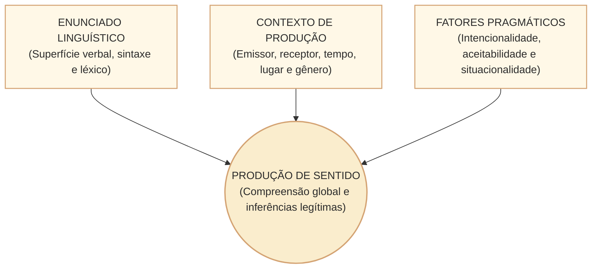
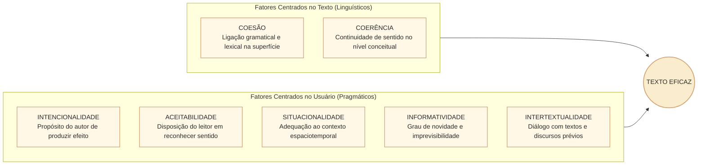
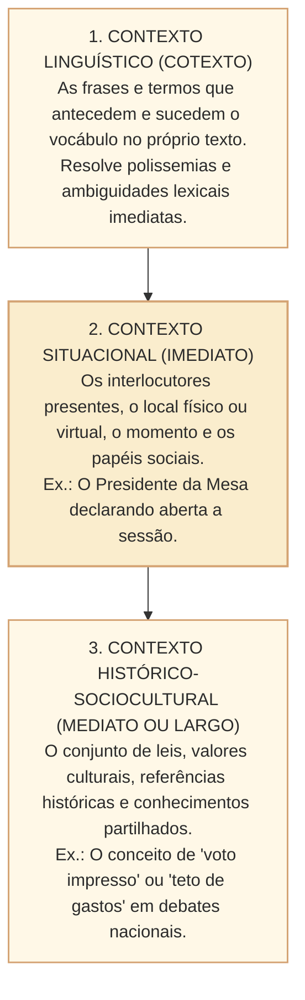
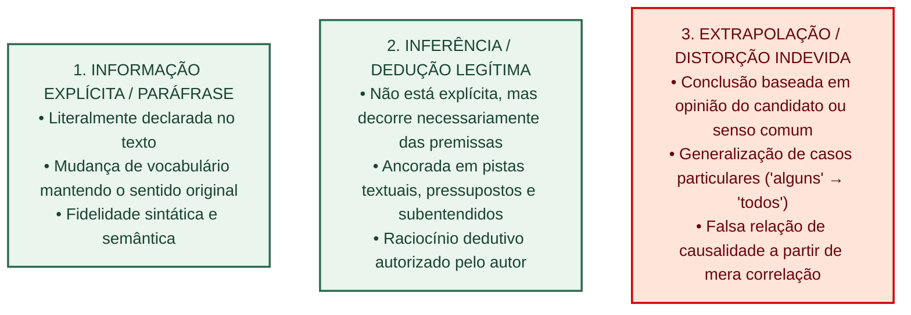
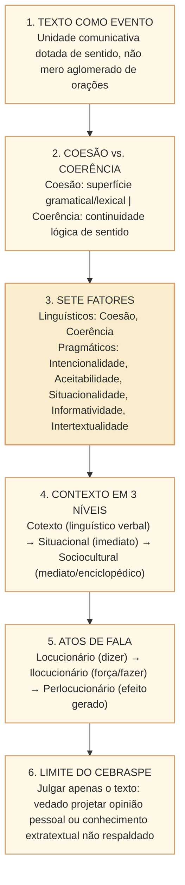

# Texto, contexto e produção de sentido: fatores de textualidade e pragmática no padrão Cebraspe

## 1. Situação concreta e o conceito de texto como evento comunicativo

Na comunicação institucional e no processo legislativo, o texto não é um mero aglomerado de frases gramaticalmente corretas, nem um repositório estático de palavras isoladas. Um relatório de consultoria, um parecer da Comissão de Constituição e Justiça e de Cidadania (CCJC) ou uma notícia da Agência Câmara constituem **eventos comunicativos** que adquirem sentido somente na interação entre interlocutores situados no tempo, no espaço e em uma comunidade discursiva.

Nas provas do **Cebraspe**, as questões de compreensão e interpretação avaliam se o candidato compreende o texto como uma **unidade de sentido** dotada de intencionalidade, contextualidade e coerência global. A banca não cobra apenas regras formais de sintaxe, mas a forma como os fatores pragmáticos condicionam a leitura e impedem extrapolações indevidas.

---

## 2. Os Sete Fatores de Textualidade (Beaugrande e Dressler)

A teoria da textualidade desenvolvida por Robert-Alain de Beaugrande e Wolfgang Dressler estabelece que um evento verbal só atinge o estatuto de texto se cumprir sete fatores constitutivos fundamentais, divididos entre a materialidade linguística e as condições pragmáticas de recepção:

### 2.1. Fatores centrados no texto: Coesão versus Coerência

| Dimensão | Coesão Textual | Coerência Textual |
| :--- | :--- | :--- |
| **Natureza** | Sintática, gramatical e morfológica (superfície textual). | Semântica, conceitual e cognitiva (estrutura profunda de sentido). |
| **Mecanismos** | Pronomes, elipses, conjunções, sinônimos, tempos verbais, concordância. | Compatibilidade de ideias, ausência de contradição, encadeamento lógico de causas e efeitos. |
| **Localização** | Visível e tangível nas palavras e conectores do parágrafo. | Construída mentalmente pelo leitor a partir do texto e de seu conhecimento de mundo. |
| **Autonomia relativa** | Um texto pode ser coeso mas incoerente (ex.: frases perfeitamente articuladas por conectivos, mas cujo conteúdo se contradiz). | Um texto pode ser coerente mesmo com coesão implícita ou elíptica (ex.: provérbios, manchetes e avisos rápidos). |

> **Pegadinha clássica do Cebraspe:** A banca costuma propor que *"a ausência de conectivos explícitos entre duas orações compromete necessariamente a coerência do texto"*. **Gabarito habitual: ERRADO.** A coerência decorre da compatibilidade lógica entre as ideias; a relação semântica de causa, oposição ou conclusão pode subsistir de forma justaposta (assindética), sem conectivo formal.

### 2.2. Fatores centrados no usuário: Pragmática e Contexto

1. **Intencionalidade**: Refere-se ao empenho do autor em produzir um discurso coeso e coerente capaz de atingir seus objetivos comunicativos (informar, persuadir, regulamentar ou advertir). No processo legislativo, a intencionalidade de um projeto de lei é materializada na sua *Justificação*.
2. **Aceitabilidade**: Refere-se à atitude do leitor em esperar que a manifestação linguística constitua um texto compreensível, relevante e dotado de propósito. Sem cooperação interpretativa (Princípio de Cooperação de Paul Grice), a comunicação se desfaz.
3. **Situacionalidade**: Refere-se à pertinência do texto à situação comunicativa em que ocorre. Um discurso parlamentar em plenário admite figuras de retórica e apelos emocionais que seriam impróprios em um parecer estritamente técnico de consultoria de orçamento.
4. **Informatividade**: Mede o grau de novidade ou previsibilidade que o texto aporta. Textos de baixíssima informatividade são redundantes e enfadonhos; textos de informatividade excessivamente alta sem contextualização tornam-se herméticos e incompreensíveis para o público-alvo.
5. **Intertextualidade**: Diz respeito à dependência de um texto em relação ao conhecimento prévio de outros textos (leis que alteram leis anteriores, citações doutrinárias, alusões históricas ou paródias).

---

## 3. O Contexto: Dimensões Pragmáticas de Análise

O sentido de uma mensagem depende da articulação de três camadas contextuais distintas:

- **Cotexto (*Linguistic Context*)**: o ambiente verbal imediato. O vocábulo *"massa"*, isolado, é polissêmico (pode designar culinária, física, multidão ou gesso). Inserido no cotexto *"a massa parlamentar da base governista aprovou o requerimento"*, o cotexto define categoricamente o sentido unívoco de agrupamento coletivo de pessoas.
- **Contexto Situacional**: as circunstâncias da enunciação. Se um orador em plenário diz *"peço a palavra pela ordem"*, o sentido desse ato de fala repousa na vigência do Regimento Interno da Casa e no papel do orador como deputado diplomado.
- **Contexto Sociocultural**: o repertório enciclopédico de mundo partilhado entre autor e leitor. Permite que o leitor reconheça alusões constitucionais sem que o autor precise redigitar a história da República a cada artigo.

---

## 4. Pragmática e Atos de Fala no Discurso Institucional

A Pragmática estuda a linguagem em uso. Conforme a teoria clássica dos atos de fala formulada por John L. Austin e John Searle, ao pronunciar enunciados, os agentes públicos realizam ações no mundo social:

1. **Ato Locucionário**: o ato físico e linguístico de pronunciar ou grafar fonemas e palavras com significado determinado (a sentença gramatical em si).
2. **Ato Ilocucionário**: a força ou a função institucional pretendida com o enunciado (afirmar, prometer, ordenar, sancionar, nomear, revogar). No Diário Oficial, a frase *"Fica exonerado o servidor X"* não é um relato descritivo, mas um ato ilocucionário diretivo/declaratório com efeitos jurídicos imediatos.
3. **Ato Perlocucionário**: o efeito real produzido no interlocutor ou no mundo exterior (convencer, intimidar, mobilizar a opinião pública, acalmar o mercado financeiro).

### Máximas Conversacionais de Grice Aplicadas à Interpretação

O filósofo Paul Grice demonstrou que a comunicação bem-sucedida baseia-se no **Princípio de Cooperação**, desdobrado em quatro máximas:
- **Máxima da Quantidade**: faça sua contribuição tão informativa quanto o necessário, nem mais nem menos.
- **Máxima da Qualidade**: não diga o que acredita ser falso e não afirme aquilo para o qual não possui evidências suficientes.
- **Máxima da Relevância (Relação)**: seja pertinente e atenha-se ao tópico central do debate.
- **Máxima de Modo**: seja claro, evite ambiguidades, obscuridades e prolixidade desnecessária.

> **Aplicação nas Provas Cebraspe:** A quebra intencional de uma dessas máximas pelo autor (por exemplo, usar uma ironia em artigo de opinião ou omitir deliberadamente um dado crucial) gera o que Grice chamou de **implicatura conversacional**. A banca frequentemente testa se o candidato é capaz de perceber a crítica velada ou a intenção implícita sem confundi-la com extrapolação irresponsável.

---

## 5. Interpretação Textual no Padrão Cebraspe: As Três Fronteiras Críticas

Para gabaritar itens de interpretação do Cebraspe, o candidato deve classificar rigidamente as asserções em três zonas:

### O Desvio da Falsa Neutralidade e o "Conhecimento de Mundo"

Uma das armadilhas mais letais nas provas de Língua Portuguesa da Câmara é a **extrapolação verossímil**:
- O item afirma algo que é factualmente verdadeiro na realidade brasileira (ex.: *"A corrupção eleitoral reduz a confiança da sociedade nas instituições representativas"*).
- No entanto, o texto-base tratava exclusivamente do impacto orçamentário da digitalização de documentos e em momento algum abordou corrupção eleitoral.
- **Julgamento Cebraspe**: O item deve ser julgado **ERRADO**. O comando de prova solicita sempre avaliar o que se *depreende*, *infere-se* ou *está de acordo com o texto*, e não a concordância empírica do candidato com a afirmativa.

---

## 6. Casos Práticos no Contexto Institucional da Câmara

### Caso 1: Parecer Técnico versus Artigo de Opinião
* **Cenário**: Uma prova apresenta um trecho de artigo assinado por cientista político publicado na *Revista de Informação Legislativa*, com o seguinte período: *"Afirmar que as emendas individuais impositivas democratizaram o orçamento da União é ignorar que a alocação de recursos frequentemente responde a interesses eleitorais paroquiais em detrimento de prioridades estruturantes nacionais"*.
* **Item Cebraspe**: *Depreende-se do texto que o autor defende a extinção total do instrumento das emendas parlamentares na gestão fiscal brasileira.*
* **Análise**: O autor critica uma tese específica (*"que democratizaram o orçamento"*) e aponta um efeito negativo (*"interesses paroquiais"*). Ele não propôs, explícita ou implicitamente, a extinção total do instrumento. Trata-se de extrapolação e radicalização de quantificadores. **Gabarito: ERRADO**.

### Caso 2: Coesão Elíptica e Continuidade de Sentido
* **Cenário**: *"O relator da proposta na CCJC apresentou parecer favorável. O Plenário da Câmara, por maioria absoluta, a aprovação final em dois turnos"*. (Omissão estilística do verbo na segunda oração — zeugma).
* **Análise Pragmática**: A ausência do verbo na segunda oração não destrói a coerência do período, pois o contexto linguístico permite recuperar a ação de chancelar/confirmar a deliberação. O leitor preenche a elipse por meio da coerência local e global.

### Caso 3: Implicatura por Quebra de Máxima
* **Cenário**: O Presidente da Casa, ao ser indagado por repórteres se determinada matéria polêmica seria votada naquela semana, declara: *"O Plenário é soberano e a pauta está repleta de medidas provisórias com prazo de caducidade iminente que trancam a pauta de votações"*.
* **Análise**: O Presidente não respondeu diretamente "sim" ou "não" (quebra aparente da máxima de modo e quantidade). Porém, no contexto normativo da Câmara (onde MPs com prazo vencido sobrestiam as demais deliberações), o enunciado gera a inferência legítima de que a matéria não poderá ser deliberada antes do desimpedimento da pauta.

---

## 7. Questões de Concurso Comentadas (Padrão Cebraspe C/E)

### Questão 1
*(Cebraspe – Adaptada / Câmara dos Deputados)*
> A coerência textual é uma propriedade que depende exclusivamente da correção gramatical e do emprego de conectivos interparágrafos, de modo que a supressão de termos de coesão sequencial acarreta, de forma mandatória, a perda de sentido do texto.

* **Gabarito**: **ERRADO**.
* **Comentário**: A coerência reside no nível semântico, conceitual e cognitivo do sentido global, e não exclusivamente na superfície morfossintática. É plenamente possível haver enunciados sem conectivos formais explícitos que preservem coerência integral por justaposição lógica de ideias, assim como é possível redigir períodos perfeitamente gramaticais e repletos de conjunções que sejam semanticamente absurdos ou contraditórios.

---

### Questão 2
*(Cebraspe – Adaptada / Analista Legislativo)*
> Conforme a teoria da textualidade, a situacionalidade diz respeito à adequação do texto ao contexto espaciotemporal e discursivo em que é veiculado, orientando as escolhas de registro linguístico e de informatividade adequadas aos interlocutores.

* **Gabarito**: **CERTO**.
* **Comentário**: Definição precisa de situacionalidade segundo Beaugrande e Dressler. A pertinência ao contexto de enunciação determina o nível de formalidade, a extensão das informações e a seleção lexical.

---

### Questão 3
*(Cebraspe – Adaptada / Comunicação Social)*
> O cotexto linguístico corresponde ao conjunto de frases e parágrafos que circundam determinado vocábulo, atuando decisivamente na seleção do significado pretendido pelo autor e na eliminação de ambiguidades inerentes a termos polissêmicos.

* **Gabarito**: **CERTO**.
* **Comentário**: O cotexto (contexto linguístico verbal estrito) delimita o valor semântico de palavras polissêmicas, permitindo ao leitor identificar com exatidão a acepção selecionada para aquele evento comunicativo específico.

---

### Questão 4
*(Cebraspe – Adaptada / Língua Portuguesa)*
> Infere-se legitimamente de um texto qualquer afirmação que se revele condizente com a realidade fática dos fatos sociais do país, ainda que o autor não tenha fornecido premissas textuais ou pistas discursivas que sustentem tal conclusão.

* **Gabarito**: **ERRADO**.
* **Comentário**: Uma inferência só é legítima quando decorre necessária ou fortemente das premissas oferecidas no próprio texto. Projetar conhecimento extratextual não respaldado pelas palavras do autor caracteriza extrapolação indevida, um dos erros mais recorrentes em provas de concursos.

---

### Questão 5
*(Cebraspe – Adaptada / Redação Oficial)*
> Em atos oficiais expedidos pelo Poder Legislativo, como resoluções e decretos legislativos, a linguagem assume predominantemente função pragmática de ato ilocucionário diretivo ou declaratório, cuja validade vincula-se às condições institucionais de autoridade e competência formal do emissor.

* **Gabarito**: **CERTO**.
* **Comentário**: No quadro dos atos de fala (Austin e Searle), textos legais e normativos não são meras descrições da realidade (atos locucionários neutros), mas constituem ações institucionais que criam, modificam ou extinguem direitos quando praticados pela autoridade com competência regimental e constitucional.

---

### Questão 6
*(Cebraspe – Adaptada / Consultoria Legislativa)*
> A informatividade de um texto mede o grau de previsibilidade das informações apresentadas; assim, um texto de alta informatividade é aquele que se limita a reiterar lugares-comuns e consensos consolidados da sociedade, assegurando máxima aceitabilidade pelo leitor.

* **Gabarito**: **ERRADO**.
* **Comentário**: O conceito foi invertido. Alta informatividade significa novidade, originalidade e imprevisibilidade dos dados trazidos ao leitor. Textos que apenas reiteram o senso comum e lugares-comuns possuem **baixa informatividade**.

---

## 8. Resumo Estruturado para Revisão Rápida

- **Coesão**: Linha e costura visível na superfície do tecido textual (pronomes, conectivos, elipses).
- **Coerência**: O padrão inteligível da tapeçaria; o sentido lógico que o leitor constrói.
- **Situacionalidade**: Adequação do discurso ao local, papel social dos interlocutores e momento histórico.
- **Informatividade**: O grau de novidade aportado (alto = novidade e ruptura; baixo = redundância e senso comum).
- **Regra de Ouro no Cebraspe**: Só é inferência válida o que decorre estritamente das premissas do texto. O que for apenas "verdadeiro na vida real", mas sem base nas frases lidas, é extrapolação indevida.
