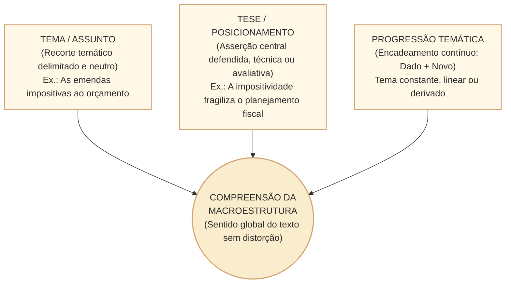
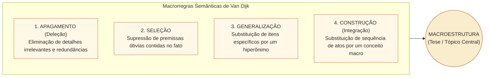
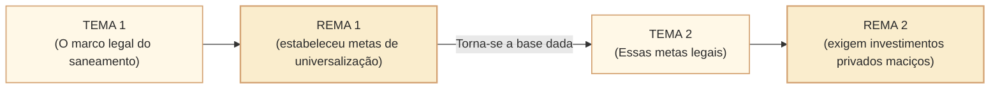
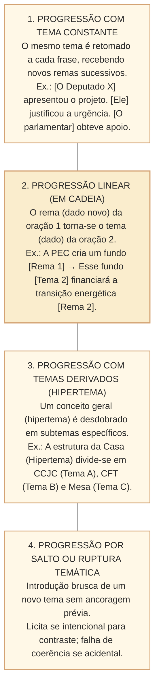
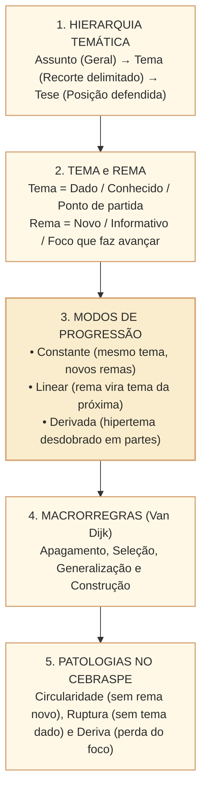

# Tema, tese e progressão temática: tópicos discursivos, macroestrutura e dinâmicas de informação no padrão Cebraspe

## 1. Situação concreta e a arquitetura semântica do texto

Na redação legislativa e na comunicação pública — seja em um relatório técnico da Consultoria de Orçamento, em um parecer conclusivo da CCJC ou em uma matéria jornalística sobre deliberações em Plenário —, o texto não avança por acumulação caótica de dados. A clareza comunicativa exige que o leitor consiga responder a duas perguntas fundamentais:
1. **Sobre o que o texto fala?** (O **Tema** ou Tópico Discursivo).
2. **O que o autor sustenta a respeito desse assunto?** (A **Tese** ou Posicionamento Central).

Nas provas do **Cebraspe**, as questões de interpretação avaliam com rigor a capacidade do candidato de distinguir **o assunto geral (tema)** da **proposição ou conclusão defendida (tese)**, além de rastrear os mecanismos linguísticos de **progressão temática** (como informações novas se ancoram em informações dadas) para não confundir argumentos secundários ou contra-argumentos com a ideia nuclear do texto.

---

## 2. Distinção Estrutural: Assunto, Tema e Tese

A confusão entre esses três níveis de delimitação informacional é a principal fonte de erros em itens de compreensão do Cebraspe:

| Nível | Definição Teórica | Grau de Generalidade | Exemplo no Contexto da Câmara |
| :--- | :--- | :--- | :--- |
| **Assunto** | O domínio amplo do conhecimento ou o campo geral de interesse fático. | Máximo (abstrato e panorâmico). | Orçamento Público Federal. |
| **Tema** | O recorte delimitado, específico e problematizado do assunto tratado no texto. | Intermediário (delimitado, sem posicionamento opinativo do autor). | O regime constitucional de execução das emendas individuais impositivas. |
| **Tese** | A proposição afirmativa ou negativa sustentada pelo autor por meio de razões; pode ser técnica ou avaliativa. | Específico: conclusão defendida, sem exigir juízo moral. | A expansão desregulada das emendas impositivas desarticula o planejamento das políticas públicas estruturantes do Executivo. |

> **Pegadinha típica do Cebraspe:** A banca apresenta uma assertiva formulando o *tema* do texto como se fosse a *tese* do autor (ou vice-versa), ou tomando um argumento acessório (ilustração de um parágrafo intermediário) como se constituísse a tese central da obra. O candidato deve identificar a **macroproposição** que subordina todos os demais parágrafos.

---

## 3. Macroestrutura Semântica e Macrorregras (Teun van Dijk)

O linguista Teun A. van Dijk desenvolveu a teoria da **macroestrutura textual**, demonstrando que a mente do leitor processa textos longos gerando resumos cognitivos por meio de **macrorregras de redução semântica**:

1. **Apagamento (Deleção)**: Elimina-se a informação que não é pré-requisito conceitual para o restante do texto (adjetivos periféricos, dados ilustrativos secundários).
2. **Seleção**: Suprime-se uma informação que é condição natural ou habitual de outra expressa (ex.: ao afirmar *"o projeto foi aprovado em dois turnos e seguiu para sanção"*, pode-se dispensar a menção a *"os deputados depositaram seus votos na urna eletrônica"*).
3. **Generalização**: Substitui-se uma série de conceitos particulares por um hiperônimo ou conceito abrangente (ex.: *"viaturas, coletes, armamentos e rádios comunicadores"* $\rightarrow$ *"equipamentos de segurança pública"*).
4. **Construção (ou Integração)**: Substitui-se uma sequência de microações pelo fato global que elas constituem (ex.: *"o relator leu o texto, os parlamentares debateram os destaques, houve contagem de votos e o Presidente proclamou o resultado"* $\rightarrow$ *"houve deliberação do Plenário"*).

---

## 4. Dinâmicas de Informação: Tema versus Rema (Dado versus Novo)

A teoria funcionalista da linguagem (Escola de Praga e Halliday) demonstra que cada oração em um texto bem construído articula dois polos de informação:

$$\text{Oração} = \text{Tema (Dado / Conhecido)} + \text{Rema (Novo / Informativo)}$$

- **Tema (*Topic*)**: O ponto de partida da mensagem; aquilo que já é conhecido do leitor pelo cotexto anterior ou pela situação. Ancoragem informacional.
- **Rema (*Focus / Comment*)**: A informação nova que se acrescenta sobre o tema; o núcleo informativo que faz a comunicação avançar.

### Tipologia da Progressão Temática (Bernard Combettes)

A forma como Tema e Rema se encadeiam ao longo dos parágrafos define os quatro padrões clássicos de progressão temática:

---

## 5. Rupturas e Patologias da Progressão no Padrão Cebraspe

Em itens de reescrita e coerência textual, o Cebraspe frequentemente formula problemas de progressão temática:
- **Tautologia / Circularidade**: O texto parece progredir, mas apenas repete o tema sob novos sinônimos sem fornecer rema substantivo (ex.: *"A burocracia excessiva atrasa os processos porque a lentidão procedimental é provocada pelo excesso de exigências burocráticas"*).
- **Ruptura Temática Injustificada**: O autor salta para outro tópico sem fornecer conectores ou elos coesivos de transição, quebrando a expectativa do leitor e a coerência local.
- **Deslocamento / Deriva Temática**: O autor inicia dissertando sobre o tema A, abre um parêntese sobre o tema B e termina concluindo sobre o tema C, sem amarrar a tese inicial.

---

## 6. Casos Práticos no Contexto Legislativo

### Caso 1: Identificação de Tese em Discurso Parlamentar
* **Texto-Base**: *"Não se discute a importância da responsabilidade fiscal para a estabilidade da moeda. No entanto, quando as regras de contenção de despesas asfixiam os investimentos públicos em infraestrutura básica e saneamento, o ajuste fiscal deixa de ser um instrumento de desenvolvimento para se tornar um fim em si mesmo, sacrificando o crescimento de longo prazo do país"*.
* **Item Inédito Cebraspe**: *O texto tem como tese central a defesa do abandono irrestrito das metas fiscais como premissa para a retomada do investimento público no Brasil.*
* **Análise**: O autor afirma que a responsabilidade fiscal é importante (*"Não se discute..."*), criticando apenas a sua transformação em *"fim em si mesmo"* quando paralisa investimentos. Ele não defende o "abandono irrestrito" das metas fiscais. A assertiva extrapola e radicaliza o posicionamento do autor. **Gabarito: ERRADO**.

### Caso 2: Rastreamento de Progressão Linear
* **Período**: *"A Mesa Diretora instituiu o novo sistema de processo eletrônico. Essa plataforma digital reduziu o tempo médio de tramitação dos pareceres técnicos nas comissões. Esse ganho de celeridade processual permitiu pautar com maior rapidez as matérias econômicas urgentes"*.
* **Análise Linguística**: Trata-se de uma **progressão temática linear típica**:
  - $T_1$ (Mesa) $\rightarrow$ $R_1$ (sistema eletrônico);
  - $T_2$ ($R_1$: plataforma digital) $\rightarrow$ $R_2$ (redução do tempo de tramitação);
  - $T_3$ ($R_2$: ganho de celeridade) $\rightarrow$ $R_3$ (maior rapidez nas pautas econômicas).
  Cada dado novo converte-se no solo de sustentação do próximo argumento.

---

## 7. Questões de Concurso Comentadas (Estilo Cebraspe C/E)

### Questão 1
*(Inédita: estilo Cebraspe / Conhecimentos Básicos)*
> Em um texto dissertativo-argumentativo, o tema e a tese coincidem conceitualmente, visto que ambos designam a matéria fática sobre a qual o autor discorre ao longo da exposição textual.

* **Gabarito**: **ERRADO**.
* **Comentário**: Tema e tese são categorias distintas. O tema é o recorte delimitado do assunto (o que está sendo tratado, em tom neutro/temático); a tese é o posicionamento crítico e avaliativo que o autor assume e defende a respeito daquele tema (a ideia nuclear sustentada pela argumentação).

---

### Questão 2
*(Inédita: estilo Cebraspe / Analista Legislativo)*
> Na progressão temática linear, a informação nova (rema) introduzida em uma oração é recuperada e assume a função de ponto de partida temático (tema) na oração subsequente, assegurando a continuidade e o encadeamento dinâmico do texto.

* **Gabarito**: **CERTO**.
* **Comentário**: Definição exata da progressão linear (em cadeia) segundo Bernard Combettes. O rema de uma oração $n$ converte-se no tema da oração $n+1$.

---

### Questão 3
*(Inédita: estilo Cebraspe / Comunicação Social)*
> Conforme a teoria da macroestrutura de Teun van Dijk, a macrorregra da generalização consiste em substituir uma proposição complexa por sua antítese, com o objetivo de confrontar os argumentos do texto com o senso comum.

* **Gabarito**: **ERRADO**.
* **Comentário**: A generalização consiste em subsumir uma sequência de conceitos ou elementos particulares sob um hiperônimo ou conceito abrangente comum (ex.: listar várias comissões e sintetizá-las como "órgãos fracionários da Casa"), e não em substituir proposições por suas antíteses.

---

### Questão 4
*(Inédita: estilo Cebraspe / Consultoria Legislativa)*
> A ocorrência de um argumento favorável a uma tese contrária (contra-argumento) no corpo de um texto dissertativo invalida a existência de uma tese central unificada, revelando incoerência argumentativa estrutural.

* **Gabarito**: **ERRADO**.
* **Comentário**: A introdução de contra-argumentos ou concessões é um recurso clássico de dialética e persuasão (argumentação por concessão). O autor expõe a tese oposta justamente para refutá-la ou atenuar o seu alcance perante a sua própria tese, sem que isso implique ausência de posicionamento central ou incoerência.

---

### Questão 5
*(Inédita: estilo Cebraspe / Redação Oficial)*
> A progressão com tema constante caracteriza-se pela reiteração do mesmo elemento temático ao longo de sucessivas orações, atribuindo-se a ele diferentes predicados ou dados novos (remas) a cada passo da exposição.

* **Gabarito**: **CERTO**.
* **Comentário**: Perfeita formulação da progressão temática de tema constante: o sujeito ou tópico tópico permanece fixo (retomado por anáfora, pronome ou elipse), enquanto novos atributos e ações vão sendo sucessivamente predicados.

---

### Questão 6
*(Inédita: estilo Cebraspe / Língua Portuguesa)*
> O fenômeno da circularidade temática ocorre quando o texto adiciona sucessivos dados informativos inéditos sem recuperar elementos previamente estabelecidos, ocasionando dispersão do foco e quebra do encadeamento lógico.

* **Gabarito**: **ERRADO**.
* **Comentário**: A definição apresentada refere-se à **ruptura temática** ou dispersão. A **circularidade (tautologia)** ocorre justamente no caso inverso: quando o texto *não* traz dado novo algum, limitando-se a girar em torno do mesmo conceito expresso por paráfrases repetitivas, sem progressão real.

---

## 8. Resumo Estruturado para Revisão Rápida

- **Assunto vs. Tema vs. Tese**: Assunto é amplo; tema é o recorte; tese é o juízo de valor sustentado.
- **Dado + Novo**: Todo parágrafo eficaz se apoia em uma base já partilhada (tema) e injeta novidade informacional (rema).
- **Progressão Linear**: A esteira mais dinâmica do texto técnico — o dado novo de uma frase alimenta o ponto de partida da seguinte.
- **Macrorregras**: Resumir mentalmente o texto aplicando apagamento de pormenores, seleção do essencial e generalização por hiperônimos para encontrar a macroestrutura.
