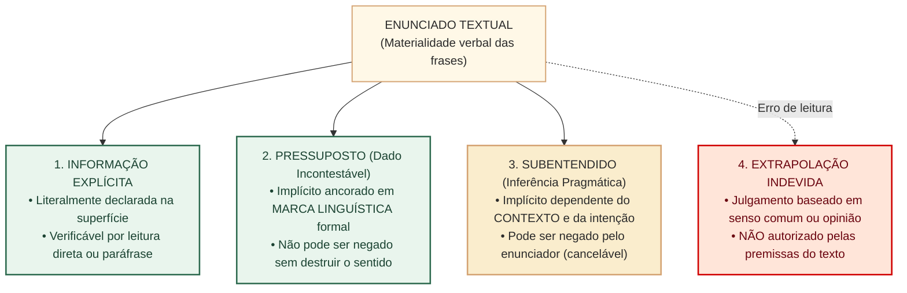
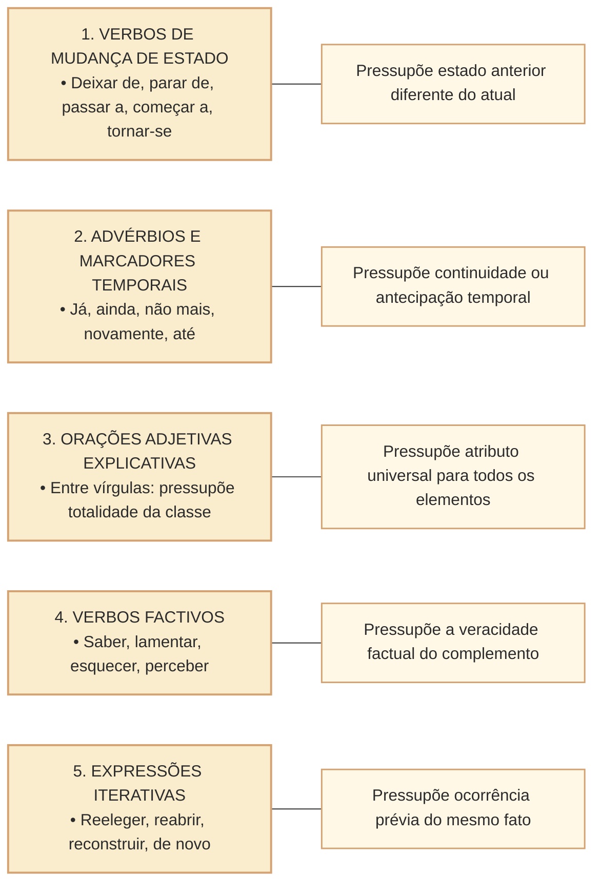
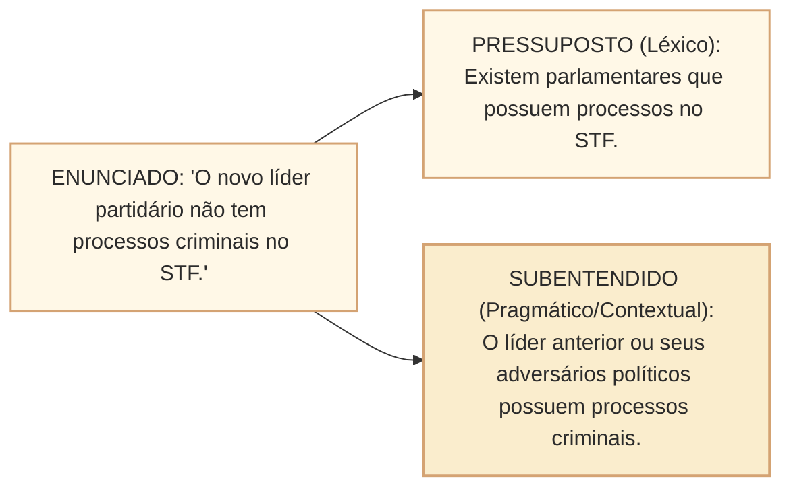
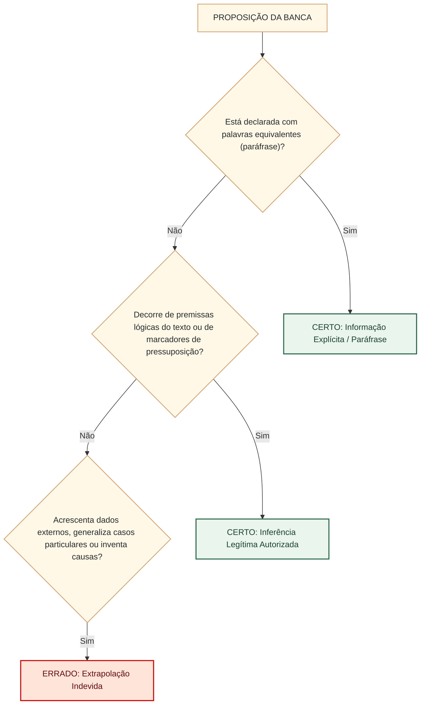
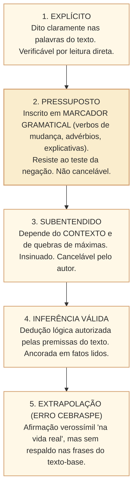

# Informação explícita, pressuposto e inferência: marcas linguísticas, subentendidos e limites da dedução no padrão Cebraspe

## 1. Situação concreta e os níveis de significação no texto institucional

Na análise de documentos parlamentares, relatórios de auditoria governamental e coberturas jornalísticas do Congresso Nacional, a mensagem transmitida raramente se esgota no que está expressamente grafado na superfície das frases. Um parecer conclusivo de comissão ou uma declaração de liderança partidária frequentemente comunica sentidos tácitos, ressalvas veladas e premissas implícitas que orientam a interpretação jurídica e política dos atos do Estado.

Nas provas do **Cebraspe**, o domínio da distinção entre **o explícito**, **o pressuposto** e **o subentendido** é o mais decisivo divisor de águas entre o candidato amador e o analista de alto rendimento. A banca constrói itens ardilosos que testam se o leitor é capaz de identificar premissas incontestáveis ancoradas em marcas gramaticais (*pressupostos*), distinguir deduções lógicas autorizadas (*inferências legítimas*) e repudiar deduções capciosas baseadas em suposições ou opiniões pessoais não respaldadas pelo texto (*extrapolações*).

---

## 2. O Explícito versus o Implícito

A comunicação opera em duas camadas simultâneas:
1. **Significado Explícito**: O conteúdo literal, codificado diretamente pelas regras gramaticais e pelo vocabulário empregado. Para confirmá-lo, basta localizar o segmento no texto ou verificar a fidelidade de sua paráfrase.
2. **Significado Implícito**: Informações que não estão ditas abertamente, mas que o leitor extrai por meio de pistas linguísticas ou do contexto comunicativo. Divide-se obrigatoriamente em **pressupostos** e **subentendidos**.

| Dimensão | Informação Explícita | Pressuposto | Subentendido |
| :--- | :--- | :--- | :--- |
| **Localização** | Na superfície visível das frases. | Ancorado em marcadores linguísticos formais no texto. | Fora da superfície estrita; construído na situação pragmática. |
| **Responsabilidade** | Integralmente do enunciador. | Assumida pelo enunciador como premissa dada e indiscutível. | Deixada a cargo da interpretação do interlocutor. |
| **Gatilho / Pista** | Termos literais. | Verbos de mudança, advérbios, orações adjetivas, conectores. | Conhecimento de mundo, contexto situacional, ironia. |
| **Cancelabilidade** | Não cancelável. | **Não cancelável** (a negação da frase preserva o pressuposto). | **Cancelável** (o enunciador pode refutar a insinuação). |

---

## 3. Os Ativadores (Gatilhos) de Pressuposição

O pressuposto é uma verdade tácita sobre a qual o enunciado se apoia para poder ser formulado. Conforme os postulados semânticos de Oswald Ducrot, a pressuposição resiste ao **teste da negação** e da **interrogação**: se a frase for negada ou transformada em pergunta, a informação pressuposta continua verdadeira.

Principais classes gramaticais que atuam como ativadores formais de pressuposição:

### Análise Prática dos Gatilhos

1. **Verbos que indicam mudança ou continuidade de estado**:
   - Exemplo: *"A Comissão Parlamentar de Inquérito **deixou de** convocar os auditores da empresa"*.
   - *Explícito*: A CPI não mais convocará os auditores.
   - *Pressuposto*: A CPI convocava os auditores anteriormente (o verbo *deixar de* ancora o fato pretérito como verdadeiro).
   - *Teste da negação*: *"A CPI **não** deixou de convocar os auditores"* $\rightarrow$ Continua pressuposto que ela já os convocava antes.

2. **Advérbios de valor aspectual ou iterativo (*já*, *ainda*, *não mais*)**:
   - Exemplo: *"O relator **ainda** não protocolou o parecer substitutivo"*.
   - *Pressuposto*: Espera-se que o parecer seja protocolado futuramente, ou havia expectativa regimental de seu protocolo.
   - Exemplo: *"O Plenário **já** atingiu o quórum qualificado de abertura"*.
   - *Pressuposto*: O quórum foi atingido antes do momento ordinário previsto ou em tempo satisfatório.

3. **Orações Adjetivas: Explicativa versus Restritiva**:
   - Exemplo Explicativo (entre vírgulas): *"Os deputados federais**, que são representantes eleitos do povo,** votaram a matéria orçamentária"*.
     - *Pressuposto*: **Todos** os deputados federais são representantes eleitos do povo (generalização atributiva inerente à totalidade).
   - Exemplo Restritivo (sem vírgulas): *"Os deputados federais **que compareceram à sessão noturna** votaram a matéria orçamentária"*.
     - *Pressuposto*: Apenas **uma parte** dos deputados compareceu à sessão noturna; houve deputados que não compareceram.

4. **Verbos Factivos (epistêmicos ou de atitude psicológica)**:
   - Exemplo: *"O Diretor-Geral **lamentou que** o prazo de implantação do sistema tenha sido prorrogado"*.
   - *Pressuposto*: O prazo de implantação do sistema foi efetivamente prorrogado (fato incontroverso, independentemente do lamento da autoridade).

---

## 4. O Subentendido: Inferência Pragmática e Não Dito

Diferentemente do pressuposto (que é marcado gramaticalmente no texto), o **subentendido** depende da cooperação interpretativa do leitor e da situação comunicativa extralinguística.

- **Natureza Evasiva**: Como o subentendido não está ancorado em uma palavra específica, o enunciador pode se resguardar e cancelar a interpretação caso seja confrontado (ex.: *"Eu nunca disse isso, você que tirou suas próprias conclusões"*).
- **Mecanismo de Geração**: Ocorre predominantemente pela quebra calculada das Máximas Conversacionais de Grice (relevância, modo, quantidade ou qualidade).

---

## 5. Inferência Legítima versus Extrapolação no Padrão Cebraspe

Nas questões de Certo ou Errado da banca Cebraspe, os enunciados frequentemente utilizam verbos de comando como:
- *"Infere-se do texto que..."*
- *"Depreende-se das palavras do autor que..."*
- *"Conclui-se logicamente do segmento que..."*

Esses comandos **não** autorizam o candidato a divagar. Uma inferência só é considerada correta pela banca se for **necessária**, **sustentada por premissas textuais explícitas** ou **ancorada em pressupostos formais**.

### A Matriz de Julgamento do Cebraspe

### Principais Vícios de Extrapolação Cobrados em Prova

1. **A Armadilha do Sentido Comum (Verdade Extratextual)**:
   - A proposição afirma algo amplamente aceito como verdadeiro pela sociedade (ex.: *"A transparência ativa dos portais públicos inibe a prática de desvios orçamentários"*).
   - Se o texto-base tratava unicamente da infraestrutura de servidores de TI da Câmara e não correlacionou a tecnologia com o combate à corrupção, o item é **ERRADO**. O Cebraspe avalia o texto, não a cultura geral do candidato.
2. **Distorção de Causalidade (Correlação $\neq$ Causa)**:
   - O texto afirma: *"Após a instalação do painel eletrônico de votações em 2001, observou-se expressivo aumento na produtividade das sessões deliberativas"*.
   - A banca propõe: *"Depreende-se do texto que a modernização tecnológica do painel eletrônico foi a causa direta do aumento da produtividade parlamentar"*.
   - Julgamento: **ERRADO**. A simples sucessão temporal (*post hoc ergo propter hoc*) não autoriza inferir causalidade substantiva, salvo se o autor declarar expressamente o nexo causal.
3. **Generalização Abusiva de Escopo (Quantificadores)**:
   - O texto cita que *"em algumas comissões temáticas permanentes, o tempo de tramitação foi reduzido"*.
   - A assertiva afirma que *"a reforma procedimental acelerou a deliberação nas comissões permanentes da Casa"*.
   - Julgamento: **ERRADO**. O quantificador particular (*"em algumas"*) não autoriza inferir a universalidade do resultado (*"nas comissões"*).

---

## 6. Casos Práticos no Contexto Institucional da Câmara dos Deputados

### Caso 1: Parecer da CCJC e Pressuposição por Verbo de Mudança
* **Trecho de Relatório**: *"A Mesa Diretora da Câmara dos Deputados **passou a** publicar em dados abertos o detalhamento nominal das cotas para o exercício da atividade parlamentar (CEAP)"*.
* **Assertiva de Prova**: *Do emprego da locução verbal "passou a publicar", infere-se que, em período pretérito, o detalhamento das cotas parlamentares não era divulgado no formato de dados abertos.*
* **Análise Linguística**: O verbo aspectual inceptivo *"passar a"* indica o início de uma ação nova que não ocorria antes. A premissa de que a divulgação em dados abertos inexistia anteriormente é um **pressuposto linguisticamente marcado**. **Gabarito: CERTO**.

### Caso 2: Declaração de Liderança e Subentendido Cancelável
* **Cenário**: Durante debate sobre a reforma tributária, um deputado discursa: *"Nossa bancada votará com responsabilidade pelos interesses da indústria nacional, ao contrário daqueles que apenas se preocupam com dividendos eleitorais imediatos nas suas bases regionais"*.
* **Assertiva de Prova**: *O texto afirma explicitamente que os parlamentares das bancadas de oposição atuam com desvio ético para obter vantagens pessoais ilícitas.*
* **Análise**: O discurso mobiliza um **subentendido** crítico contra adversários políticos, mas **não afirma explicitamente** que a oposição comete desvio ilícito. A assertiva comete dois erros capitais: classifica como "explícito" aquilo que é tácito/subentendido e extrapola a crítica política para acusação penal de "vantagens pessoais ilícitas". **Gabarito: ERRADO**.

### Caso 3: Restritiva versus Explicativa em Dispositivo Normativo
* **Trecho Regimental**: *"Os servidores efetivos da Casa **que concluírem o curso de formação legislativa** perceberão gratificação de qualificação técnica"*.
* **Assertiva de Prova**: *Depreende-se do dispositivo que a totalidade dos servidores efetivos da Câmara dos Deputados terá direito ao recebimento da aludida gratificação, independentemente da participação em programas de treinamento.*
* **Análise**: A oração adjetiva introduzida por *"que concluírem..."* é **restritiva** (ausência de vírgulas). Ela restringe o benefício apenas à parcela dos servidores que cumprir o requisito do curso, pressupondo a existência de servidores que não o concluirão. A assertiva converte a restrição em regra universal e viola o pressuposto gramatical do texto. **Gabarito: ERRADO**.

---

## 7. Questões de Concurso Comentadas (Estilo Cebraspe C/E)

### Questão 1
*(Inédita: estilo Cebraspe / Conhecimentos Básicos)*
> As informações pressupostas em um texto decorrem de marcadores linguísticos explícitos, como certos verbos, advérbios e estruturas sintáticas, caracterizando-se por resistirem ao teste da negação lógica do enunciado.

* **Gabarito**: **CERTO**.
* **Comentário**: Definição rigorosamente correta segundo a teoria semântica de Oswald Ducrot. O pressuposto é ativado por pistas gramaticais no texto e permanece verdadeiro mesmo quando a oração principal é negada ou interrogada (ex.: *"Ele parou de discursar"* e *"Ele não parou de discursar"* compartilham o pressuposto de que ele discursava antes).

---

### Questão 2
*(Inédita: estilo Cebraspe / Analista Legislativo)*
> Infere-se legitimamente de um texto qualquer proposição cuja temática seja condizente com a ordem jurídica vigente no país, sendo dispensável que o autor tenha inserido elementos linguísticos específicos que autorizem tal conclusão.

* **Gabarito**: **ERRADO**.
* **Comentário**: No padrão Cebraspe, uma inferência só é legítima se decorrer diretamente das premissas e marcas do texto-base. A concordância com o ordenamento jurídico do "mundo real", sem suporte no texto lido, configura extrapolação indevida e torna o item incorreto.

---

### Questão 3
*(Inédita: estilo Cebraspe / Comunicação Social)*
> No período "O novo portal institucional da Câmara ainda não disponibilizou o módulo de consulta às atas históricas", o advérbio "ainda" atua como gatilho de pressuposição, indicando a expectativa de que o referido módulo venha a ser disponibilizado futuramente.

* **Gabarito**: **CERTO**.
* **Comentário**: O advérbio aspectual temporal *"ainda"* opera como ativador formal de pressuposição, projetando que o estado atual de indisponibilidade é transitório e que há uma expectativa comunicativa ou factual de que o módulo seja entregue.

---

### Questão 4
*(Inédita: estilo Cebraspe / Consultoria Legislativa)*
> Ao contrário dos pressupostos, que são ativados por marcas linguísticas na estrutura gramatical da frase, os subentendidos dependem predominantemente da interpretação pragmática do interlocutor no contexto da enunciação, podendo ser cancelados pelo autor caso este seja confrontado.

* **Gabarito**: **CERTO**.
* **Comentário**: O item sintetiza com exatidão a fronteira teórica entre pressuposto e subentendido. O subentendido não se apoia em um vocábulo fixo, permitindo ao emissor resguardar-se ("não foi isso que eu disse"), enquanto o pressuposto está inscrito na forma linguística e vincula formalmente o enunciador.

---

### Questão 5
*(Inédita: estilo Cebraspe / Redação Oficial)*
> Na oração "Os consultores legislativos, que detêm conhecimento jurídico especializado, redigiram a minuta do substitutivo", o segmento entre vírgulas estabelece uma restrição que pressupõe a existência de consultores legislativos desprovidos de conhecimento especializado na instituição.

* **Gabarito**: **ERRADO**.
* **Comentário**: O segmento entre vírgulas é uma oração adjetiva **explicativa**, e não restritiva. As explicativas atribuem uma característica universal a **toda a classe** dos consultores legislativos mencionados, pressupondo que todos detêm o conhecimento especializado. A ideia de que "apenas uma parte detém" decorreria de uma oração restritiva (sem vírgulas).

---

### Questão 6
*(Inédita: estilo Cebraspe / Técnica Legislativa)*
> A afirmação de que determinado fenômeno ocorreu após a vigência de uma nova lei autoriza concluir, sob a ótica da interpretação estrita, que a referida legislação constituiu a causa eficiente e determinante daquele acontecimento.

* **Gabarito**: **ERRADO**.
* **Comentário**: A mera sucessão cronológica entre fatos (*post hoc ergo propter hoc*) não autoriza inferir relação de causa e efeito. A extrapolação de correlação temporal para causalidade necessária é uma das armadilhas lógicas mais recorrentes em provas de interpretação textual do Cebraspe.

---

## 8. Resumo Estruturado para Revisão Rápida

- **Teste da Negação**: Negue a frase; se a informação continuar obrigatoriamente verdadeira, ela é um **pressuposto**.
- **Gatilhos Clássicos**: *Deixar de*, *parar de*, *passar a*, *já*, *ainda*, *novamente*, adjetivas explicativas.
- **Explicativa vs. Restritiva**: Com vírgula = generaliza para todos (pressuposto universal); Sem vírgula = restringe a uma parte (pressuposto particular).
- **Regra de Ouro do Cebraspe**: Nunca marque CERTO para uma proposição apenas porque ela é "verdadeira no Brasil". Verifique se o texto-base contém as premissas que autorizam a inferência.
