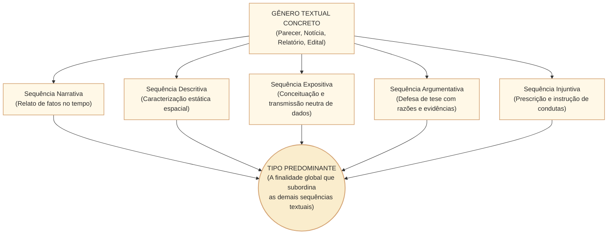
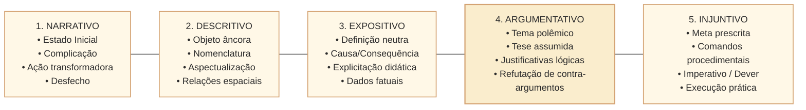
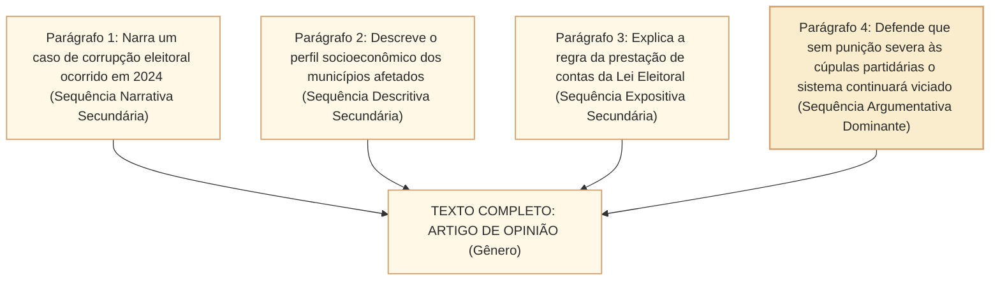
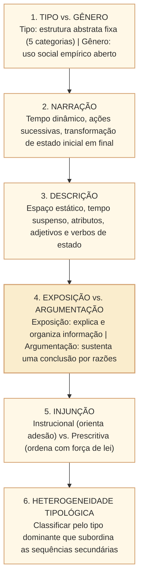

# Tipologia textual: critérios de distinção, sequências prototípicas e formas híbridas no padrão Cebraspe

## 1. Situação concreta e a arquitetura das sequências textuais

Na atividade parlamentar e na administração pública, os textos oficiais articulam múltiplas modalidades discursivas para cumprir seus objetivos institucionais. Um parecer de relator na Comissão de Constituição e Justiça e de Cidadania (CCJC), por exemplo, abre com o *relatório* (sequência predominantemente **narrativa** dos atos pretéritos da proposição), transita pelo *voto* (sequência densamente **argumentativa** que fundamenta a constitucionalidade ou a antijuridicidade mediante razões jurídicas e precedentes) e encerra com a *conclusão* (sequência **injuntiva/prescritiva** que determina o encaminhamento da deliberação aos membros da comissão).

Nas provas do **Cebraspe**, o domínio da **tipologia textual** exige ir muito além da memorização mecânica de cinco nomes. A banca avalia a capacidade do candidato de discernir a **sequência prototípica predominante** daquelas meramente secundárias ou subordinadas, mapear os **critérios linguísticos e enunciativos formais** de cada tipo (progressão temporal, dinâmicas de estados, predicados avaliativos vs. neutros e comandos imperativos) e reconhecer a coexistência híbrida de tipos dentro de um mesmo gênero textual.

---

## 2. Critérios Teóricos de Distinção: A Matriz de Jean-Michel Adam

Segundo o modelo da linguística textual consagrado por **Jean-Michel Adam** (*Les textes: types et prototypes*), os textos não são puros, mas compostos por **sequências textuais prototípicas**. A classificação tipológica repousa sobre três critérios linguísticos estruturais:

1. **Temporalidade e Dinâmica de Estados**: se o texto opera com progressão cronológica orientada (transformação de um estado inicial em um estado final) ou com simultaneidade estática.
2. **Postura Enunciativa (Objetividade $\times$ Subjetividade Avaliativa)**: se o enunciador se limita a expor dados e conceitos universais aceitos ou se assume a autoria de uma tese controversa que requer convencimento e adesão.
3. **Direcionalidade Ilucucionária**: se a mensagem tem finalidade representativa (relatar, descrever, explicar) ou diretiva (induzir o interlocutor a uma ação obrigatória ou recomendada).

| Critério Estrutural | Narração | Descrição | Exposição (Dissertação Expositiva) | Argumentação (Dissertação Argumentativa) | Injunção (Instrução / Prescrição) |
| :--- | :--- | :--- | :--- | :--- | :--- |
| **Eixo Organizador** | Sucessão temporal e causal de ações. | Coexistência espacial de traços e atributos. | Hierarquia lógica de conceitos e categorias. | Conexão lógica de premissas a favor de uma tese. | Sequência de passos para a realização de um ato. |
| **Progressão no Tempo** | **Alta**: há anterioridade, posterioridade e desfecho. | **Nula ou Baixa**: tempo suspenso ou atemporal. | **Atemporal**: foco em verdades conceituais e definições. | **Lógica**: encadeamento de causas, razões e conclusões. | **Prospectiva**: orientada para a ação futura do leitor. |
| **Classes Gramaticais Nucleares** | Verbos de ação no pretérito perfeito/mais-que-perfeito e advérbios de tempo. | Adjetivos, locuções adjetivas, substantivos concretos e verbos de ligação/estado no pretérito imperfeito ou presente. | Substantivos abstratos, verbos no presente do indicativo de valor atemporal e conectores explicativos. | Conectores argumentativos (conclusivos, concessivos, causais), operadores argumentativos e adjetivos axiológicos. | Verbos no imperativo, infinitivo modal, futuro do presente ou locuções de dever (*deve*, *é obrigatório*). |
| **Finalidade Ilocucionária** | Contar uma história ou relatar uma sucessão de eventos. | Retratar verbalmente um ser, objeto, paisagem ou cena. | Transmitir conhecimento objetivo, informar e definir. | Persuadir, convencer e defender um ponto de vista crítico. | Prescrever, orientar, ordenar ou instruir procedimentos. |

---

## 3. As Cinco Sequências Prototípicas em Detalhe

### 3.1. Sequência Narrativa
- **Núcleo Constitutivo**: Exige obrigatoriamente a passagem de um estado inicial para um estado final por meio de uma complicação e de uma transformação no tempo conduzida por agentes (personagens).
- **Padrão em Concurso**: Trechos de relatórios de comissões que reconstituem a ordem cronológica dos fatos apurados em investigações parlamentares ou notícias institucionais sobre o desenrolar das votações em plenário.

### 3.2. Sequência Descritiva
- **Núcleo Constitutivo**: O olhar do autor percorre o objeto no espaço (de cima para baixo, de dentro para fora, do geral para o particular), suspendendo o fluxo temporal das ações.
- **Padrão em Concurso**: Descrição das dependências arquitetônicas do Palácio do Congresso Nacional, laudos periciais de danos ao patrimônio público ou a caracterização das dimensões físicas e tecnológicas de um equipamento licitado.

### 3.3. Sequência Expositiva (Informativa / Explicativa)
- **Núcleo Constitutivo**: Apresentação de dados, teorias, métodos ou definições conceituais com neutralidade discursiva aparente. A finalidade principal é explicar ou organizar conhecimento. O texto pode trazer avaliações secundárias; o que importa é se **explica** um objeto ou **sustenta uma conclusão com razões**.
- **Marcas Formais**: Definições por gênero próximo e diferença específica, orações explicativas, enumerações de categorias e dados estatísticos consolidados.

### 3.4. Sequência Argumentativa (Opinativa)
- **Núcleo Constitutivo**: Existência de uma **tese defendida** por **razões, evidências, exemplos ou inferências**, buscando justificar uma conclusão perante o leitor. A tese pode ser **técnica** (por exemplo, defender um procedimento de controle mais confiável), mesmo sem adjetivos avaliativos ou controvérsia explícita.
- **O Divisor de Águas entre Exposição e Argumentação (Pegadinha Letal Cebraspe)**:
  - *Exposição*: *"O marco regulatório do saneamento foi aprovado pelo Congresso Nacional e prevê metas de 99% de atendimento de água potável até 2033 mediante leilões de concessão regionalizada"*. (Relato neutro de fatos e dispositivos normativos — não há juízo de valor).
  - *Argumentação*: *"A imposição açodada de metas de universalização pelo marco do saneamento desconsidera as peculiaridades econômicas dos municípios mais pobres, aprofundando injustiças federativas para favorecer oligopólios privados"*. (Há juízo de valor, adjetivação axiológica e defesa explícita de tese crítica).

### 3.5. Sequência Injuntiva versus Prescritiva
A moderna linguística textual distingue duas gradações na injunção:
- **Injunção Instrucional**: Oferece orientações, sugestões e conselhos cuja adesão é voluntária (manuais de redação jornalística, tutoriais de sistemas, bulas de remédio, receitas).
- **Injunção Prescritiva**: Estabelece normas mandatórias, ordens e proibições cuja inobservância acarreta sanção jurídica (leis, decretos, regimentos internos, editais de licitação e portarias administrativas).

---

## 4. Relações Híbridas: Heterogeneidade Tipológica e Dominância

Em situações reais de comunicação, textos raramente são monológicos ou tipologicamente puros. Conforme Jean-Michel Adam, ocorre a **heterogeneidade tipológica**:

> **Atenção para o Julgamento no Cebraspe**: Quando a questão afirma *"Predomina no texto a tipologia argumentativa..."*, a presença de um parágrafo narrativo ou de dados descritivos não invalida o item. O candidato deve identificar qual sequência textual **subordina e orienta a finalidade global do texto**. Se a narração do parágrafo 1 serve unicamente como evidência ilustrativa para sustentar a tese do parágrafo 4, o texto é **predominantemente argumentativo**.

---

## 5. Casos Práticos no Contexto Institucional da Câmara dos Deputados

### Caso 1: Identificação de Tipologia em Parecer da CCJC
* **Excerto**: *"A proposição em exame, Projeto de Lei nº 1.234/2025, foi apresentada em 15 de março, distribuída a este colegiado e autuada no sistema de processo eletrônico. [...] A matéria não padece de vícios formais de iniciativa, uma vez que a matéria orçamentária foi estritamente preservada pelo autor, nos moldes do art. 61, § 1º, da Carta Magna. Ademais, sob o prisma material, o conteúdo proposto harmoniza-se plenamente com os direitos e garantias fundamentais consagrados na ordem constitucional. [...] Ante o exposto, vota-se pela constitucionalidade, juridicidade e boa técnica legislativa da matéria"*.
* **Item Inédito Cebraspe**: *No excerto apresentado, embora o primeiro período contenha uma sequência narrativa introdutória, constata-se a predominância da tipologia dissertativo-argumentativa, estruturada para fundamentar juridicamente o voto do relator.*
* **Análise**: O primeiro período relata fatos cronológicos (distribuição, autuação). Contudo, o corpo nuclear do texto articula argumentos constitucionais (adequação formal e material) que convergem logicamente para o julgamento final (*"vota-se pela..."*). A argumentação é a sequência dominante que subordina os fatos narrados. **Gabarito: CERTO**.

### Caso 2: Diferenciação entre Exposição e Injunção em Edital
* **Excerto A**: *"A Câmara dos Deputados é o órgão de representação popular do Poder Legislativo federal, composta por 513 deputados eleitos pelo sistema proporcional em cada estado e no Distrito Federal"*.
* **Excerto B**: *"Os candidatos deverão comparecer ao local de prova com antecedência mínima de uma hora do horário fixado para o fechamento dos portões, munidos de caneta esferográfica de tinta preta fabricada em material transparente"*.
* **Análise Tipológica**:
  - O Excerto A é estritamente **expositivo**: define a instituição, expõe sua composição e o método eleitoral de forma neutra, sem ordenar condutas.
  - O Excerto B é estritamente **injuntivo-prescritivo**: utiliza verbos de obrigatoriedade (*"deverão comparecer"*) e estabelece regras mandatórias imperativas que condicionam a participação no certame.

### Caso 3: Narrativa Histórica em Discurso Comemorativo
* **Excerto**: *"Em 5 de outubro de 1988, Ulysses Guimarães ergueu o exemplar da nova Constituição cidadã perante o plenário lotado do Congresso Nacional. Naquele instante histórico, rompiam-se mais de duas décadas de exceção autoritária e refundava-se a ordem democrática republicana sob o império da lei"*.
* **Análise**: O texto organiza ações datadas no tempo (*"Em 5 de outubro de 1988"*, *"ergueu"*, *"rompiam-se"*, *"refundava-se"*), descrevendo a transição de um estado anterior (regime de exceção) para um estado novo (ordem democrática). Predomina a sequência **narrativa**, com traços avaliativos subordinados ao relato cronológico da refundação institucional.

---

## 6. Questões de Concurso Comentadas (Estilo Cebraspe C/E)

### Questão 1
*(Inédita: estilo Cebraspe / Conhecimentos Básicos)*
> A tipologia textual e os gêneros textuais constituem conceitos intercambiáveis na linguística moderna, haja vista que ambos se definem pelo propósito sociocomunicativo e pelo suporte físico de circulação da mensagem.

* **Gabarito**: **ERRADO**.
* **Comentário**: Tipo e gênero são categorias teóricas distintas. O **tipo textual** é uma categoria teórica fechada e abstrata (narração, descrição, dissertação expositiva, argumentação, injunção), definida pela sua estrutura linguística intrínseca; o **gênero textual** é uma prática social empírica aberta, infinita e mutável (notícia, editorial, edital, parecer, relatório, e-mail), determinada pela finalidade social, interlocutores e contexto.

---

### Questão 2
*(Inédita: estilo Cebraspe / Analista Legislativo)*
> Na sequência descritiva prototípica, a progressão cronológica orientada entre anterioridade e posterioridade é o elemento primário de estruturação, cabendo aos verbos de ação indicar a contínua transformação da realidade abordada.

* **Gabarito**: **ERRADO**.
* **Comentário**: A definição apresentada é da sequência **narrativa**. Na sequência **descritiva**, a progressão temporal é suspensa ou atenuada, organizando-se a mensagem no eixo da **coexistência espacial** e da caracterização de propriedades por meio de adjetivos, locuções adjetivas e verbos de estado.

---

### Questão 3
*(Inédita: estilo Cebraspe / Comunicação Social)*
> O que diferencia essencialmente um texto dissertativo-expositivo de um dissertativo-argumentativo é a presença de uma tese controversa sustentada por argumentos persuasivos no segundo, ao passo que o primeiro se restringe a explanar, conceituar e organizar informações objetivas sobre determinado tema.

* **Gabarito**: **ERRADO**.
* **Comentário**: O item impõe duas condições excessivas: **tese necessariamente controversa** e exposição restrita a **informações objetivas**. A argumentação se caracteriza pela **defesa de uma conclusão por razões**, inclusive em pareceres técnicos sem juízo de valor explícito; a exposição tem como função predominante **explicar ou organizar informações**, mesmo que registre avaliações. Exemplo contrastivo: “O relatório apresenta três modelos de fiscalização e suas etapas” (exposição); “O modelo B deve ser adotado porque registra todas as decisões e permite revisão independente” (argumentação técnica). A troca de gabarito decorre da formulação **universalizante deste item inédito**, não de atribuição a uma prova real do Cebraspe.

---

### Questão 4
*(Inédita: estilo Cebraspe / Redação Oficial)*
> A constatação de que um artigo de opinião se inicia com um relato factual cronológico desautoriza categorizá-lo como texto predominantemente argumentativo, impondo sua reclassificação formal para a tipologia narrativa.

* **Gabarito**: **ERRADO**.
* **Comentário**: A heterogeneidade tipológica (Adam) demonstra que textos concretos combinam diversas sequências internas. A classificação do texto como um todo orienta-se pela sua **sequência dominante** (aquela que rege o propósito global da obra). Em um artigo de opinião, relatos narrativos introdutórios atuam como premissas empíricas secundárias para respaldar a tese do autor, preservando a predominância da argumentação.

---

### Questão 5
*(Inédita: estilo Cebraspe / Técnica Legislativa)*
> Os textos normativos e legais, tais como o Regimento Interno da Câmara dos Deputados e a Lei Orgânica do Distrito Federal, enquadram-se na tipologia injuntiva de natureza prescritiva, caracterizando-se pelo emprego de enunciados que determinam imperativamente obrigações, permissões e vedações de conduta.

* **Gabarito**: **CERTO**.
* **Comentário**: Textos de leis e regimentos públicos são os exemplares prototípicos da injunção prescritiva: sua finalidade comunicativa é ditar comportamentos obrigatórios e estabelecer sanções institucionais mediante operadores deônticos de comando, dever e proibição.

---

### Questão 6
*(Inédita: estilo Cebraspe / Consultoria Legislativa)*
> A presença marcante de operadores argumentativos e de adjetivos avaliativos em um relatório governamental de gestão denota uma postura enunciativa eminentemente descritiva, cuja meta exclusiva é registrar com isenção as variáveis materiais do órgão público.

* **Gabarito**: **ERRADO**.
* **Comentário**: O emprego reiterado de operadores argumentativos (conectores de oposição, concessão, conclusão) e de adjetivos avaliativos/axiológicos (que emitem juízo moral ou crítico) é a marca linguística inequívoca da **tipologia argumentativa**, e não da descrição isenta.

---

## 7. Resumo Estruturado para Revisão Rápida

- **Tipo**: Modo como a linguagem é organizada por dentro (narração, descrição, exposição, argumentação, injunção).
- **Gênero**: Nome do documento no mundo real (parecer, edital, reportagem, e-mail).
- **Exposição**: "O que é isso?" (Transmissão objetiva de conhecimento).
- **Argumentação**: "Que conclusão está sendo defendida e com que fundamentos?" (Tese técnica ou avaliativa sustentada por razões).
- **Injunção**: "Faça isso dessa forma!" (Orientação ou prescrição de conduta).
- **Dominância**: Em provas Cebraspe, identifique para que serve a sequência secundária: se a historinha (narração) serve apenas para provar a opinião do autor, o texto todo é argumentativo.
