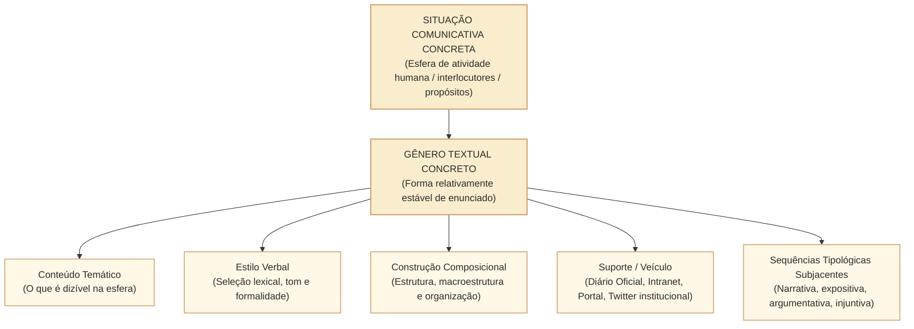
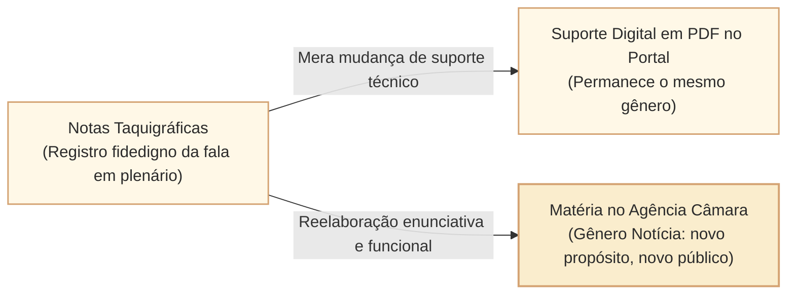

# Gênero textual: situação de uso, suporte, finalidade sociocomunicativa e intergenericidade no padrão Cebraspe

## 1. Situação concreta e o papel dos gêneros discursivos

Na rotina da Câmara dos Deputados, a atividade comunicativa não se dá no vazio teórico de tipos textuais abstratos, mas sim por meio de **práticas sociais institucionalizadas**. Quando uma deputada propõe a criação de uma política de apoio à primeira infância, ela protocola um **Projeto de Lei (PL)** com estrutura rígida: ementa, artigos numerados, cláusula de vigência e justificação. Quando um cidadão busca obter dados orçamentários sobre obras públicas não divulgados no Portal da Transparência, formula um **Pedido de Acesso à Informação (e-SIC)**. Se um servidor da Mesa Diretora constata irregularidade na tramitação regimental, redige uma **Informação Técnica** ou uma **Nota Técnica**. 

Cada uma dessas manifestações é um **gênero textual (ou discursivo)**. Nas provas do **Cebraspe**, o estudo dos gêneros ultrapassa a memorização mecânica de formatos. A banca avalia a compreensão do aluno acerca da **função sociocomunicativa**, das condições de produção e circulação, da relação entre interlocutores (grau de formalidade, distância social e autoridade institucional), do papel do **suporte (veículo físico ou digital)** e dos fenômenos contemporâneos de **hibridismo e intergenericidade**.

---

## 2. Fundamentação Teórica: Bakhtin e Marcuschi

A compreensão contemporânea de gêneros textuais exigida pelo Cebraspe articula dois eixos teóricos centrais: os **gêneros do discurso de Mikhail Bakhtin** e a **matriz sociocomunicativa de Luiz Antônio Marcuschi**.

### 2.1. Bakhtin e os Enunciados Relativamente Estáveis

Para Bakhtin (1953/1979), a língua só se realiza na forma de enunciados concretos e únicos proferidos pelos integrantes de uma determinada esfera da atividade humana. Esses enunciados refletem as condições específicas e as finalidades de cada esfera:

> *"O emprego da língua efetua-se em forma de enunciados (orais e escritos) concretos e únicos, proferidos pelos integrantes duma ou doutra esfera da atividade humana [...] Cada esfera de utilização da língua elabora seus tipos relativamente estáveis de enunciados, sendo isso que denominamos gêneros do discurso."*

Segundo a taxonomia bakhtiniana, os gêneros articulam três elementos indissociáveis:
1. **Conteúdo Temático**: o objeto do dizer, delimitado pelo que é pertinente, dizível e aceitável naquela esfera social (ex.: a admissibilidade constitucional de uma PEC no âmbito da CCJC; as despesas autorizadas na Lei Orçamentária Anual);
2. **Estilo Verbal**: a seleção dos recursos lexicais, fraseológicos e gramaticais da língua, determinando o grau de impessoalidade, concisão, polidez e registro culto exigidos pela situação;
3. **Construção Composicional**: a arquitetura estrutural e organizacional do texto, sua forma de abertura, articulação interna e encerramento (ex.: a tripartição clássica de um parecer: Relatório $\rightarrow$ Voto/Fundamentação $\rightarrow$ Dispositivo/Conclusão).

Bakhtin dividiu ainda os gêneros em duas categorias evolutivas:
- **Gêneros Primários (Simples)**: formados nas condições da comunicação discursiva espontânea e imediata (diálogo cotidiano, bilhete, relato oral, troca informal de mensagens).
- **Gêneros Secundários (Complexos)**: surgem em condições de comunicação cultural mais complexa, relativamente desenvolvida e organizada, predominantemente escrita (romances, teses científicas, discursos políticos, peças jurídicas, normas legais e relatórios de auditoria). Os gêneros secundários absorvem e transmutam os gêneros primários em sua estrutura interna.

---

### 2.2. A Tríade de Marcuschi: Tipo Textual $\times$ Gênero Textual $\times$ Suporte

Luiz Antônio Marcuschi (2002) delimitou com rigor as fronteiras conceituais fundamentais para a resolução de itens de concurso:

| Critério de Comparação | Tipo Textual (Sequência) | Gênero Textual | Suporte Textual (*Carrier*) |
| :--- | :--- | :--- | :--- |
| **Natureza Conceitual** | Construto teórico-linguístico abstrato. | Prática sociocomunicativa empírica e concreta. | Meio físico ou digital de fixação e circulação. |
| **Quantitativo** | Finito (Adam: 5 tipos prototípicos). | Infinito e maleável (cresce com as práticas sociais). | Variado (mural, papel, tela, aplicativo, web). |
| **Critério de Definição** | Estrutura sintática, tempos verbais, relações lógicas. | Função social, objetivo comunicativo, contexto cultural. | Materialidade técnica e tecnológica de transmissão. |
| **Exemplos no Setor Público** | Exposição, argumentação, narração, descrição, injunção. | Parecer, Edital, Mensagem de Veto, Ofício, Notícia. | Diário da Câmara dos Deputados, portal web, painel eletrônico. |

> **Atenção no Cebraspe**: O suporte não define o gênero, mas **condiciona suas restrições formais e materiais**. Um texto publicado no portal da Câmara em formato de matéria jornalística é do gênero *notícia*, cujo suporte é a página HTML do portal; o fato de estar no portal institucional não o converte em *lei* ou *decreto*.

---

## 3. Dinâmica dos Gêneros na Esfera Pública e Legislativa

Na esfera parlamentar e administrativa, os gêneros textuais cumprem funções regulatórias, deliberativas e comunicativas precisas. A tabela abaixo sintetiza os principais gêneros cobrados em provas do Cebraspe para o Legislativo:

| Gênero Textual | Finalidade Sociocomunicativa Principal | Interlocutores Típicos | Sequência Prototípica Dominante | Suporte Canônico |
| :--- | :--- | :--- | :--- | :--- |
| **Parecer Técnico/Jurídico** | Subsidiar a deliberação de colegiado mediante análise de admissibilidade ou mérito. | Relator/Consultor $\rightarrow$ Membros da Comissão/Plenário. | **Argumentativa** (fundamentação de voto) subordinando relatório narrativo. | Avulso de proposição, Diário Oficial, Sistema Eletrônico. |
| **Edital de Concurso Público** | Disciplinar as regras vinculantes de certame de provimento de cargos. | Administração Pública $\rightarrow$ Candidatos em potencial. | **Injuntiva/Prescritiva** (comandos obrigatórios e prazos preclusivos). | Diário Oficial da União, portal eletrônico da banca organizadora. |
| **Discurso Parlamentar** | Sustentar posicionamento ideológico, prestar contas ou persuadir pares e eleitorado. | Parlamentar $\rightarrow$ Pares no Plenário e sociedade. | **Argumentativa** (com recursos retóricos, relatos ilustrativos e apelos de adesão). | Notas Taquigráficas, Diário da Câmara, transmissão televisiva/web. |
| **Manual de Redação Oficial** | Padronizar a expedição de comunicações no serviço público com clareza e impessoalidade. | Órgão central de normatização $\rightarrow$ Servidores e redatores públicos. | **Injuntiva/Instrucional** (regras gramaticais, modelos e vedações expressas). | Livro, e-book institucional, portal normativo federal. |
| **Ofício Administrativo** | Tratar de assuntos de serviço entre autoridades da administração pública. | Autoridade remetente $\rightarrow$ Autoridade destinatária equivalente ou superior. | **Expositiva** (solicitação objetiva ou encaminhamento neutro de expediente). | Sistema Eletrônico de Informações (SEI), correspondência oficial. |
| **Notícia Institucional** | Informar a sociedade sobre votações, atos e projetos da Casa com linguagem acessível. | Assessoria de Comunicação $\rightarrow$ População em geral e imprensa. | **Expositiva/Informativa** (Lead, dados objetivos, pirâmide invertida). | Agência Câmara de Notícias, redes sociais institucionais. |

---

## 4. Intergenericidade, Hibridismo e Transmutação de Gêneros

Um dos temas mais sofisticados cobrados pelo Cebraspe envolve a plasticidade dos gêneros textuais:

### 4.1. Intergenericidade (Hibridismo de Gêneros)
Ocorre quando um determinado gênero **adota a forma composicional ou recursos expressivos de outro gênero**, sem perder sua função sociocomunicativa primordial.
- *Exemplo institucional*: Uma campanha de comunicação da Câmara dos Deputados no combate à desinformação veiculada em cartazes que imitam a estrutura de uma *Bula de Remédio* (com tópicos "Composição: fatos verificados", "Contraindicações: compartilhar sem checar a fonte", "Posologia: consulte sempre os canais oficiais"). Trata-se de uma **peça publicitária institucional** que recorre à forma de uma **bula médica** para ampliar a eficácia persuasiva.

### 4.2. Relação entre Gênero e Autonomia de Sentido
O Cebraspe frequentemente formula itens questionando se a mudança de suporte altera a essência do gênero textual.
- *Regra de julgamento*: A transposição de uma ata taquigráfica de sessão deliberativa do suporte físico em papel para um banco de dados digital em PDF pesquisável na internet **não altera o gênero textual** (continua sendo uma ata taquigráfica dotada de fé pública); contudo, se a assessoria de imprensa toma as notas taquigráficas e redige um texto resumido com manchete, subtítulo e aspas para o portal, **houve transmutação de gênero**: produziu-se uma *notícia jornalística*.

---

## 5. Casos Práticos na Esfera Legislativa

### Caso 1: Parecer da CCJC e a Coexistência Tipológica no Gênero Jurídico
- **Situação**: Um candidato analisa o parecer emitido pela CCJC sobre um projeto de lei que institui novas diretrizes para inteligência artificial. O texto contém 15 páginas. As primeiras duas páginas historiam os passos da tramitação da matéria (sequência narrativa). As dez páginas seguintes confrontam a proposta com a Constituição Federal, citam precedentes do STF e refutam argumentos de inconstitucionalidade material levantados por entidades civis (sequência argumentativa). A última página conclui pela admissibilidade e recomenda a aprovação integral (sequência prescritiva/injuntiva).
- **Análise Enunciativa**:
  - *Gênero Textual*: Parecer Jurídico de Comissão Parlamentar.
  - *Tipo Textual Predominante*: Argumentativo.
  - *Armadilha Cebraspe*: A banca propõe item afirmando que, "por abrir com o relato dos fatos da tramitação e detalhar cronologicamente as sessões anteriores, o parecer enquadra-se tipologicamente como texto estritamente narrativo". **Item ERRADO**. A sequência narrativa atua como subsídio subordinado; o objetivo nuclear do parecer é sustentar a tese jurídica de compatibilidade constitucional para persuadir os membros do colegiado a aprovarem o voto do relator.

### Caso 2: Campanha Institucional e a Intergenericidade Pedagógica
- **Situação**: A Secretaria de Comunicação Social da Câmara publica em sua rede social oficial uma postagem com o formato visual de uma *Receita Culinária*:
  - *"Ingredientes: 1 projeto de lei de iniciativa popular; 1% do eleitorado nacional subscritor; 5 estados participantes com ao menos 0,3% dos eleitores cada. Modo de preparo: Misture as assinaturas válidas, protocole na Mesa Diretora da Câmara e acompanhe a tramitação nas comissões temáticas."*
- **Análise Enunciativa**:
  - *Gênero Textual Primário na Forma*: Receita culinária (sequência injuntiva/instrucional).
  - *Gênero Textual Real e Função Social*: Peça de divulgação institucional / post de rede social para educação cidadã.
  - *Julgamento Cebraspe*: Trata-se de fenômeno de **intergenericidade (ou hibridismo)**, no qual a estrutura formal de um gênero do cotidiano instrucional é incorporada para finalidade pedagógica e de comunicação pública. O texto não se converte em documento culinário nem em ato legislativo formal.

### Caso 3: Ata de Sessão Plenária e Notas Taquigráficas
- **Situação**: Um pesquisador acessa as notas taquigráficas de uma sessão solene da Câmara. O texto transcreve fielmente apartes, aplausos, risos em plenário e a fala oral espontânea de deputados.
- **Análise Enunciativa**:
  - Embora a fala oral original contivesse marcas conversacionais espontâneas típicas de gêneros primários (hesitações, repetições, vocativos informais), o processo de registro estenotípico e publicação oficial constitui um **gênero secundário institucional** regulamentado pelo Regimento Interno, cujo suporte canônico confere autenticidade jurídica aos atos parlamentares.

---

## 6. Questões Inéditas Comentadas no Padrão Cebraspe

### Questão 1
*(Inédita: estilo Cebraspe / Câmara dos Deputados – Analista Legislativo)*  
No âmbito dos estudos discursivos e da redação oficial, os tipos textuais constituem formas empíricas e infinitas de enunciados condicionados pelas esferas de atividade humana, ao passo que os gêneros textuais constituem um conjunto teórico finito e invariável de sequências linguísticas estruturadas por traços lexicais e sintáticos intrínsecos.

- [ ] Certo
- [ ] Errado

> **Gabarito: ERRADO**  
> **Comentário**: O item inverteu completamente os conceitos da matriz de Marcuschi e Adam. Os **tipos textuais** (narração, descrição, dissertação expositiva, argumentação, injunção) são construtos teóricos definidos por categorias linguísticas formais e compõem um rol **finito e limitado**. Em contrapartida, os **gêneros textuais** (ofício, parecer, notícia, tweet, edital, bate-papo) são práticas sociocomunicativas concretas, empíricas e historicamente situadas, compondo um inventário **aberto, ilimitado e infinito**, que surge e se renova conforme evoluem as necessidades de interação nas esferas sociais.

---

### Questão 2
*(Inédita: estilo Cebraspe / Câmara dos Deputados – Analista Legislativo)*  
Segundo a teoria de Bakhtin, cada gênero discursivo articula de forma indissociável três dimensões constitutivas: o conteúdo temático, o estilo verbal e a construção composicional, refletindo as condições específicas e as finalidades da esfera de atividade em que circula.

- [ ] Certo
- [ ] Errado

> **Gabarito: CERTO**  
> **Comentário**: O item transcreve com fidelidade a clássica formulação de Mikhail Bakhtin em *Os Gêneros do Discurso*. Para o autor, o enunciado é sempre marcado pelo: 1) **conteúdo temático** (o que é dito e tematizado na esfera social correspondente); 2) **estilo verbal** (a seleção lexical, fraseológica e gramatical); e 3) **construção composicional** (a arquitetura formal e a estrutura de organização do enunciado). Esses três elementos são determinados pelas finalidades da esfera de uso da língua.

---

### Questão 3
*(Inédita: estilo Cebraspe / Câmara dos Deputados – Analista Legislativo)*  
A alteração do suporte textual acarreta necessariamente a transmutação do gênero textual, de modo que a digitalização de uma ata taquigráfica impressa para publicação em formato PDF em sítio eletrônico oficial a converte, automaticamente, em matéria jornalística de divulgação institucional.

- [ ] Certo
- [ ] Errado

> **Gabarito: ERRADO**  
> **Comentário**: O item traz duas falhas conceituais graves. Primeiro, a mudança de suporte (do meio impresso em papel para o meio digital em PDF no portal) **não altera, por si só, a natureza do gênero textual**, pois os interlocutores, a finalidade sociocomunicativa, a estrutura composicional e o estilo continuam sendo exatamente os de uma ata taquigráfica oficial. Segundo, para que houvesse transmutação para o gênero *matéria jornalística*, seria necessária uma reelaboração discursiva completa (redação de lead, linguagem acessível, pirâmide invertida e enquadramento informativo), o que não ocorre na mera conversão técnica de suporte.

---

### Questão 4
*(Inédita: estilo Cebraspe / Câmara dos Deputados – Analista Legislativo)*  
O fenômeno da intergenericidade evidencia-se quando um texto adota recursos formais ou a estrutura composicional típica de determinado gênero para atender aos propósitos comunicativos de outro gênero, como ocorre em campanhas públicas institucionais que se apropriam da estrutura de bulas ou receitas culinárias para instruir os cidadãos.

- [ ] Certo
- [ ] Errado

> **Gabarito: CERTO**  
> **Comentário**: O item define com precisão o conceito de **intergenericidade** (ou hibridismo de gêneros). Trata-se da sobreposição ou empréstimo das características formais, visuais ou linguísticas de um gênero em outro, gerando um efeito de sentido estilístico ou didático singular, sem que o texto deixe de cumprir a função primária do gênero hospedeiro (no exemplo, campanha de utilidade pública).

---

### Questão 5
*(Inédita: estilo Cebraspe / Câmara dos Deputados – Analista Legislativo)*  
Em conformidade com a distinção teórica entre gêneros primários e secundários proposta por Bakhtin, as correspondências administrativas oficiais e os pareceres de comissões parlamentares classificam-se como gêneros discursivos primários, dado que sua finalidade primordial reside na comunicação imediata e funcional entre agentes públicos.

- [ ] Certo
- [ ] Errado

> **Gabarito: ERRADO**  
> **Comentário**: Na classificação bakhtiniana, os **gêneros primários (ou simples)** são aqueles típicos da comunicação verbal espontânea, direta e imediata do cotidiano (ex.: diálogos familiares, cumprimentos, bilhetes informais). Em contrapartida, **correspondências oficiais, relatórios de auditoria, projetos de lei, pareceres jurídicos e ensaios científicos** são classificados como **gêneros secundários (ou complexos)**, visto que exigem elaboração cultural desenvolvida, institucionalização formal, registro escrito rigoroso e codificação regimental, absorvendo e retrabalhando as formas primárias da linguagem.

---

### Questão 6
*(Inédita: estilo Cebraspe / Câmara dos Deputados – Analista Legislativo)*  
Embora um edital de concurso público incorpore trechos narrativos para historiar as autorizações orçamentárias e passagens descritivas para delimitar o perfil dos cargos vagos, sua finalidade sociocomunicativa impõe a predominância da sequência injuntiva/prescritiva, caracterizada pela fixação de comandos, deveres e prazos de cumprimento obrigatório.

- [ ] Certo
- [ ] Errado

> **Gabarito: CERTO**  
> **Comentário**: O item aborda com rigor a relação entre o gênero e a heterogeneidade tipológica. O edital é um documento normativo que estabelece o regulamento do certame (*lei interna do concurso*). Embora apresente sequências descritivas e narrativas subordinadas, sua força ilocucionária primária é prescrever e vincular condutas da administração e dos candidatos sob pena de preclusão, configurando a predominância da sequência **injuntiva/prescritiva**.

---

## 7. Relações com Outras Unidades e Próximos Passos

- **Unidade Anterior**: [[3 - Materias/Portugues/15 - tipologia textual criterios de distincao e sequencias prototipicas|CAM-LP-004 · Tipologia textual: critérios de distinção, sequências prototípicas e formas híbridas]].
- **Artigo Fundamental Conexo**: [[3 - Materias/Portugues/09 - tipos e generos textuais|09 • Tipos e gêneros textuais (Visão Geral de Fixação)]].
- **Próxima Unidade**: **CAM-LP-006 · Ortografia e convenções da escrita** (Acordo ortográfico, acentuação gráfica, hífen e ortoépia aplicados ao padrão da redação oficial e do Cebraspe).
