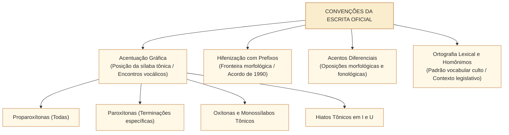
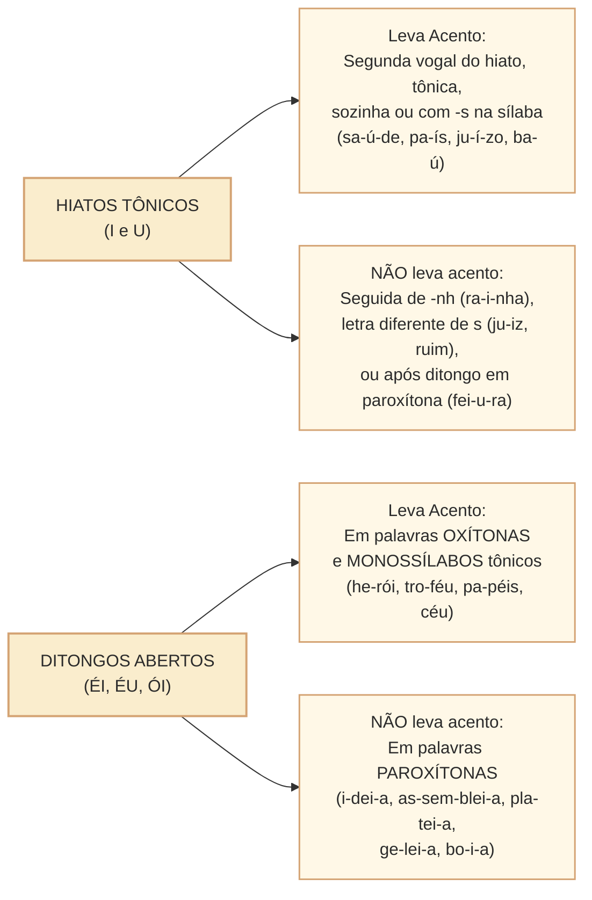
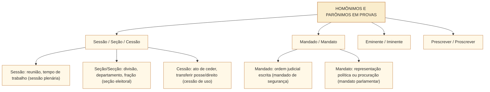

# Ortografia e convenções da escrita: Acordo Ortográfico, acentuação gráfica, hifenização e ortoépia no padrão Cebraspe

## 1. Situação concreta e a normatização oficial da escrita

Na atividade legislativa e na redação dos atos oficiais da Câmara dos Deputados, a obediência às convenções ortográficas e às regras de acentuação gráfica não é mero capricho estético: é uma imposição da **segurança jurídica e do princípio da clareza** (Lei Complementar nº 95/1998 e Manual de Redação da Presidência da República). Uma oscilação gráfica em termos técnicos, a omissão de um acento que diferencie classes gramaticais (como *pode* no presente do indicativo versus *pôde* no pretérito perfeito) ou a hifenização incorreta de compostos e prefixos em ementas legislativas comprometem a padronização oficial e a inteligibilidade do texto normativo.

Nas provas do **Cebraspe**, a cobrança de **ortografia e convenções da escrita** não se restringe a listas de decoreba. A banca avalia:
1. **A justificativa fonológica e estrutural do acento**: se duas palavras são acentuadas com base na mesma regra ou em regras distintas (ex.: paroxítona terminada em ditongo crescente $\times$ proparoxítona eventual);
2. **As regras de hifenização do Acordo Ortográfico de 1990** (em vigor obrigatório desde 2016): o princípio dos opostos (vogais iguais se repelem; vogais diferentes se atraem), a regra do H e a duplicação de R/S;
3. **Casos especiais e acentos diferenciais remanescentes**: a abolição do acento diferencial em pares como *para/pára*, *pelo/pêlo*, mantendo-se em *pôde/pode*, *pôr/por* e nos verbos *ter/vir* e seus derivados (*têm/vêm*, *mantêm/intervêm*);
4. **Ortografia oficial e parônimos/homônimos contextuais** recorrentes no serviço público (*sessão, seção, cessão*; *mandado, mandato*; *eminente, iminente*).

---

## 2. Acentuação Gráfica: Sistema de Regras e Fundamentação Fonológica

A acentuação gráfica em língua portuguesa orienta a pronúncia correta (*ortoépia*) de vocábulos que fogem ao padrão prosódico natural da língua. Em português, o padrão estatisticamente dominante é a **paroxítona terminada em -a, -e, -o (seguidos ou não de -s) e -em/-ens**. Portanto, palavras que seguem esse padrão natural **não recebem acento gráfico** (*mesa, livro, parede, homem, jovens*). O acento é acionado justamente quando a estrutura silábica destoa dessa norma espontânea.

### 2.1. Regras Básicas: Posição da Sílaba Tônica

| Posição Tônica | Regra Geral de Acentuação | Exemplos Canônicos no Serviço Público | Armadilha Clássica do Cebraspe |
| :--- | :--- | :--- | :--- |
| **Proparoxítonas** (antepenúltima) | **Todas** são acentuadas graficamente sem exceção. | *câmara, público, déficit, trâmite, regimento, código, rubrica* (esta última é paroxítona: pronuncia-se *ru-BRI-ca*, sem acento!). | Induzir o candidato a considerar *rubrica* ou *filantropo* como proparoxítonas. |
| **Paroxítonas** (penúltima) | Acentuam-se as terminadas em: **-r, -x, -n, -l**; **-i(s), -us**; **-um, -uns**; **-ã(s), -ão(s)**; **-ps**; e **ditongos orais** (crescentes ou decrescentes, seguidos ou não de -s). | *caráter, tórax, hífen (mas hifens não leva!), fóssil, júri, vírus, fórum, álbuns, órfã, órgão, bíceps, relatório, matéria, previdenciário*. | Afirmar que *hífen* e *hifens* recebem acento pela mesma regra (o plural *hifens* não é acentuado). |
| **Oxítonas** (última) | Acentuam-se as terminadas em: **-a(s), -e(s), -o(s)**; **-em, -ens**; e nos **ditongos abertos oxítonos -éi(s), -éu(s), -ói(s)**. | *estará, você, proporá, também, parabéns, desdém, troféu, herói, papéis, chapéu*. | Confundir oxítonas terminadas em -em (*contém*) com monossílabos ou paroxítonas. |
| **Monossílabos Tônicos** | Acentuam-se os terminados em: **-a(s), -e(s), -o(s)** e nos ditongos abertos **-éi(s), -éu(s), -ói(s)**. | *pá, três, dó, céu, réu, dói, há (verbo)*. | Afirmar que *pá* e *estará* são acentuadas pela mesma regra (monossílabo tônico $\neq$ oxítona). |

---

### 2.2. A Questão Controversa do Cebraspe: Paroxítonas Terminadas em Ditongo Crescente $\times$ Proparoxítonas Eventuais

Um dos temas mais frequentes em provas do Cebraspe envolve vocábulos como *relatório, câmara, secretária, estratégia, judiciário, série, história*.
- **Posição Tradicional (Cegalla, Bechara)**: São palavras **paroxítonas terminadas em ditongo oral crescente** (*re-la-tó-rio*, *es-tra-té-gia*).
- **Posição Fonológica Complementar (Câmara Júnior, Rocha Lima)**: Admitem dupla pronúncia na prosódia culta, podendo ser tratadas como **proparoxítonas eventuais, aparentes ou relativas**, caso o encontro vocálico final seja pronunciado em hiato (*re-la-tó-ri-o*, *es-tra-té-gi-a*).

> **Atenção no Cebraspe**: A banca aceita **ambas** as classificações em seus itens. Quando o Cebraspe afirma que *"as palavras 'relatório' e 'previdenciário' são acentuadas com base na mesma justificativa gramatical"*, o item está **CERTO** (ambas são paroxítonas terminadas em ditongo crescente, ou ambas são proparoxítonas eventuais). Contudo, se a banca comparar *relatório* (paroxítona terminada em ditongo) com *público* (proparoxítona real/estrita), afirmando que possuem a **mesma regra**, o item é considerado **ERRADO** pela regra estrita tradicional, salvo se a assertiva explicitar expressamente a teoria das proparoxítonas aparentes.

---

### 2.3. Regras Especiais: Hiatos e Ditongos Abertos no Acordo Ortográfico

1. **Hiato Tônico em I e U**:
   - Acentuam-se o **i** e o **u** tônicos quando formam hiato com a vogal anterior, sozinhos na sílaba ou seguidos de **-s** (*sa-ú-de, sa-í-da, pa-ís, pro-í-be, ba-ús*).
   - *Não se acentuam*: se seguidos de **-nh** (*rainha, bainha*); se seguidos de outra consoante que não -s (*juiz, ruim, cair, paul*); ou se forem precedidos de ditongo **em palavras paroxítonas** (*feiura, baiuca* — mas atenção: em oxítonas mantém-se o acento, como em *Piauí*!).

2. **Ditongos Abertos ÉI, ÉU, ÓI**:
   - Perderam o acento gráfico nas **paroxítonas**: *ideia, assembleia, plateia, proteico, paranoia, jiboia, heroico, apoio (substantivo)*.
   - **Mantêm o acento** nas **oxítonas** e **monossílabos**: *herói, troféu, chapéu, papéis, dói, sóis, céu, anéis*.

3. **Vogais Duplas EE e OO**:
   - Perderam totalmente o acento circunflexo: *creem, deem, leem, veem* (e derivados: *descreem, releem, preveem*); *voo, enjoo, perdoo, abençoo*.

---

### 2.4. Acentos Diferenciais Remanescentes

O Acordo Ortográfico aboliu a imensa maioria dos acentos diferenciais (*para* do verbo parar $\rightarrow$ *para*; *pela* do verbo pelar $\rightarrow$ *pela*; *polo* atração $\rightarrow$ *polo*). No entanto, preservou acentos diferenciais vitais para desfazer ambiguidades gramaticais:

| Caso Diferencial | Com Acento Gráfico | Sem Acento Gráfico | Função Gramatical / Contexto |
| :--- | :--- | :--- | :--- |
| **pôde $\times$ pode** | **pôde** (pretérito perfeito do indicativo: som fechado) | **pode** (presente do indicativo: som aberto) | Diferenciação de tempo verbal estritamente obrigatória. |
| **pôr $\times$ por** | **pôr** (verbo no infinitivo) | **por** (preposição essencial) | Diferenciação de classe gramatical obrigatória (*pôr o projeto em pauta por decisão da Mesa*). |
| **ter e vir (Plural)** | **eles têm**, **eles vêm** (circunflexo marca o plural) | **ele tem**, **ele vem** (singular sem acento) | Monossílabos com concordância de número. |
| **Derivados de ter/vir** | **eles mantêm**, **eles intervêm**, **eles contêm** (circunflexo no plural) | **ele mantém**, **ele intervém**, **ele contém** (agudo no singular por ser oxítona em -em) | Oxítonas terminadas em -em/-ens com diferenciação morfológica singular $\times$ plural. |
| **fôrma $\times$ forma** | **fôrma** (utensílio/molde — acento circunflexo **facultativo**) | **forma** (aspecto, modo, verbo formar) | Uso recomendável na redação oficial quando houver ambiguidade evidente. |

---

## 3. Hifenização com Prefixos no Acordo Ortográfico

A hifenização sob o Acordo de 1990 rege-se pelo princípio da aglutinação sistemática, ressalvadas as fronteiras fonéticas de conflito.

### 3.1. A Regra Geral dos Opostos (Vogais)
- **Vogais Iguais $\rightarrow$ USA-SE HÍFEN** (*princípio da repulsão de iguais*):  
  *micro-ondas, anti-inflamatório, micro-organismo, contra-ataque, auto-observação, sobre-elevar*.
- **Vogais Diferentes $\rightarrow$ JUNTA-SE TUDO** (*princípio da atração dos diferentes*):  
  *autoescola, infraestrutura, semiaberto, coautor, extraoficial, plurianual, hidroelétrica, socioeconômico*.

### 3.2. H inicial: regra geral e exceções verificadas
- **Em regra**, usa-se hífen antes de elemento iniciado por **h**: *anti-higiênico, super-homem, sobre-humano, pré-história*. A palavra **sempre** tornaria a regra falsa, pois há prefixos que se aglutinam com supressão do **h**.
- Com **co-**, a Academia Brasileira de Letras registra **coerdeiro**, **coabitar** e formas semelhantes sem hífen e sem **h**. É necessário distinguir a redação original da Base XVI do Acordo, que exemplificava *co-herdeiro*, da interpretação adotada no **VOLP brasileiro**. Para a grafia brasileira de referência, prefira **coerdeiro**. Fonte: [Academia Brasileira de Letras, *Acordo ortográfico e VOLP*](https://www.academia.org.br/artigos/acordo-ortografico-e-volp-2).
- Também existem formações consagradas com perda do **h**, como *inábil* e *subumano*. Em dúvidas sobre a existência de exceção, consultar o [VOLP da ABL](https://www.academia.org.br/nossa-lingua/busca-no-vocabulario), evitando extrapolar por analogia.

### 3.3. Prefixos com Consoantes R e S
- Se o prefixo terminar por **vogal** e o segundo elemento começar por **R** ou **S**, o hífen é **eliminado** e a consoante é **duplicada** (-rr-, -ss-) para manter o som forte:  
  *antissocial, contrarregra, autorretrato, microssistema, ultrassom, cosseno, antirrepublicano, minissaia*.
- *Atenção aos prefixos terminados em consoante*: Se o prefixo terminar em consoante e o segundo elemento começar pela **mesma consoante**, usa-se hífen:  
  *super-resistente, inter-resistente, sub-base, sob-roda*. Mas se forem consoantes diferentes, aglutina-se: *superinteressante, hiperativo, subchefe, subscrito*.

### 3.4. Casos Especiais Mandatórios no Cebraspe

| Prefixo ou Elemento | Regra de Hifenização | Exemplos Canônicos |
| :--- | :--- | :--- |
| **pré-, pós-, pró- (Tônicos e autônomos)** | **Sempre com hífen** e com acento próprio. | *pré-requisito, pós-graduação, pró-reitoria, pré-natal, pró-ativo*. |
| **pre-, pos-, pro- (Átonos e aglutinados)** | **Sem hífen** e sem acento gráfico. | *prever, propor, predeterminar, preexistente, pospor*. |
| **ex-, sem-, vice-, soto-, além-, aquém-, recém-** | **Sempre com hífen**. | *ex-presidente, vice-líder, recém-eleito, sem-terra, além-fronteiras*. |
| **sub-** | Usa hífen antes de **B, H e R**. | *sub-base, sub-bloco, sub-humano, sub-região*. Diante de outras letras, aglutina: *subchefe, subdelegado, subestimar*. |
| **co-, re-** | Em regra, **aglutinam-se mesmo diante de vogal igual**; com *co-*, ocorre também supressão de *h* em grafias registradas pelo VOLP. | *coordenar, cooperar, reeleger, reeditar, coabitar, coerdeiro*. |

---

## 4. Ortografia Lexical e Vocabulário Oficial no Serviço Público

O Cebraspe frequentemente constrói itens de interpretação e gramática que exploram a grafia exata de parônimos e homônimos aplicados ao direito administrativo e regimental:

---

## 5. Casos Práticos na Redação Legislativa

### Caso 1: Parecer da CCJC e Justificativa de Acentuação
- **Situação**: O relator da CCJC emprega em seu voto os vocábulos *acórdão, relatório, câmara e déficit*. Em item de prova, a banca indaga se *relatório* e *câmara* recebem acento gráfico em razão da mesma regra.
- **Análise Normativa**:
  - *câmara*: proparoxítona real/estrita (a antepenúltima sílaba é a tônica: *câ-ma-ra*). Todas as proparoxítonas são acentuadas.
  - *relatório*: paroxítona terminada em ditongo oral crescente (*re-la-tó-rio*).
  - *Julgamento*: Embora admitam a teoria fonológica das proparoxítonas aparentes, no confronto direto estrito, *relatório* e *câmara* derivam de regras formais primárias **distintas**. A assertiva que afirme categoricamente que pertencem à mesmíssima regra sem menção à teoria fonológica especial é avaliada como **ERRADA** no Cebraspe.

### Caso 2: Emenda Substitutiva e Hifenização de Cargos e Prefixos
- **Situação**: Uma emenda substitutiva apresentada pela Mesa Diretora propõe criar as figuras de *vice-presidente da comissão*, *coordenador-geral*, *sub-região metropolitana* e *infra-estrutura de TI*.
- **Análise Normativa**:
  - *vice-presidente*: correto com hífen (o prefixo *vice-* sempre exige hífen).
  - *coordenador-geral*: correto com hífen (composto com adjetivo qualificativo autônomo).
  - *sub-região*: correto com hífen (prefixo *sub-* diante de R exige hífen).
  - *infra-estrutura*: **INCORRETO**. Pelo Acordo Ortográfico, o prefixo termina em vogal (-a) e a base inicia por vogal diferente (-e); aplica-se a atração de diferentes: **infraestrutura** (sem hífen).

### Caso 3: Ata da Sessão e Acento Diferencial Verbal
- **Situação**: A ata da sessão registra: *"Os líderes partidários tem divergências regimentais, mas a Presidência mantem a deliberação"*.
- **Análise Normativa**:
  - Sujeito plural (*os líderes partidários*) exige o verbo no plural com acento circunflexo diferencial: **eles têm**.
  - Sujeito singular (*a Presidência*) com verbo derivado oxítono em -em exige acento agudo: **ela mantém** (ao passo que o plural seria *elas mantêm*).
  - O texto apresentava erro duplo de acentuação diferencial.

---

## 6. Questões Inéditas Comentadas no Padrão Cebraspe

### Questão 1
*(Inédita: estilo Cebraspe / Câmara dos Deputados – Analista Legislativo)*  
As palavras “Câmara”, “público” e “trâmite” são acentuadas graficamente com base na mesma regra de acentuação gráfica, segundo a qual todas as palavras proparoxítonas devem ser acentuadas na língua portuguesa.

- [ ] Certo
- [ ] Errado

> **Gabarito: CERTO**  
> **Comentário**: Os três vocábulos têm a antepenúltima sílaba como tônica (*Câ-ma-ra*, *pú-bli-co*, *trâ-mi-te*), enquadrando-se com perfeição e sem controvérsias na regra universal das **proparoxítonas**, cuja prescrição normativa impõe acento gráfico a todas elas, sem exceções.

---

### Questão 2
*(Inédita: estilo Cebraspe / Câmara dos Deputados – Analista Legislativo)*  
Os vocábulos “estratégia”, “previdenciário” e “noticiário” são acentuados graficamente por serem paroxítonas terminadas em ditongo oral crescente, admitindo-se, segundo vertente fonológica da gramática normativa, sua classificação alternativa como proparoxítonas eventuais.

- [ ] Certo
- [ ] Errado

> **Gabarito: CERTO**  
> **Comentário**: O item aborda com absoluta precisão o duplo enquadramento formal admitido pelo Cebraspe. Na divisão silábica tradicional das paroxítonas terminadas em ditongo crescente (*es-tra-té-gia*, *pre-vi-den-ciá-rio*, *no-ti-ciá-rio*), a penúltima sílaba é a tônica. Em virtude da semivogal final seguida de vogal aberta, admite-se na pronúncia culta a realização em hiato (*es-tra-té-gi-a*), o que autoriza fonologicamente a designação como proparoxítonas eventuais ou aparentes.

---

### Questão 3
*(Inédita: estilo Cebraspe / Câmara dos Deputados – Analista Legislativo)*  
Em conformidade com as regras de hifenização fixadas pelo Acordo Ortográfico vigente, os vocábulos “autoescola”, “antissocial” e “micro-ondas” encontram-se grafados em estrita observância ao padrão culto oficial.

- [ ] Certo
- [ ] Errado

> **Gabarito: CERTO**  
> **Comentário**: As três formas estão perfeitamente corretas:
> 1. *autoescola*: prefixo em vogal (-o) diante de vogal diferente (-e) aglutina-se sem hífen;
> 2. *antissocial*: prefixo em vogal (-i) diante de S elimina o hífen e duplica a consoante (-ss-);
> 3. *micro-ondas*: prefixo em vogal (-o) diante da mesma vogal (-o) exige hífen pelo princípio da repulsão de iguais.

---

### Questão 4
*(Inédita: estilo Cebraspe / Câmara dos Deputados – Analista Legislativo)*  
Mantêm a acentuação gráfica original as formas paroxítonas com ditongos abertos “ei” e “oi”, tais como “idéia”, “assembléia” e “heróico”, preservando-se o acento agudo para assinalar o timbre aberto das vogais tônicas.

- [ ] Certo
- [ ] Errado

> **Gabarito: ERRADO**  
> **Comentário**: Com o advento do Acordo Ortográfico de 1990 (obrigatório desde 2016), os ditongos abertos **-ei-** e **-oi-** perderam o acento gráfico nas palavras **paroxítonas**. Grafam-se obrigatoriamente sem acento: **ideia, assembleia, heroico, plateia, paranoia**. O acento agudo nesses ditongos só permanece em palavras **oxítonas** e monossílabos tônicos (*herói, troféu, papéis, dói, céu*).

---

### Questão 5
*(Inédita: estilo Cebraspe / Câmara dos Deputados – Analista Legislativo)*  
No trecho “o relator não pôde comparecer à comissão no horário regimental, mas agora pode deliberar normalmente”, a presença do acento circunflexo na forma verbal “pôde” justifica-se por razões de distinção temporal e morfológica em relação a “pode”.

- [ ] Certo
- [ ] Errado

> **Gabarito: CERTO**  
> **Comentário**: O par *pôde / pode* constitui um dos acentos diferenciais expressamente preservados pelo Acordo Ortográfico. O circunflexo em *pôde* (com som fechado /ô/) é de uso obrigatório para indicar a terceira pessoa do singular do **pretérito perfeito do indicativo**, diferenciando-se da forma homógrafa *pode* (com som aberto /ó/), pertencente ao **presente do indicativo**.

---

### Questão 6
*(Inédita: estilo Cebraspe / Câmara dos Deputados – Analista Legislativo)*  
A palavra “hífen” recebe acento gráfico por ser paroxítona terminada na consoante -n; por essa mesma razão, a sua forma de plural — “hifens” — deve ser obrigatoriamente acentuada graficamente.

- [ ] Certo
- [ ] Errado

> **Gabarito: ERRADO**  
> **Comentário**: Trata-se de uma das mais célebres pegadinhas do Cebraspe em acentuação. No singular, **hífen** recebe acento por ser paroxítona terminada em -n (*pólen, próton, elétron*). No entanto, o seu plural **hifens** termina em **-ens**, que é a terminação típica das paroxítonas que **não** recebem acento (a terminação -ens só gera acento em palavras oxítonas, como *parabéns, desdém, armazéns*). Logo, escreve-se *hífen* (com acento), mas *hifens* e *polens* (sem acento!).

---

## 7. Relações com Outras Unidades e Próximos Passos

- **Unidade Anterior**: [[3 - Materias/Portugues/16 - genero textual situacao de uso suporte e finalidade|CAM-LP-005 · Gênero textual: situação de uso, suporte e finalidade]].
- **Artigo Histórico Conexo**: [[3 - Materias/Portugues/05 - acordo ortografico|05 • Acordo ortográfico (Guia Sintético de Prefixos)]].
- **Próxima Unidade**: **CAM-LP-007 · Referência textual: anáfora, catáfora e dêixis** (Mecanismos de referenciação endofórica e exofórica, cadeias coesivas e pronomes demonstrativos no padrão Cebraspe).
