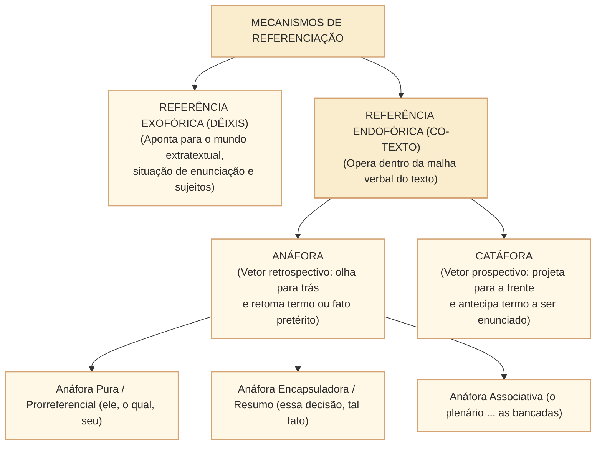
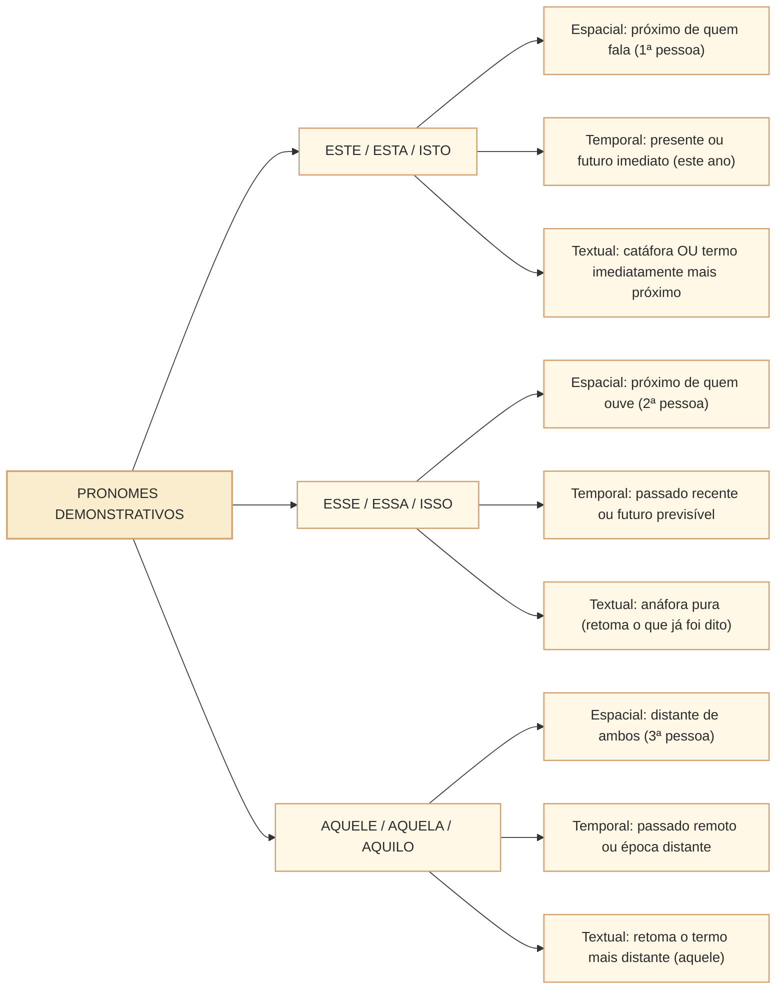

# Referência textual: anáfora, catáfora, dêixis e cadeias coesivas no padrão Cebraspe

## 1. Situação concreta e a tessitura referencial no discurso legislativo

Em peças institucionais e proposições legislativas na Câmara dos Deputados, a clareza e a precisão das remissões textuais são determinantes para evitar antinomias e ambiguidades interpretativas. Considere o trecho de um relatório de comissão:

> *"O relator reuniu-se com o presidente da Mesa Diretora para avaliar as emendas apresentadas ao projeto de lei orçamentária. **Este** manifestou preocupação com o teto de gastos; **aquele**, com os prazos de tramitação regimental. O parecer final contemplou **estas medidas**: contingenciamento preventivo e remanejamento de dotações."*

Nesse excerto, os mecanismos de **referenciação textual** estabelecem a conexão lógica e a identificação unívoca dos termos: o pronome demonstrativo *este* retoma o referente imediatamente mais próximo (*o presidente da Mesa Diretora*); *aquele* resgata o referente mais distante (*o relator*); e o pronome *estas* antecipa o conteúdo dos termos que serão listados a seguir (*contingenciamento preventivo e remanejamento*).

Nas provas do **Cebraspe**, a **coesão referencial** é cobrada em nível profundo e analítico. A banca não se limita a exigir a identificação de pronomes. Ela avalia:
1. **A fronteira entre referência endofórica (textual interna) e exofórica (dêitica/situacional externa)**;
2. **A direção do vetor referencial**: anáfora (retomada à esquerda) $\times$ catáfora (antecipação à direita);
3. **O emprego normativo e discursivo dos pronomes demonstrativos** (*este/esse/aquele*) nos eixos espacial, temporal e textual;
4. **Cadeias coesivas e anáfora associativa/encapsuladora**: a capacidade de um pronome ou sintagma nominal encapsular uma oração inteira ou fato pretérito (*"esse fato", "tal deliberação"*);
5. **Ambiguidade referencial e a armadilha do referente mais próximo**: no Cebraspe, proximidade física não se sobrepõe a restrições sintáticas e plausibilidade semântica.

---

## 2. A Arquitetura da Referenciação: Dêixis $\times$ Endófora

A teoria linguística da coesão (Halliday & Hasan, 1976; Ingedore Koch, 2002) distingue a referência conforme o local onde se encontra a chave interpretativa do referente:

### 2.1. Referência Exofórica (Dêixis)
Ocorre quando o elemento linguístico remete a um referente **fora da superfície textual**, situado na **situação comunicativa concreta (contexto de enunciação)**. O leitor só identifica o referente se conhecer os participantes, o tempo ou o lugar da emissão do discurso.
- **Dêixis Pessoal**: *eu, nós, você, vossa excelência* (identificam os interlocutores no ato da fala).
- **Dêixis Espacial**: *aqui, cá, aí, ali, acolá, este gabinete* (demarcam a posição física em relação ao enunciador).
- **Dêixis Temporal**: *agora, hoje, ontem, amanhã, atualmente, nesta legislatura* (ancoram o enunciado no tempo da fala).

> **Exemplo na Câmara**: Em discurso no Plenário Ulysses Guimarães, o parlamentar declara: *"Subo **aqui** no dia de **hoje** para afirmar que **nós** não aceitaremos cortes na educação."* Os termos *aqui* (espaço), *hoje* (tempo) e *nós* (pessoas) são dêiticos: dependem integralmente do contexto físico em que foram proferidos.

---

### 2.2. Referência Endofórica (Anáfora e Catáfora)
Ocorre quando o referente encontra-se **inscrito no próprio tecido verbal do texto (co-texto)**. Dispensa informações extratextuais imediatas para ser compreendido gramaticalmente:

| Mecanismo Endofórico | Vetor Direcional | Mecanismo Linguístico | Exemplo no Contexto Parlamentar |
| :--- | :--- | :--- | :--- |
| **Anáfora** | **Retrospectivo** ($\leftarrow$ olha para o que já foi dito). | Pronomes retos/oblíquos, possessivos, demonstrativos (*esse, aquele*), sinônimos e hiperônimos. | *"A Comissão de Ética concluiu o relatório preliminar. **O documento** será votado na próxima terça-feira."* (*O documento* retoma anaforicamente *o relatório preliminar*). |
| **Catáfora** | **Prospectivo** ($\rightarrow$ aponta para o que será dito). | Pronomes demonstrativos catafóricos (*isto, este*), dois-pontos e orações apositivas. | *"A Consultoria Legislativa enfatizou **isto**: a emenda orçamentária é incompatível com a LDO."* (*isto* antecipa a oração que se segue). |

---

## 3. O Emprego Normativo e Discursivo dos Pronomes Demonstrativos

O Cebraspe explora com grande frequência a tripartição dos pronomes demonstrativos (*este/esse/aquele* e suas variações) em três dimensões:

### 3.1. Quadro Sinótico dos Demonstrativos

| Pronome | Dimensão Espacial | Dimensão Temporal | Dimensão Textual (Coesão) |
| :--- | :--- | :--- | :--- |
| **Este, esta, isto** | Próximo do emissor / enunciador (1ª pessoa): *"este microfone em minha bancada"*. | Tempo presente ou presente estendido: *"neste ano legislativo de 2026"*. | 1. **Catáfora**: antecipa termos (*"proponho **isto**: a CPI"*); 2. **Referente mais próximo**: no confronto com outro termo já citado. |
| **Esse, essa, isso** | Próximo do receptor / interlocutor (2ª pessoa): *"esse documento em suas mãos, nobre deputado"*. | Tempo passado recente ou futuro: *"nessa última semana de votações"*. | **Anáfora pura**: retoma termo, oração ou fato já expresso anteriormente (*"A inflação subiu; **esse índice** preocupa"*). |
| **Aquele, aquela, aquilo** | Distante de ambos os interlocutores (3ª pessoa): *"aquele painel eletrônico no fundo do plenário"*. | Tempo passado remoto ou época distante: *"naquela legislatura constituinte de 1988"*. | **Referente mais distante**: no confronto com termo citado anteriormente (*"O Senado e a Câmara divergiram; **esta** (Câmara) aprovou, **aquele** (Senado) rejeitou"*). |

### 3.2. A Regra do Confronto de Termos Antecedentes: Este $\times$ Aquele $\times$ Esse
Quando dois ou três elementos foram mencionados anteriormente e precisam ser retomados sem ambiguidade:
- **Dois elementos citados**:
  - **Este** retoma o termo **mais próximo** (o último citado).
  - **Aquele** retoma o termo **mais distante** (o primeiro citado).
- **Três elementos citados**:
  - **Aquele** retoma o **primeiro** (mais distante);
  - **Esse** retoma o **do meio** (intermediário);
  - **Este** retoma o **último** (mais recente).

---

## 4. Anáfora Encapsuladora e Anáfora Associativa

Nas provas de nível superior do Cebraspe para carreiras legislativas, a referenciação transcende a mera substituição de substantivos por pronomes pessoais.

### 4.1. Anáfora Encapsuladora (Rotulização Conceitual)
Ocorre quando um sintagma nominal (substantivo acompanhado de determinante demonstrativo ou artigo) **resume, sintetiza ou avalia conceitualmente uma proposição inteira**, um parágrafo anterior ou uma cadeia de fatos:
- *Exemplo*: *"O Poder Executivo editou medida provisória autorizando crédito extraordinário para socorro aos municípios atingidos por enchentes. **Essa iniciativa emergencial** foi saudada pelos parlamentares de oposição."*
- *Análise*: A expressão *Essa iniciativa emergencial* não retoma apenas a palavra *medida provisória*, mas **encapsula toda a ação governamental e o propósito do ato**, agregando um juízo valorativo (*iniciativa emergencial*).

### 4.2. Anáfora Associativa
Ocorre quando um termo é introduzido no texto como conhecido (com artigo definido), não porque tenha sido previamente mencionado de forma explícita, mas porque **faz parte do mesmo campo semântico ou esquema cognitivo (*frame*) de um termo antecedente**:
- *Exemplo*: *"A comissão especial aprovou a reforma tributária. **O relator** leu o parecer sob aplausos de governistas, enquanto **as emendas de plenário** eram organizadas pela Mesa."*
- *Análise*: As expressões *O relator* e *as emendas de plenário* não foram introduzidas anteriormente no texto, mas funcionam anaforicamente por **associação enciclopédica** natural à ideia de *comissão especial* e *tramitação legislativa*.

---

## 5. Casos Práticos na Interpretação Cebraspe

### Caso 1: Ambiguidade de Referência Pronominal e Falso "Termo Mais Próximo"
- **Trecho sob Análise**:  
  > *"A Consultoria da Câmara remeteu à liderança partidária a nota técnica sobre a matéria antes que **ela** apresentasse o destaque para votação em separado."*
- **A Questão da Banca**: O pronome "ela" refere-se obrigatoriamente a "nota técnica", por ser este o sintagma substantivo mais próximo na oração anterior.
- **Análise Cebraspe**:
  - *Mecanismo Linguístico*: O pronome reto feminino singular *ela* é sintática e morfologicamente compatível tanto com *a Consultoria da Câmara*, quanto com *a liderança partidária* e *a nota técnica*.
  - *Critério Semântico e Pragmático*: No contexto regimental da Câmara dos Deputados, uma *nota técnica* não tem personalidade jurídica nem capacidade para "apresentar destaque em votação separada" (destaques são prerrogativa de partidos e líderes!). Quem apresenta destaque é *a liderança partidária* (ou a Consultoria em subsídio). Portanto, *ela* remete funcionalmente à liderança partidária, e não ao termo inanimado mais próximo.
  - *Conclusão*: O item é julgado **ERRADO**. Proximidade linear não substitui coerência semântica e competência sintática.

### Caso 2: Emprego de "Este" versus "Esse" na Redação Oficial
- **Trecho sob Análise**:  
  > *"As comissões temáticas deliberaram sobre a admissibilidade da proposição; **essa** decisão destrancou a pauta do plenário."*
- **A Questão da Banca**: A substituição do pronome "essa" por "esta" prejudicaria a correção gramatical do texto, haja vista que apenas a forma com dois "s" pode ser empregada para retomar fatos pretéritos.
- **Análise Cebraspe**:
  - Embora a gramática normativa tradicional prescreva comumente *esse* para a anáfora textual e *este* para a catáfora, o padrão culto e os linguistas modernos (Bechara, Cunha & Cintra) reconhecem que **este** também pode atuar anaforicamente em referência ao texto imediatamente antecedente, sobretudo para criar efeito de atualidade ou proximidade discursiva.
  - O Cebraspe tradicionalmente classifica itens dessa natureza como **ERRADOS** quando a assertiva afirma categoricamente que a permuta entre *este* e *esse* "acarreta incorreção gramatical" no plano anafórico simples, desde que não haja disputa com outro termo anterior (*este $\times$ aquele*).

---

## 6. Questões Inéditas Comentadas no Padrão Cebraspe

### Questão 1
*(Inédita: estilo Cebraspe / Câmara dos Deputados – Analista Legislativo)*  
No trecho “A Mesa Diretora convocou os líderes partidários e os presidentes de comissão. A estes coube a organização das pautas temáticas; àqueles, a articulação do quórum de votação”, o pronome “estes” retoma anaforicamente “os líderes partidários”, por serem as figuras de maior relevância hierárquica na condução das deliberações plenárias.

- [ ] Certo
- [ ] Errado

> **Gabarito: ERRADO**  
> **Comentário**: Na correlação anafórica estrita entre dois termos antecedentes, o par correlativo **estes/àqueles** retoma, **na construção apresentada**, o elemento mais recente (*os presidentes de comissão*) e o primeiro citado (*os líderes partidários*), respectivamente. Esse critério de ordenação **não substitui** a análise de contexto e sentido para outros usos anafóricos. No texto, o termo mais próximo de *estes* é *os presidentes de comissão*; logo, coube a eles a organização das pautas. *Àqueles* retoma *os líderes partidários*. O item é duplamente errado ao inverter a remissão sintática e justificar a escolha por critérios de "relevância hierárquica", critério extralinguístico inexistente na regra de coesão demonstrativa.

---

### Questão 2
*(Inédita: estilo Cebraspe / Câmara dos Deputados – Analista Legislativo)*  
No fragmento “A Casa iniciou os trabalhos e submeteu o projeto à votação; esse conjunto de providências permitiu retomar a tramitação regimental”, a expressão “esse conjunto de providências” desempenha função anafórica encapsuladora, pois reúne e rotula as duas ações anteriormente enunciadas.

- [ ] Certo
- [ ] Errado

> **Gabarito: CERTO**  
> **Comentário**: O item conceitua com precisão a **anáfora encapsuladora** (ou rotuladora). A expressão *esse conjunto de providências* retoma a **sequência formada por iniciar os trabalhos e submeter o projeto à votação**. O núcleo plural e a palavra *conjunto* delimitam explicitamente a retomada de mais de uma ação. Compare com *“a Casa submeteu o projeto à votação; esse ato permitiu...”*, em que *esse ato* pode retomar só a votação. O gabarito CERTO se refere **à versão revista e inequívoca do item inédito**.

---

### Questão 3
*(Inédita: estilo Cebraspe / Câmara dos Deputados – Analista Legislativo)*  
Em “Em pronunciamento no Plenário, o parlamentar declarou: ‘Nesta tarde, nós assumimos perante este Plenário o compromisso de aprovar o orçamento’”, os vocábulos “nesta”, “nós” e “este” operam como elementos de referência endofórica puramente anafórica, visto que prescindem de informações da situação fática concreta para que seus referentes sejam identificados.

- [ ] Certo
- [ ] Errado

> **Gabarito: ERRADO**  
> **Comentário**: Os vocábulos citados (*nesta, nós, este*) exercem função **exofórica (dêitica)**, e não endofórica. Eles apontam para o contexto material imediato de produção do discurso: *nesta tarde* (dêixis temporal ancorada no momento da fala), *nós* (dêixis de pessoa designando o locutor e seus pares) e *este Plenário* (dêixis espacial apontando para o recinto físico onde o orador discursa). Sua interpretação depende intrinsecamente da situação enunciativa extratextual.

---

### Questão 4
*(Inédita: estilo Cebraspe / Câmara dos Deputados – Analista Legislativo)*  
No trecho “O relator salientou que apenas uma medida seria eficaz: a convocação urgente do ministro de Estado”, o termo “uma medida” exerce papel catafórico no texto, projetando a atenção do leitor para a informação enunciada após os dois-pontos.

- [ ] Certo
- [ ] Errado

> **Gabarito: CERTO**  
> **Comentário**: O termo *uma medida* funciona em perspectiva **catafórica** (vetor prospectivo), pois seu conteúdo semântico específico ainda não é conhecido pelo leitor no momento de sua emissão, sendo revelado e esclarecido somente pelo segmento aposto subsequente (*a convocação urgente do ministro de Estado*).

---

### Questão 5
*(Inédita: estilo Cebraspe / Câmara dos Deputados – Analista Legislativo)*  
A identificação do referente de pronomes com valor anafórico orienta-se prioritariamente pela proximidade física linear, de tal sorte que, em caso de ambiguidade estrutural com dois antecedentes compatíveis em gênero e número, a norma gramatical impõe a remissão obrigatória ao termo antecedente mais próximo.

- [ ] Certo
- [ ] Errado

> **Gabarito: ERRADO**  
> **Comentário**: O Cebraspe rejeita firmemente o dogma de que o pronome retoma "obrigatoriamente o termo mais próximo". Quando há ambiguidade na superfície textual, a determinação do referente correto depende da **análise sintática das funções oracionais**, da **seleção semântica dos predicados** e da **coerência lógica e pragmática do contexto discursivo**. A proximidade física não revoga a semântica nem resolve por si só uma ambiguidade.

---

### Questão 6
*(Inédita: estilo Cebraspe / Câmara dos Deputados – Analista Legislativo)*  
Considerando a referência anafórica associativa, a introdução de termos como “os ministros” ou “o plenário” acompanhados de artigo definido é linguisticamente legítima em um texto sobre o Supremo Tribunal Federal, dispensando-se menção prévia explícita a esses vocábulos na superfície textual.

- [ ] Certo
- [ ] Errado

> **Gabarito: CERTO**  
> **Comentário**: Trata-se da exata definição da **anáfora associativa**. Determinados termos não precisam ser explicitamente apresentados com artigo indefinido para depois serem retomados pelo definido, pois são ativados na memória discursiva por pertencerem ao mesmo esquema semântico-cognitivo (*frame*) de um termo-âncora (no caso, a menção ao *Supremo Tribunal Federal* evoca automaticamente os conceitos de *ministros* e *plenário*).

---

## 7. Relações com Outras Unidades e Próximos Passos

- **Unidade Anterior**: [[3 - Materias/Portugues/17 - ortografia convencoes da escrita acentuacao e hifenizacao|Ortografia e convenções da escrita: Acordo Ortográfico, acentuação gráfica, hifenização e ortoépia no padrão Cebraspe]].
- **Artigo Fundamental Conexo**: [[3 - Materias/Portugues/08 - coesao textual referenciacao e tempos verbais|08 • Coesão textual: referenciação, conectores e tempos verbais (Visão Geral)]].
- **Próxima Unidade**: **CAM-LP-008 · Substituição, elipse, repetição e coesão lexical** (Coesão lexical por hiponímia/hiperonímia, nominalização, elipse do sujeito e coesão por reiteração no padrão Cebraspe).
