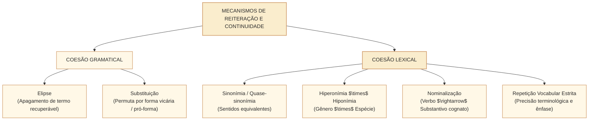

# Substituição, elipse, repetição e coesão lexical: mecanismos de reiteração no padrão Cebraspe

## 1. Situação concreta e os recursos de tessitura lexical no texto oficial

Na elaboração de textos normativos e pronunciamentos na Câmara dos Deputados, a manutenção do fluxo informativo exige um equilíbrio delicado entre **clareza terminológica e concisão estilística** (Manual de Redação da Presidência da República). A repetição desordenada de um mesmo substantivo produz monotonia e cansaço visual; por outro lado, a substituição leviana de termos jurídicos precisos por sinônimos imprecisos gera insegurança conceitual. Observe o fragmento adaptado de um debate em plenário:

> *"A Comissão de Fiscalização Financeira e Controle realizou a **auditoria** nos contratos de tecnologia da informação. Essa **fiscalização** revelou sobrepreço em licenças de software. Os técnicos constataram irregularidades nos pagamentos e $\varnothing$ apontaram a responsabilidade dos gestores. Para solucionar o impasse, o Tribunal de Contas da União sugeriu a anulação do certame; a Mesa Diretora da Câmara fez **o mesmo**."*

Neste parágrafo atuam quatro mecanismos fundamentais da **coesão gramatical e lexical**:
1. **Coesão Lexical por Hiperonímia**: o termo específico *auditoria* é retomado pelo termo mais abrangente *fiscalização* (hiperônimo);
2. **Elipse Gramatical (Sujeito Elíptico / Oculto)**: o sujeito da forma verbal *apontaram* é omitido ($\varnothing$), sendo recuperado contextualmente pelo sintagma *Os técnicos*;
3. **Substituição Gramatical**: a expressão *o mesmo* substitui anaforicamente todo o predicado verbal anterior (*sugeriu a anulação do certame*);
4. **Repetição e Reiteração Vocabular Controlada**: termos técnicos insubstituíveis (*tecnologia da informação, software*) são mantidos para preservar a precisão semântica.

Nas provas do **Cebraspe**, a banca não se limita a perguntar se dois termos são sinônimos. Ela avalia se a **substituição lexical altera o grau de generalidade do enunciado**, se a **elipse preserva a correlação sintática estrita sem acarretar ambiguidade** e se a **repetição é viciosa (tautológica) ou funcional (enfática/terminológica)**.



---

## 2. Coesão Gramatical: Elipse e Substituição

A coesão gramatical opera no nível estrutural das funções sintáticas e das formas vicárias (Halliday & Hasan; Ingedore Koch).

### 2.1. A Elipse e seus Limites Gramaticais
A **elipse** consiste na **omissão deliberada de um termo gramatical** cuja identificação é assegurada com clareza pela malha contextual ou pelas desinências flexionais.
- **Elipse do Sujeito**: É o caso mais frequente em português. Quando o sujeito de orações coordenadas é idêntico, sua omissão assegura a agilidade do período:
  - *"O relator rejeitou as emendas da oposição e $\varnothing$ apresentou voto favorável ao texto original."* ($\varnothing$ = o relator).
- **Zeugma (Espécie de Elipse)**: Ocorre quando o elemento omitido já foi **expressamente enunciado no período anterior**:
  - *"A Câmara aprovou o projeto de lei ordinária; o Senado, o projeto de lei complementar."* (Omissão da forma verbal *aprovou* na segunda oração, comumente assinalada por vírgula).
- **Falsa Elipse / Ambiguidade**: A omissão torna-se viciosa quando o período contém dois antecedentes gramaticais plausíveis para a oração seguinte:
  - *"O ministro consultou o diretor do departamento antes que $\varnothing$ decidisse sobre o cancelamento do contrato."* (A elipse gera dúvida: quem decidiu? O ministro ou o diretor?).

### 2.2. A Substituição e as Formas Vicárias
Diferente da elipse (que apaga o termo), a **substituição** introduz um elemento gramatical substituto (*forma vicária* ou *pró-forma*) no lugar de um nome, verbo ou oração inteira:
- **Substituição Nominal**: *"Muitos servidores apoiaram a proposta; **outros**, a rejeitaram."* (*outros* atua como pró-forma nominal).
- **Substituição Verbal (Verbo Vicário *Fazer*)**: *"O presidente do colegiado solicitou vista dos autos, e o líder da minoria fez **o mesmo**."* (A expressão *fez o mesmo* substitui o sintagma verbal *solicitou vista dos autos*).
- **Substituição Frasal/Oracional (Pronomes Neutros *o*, *isso*)**: *"O regimento proíbe a votação de matéria sem parecer de mérito, mas os líderes não **o** sabiam."* (O pronome oblíquo átono *o* substitui toda a oração antecedente).

---

## 3. Coesão Lexical: Estruturas Semânticas e Relações Conceituais

A **coesão lexical** opera por meio da seleção vocabular, estabelecendo elos conceituais entre diferentes segmentos do texto.

```mermaid
flowchart LR
    classDef default fill:#fff8e7,stroke:#d4a373,stroke-width:1.5px,color:#2b2b2b;
    classDef destaque fill:#faedcd,stroke:#d4a373,stroke-width:2px,color:#2b2b2b;

    ESC["ESCALA SEMÂNTICA"]:::destaque

    HIPER["HIPERÔNIMO<br>(Termo de sentido mais amplo / Gênero)<br>Ex.: Documento, Proposição, Sanção"]
    HIPO["HIPÔNIMO<br>(Termo de sentido mais específico / Espécie)<br>Ex.: Emenda, Medida Provisória, Multa"]

    HIPO -->|Generalização coesiva: Hipônimo $\rightarrow$ Hiperônimo (Legítima)| HIPER
    HIPER -.->|Especificação indevida: Hiperônimo $\rightarrow$ Hipônimo (Risco de extrapolação)| HIPO
```

### 3.1. Hiperonímia versus Hiponímia no Cebraspe
A relação hiperonímica organiza o vocabulário em hierarquias semânticas:
- **Hiperônimo**: termo com maior extensão semântica e menor intensão (mais genérico). Ex.: *proposição legislativa, servidor público, penalidade administrativa*.
- **Hipônimo**: termo com menor extensão semântica e maior intensão (mais específico). Ex.: *projeto de lei complementar, analista legislativo, demissão*.

> **Atenção no Cebraspe**: 
> 1. A retomada de um **hipônimo por um hiperônimo** é semanticamente legítima e preserva a coerência do texto: *"A comissão aprovou a **Medida Provisória**. A **proposição** segue agora para o Plenário."* (Toda Medida Provisória é uma proposição; não há extrapolação!).
> 2. O inverso, contudo, é uma **armadilha frequente de interpretação**: tomar um termo genérico do texto e substituí-lo por um específico altera o sentido original. Se o texto diz que *"a autoridade aplicou **penalidades** aos infratores"*, inferir que *"a autoridade aplicou **demissão**"* constitui extrapolação indevida, pois a espécie *demissão* não foi autorizada pela premissa ampla.

### 3.2. Sinonímia Contextual e Quase-Sinonímia
Dois vocábulos raramente compartilham 100% de seus traços semânticos e conotativos em todos os contextos. A sinonímia avaliada pelo Cebraspe é **estritamente contextual**:
- *"O relator manteve postura **inflexível** durante a negociação."* $\rightarrow$ Em contexto formal de deliberação, *inflexível* equivale a *intransigente* ou *rígido*, mas **não** equivale a *duro* no sentido físico material.
- Na redação oficial, a sinonímia deve ser dosada com cautela: termos técnicos consolidados na legislação (*posse, exercício, vacância, provimento*) possuem definição jurídica autônoma na Lei nº 8.112/1990 e **não admitem substituição por sinônimos populares**.

### 3.3. Nominalização (Derivação Sufixal Coesiva)
A **nominalização** consiste na transformação de um verbo (ou adjetivo) em um substantivo abstrato correspondente, permitindo transformar um processo dinâmico em um conceito estático que serve de tópico para a oração seguinte:
- *"A Mesa Diretora **reorganizou** a estrutura das secretarias parlamentares. Essa **reorganização** permitiu economizar recursos orçamentários."*
- *Função no discurso*: Converte a ação verbal (*reorganizou*) em fato consolidado (*reorganização*), permitindo a progressão temática sem redundância frasal.

### 3.4. Repetição Vocabular: Vício $\times$ Recurso Legítimo
A repetição de palavras é historicamente estigmatizada no ensino escolar tradicional. No entanto, na redação oficial e na jurisprudência do Cebraspe, a repetição é reconhecida como **plenamente legítima e necessária** quando:
1. **Garante a precisão técnica e jurídica**: evitar confusão entre categorias regimentalmente distintas (*ordem do dia, questão de ordem, destaque*);
2. **Assegura a ênfase retórica e persuasiva**: em discursos parlamentares e petições orais;
3. **Evita a ambiguidade produzida por sinônimos imperfeitos**.
- *Critério de reprovação*: A repetição só se torna viciosa quando resulta de **pobreza lexical do enunciador**, gerando cacofonia e redundância sem ganho comunicativo.

---

## 4. Matriz Comparativa dos Mecanismos de Coesão

| Mecanismo de Coesão | Classificação | Operação Linguística Principal | Risco / Ponto Crítico no Cebraspe |
| :--- | :--- | :--- | :--- |
| **Elipse** | Gramatical | Apagamento de termo recuperável pela morfologia ou contexto. | Falso elipse gerando ambiguidade de sujeito com dois antecedentes. |
| **Zeugma** | Gramatical | Omissão de termo expresso em oração imediatamente antecedente. | Pontuação inadequada (vírgula marcando a elipse do verbo). |
| **Substituição** | Gramatical | Emprego de pró-formas gramaticais (*o mesmo, outro, tal*). | Emprego abusivo de *"o mesmo"* como pronome pessoal (vedado pelo MRPR!). |
| **Hiperonímia** | Lexical | Retomada do específico (hipônimo) pelo genérico (hiperônimo). | Omissão de nuances ou falsa generalização no raciocínio lógico. |
| **Nominalização** | Lexical | Conversão de verbo/ação em substantivo cognato. | Condensação semântica excessiva que prejudique a clareza. |
| **Repetição** | Lexical | Reiteração literal de vocábulo na superfície textual. | Confundir repetição técnica necessária com erro gramatical. |

---

## 5. Casos Práticos na Interpretação de Textos da Câmara

### Caso 1: O Emprego Vicioso de "O Mesmo" versus Substituição Legítima
- **Texto analisado**:  
  > *"O parlamentar entregou o parecer à Mesa e solicitou que **o mesmo** fosse lido no expediente."*
- **A Questão da Banca**: O emprego da expressão "o mesmo" está plenamente adequado às normas do Manual de Redação da Presidência da República (MRPR), funcionando como mecanismo legítimo de coesão anafórica.
- **Análise Cebraspe**:
  - *Norma Culta e Redação Oficial*: O Manual de Redação da Presidência da República condena expressamente o uso de *o mesmo* como pronome pessoal substituto de substantivo antecedente. Para retomar *o parecer*, a redação oficial exige o pronome pessoal oblíquo átono (*solicitou que **ele** fosse lido* ou *solicitou **sua** leitura*).
  - *Julgamento*: Item considerado **ERRADO**. A substituição por *o mesmo* só é gramaticalmente aceitável quando atua em construções de identidade estrita ou reforço enfático (*"fez o mesmo que o colega"*), nunca como pronome pessoal puro.

### Caso 2: Hiperonímia e o Limite da Dedução Lógica no Parecer
- **Texto analisado**:  
  > *"A Consultoria da Câmara examinou os **projetos de lei ordinária** referentes à política habitacional e opinou pelo arquivamento daqueles que colidiam com normas federais."*
- **Assertiva da Banca**: Infere-se do texto que todas as proposições legislativas sobre política habitacional em tramitação na Casa foram objeto de análise da Consultoria.
- **Análise Cebraspe**:
  - *Erro Semântico por Generalização*: O texto menciona especificamente *projetos de lei ordinária* (hipônimo). A assertiva extrapola para *todas as proposições legislativas* (hiperônimo abrangente que inclui PECs, Projetos de Lei Complementar, Medidas Provisórias e Decretos Legislativos).
  - *Julgamento*: Item considerado **ERRADO**. A substituição de hipônimo por hiperônimo em itens inferenciais do Cebraspe altera a quantificação e o escopo do enunciado original.

---

## 6. Questões Inéditas Comentadas no Padrão Cebraspe

### Questão 1
*(Inédita: estilo Cebraspe / Câmara dos Deputados – Analista Legislativo)*  
No trecho “A comissão aprovou a emenda à proposta de emenda constitucional; a Mesa Diretora, a publicação do texto consolidado”, a vírgula empregada após “Mesa Diretora” justifica-se pela omissão da forma verbal “aprovou”, configurando o recurso da coesão por zeugma.

- [ ] Certo
- [ ] Errado

> **Gabarito: CERTO**  
> **Comentário**: O item descreve com exatidão a figura sintática do **zeugma**, espécie de elipse em que se omite termo já explicitado no período anterior (no caso, a forma verbal *aprovou*). O emprego da vírgula vicária é prescrito pela norma culta para assinalar a elipse do verbo, assegurando a clareza e a coesão do período composto.

---

### Questão 2
*(Inédita: estilo Cebraspe / Câmara dos Deputados – Analista Legislativo)*  
Em textos técnicos e dissertativos, a repetição literal de vocábulos e termos específicos constitui sempre vício de linguagem decorrente de inabilidade do redator, devendo o enunciador substituí-los invariavelmente por pronomes ou sinônimos contextuais.

- [ ] Certo
- [ ] Errado

> **Gabarito: ERRADO**  
> **Comentário**: A afirmação é excessivamente absoluta e incorreta. Na redação oficial e técnica (como na redação legislativa), a repetição de termos é **frequentemente recomendável e mandatória** para preservar a precisão semântica e terminológica, evitando que o uso de sinônimos vagos introduza dubiedade em conceitos jurídicos (como diferenciar *licitação, contrato, dispensa* ou *posse*). A repetição só é censurada quando gratuita, redundante e sem finalidade funcional.

---

### Questão 3
*(Inédita: estilo Cebraspe / Câmara dos Deputados – Analista Legislativo)*  
No fragmento “O relator votou favoravelmente ao projeto de lei, mas os demais membros da comissão não o fizeram”, o segmento “o fizeram” desempenha função de substituição gramatical de natureza vicária, resgatando a ideia expressa pelo predicado antecedente.

- [ ] Certo
- [ ] Errado

> **Gabarito: CERTO**  
> **Comentário**: Trata-se do clássico emprego do verbo vicário **fazer** acompanhado do pronome neutro *o*, atuando como **pró-forma verbal** que substitui todo o predicado da oração anterior (*votaram favoravelmente ao projeto de lei*). Esse mecanismo evita a repetição da locução verbal e mantém a coesão sintática e semântica do período.

---

### Questão 4
*(Inédita: estilo Cebraspe / Câmara dos Deputados – Analista Legislativo)*  
No excerto “A Polícia Legislativa apreendeu equipamentos eletrônicos suspeitos; os computadores foram periciados de imediato”, o sintagma “os computadores” funciona como hiperônimo de “equipamentos eletrônicos”, operando um movimento coesivo de generalização semântica.

- [ ] Certo
- [ ] Errado

> **Gabarito: ERRADO**  
> **Comentário**: O item inverteu a relação hierárquica entre as categorias. *Equipamentos eletrônicos* é o termo mais amplo (o gênero), classificando-se como **hiperônimo**. Em contrapartida, *computadores* é uma espécie particular de equipamento eletrônico, classificando-se como **hipônimo**. O movimento operado foi de especificação (restrição de escopo), e não de generalização.

---

### Questão 5
*(Inédita: estilo Cebraspe / Câmara dos Deputados – Analista Legislativo)*  
O mecanismo da nominalização contribui para a coesão e para a progressão temática do texto ao permitir que uma oração predicativa estruturada em torno de um verbo seja convertida em um substantivo abstrato, o qual passa a funcionar como ponto de partida informativo da sequência textual subsequente.

- [ ] Certo
- [ ] Errado

> **Gabarito: CERTO**  
> **Comentário**: A assertiva define com exatidão a função discursiva da **nominalização**. Ao transmutar um processo verbal (*o colegiado deliberou sobre a emenda*) em um substantivo abstrato cognato (*essa deliberação*), o enunciador transforma o evento em um conceito estático e consolidado, que serve de tópico anafórico e ancora a introdução de novos rezas informativos.

---

### Questão 6
*(Inédita: estilo Cebraspe / Câmara dos Deputados – Analista Legislativo)*  
Em consonância com as prescrições do Manual de Redação da Presidência da República, a expressão “o mesmo” é classificada como recurso estilístico preferencial para a retomada de substantivos antecedentes na redação oficial de memorandos e pareceres técnicos.

- [ ] Certo
- [ ] Errado

> **Gabarito: ERRADO**  
> **Comentário**: O Manual de Redação da Presidência da República (MRPR) condena expressamente o uso da forma *o mesmo* como pronome pessoal substitutivo de substantivo antecedente (*"recebi o ofício e arquivei o mesmo"*). Trata-se de solecismo comum que deve ser substituído por pronomes pessoais oblíquos átonos (*"arquivei-o"*), pronomes possessivos ou elipse (*"recebi o ofício e o arquivei"*).

---

## 7. Relações com Outras Unidades e Próximos Passos

- **Unidade Anterior**: [[3 - Materias/Portugues/18 - referencia textual anafora catafora e deixis|CAM-LP-007 · Referência textual: anáfora, catáfora e dêixis]].
- **Artigo Fundamental Conexo**: [[3 - Materias/Portugues/08 - coesao textual referenciacao e tempos verbais|08 • Coesão textual: referenciação, conectores e tempos verbais]].
- **Próxima Unidade**: **CAM-LP-009 · Conectores, relações lógicas e sequenciação** (Conjunções coordenativas e subordinativas, operadores argumentativos e valores discursivos no padrão Cebraspe).
