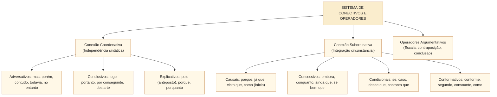
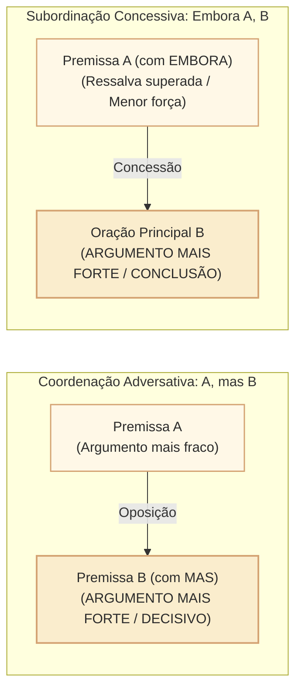

# Conectores, relações lógicas e sequenciação: operadores argumentativos e articulação do período no padrão Cebraspe

## 1. Situação concreta e a dinâmica dos conectivos no discurso legislativo

Na atividade deliberativa e na redação dos pareceres na Câmara dos Deputados, a escolha dos **conectores (conjunções, preposições e locuções conectivas)** não é mero adorno estilístico: é o dispositivo que determina a **força ilocucionária e a orientação argumentativa** de toda a proposição. Considere o confronto entre duas redações possíveis para a conclusão de um parecer da CCJC:

> **Redação A**: *"O projeto de lei atende aos requisitos formais de tramitação, **mas** apresenta incompatibilidade material com o princípio da separação dos Poderes."*  
> **Redação B**: *"**Embora** apresente incompatibilidade material com o princípio da separação dos Poderes, o projeto de lei atende aos requisitos formais de tramitação."*

Embora ambas as frases articulem as mesmas premissas fáticas, seus efeitos jurídicos e persuasivos são opostos:
- Na **Redação A**, o conector adversativo coordenado (*mas*) introduz o argumento que possui maior peso discursivo (*o argumento decisivo*), orientando a conclusão para a **rejeição da matéria**;
- Na **Redação B**, o conector subordinativo concessivo (*embora*) rebaixa a incompatibilidade material a um obstáculo superado, direcionando o foco argumentativo para o cumprimento dos requisitos formais e orientando a conclusão para a **aprovação**.

Nas provas do **Cebraspe**, o domínio de **conectores e relações lógico-semânticas** é avaliado em nível exaustivo. A banca cobra:
1. **O valor lógico-semântico exato dos conectores**: causa, consequência, oposição/adversidade, concessão, condição, conformidade, proporção, finalidade, comparação e explicação;
2. **A fronteira entre adversidade (coordenação) e concessão (subordinação)**: o argumento mais forte fica na oração introduzida pelo conectivo adversativo, ao passo que fica na oração principal diante do conectivo concessivo;
3. **Equivalência semântica e correções sintáticas na reescrita**: a substituição de conectivos e a correspondente exigência de alteração do modo verbal (indicativo $\leftrightarrow$ subjuntivo);
4. **Conectivos polissêmicos**: as múltiplas faces de *como* (causal, comparativo, conformativo, aditivo), *se* (condicional, integrante, causal), *já que* e *posto que* (este último genuinamente concessivo!).

---

## 2. A Oposição Decisiva no Cebraspe: Adversidade $\times$ Concessão

O confronto entre **coordenação adversativa** e **subordinação concessiva** é o tema mais recorrente em reescrita e interpretação de texto no Cebraspe:

| Critério de Comparação | Coordenação Adversativa | Subordinação Concessiva |
| :--- | :--- | :--- |
| **Conectivos Canônicos** | *mas, porém, contudo, todavia, entretanto, no entanto, não obstante (coordenativo)*. | *embora, conquanto, ainda que, mesmo que, se bem que, posto que, apesar de (que), não obstante (concessivo)*. |
| **Estrutura Sintática** | Liga orações sintaticamente independentes. | Liga oração dependente à oração principal. |
| **Modo Verbal Requerido** | Verbo no **Modo Indicativo** (*O relator alertou, mas a Mesa aprovou*). | Verbo no **Modo Subjuntivo** (*Embora o relator tenha alertado, a Mesa aprovou*). |
| **Peso Argumentativo** | O argumento **mais forte** (decisivo para a tese) é introduzido pelo conector adversativo. | O conector concessivo introduz um argumento **mais fraco** (uma ressalva que não impede a oração principal). |
| **Mobilidade Oracional** | A oração adversativa introduzida por *mas* **não pode ser anteposta** à primeira oração. | A oração subordinada concessiva **possui mobilidade total** (pode vir anteposta, intercalada ou posposta). |

> **Atenção no Cebraspe**: Quando a banca propõe reescrever *"O projeto é oportuno, **mas** acarreta impacto orçamentário"* por *"**Embora** o projeto seja oportuno, acarreta impacto orçamentário"*, a reescrita preserva o sentido original e a tese central (o impacto orçamentário continua prevalecendo). No entanto, se a proposta inverter as orações (*"**Embora** acarrete impacto orçamentário, o projeto é oportuno"*), **o sentido é substancialmente alterado**: o projeto passou de inviável a aprovável!

---

## 3. Relações Lógico-Semânticas e Catálogo de Conectores

### 3.1. Relação de Causa $\times$ Consequência $\times$ Explicação
A confusão entre causa, explicação e consequência é intensamente explorada em provas:
- **Causa**: Fato gerador antecedente cronologicamente que produz um efeito físico ou objetivo no mundo real.  
  *Conectivos*: *porque, já que, visto que, dado que, porquanto, uma vez que, como (obrigatoriamente no início do período)*.  
  *Exemplo*: *"Como o quórum regimental não foi atingido, a sessão deliberativa foi cancelada."*
- **Consequência (Consecutiva)**: Efeito gerado pela causa, frequentemente associado a um intensificador (*tão, tanto, tamanho, tal* ... *que*).  
  *Conectivos*: *de modo que, de forma que, de sorte que, tanto que*.  
  *Exemplo*: *"A obstrução parlamentar foi **tão** intensa **que** a votação foi adiada."*
- **Explicação / Justificativa**: Justificação de uma ordem, de uma hipótese ou de um juízo de valor subjetivo do enunciador (não há relação física de causalidade cronológica estrita).  
  *Conectivos*: *porque, que, porquanto, pois (anteposto ao verbo)*.  
  *Exemplo*: *"Fechem as portas do plenário, **porque** a votação nominal vai começar."* (O início da votação não é a causa física do fechamento das portas, mas a justificativa lógica da ordem!).

### 3.2. Relação de Condição
Introduz uma hipótese necessária para a realização da oração principal.
- *Conectivos*: *se, caso (exige verbo no subjuntivo!), desde que, contanto que, a menos que, a não ser que*.
- *Armadilha do modo verbal*: Substituir *se* por *caso* exige ajustar o tempo verbal:  
  *"**Se** o Plenário **aprovar**..."* $\rightarrow$ *"**Caso** o Plenário **aprove**..."* (a substituição sem ajuste do verbo acarreta erro gramatical grave no Cebraspe!).

### 3.3. Relação de Conformidade
Indica concordância com uma regra, modelo, autor ou fato precedente.
- *Conectivos*: *conforme, segundo, consoante, de acordo com, como*.
- *Exemplo*: *"A Mesa conduziu os trabalhos **consoante** prescreve o Regimento Interno."*

### 3.4. Relação de Proporção
Expressa variação simultânea e concomitante entre dois fatos.
- *Conectivos*: *à medida que, à proporção que, ao passo que, quanto mais... mais*.
- *Cuidado no Cebraspe*: A locução **à medida que** (proporcional) não se confunde com **na medida em que** (estritamente causal e sem crase!). As formas híbridas *"à medida em que"* e *"na medida que"* são consideradas **incorretas** pela norma culta.

---

## 4. Conectivos Polissêmicos em Destaque no Cebraspe

| Conector | Sentido 1 | Sentido 2 | Sentido 3 | Teste de Substituição Infalível |
| :--- | :--- | :--- | :--- | :--- |
| **como** | **Causa** (*"Como a sessão era secreta, não houve transmissão."*) | **Conformidade** (*"A comissão agiu como determina a lei."*) | **Comparação** (*"O deputado discursou como um tribuno clássico."*) | Causa = *já que*; Conformidade = *conforme*; Comparação = *tal qual*. |
| **se** | **Condição** (*"Se houver quórum, haverá votação."*) | **Conjunção Integrante** (*"O presidente não sabe se haverá sessão."*) | **Causa** (*"Se todos concordam, encerremos a reunião."*) | Condição = *caso*; Integrante = substitui por *isso*; Causa = *já que*. |
| **posto que** | **Concessão estrita** (*"Posto que houvesse divergências, o texto foi aprovado."*) | — | — | **Não é causal!** *Posto que* equivale a *embora* ou *conquanto*, exigindo verbo no subjuntivo. |
| **pois** | **Explicação/Causa** (anteposto ao verbo: *"Apresse-se, pois o prazo expira."*) | **Conclusão** (posposto ao verbo, entre vírgulas: *"O prazo expirou; não cabe, pois, recurso."*) | — | Anteposto = *porque*; Posposto = *portanto*. |

---

## 5. Casos Práticos na Reescrita e Interpretação

### Caso 1: A Permuta entre "Na Medida Em Que" e "À Medida Que"
- **Trecho analisado**:  
  > *"O debate legislativo amadurecia **à medida que** as audiências públicas eram realizadas."*
- **Proposta da Banca**: A substituição da locução "à medida que" por "na medida em que" preservaria a correção gramatical e as relações de sentido originais do texto.
- **Análise Cebraspe**:
  - *à medida que*: expressa relação de **proporcionalidade temporal** concomitante (com o passar das audiências, o debate amadurecia).
  - *na medida em que*: expressa relação estritamente **causal/explicativa** (porque as audiências eram realizadas).
  - *Julgamento*: Item julgado **ERRADO**. A substituição altera a relação lógico-semântica de proporcionalidade para causalidade, desvirtuando a semântica do período.

### Caso 2: Posição do Conector "Pois" e Mudança de Relação Sintática
- **Trecho analisado**:  
  > *"A matéria não foi deliberada pela comissão, **pois** o relator solicitou prazo regimental adicional."*
- **Proposta da Banca**: No trecho, a conjunção "pois" introduz uma oração que expressa a conclusão da proposição enunciada anteriormente.
- **Análise Cebraspe**:
  - A conjunção *pois* encontra-se **anteposta ao verbo** (*solicitou*), exercendo papel **explicativo/causal** (justifica o motivo de a matéria não ter sido deliberada).
  - Para ter valor **conclusivo**, o conector *pois* deveria obrigatoriamente estar **posposto ao verbo**, deslocado e isolado entre vírgulas (*"o relator solicitou, pois, prazo adicional"*).
  - *Julgamento*: Item julgado **ERRADO**.

---

## 6. Questões Inéditas Comentadas no Padrão Cebraspe

### Questão 1
*(Inédita: estilo Cebraspe / Câmara dos Deputados – Analista Legislativo)*  
No trecho “Embora a proposta de emenda conte com amplo apoio popular, sua tramitação esbarra em vícios de iniciativa formal”, a oração subordinada introduzida por “Embora” veicula uma concessão, o que significa que o argumento introduzido por esse conector possui menor força argumentativa na conclusão final do que a proposição enunciada na oração principal.

- [ ] Certo
- [ ] Errado

> **Gabarito: CERTO**  
> **Comentário**: O item sintetiza a teoria pragmático-discursiva da concessão. A oração subordinada concessiva apresenta um argumento real ou potencial contrário, mas que é **insuficiente para anular a asserção da oração principal**. A tese que prevalece e determina o desfecho do período é a de que a proposta esbarra em vícios formais (oração principal, dotada de maior força argumentativa).

---

### Questão 2
*(Inédita: estilo Cebraspe / Câmara dos Deputados – Analista Legislativo)*  
A substituição do conectivo “mas” por “embora” no período “O texto da reforma tributária era complexo, mas foi aprovado com ampla margem de votos” mantém a correção gramatical e as relações sintáticas do período, prescindindo de qualquer alteração na flexão das formas verbais.

- [ ] Certo
- [ ] Errado

> **Gabarito: ERRADO**  
> **Comentário**: A substituição é inviável sem ajuste sintático. A conjunção coordenativa adversativa *mas* articula orações coordenadas com verbos no **modo indicativo** (*era*, *foi aprovado*). Já a conjunção subordinativa concessiva *embora* exige que o verbo da oração que ela introduz esteja flexionado no **modo subjuntivo** (*"Embora o texto da reforma tributária **fosse** complexo, foi aprovado..."*). Além disso, há alteração da relação sintática (de coordenação para subordinação).

---

### Questão 3
*(Inédita: estilo Cebraspe / Câmara dos Deputados – Analista Legislativo)*  
No fragmento “O plenário da Casa não alcançou o quórum qualificado; não pôde, pois, homologar o acordo internacional”, a conjunção “pois” desempenha função estritamente causal, justificando o motivo do impedimento à homologação.

- [ ] Certo
- [ ] Errado

> **Gabarito: ERRADO**  
> **Comentário**: Quando a conjunção **pois** aparece **posposta ao verbo** (*pôde*) e isolada entre vírgulas, ela assume valor **conclusivo**, equivalendo semanticamente a *portanto, logo, por conseguinte, destarte*. A causa da não homologação é a falta de quórum (oração anterior); a oração com o *pois* posposto expressa a consequência lógica deduzida (a conclusão).

---

### Questão 4
*(Inédita: estilo Cebraspe / Câmara dos Deputados – Analista Legislativo)*  
A locução “posto que”, amplamente empregada na linguagem culta e formal, possui valor semântico primariamente causal, funcionando como sinônimo perfeito de “já que” e “visto que”.

- [ ] Certo
- [ ] Errado

> **Gabarito: ERRADO**  
> **Comentário**: Esta é uma das armadilhas semânticas mais célebres do Cebraspe. Na norma culta e na tradição gramatical rigorosa, **posto que** é uma **locução conjuntiva concessiva** (equivalente a *embora, ainda que, se bem que, conquanto*), regendo verbo no modo subjuntivo (*"posto que houvesse quórum..."*). Seu emprego com valor causal é considerado solecismo em provas de alto nível.

---

### Questão 5
*(Inédita: estilo Cebraspe / Câmara dos Deputados – Analista Legislativo)*  
No período “Como o regimento interno veda a reeleição de membros da Mesa na mesma legislatura, a candidatura foi impugnada”, o termo “Como” estabelece relação de conformidade entre a vedação regimental e a impugnação da candidatura.

- [ ] Certo
- [ ] Errado

> **Gabarito: ERRADO**  
> **Comentário**: O conector *Como*, quando posicionado **obrigatoriamente no início do período** introduzindo oração subordinada anteposta à principal, possui valor **causal** (*"Já que o regimento veda...", "Visto que o regimento veda..."*). A vedação regimental é a causa formal que gerou a consequência descrita na oração principal (a impugnação). Para expressar conformidade, o conector deveria permitir substituição por *conforme* ou *segundo* em estrutura equivalente.

---

### Questão 6
*(Inédita: estilo Cebraspe / Câmara dos Deputados – Analista Legislativo)*  
As locuções conjuntivas “à medida que” e “na medida em que” são semanticamente intercambiáveis na redação oficial, visto que ambas estabelecem relação de proporcionalidade gradual entre os fatos narrados.

- [ ] Certo
- [ ] Errado

> **Gabarito: ERRADO**  
> **Comentário**: As locuções possuem sentidos e papéis sintáticos inteiramente distintos:
> 1. **à medida que**: expressa **proporção / concomitância gradual** (*"à medida que o tempo passava, o plenário esvaziava-se"*);
> 2. **na medida em que**: expressa **causa / explicação** (*"o projeto foi aprovado na medida em que atende aos reclamos sociais"*). Elas não são sinônimas nem intercambiáveis.

---

## 7. Relações com Outras Unidades e Próximos Passos

- **Unidade Anterior**: [[3 - Materias/Portugues/19 - substituicao elipse repeticao e coesao lexical|CAM-LP-008 · Substituição, elipse, repetição e coesão lexical]].
- **Artigo Fundamental Conexo**: [[3 - Materias/Portugues/07 - oracoes coordenadas e subordinadas|07 • Orações coordenadas e subordinadas (Estrutura Sintática)]].
- **Próxima Unidade**: **CAM-LP-010 · Tempo, modo e aspecto verbal na construção do texto** (Correlação verbal, tempos do indicativo/subjuntivo e valores aspectuais no padrão Cebraspe).
