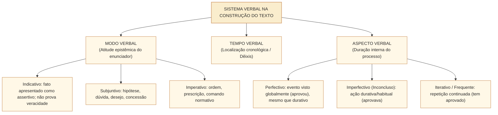
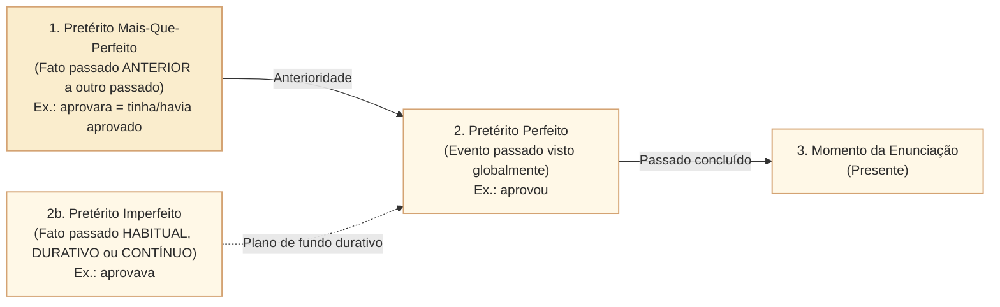

# Tempo, modo e aspecto verbal na construção do texto: correlação de tempos e efeitos discursivos no padrão Cebraspe

## 1. Situação concreta e o valor semântico das formas verbais no discurso legislativo

Na elaboração de pareceres, relatórios de auditoria e projetos de lei na Câmara dos Deputados, a escolha de um tempo e modo verbal contribui para a **perspectiva enunciativa, a organização temporal e o aspecto** das ações narradas; não comprova, por si só, a realidade dos fatos jurídicos. Observe três formulações em um relatório de comissão parlamentar de inquérito (CPI):

> **Formulação 1**: *"O gestor **autorizou** o repasse no exercício de 2023."* (Pretérito Perfeito do Indicativo: evento apresentado como globalmente concluído, **sem prova linguística de sua veracidade nem exigência de duração pontual**).  
> **Formulação 2**: *"O gestor **autorizava** repasses sem parecer jurídico prévio."* (Pretérito Imperfeito do Indicativo: ação apresentada em curso ou como habitual no passado; o tempo verbal **não comprova sozinho uma prática sistemática**).  
> **Formulação 3**: *"Segundo denúncias anônimas, o gestor **teria autorizado** o repasse irregular."* (Futuro do Pretérito Composto: reserva epistêmica, incerteza, discurso alheio não assumido diretamente pelo relator).

Nas provas do **Cebraspe**, o estudo de verbos afasta-se da conjugação mecânica escolar e concentra-se na **semântica dos tempos e modos**, no **aspecto verbal** e na **correlação verbal (*consecutio temporum*)**. A banca avalia:
1. **A diferença aspectual nos pretéritos do indicativo** (perfeito $\times$ imperfeito $\times$ mais-que-perfeito simples e composto);
2. **Os valores discursivos especiais**: presente histórico, presente gnômico (universal/atemporal) e futuro do pretérito modalizador de incerteza ou polidez;
3. **A correlação harmônica entre tempos e modos verbais** nas orações subordinadas substantivas, adjetivas e condicionais (*Se aprovasse... garantiria* $\times$ *Se aprovar... garantirá*);
4. **A equivalência entre formas simples e compostas**: a permuta clássica do Cebraspe entre o pretérito mais-que-perfeito simples (*aprovara*) e o composto (*tinha/havia aprovado*).

---

## 2. Modos e Aspectos Verbais: A Atitude do Enunciador e a Duração do Processo

### 2.1. Os Três Modos Verbais
O **modo verbal** traduz a postura psicológica e epistêmica de quem fala diante do fato enunciado:
- **Modo Indicativo**: Apresenta o conteúdo como uma asserção ou fato situado pelo enunciador, seja no presente, no passado ou no futuro; **não garante que seja verdadeiro ou documentalmente comprovado**. É o modo padrão dos relatórios descritivos, das exposições de motivos e da enunciação de normas vigentes (*"Esta Lei entra em vigor na data de sua publicação"*).
- **Modo Subjuntivo**: Exprime o fato como **hipotético, duvidoso, eventual, desejável ou subordinado a uma condição/concessão**. É acionado obrigatoriamente por conjunções como *embora, caso, desde que, para que* e por verbos de desejo, dúvida ou ordem na oração principal (*"A Mesa determinou que a comissão **aprecie** a matéria"*).
- **Modo Imperativo (Afirmativo e Negativo)**: Exprime **ordem, comando, instrução, exortação ou súplica**, sendo característico de textos injuntivos e despachos decisórios (*"**Publique-se**. **Registre-se**. **Cumpra-se**"*).

---

### 2.2. O Aspecto Verbal: Perfectivo $\times$ Imperfectivo $\times$ Iterativo
Diferente do tempo (que localiza o evento em relação ao momento da fala), o **aspecto verbal** descreve como o processo se desenrola internamente (começo, meio, fim, repetição):
1. **Aspecto perfectivo (visão global do evento)**: O processo é apresentado como um todo, sem privilegiar suas fases internas. É frequente no pretérito perfeito (*"O Plenário **rejeitou** o destaque"*). **Perfectividade não significa duração instantânea nem prova de ocorrência**: *"Durante três horas, a comissão debateu a proposta"* combina duração explícita com visão perfectiva.
2. **Aspecto Imperfectivo (Inconcluso / Durativo / Cursivo)**: A ação é apresentada em seu curso, em desenvolvimento contínuo ou como hábito passado, sem foco em seu término. Típico do **Pretérito Imperfeito** (*"A comissão **debatia** o projeto quando a sessão foi suspensa"*) e das perífrases com gerúndio (*"estava debatendo"*).
3. **Aspecto Incoativo**: Marca o início de um processo (*"**Começou a vigorar** o novo regimento"*; *"**Amanheceu**"*).
4. **Aspecto Cessativo (Terminativo)**: Marca a interrupção ou término de uma ação que vinha ocorrendo (*"**Deixou de existir** a rubrica"*).
5. **Aspecto Iterativo (Frequentativo)**: Indica uma ação que se repete ao longo de um intervalo que se estende do passado até o presente. É a marca registrada do **Pretérito Perfeito Composto do Indicativo** em português (*"O Parlamento **tem aperfeiçoado** os mecanismos de transparência nos últimos anos"*).

> **Armadilha Clássica do Cebraspe**: A banca frequentemente afirma que *"a forma composta 'tem aperfeiçoado' equivale semanticamente a 'aperfeiçoou', indicando ação totalmente concluída no passado"*. **Item ERRADO!** Em língua portuguesa, *tem feito / tem aprovado* indica **ação iterativa continuada** (começou no passado e continua se repetindo até o presente), jamais ação pontual encerrada!

---

## 3. A Semântica dos Tempos do Indicativo no Cebraspe

### 3.1. Valores Discursivos do Presente do Indicativo
Além de indicar um fato que ocorre no exato momento da fala (*presente momentâneo*), o presente do indicativo assume quatro funções nobres em textos de concurso:
- **Presente Gnômico (Atemporal / Universal / Científico)**: Enuncia verdades científicas, máximas filosóficas, dogmas jurídicos e disposições legais permanentes (*"Todo o poder **emana** do povo"*; *"A lei não **prejudica** o direito adquirido"*).
- **Presente Histórico (Narrativo)**: Empregado para narrar fatos do passado como se estivessem ocorrendo diante do leitor, conferindo **vivacidade, dinamismo e proximidade** ao relato (*"Em outubro de 1988, Ulysses Guimarães **promulga** a Constituição Cidadã"*).
- **Presente Habitual (Frequente)**: Indica ações rotineiras ou costumes regulares (*"As comissões permanentes **reúnem-se** às quartas-feiras"*).
- **Presente pelo Futuro**: Indica um fato futuro próximo dado como absolutamente certo (*"A sessão solene **começa** amanhã às nove horas"*).

---

### 3.2. A Tríade dos Pretéritos do Indicativo: O Confronto Favorito da Banca

| Tempo do Pretérito | Valor Semântico e Aspectual | Equivalência Autorizada pelo Cebraspe | Substituição Proibida (Altera Sentido) |
| :--- | :--- | :--- | :--- |
| **Pretérito Perfeito Simples** (*aprovou, fez, disse*) | Evento apresentado globalmente como situado no passado (aspecto perfectivo); pode ter duração longa e não é necessariamente comprovado. | — | Não equivale a *aprovava* (imperfeito) nem a *aprovara* (mais-que-perfeito). |
| **Pretérito Imperfeito** (*aprovava, fazia, dizia*) | 1. Fato **habitual/contínuo** no passado; 2. Ação em curso quando outra sobreveio; 3. Descrição de cenário no passado. | Em contextos condicionais ou de polidez coloquial, pode equivaler ao futuro do pretérito (*podia = poderia*). | **Jamais equivale ao Pretérito Perfeito**: trocar *aprovava* por *aprovou* destrói a ideia de continuidade/hábito! |
| **Pretérito Mais-Que-Perfeito** (*aprovara, fizera, dissera*) | **Passado do passado**: ação ocorrida **antes** de outra ação também passada. | **Equivale perfeitamente à forma composta** com *ter* ou *haver*: **aprovara = tinha aprovado = havia aprovado**. | Não equivale ao futuro do presente (*aprovará*) nem ao pretérito perfeito (*aprovou*) em rigor cronológico. |

---

### 3.3. Futuro do Presente $\times$ Futuro do Pretérito
- **Futuro do Presente** (*aprovará, será*):
  1. Fato posterior ao momento da fala;
  2. **Futuro de Dúvida / Suposição no Presente**: *"Quantos deputados **estarão** presentes no plenário agora?"*;
  3. **Comando Imperativo Normativo** (típico de leis e editais): *"O candidato **apresentará** documento oficial com foto"*.
- **Futuro do Pretérito** (*aprovaria, seria, teria desviado*):
  1. **Fato futuro em relação a um marco passado**: *"O líder garantiu ontem que a bancada **votaria** hoje"*;
  2. **Condição Hipotética (Apódose)**: *"Se houvesse acordo, o projeto **seria** votado"*;
  3. **Polidez / Cerimônia**: *"Vossa Excelência **poderia** conceder-me um aparte?"*;
  4. **Incerteza / Reserva Jornalística ou Investigativa**: *"Segundo o depoente, os recursos **teriam sido** desviados"* (o autor exime-se de atestar a veracidade absoluta do fato).

---

## 4. Correlação Verbal (*Consecutio Temporum*)

A **correlação verbal** é a harmonia lógica e gramatical exigida entre os tempos e modos da oração principal e da oração subordinada. O Cebraspe cobra intensamente os pares canônicos de correlação:

| Estrutura da Oração Condicional / Subordinada | Tempo/Modo na Subordinada | Tempo/Modo na Oração Principal | Exemplo Canônico Harmonizado |
| :--- | :--- | :--- | :--- |
| **Condição Real / Provável no Futuro** | **Futuro do Subjuntivo** (*Se aprovar / Quando aprovar*) | **Futuro do Presente do Indicativo** (ou Presente) | *"Se a comissão **aprovar** o parecer, o projeto **seguirá** ao Plenário."* |
| **Condição Hipotética / Irreal no Presente-Futuro** | **Pretérito Imperfeito do Subjuntivo** (*Se aprovasse / Caso aprovasse*) | **Futuro do Pretérito do Indicativo** | *"Se a comissão **aprovasse** o parecer, o projeto **seguiria** ao Plenário."* |
| **Condição Irreal no Passado (Fato Não Ocorrido)** | **Pretérito Mais-Que-Perfeito Composto do Subjuntivo** (*Se tivesse aprovado*) | **Futuro do Pretérito Composto do Indicativo** | *"Se a comissão **tivesse aprovado** o parecer ontem, o projeto **teria seguido** ao Plenário."* |
| **Oração Subordinada a Verbo no Passado** | **Pretérito Imperfeito do Subjuntivo** | **Pretérito Perfeito / Imperfeito do Indicativo** | *"O presidente **exigiu** que os relatores **entregassem** os votos no prazo."* |

---

## 5. Casos Práticos na Reescrita e Interpretação Cebraspe

### Caso 1: Permuta entre Mais-Que-Perfeito Simples e Composto
- **Trecho analisado**:  
  > *"O relator leu no plenário o substitutivo que **elaborara** em conjunto com os técnicos da consultoria."*
- **Proposta da Banca**: A substituição da forma verbal "elaborara" pela locução "havia elaborado" ou "tinha elaborado" mantém a correção gramatical e o sentido original de anterioridade em relação ao ato de ler.
- **Análise Cebraspe**:
  - *elaborara* encontra-se no pretérito mais-que-perfeito simples do indicativo (indicando que a elaboração ocorreu no passado **antes** do ato passado de *ler*).
  - As formas compostas **tinha elaborado** e **havia elaborado** são os exatos equivalentes analíticos modernos do mais-que-perfeito simples.
  - *Julgamento*: Item **CERTO**. Essa é a substituição verbal mais recorrente e aprovada nas provas do Cebraspe.

### Caso 2: Quebra de Correlação Verbal com a Conjunção "Caso"
- **Trecho analisado**:  
  > *"Se o Congresso Nacional **rejeitar** o veto presidencial, a norma **será** promulgada."*
- **Proposta da Banca**: Caso a conjunção "Se" seja substituída por "Caso", manter-se-á a correção gramatical com a alteração de "rejeitar" para "rejeitasse", preservando-se inalterada a forma "será".
- **Análise Cebraspe**:
  - A conjunção *Caso* rege o modo subjuntivo no presente (*Caso rejeite... será promulgada*) ou no pretérito imperfeito (*Caso rejeitasse...*).
  - Contudo, se o candidato optar pelo pretérito imperfeito do subjuntivo (*Caso rejeitasse*), a correlação verbal obriga a mudar a oração principal do futuro do presente (*será*) para o **futuro do pretérito** (*seria promulgada*). Manter *"Caso rejeitasse... será promulgada"* produz quebra de harmonia temporal!
  - *Julgamento*: Item **ERRADO**.

---

## 6. Questões Inéditas Comentadas no Padrão Cebraspe

### Questão 1
*(Inédita: estilo Cebraspe / Câmara dos Deputados – Analista Legislativo)*  
No período “A comissão especial já encerrara a tomada de depoimentos quando os novos documentos sigilosos chegaram à Câmara”, a substituição da forma verbal “encerrara” por “havia encerrado” preserva a correção gramatical e a ideia de um fato passado anterior a outro também passado.

- [ ] Certo
- [ ] Errado

> **Gabarito: CERTO**  
> **Comentário**: A forma verbal *encerrara* está flexionada no **pretérito mais-que-perfeito simples do indicativo**, expressando uma ação passada (*o encerramento dos depoimentos*) ocorrida anteriormente a outro evento também situado no passado (*a chegada dos documentos*). Na norma culta, o mais-que-perfeito simples equivale integralmente à forma composta formada pelos auxiliares *ter* ou *haver* no pretérito imperfeito + particípio (**tinha encerrado / havia encerrado**).

---

### Questão 2
*(Inédita: estilo Cebraspe / Câmara dos Deputados – Analista Legislativo)*  
Em “A Ouvidoria Parlamentar tem recebido milhares de manifestações cidadãs desde a implantação do novo portal”, a locução verbal “tem recebido” expressa uma ação pontual integralmente concluída no passado recente, equivalendo semanticamente à forma simples “recebeu”.

- [ ] Certo
- [ ] Errado

> **Gabarito: ERRADO**  
> **Comentário**: A locução *tem recebido* está no **pretérito perfeito composto do indicativo**. Diferentemente do francês ou do espanhol, na língua portuguesa esse tempo composto possui **aspecto iterativo (frequentativo e continuado)**: indica uma ação que se iniciou no passado e que **continua se repetindo até o momento presente**. Substituí-la pelo pretérito perfeito simples (*recebeu*) alteraria substancialmente o sentido, pois daria o processo por encerrado.

---

### Questão 3
*(Inédita: estilo Cebraspe / Câmara dos Deputados – Analista Legislativo)*  
No trecho “Antes da reforma do regimento, as lideranças partidárias apresentavam destaques de bancada sem limite quantitativo”, o emprego do pretérito imperfeito em “apresentavam” denota um processo habitual e recorrente em uma época passada, razão pela qual sua substituição por “apresentaram” alteraria o aspecto verbal da proposição.

- [ ] Certo
- [ ] Errado

> **Gabarito: CERTO**  
> **Comentário**: O **pretérito imperfeito do indicativo** (*apresentavam*) carrega o aspecto **imperfectivo, durativo e habitual**, retratando uma rotina parlamentar contínua vigente antes da reforma regimental. A sua troca pelo **pretérito perfeito** (*apresentaram*) passaria a apresentar a ocorrência retrospectivamente sob uma perspectiva global (aspecto perfectivo), **sem implicar obrigatoriamente evento único ou instantâneo**, modificando o sentido original do texto.

---

### Questão 4
*(Inédita: estilo Cebraspe / Câmara dos Deputados – Analista Legislativo)*  
No excerto “De acordo com relatórios preliminares da auditoria, a empresa contratada teria descumprido cláusulas de nível de serviço”, o emprego do futuro do pretérito composto em “teria descumprido” introduz uma modalização epistêmica de ressalva, sinalizando que o enunciador reporta informação cuja certeza definitiva ainda depende de confirmação.

- [ ] Certo
- [ ] Errado

> **Gabarito: CERTO**  
> **Comentário**: Na linguagem jornalística, jurídica e de auditoria, o **futuro do pretérito** (simples ou composto: *seria, teria descumprido*) funciona como **modalizador de incerteza, hipótese ou distanciamento enunciativo**. O redator atribui a informação a uma fonte preliminar e preserva a cautela técnica, evitando cravar o descumprimento como fato definitivo antes do contraditório.

---

### Questão 5
*(Inédita: estilo Cebraspe / Câmara dos Deputados – Analista Legislativo)*  
Caso o redator substituísse a forma verbal “aprove” por “aprovasse” no período “Caso o Plenário aprove a urgência constitucional, a matéria será votada imediatamente”, a correlação verbal exigiria a substituição de “será votada” por “seria votada”.

- [ ] Certo
- [ ] Errado

> **Gabarito: CERTO**  
> **Comentário**: Pela regra de **correlação verbal (*consecutio temporum*)**, o presente do subjuntivo na prótase condicional (*Caso aprove*) harmoniza-se com o futuro do presente do indicativo na apódose (*será votada*). Ao recuar o verbo da oração condicional para o **pretérito imperfeito do subjuntivo** (*Caso aprovasse*), torna-se gramaticalmente obrigatória a transposição da oração principal para o **futuro do pretérito do indicativo** (*seria votada*).

---

### Questão 6
*(Inédita: estilo Cebraspe / Câmara dos Deputados – Analista Legislativo)*  
Na frase “Em 1823, instala-se no Rio de Janeiro a primeira Assembleia Constituinte do Brasil, que logo entra em conflito com o Imperador”, as formas verbais “instala-se” e “entra” exemplificam o emprego do presente gnômico, destinado a enunciar leis universais imutáveis.

- [ ] Certo
- [ ] Errado

> **Gabarito: ERRADO**  
> **Comentário**: No fragmento citado, o verbo no presente do indicativo é utilizado para narrar um evento datado do passado (*Em 1823*) com o propósito estilístico de conferir maior vivacidade, dramaticidade e aproximação ao leitor. Esse recurso denomina-se **presente histórico (ou presente narrativo)**, e não presente gnômico (este último é reservado a axiomas científicos, provérbios e verdades atemporais, como em *"A água ferve a cem graus"*).

---

## 7. Relações com Outras Unidades e Próximos Passos

- **Unidade Anterior**: [[3 - Materias/Portugues/20 - conectores relacoes logicas e sequenciacao|CAM-LP-009 · Conectores, relações lógicas e sequenciação: operadores argumentativos]].
- **Artigo Fundamental Conexo**: [[3 - Materias/Portugues/08 - coesao textual referenciacao e tempos verbais|08 • Coesão textual: referenciação, conectores e tempos verbais]].
- **Próxima Unidade**: **CAM-LP-011 · Classes de palavras e suas funções no período** (Morfossintaxe de substantivos, adjetivos, advérbios, pronomes e preposições no padrão Cebraspe).
